# 《股票投资要义》——30914975.pdf Markdown 整理版

作者：胡斐。出版：经济管理出版社，2015 年 6 月第 1 版；版权页 CIP 时间为 2015.5。ISBN：978-7-5096-3773-9。整理日期：2026-10-18。

原文件：[30914975.pdf](30914975.pdf)，210 个 PDF 页面，正文及后记编号至 202 页。PDF 第 8～209 页与书内页码通常相差 7；空白插页仍保留位置。末页为封底，不按正文第 203 页引用。

本文件是**完整逐页 OCR 整理版**。阅读区自动合并正文行，剔除常规页眉页脚和多数图表细小报价；每页另附完整识别文字、原图、带坐标和置信度的 JSON，便于复核。题材评分表与交易系统表已按原图人工整理。关键参数、原文矛盾及空白页做过人工核对，**未逐字校订全书**；图表数值、公式、引语归属和历史叙事不能仅凭 OCR 确认。正文中的“必买”“确定性”“100%”均为原作者表述。

思想分析、选股和离场策略、现代投资理论完善方案：[Vibe-Trading 研究设计文档](../Vibe-Trading/docs/design/14-stock-investment-essentials-design.md)。

原件 SHA-256：`082926772d476c15f15b2e4e77fa90794854ff044a70625cfd86ec73cede9abc`。

全部 OCR 在本地执行。工具、模型哈希及逐页统计见 [manifest.json](30914975.assets/manifest.json)；整理与核验记录见 [quality-report.json](30914975.assets/quality-report.json)。本地全文与页面资产随原书保存；仓库文档保存分析和设计。

## 章节导航

- [封面](#pdf-page-0001)（PDF 1）
- [书名](#pdf-page-0002)（PDF 2）
- [版权](#pdf-page-0003)（PDF 3）
- [前言](#pdf-page-0004)（PDF 4）
- [目录](#pdf-page-0006)（PDF 6）
- [第一章 中国证券市场的周期和大盘判断](#pdf-page-0008)（PDF 8）
  - [第一节 中国股市的周期判断](#pdf-page-0008)（PDF 8）
  - [第二节 中国经济的大局观和未来演绎](#pdf-page-0020)（PDF 20）
- [第二章 股票投资的逻辑](#pdf-page-0022)（PDF 22）
  - [第一节 股票投资的逻辑基础](#pdf-page-0022)（PDF 22）
  - [第二节 四项基本分析](#pdf-page-0028)（PDF 28）
  - [第三节 题材与大盘不同打法](#pdf-page-0034)（PDF 34）
  - [第四节 不同市况的不同操作策略](#pdf-page-0036)（PDF 36）
  - [第五节 交易心得](#pdf-page-0040)（PDF 40）
- [第三章 两类最常见大牛股的操作模式](#pdf-page-0046)（PDF 46）
  - [第一节 长线跨年度庄家大牛股的操作模式](#pdf-page-0046)（PDF 46）
  - [第二节 龙头股爆发战法](#pdf-page-0055)（PDF 55）
  - [第三节 涨停板研究](#pdf-page-0057)（PDF 57）
- [第四章 九种确定性较大的盈利模式](#pdf-page-0076)（PDF 76）
  - [第一节 模式一：低吸“价格确定，时间不确定”的股票](#pdf-page-0076)（PDF 76）
  - [第二节 模式二：快速建仓处于横盘末期位置的优质股](#pdf-page-0079)（PDF 79）
  - [第三节 模式三：30％仓位买进处于第一次回调位置的前期连续涨停股](#pdf-page-0081)（PDF 81）
  - [第四节 模式四：布局处于稳定上升通道的龙头股](#pdf-page-0083)（PDF 83）
  - [第五节 模式五：年度长线持有主流题材股](#pdf-page-0084)（PDF 84）
  - [第六节 模式六：死磕跟庄筹码集中股](#pdf-page-0086)（PDF 86）
  - [第七节 模式七：果断满仓出击“时间确定，价格不确定”的股票](#pdf-page-0087)（PDF 87）
  - [第八节 模式八：牛市满仓券商＋行业龙头股](#pdf-page-0089)（PDF 89）
  - [第九节 模式九：图形定式与条件反射技术买点](#pdf-page-0090)（PDF 90）
- [第五章 笔者的交易系统](#pdf-page-0094)（PDF 94）
  - [第一节 技术分析的应用范围](#pdf-page-0094)（PDF 94）
  - [第二节 MACD：终极指标](#pdf-page-0100)（PDF 100）
  - [第三节 市场本质的数学原理](#pdf-page-0117)（PDF 117）
  - [第四节 笔者的交易系统](#pdf-page-0166)（PDF 166）
- [第六章 三位世界级高手的投机思想](#pdf-page-0168)（PDF 168）
  - [第一节 投机界鼻祖大作手杰西·利弗莫尔](#pdf-page-0168)（PDF 168）
  - [第二节 全球宏观策略鼻祖乔治·W．索罗斯](#pdf-page-0186)（PDF 186）
  - [第三节 期货王者斯坦利·克罗](#pdf-page-0199)（PDF 199）
- [后记](#pdf-page-0208)（PDF 208）
- [封底](#pdf-page-0210)（PDF 210）

## 逐页正文

<a id="pdf-page-0001"></a>

### PDF 第 1 页｜前置页

[查看 PDF](30914975.pdf#page=1) · [原页图像](30914975.assets/page-0001.jpeg) · [OCR 坐标与置信度](30914975.assets/ocr/page-0001.json)

股市奇书：一本天书揭露中国A股惊天大秘密

影响3亿投资者的大思想

未来30年市场格局的大预测

胡斐/著

股票

Essence of Stock Investments

投资要义

市场分岐度（右）

后数

洞悉牛熊周期

·市场分收度均值

per Mov Avg （市场分度（右））

围猎庄家牛股

固化盈利模式

定义买点卖点

<details>
<summary>展开原页图像</summary>

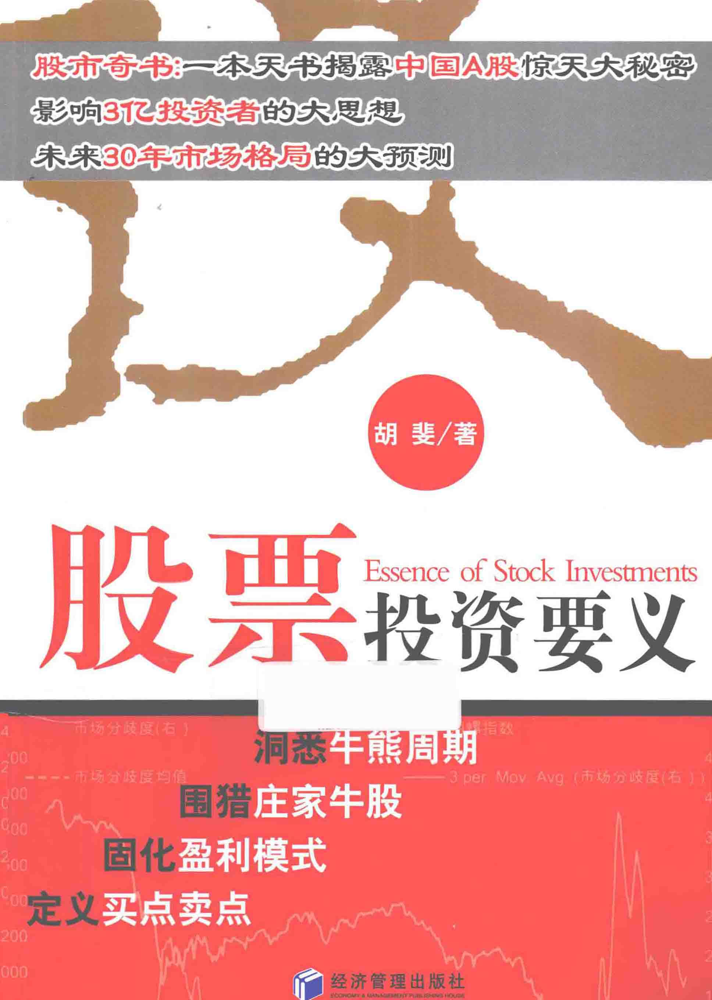

</details>

<details>
<summary>展开完整 OCR 识别记录（含页眉、页码及图表文字）</summary>

```text
股市奇书：一本天书揭露中国A股惊天大秘密
影响3亿投资者的大思想
未来30年市场格局的大预测
胡斐/著
股票
Essence of Stock Investments
投资要义
市场分岐度（右）
后数
洞悉牛熊周期
·市场分收度均值
per Mov Avg （市场分度（右））
围猎庄家牛股
固化盈利模式
定义买点卖点
200
000
经济管理出版社
```

</details>

<a id="pdf-page-0002"></a>

### PDF 第 2 页｜前置页

[查看 PDF](30914975.pdf#page=2) · [原页图像](30914975.assets/page-0002.jpeg) · [OCR 坐标与置信度](30914975.assets/ocr/page-0002.json)

股市奇书：一本天书揭露中国A股惊天大秘密

影响3亿投资者的大思想

未来30年市场格局的大预测

胡斐/著

股票投资文

山

EssencebfStockInvestments

<details>
<summary>展开原页图像</summary>

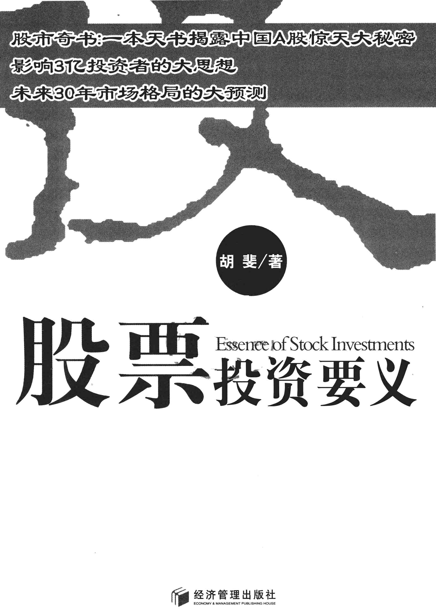

</details>

<details>
<summary>展开完整 OCR 识别记录（含页眉、页码及图表文字）</summary>

```text
股市奇书：一本天书揭露中国A股惊天大秘密
影响3亿投资者的大思想
未来30年市场格局的大预测
胡斐/著
股票投资文
山
EssencebfStockInvestments
经济管理出版社
ECONOMY&MANAGEMENTPUBLISHINGHOUSE
```

</details>

<a id="pdf-page-0003"></a>

### PDF 第 3 页｜前置页

[查看 PDF](30914975.pdf#page=3) · [原页图像](30914975.assets/page-0003.jpeg) · [OCR 坐标与置信度](30914975.assets/ocr/page-0003.json)

图书在版编目（CIP）数据

股票投资要义/胡斐著.一北京：经济管理出版社，2015.5

ISBN978-7-5096-3773-9

I.①股·ⅡI.①胡.Ⅲ.①股票投资一基本知识IV.①F830.91

中国版本图书馆CIP数据核字（2015）第096835号

组稿编辑：陈力

责任编辑：陈力赵彩侠

责任印制：黄章平

责任校对：赵天宇

出版发行：经济管理出版社

(北京市海淀区北蜂窝8号中雅大厦A座11层100038)

网

址：www.E-mp.com.cn

电

话：（010)51915602

印

刷：三河市延风印装厂

经

销：新华书店

开

本：710mmx1000mm/16

印

张：13

字

数：160千字

版

次：2015年6月第1版2015年6月第1次印刷

书

号：ISBN978-7-5096-3773-9

定

价：42.00元

·版权所有翻印必究·

凡购本社图书，如有印装错误，由本社读者服务部负责调换。

联系地址：北京阜外月坛北小街2号

电话：（010)68022974

邮编：100836

<details>
<summary>展开原页图像</summary>

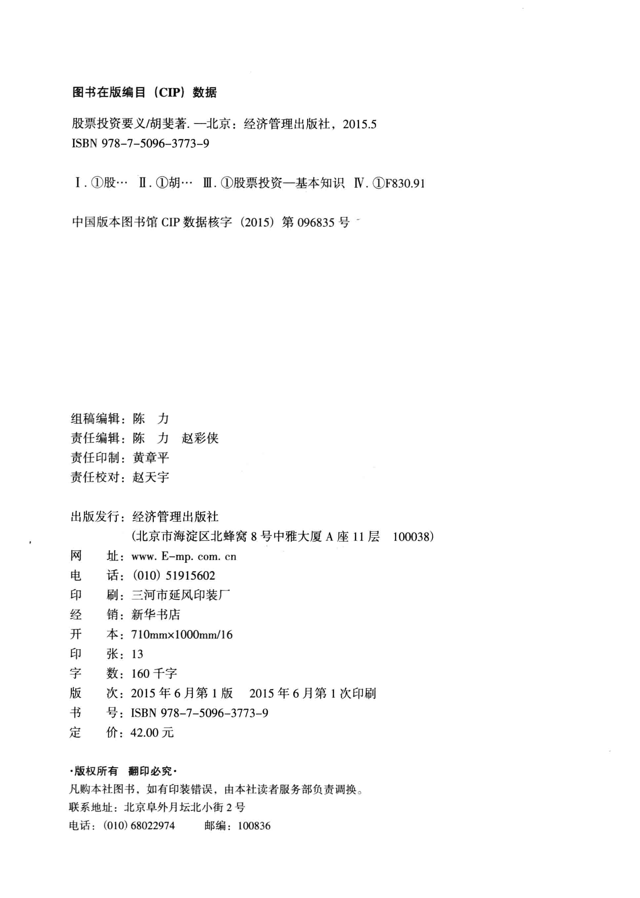

</details>

<details>
<summary>展开完整 OCR 识别记录（含页眉、页码及图表文字）</summary>

```text
图书在版编目（CIP）数据
股票投资要义/胡斐著.一北京：经济管理出版社，2015.5
ISBN978-7-5096-3773-9
I.①股·ⅡI.①胡.Ⅲ.①股票投资一基本知识IV.①F830.91
中国版本图书馆CIP数据核字（2015）第096835号
组稿编辑：陈力
责任编辑：陈力赵彩侠
责任印制：黄章平
责任校对：赵天宇
出版发行：经济管理出版社
(北京市海淀区北蜂窝8号中雅大厦A座11层100038)
网
址：www.E-mp.com.cn
电
话：（010)51915602
印
刷：三河市延风印装厂
经
销：新华书店
开
本：710mmx1000mm/16
印
张：13
字
数：160千字
版
次：2015年6月第1版2015年6月第1次印刷
书
号：ISBN978-7-5096-3773-9
定
价：42.00元
·版权所有翻印必究·
凡购本社图书，如有印装错误，由本社读者服务部负责调换。
联系地址：北京阜外月坛北小街2号
电话：（010)68022974
邮编：100836
```

</details>

<a id="pdf-page-0004"></a>

### PDF 第 4 页｜前置页

[查看 PDF](30914975.pdf#page=4) · [原页图像](30914975.assets/page-0004.jpeg) · [OCR 坐标与置信度](30914975.assets/ocr/page-0004.json)

序

华尔街没有新鲜事物，投机像山岳一样古老。

华尔街谚语

股票的本质是一种流通工具，是全社会货币的一个“水库”，货币流动性大、多，则水库水位高，对应股票上涨；货币流动性吃紧，则水库水位低，对应股票下跌。

基于股票的流动性本质，可以将其等同于“钞票”。现代社会就是证监会发行股票，央行发行钞票，一个释放流动性，一个吸收流动性。这就是目前地球上所有国家金融的基础。

既然股票的本质是流动性，那么可以说是无差别的，就跟钞票一样，流向哪里就看谁有本事了；因为钞票是财富的符号，所以股票本质上就成了财富转移的工具，是一个社会工具，有时也可以是政治工具。国家只管发行钞票，不管谁挣钱；国家也只管发行股票，不管筹码如何流动。

价格是表象，因为全社会都看到一个价格，同一只股票同一时刻只能有一个价格，所以它是表象，就好比钞票的购买力，全社会基本

<details>
<summary>展开原页图像</summary>

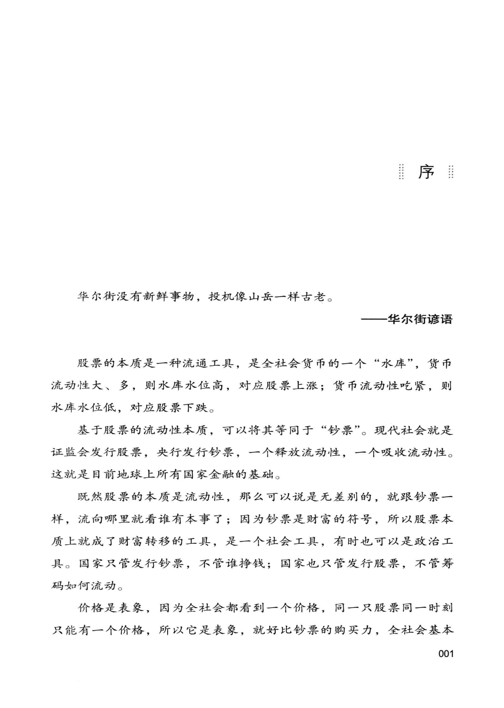

</details>

<details>
<summary>展开完整 OCR 识别记录（含页眉、页码及图表文字）</summary>

```text
序
华尔街没有新鲜事物，投机像山岳一样古老。
华尔街谚语
股票的本质是一种流通工具，是全社会货币的一个“水库”，货币
流动性大、多，则水库水位高，对应股票上涨；货币流动性吃紧，则
水库水位低，对应股票下跌。
基于股票的流动性本质，可以将其等同于“钞票”。现代社会就是
证监会发行股票，央行发行钞票，一个释放流动性，一个吸收流动性。
这就是目前地球上所有国家金融的基础。
既然股票的本质是流动性，那么可以说是无差别的，就跟钞票一
样，流向哪里就看谁有本事了；因为钞票是财富的符号，所以股票本
质上就成了财富转移的工具，是一个社会工具，有时也可以是政治工
具。国家只管发行钞票，不管谁挣钱；国家也只管发行股票，不管筹
码如何流动。
价格是表象，因为全社会都看到一个价格，同一只股票同一时刻
只能有一个价格，所以它是表象，就好比钞票的购买力，全社会基本
001
```

</details>

<a id="pdf-page-0005"></a>

### PDF 第 5 页｜前置页

[查看 PDF](30914975.pdf#page=5) · [原页图像](30914975.assets/page-0005.jpeg) · [OCR 坐标与置信度](30914975.assets/ocr/page-0005.json)

等同。本质是什么呢？筹码的流动。只要股票没有被注销，筹码始终会被发行出来，被发行出来的股票就会流通。筹码的流动才是本质。我们研究股票就要研究筹码的流动，不是研究价格。

筹码在机构手里，如果它不卖，上面没有抛盘，牛市一来，即使不拉股票就飞起来；如果筹码在大众手里，买家和卖家都很多，那么就是随机涨跌，跟随大盘，也没有独立走势。

我们要找的就是筹码集中在机构手里，或者即将集中在机构手里的股票，舍此无他，因为筹码分散的股票一定不是牛股。各种消息题材、概念业绩最终体现在盘面上必然是被集中的筹码不卖，分散的筹码被买，价格空间才被打开。

所以，我们就要想，如果我是机构，我是对冲基金经理，手握10亿元以上资金，我如何选股？送哪些股？怎么买进？什么时间卖出？

胡斐-戊午微博二维码

胡斐的朋友微信公众号二维码

2015年4月

<details>
<summary>展开原页图像</summary>

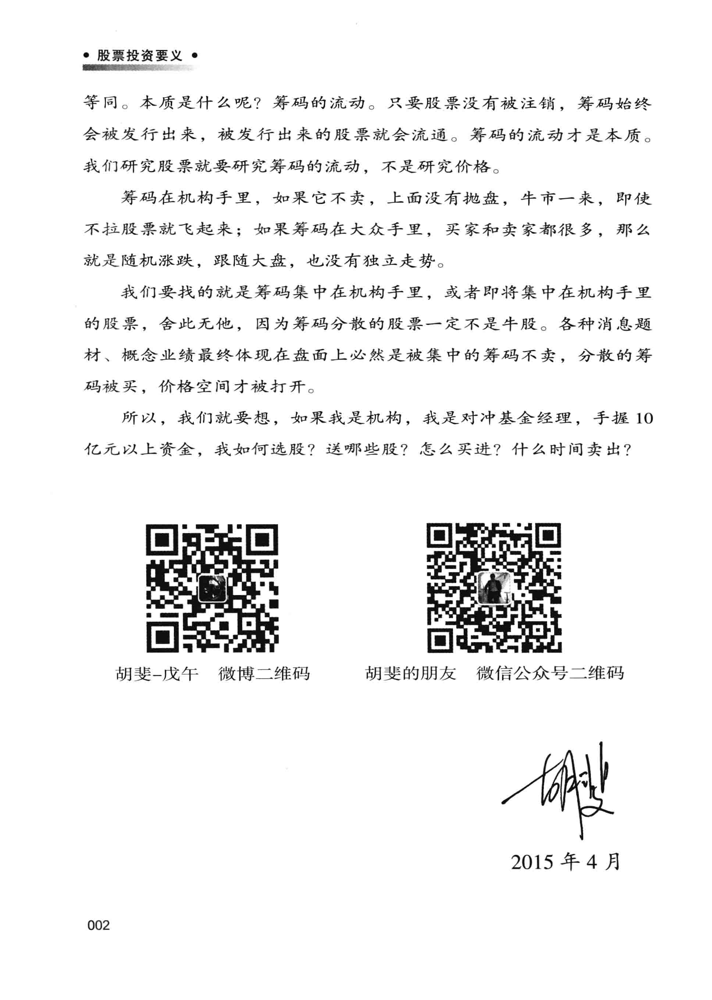

</details>

<details>
<summary>展开完整 OCR 识别记录（含页眉、页码及图表文字）</summary>

```text
股票投资要义
等同。本质是什么呢？筹码的流动。只要股票没有被注销，筹码始终
会被发行出来，被发行出来的股票就会流通。筹码的流动才是本质。
我们研究股票就要研究筹码的流动，不是研究价格。
筹码在机构手里，如果它不卖，上面没有抛盘，牛市一来，即使
不拉股票就飞起来；如果筹码在大众手里，买家和卖家都很多，那么
就是随机涨跌，跟随大盘，也没有独立走势。
我们要找的就是筹码集中在机构手里，或者即将集中在机构手里
的股票，舍此无他，因为筹码分散的股票一定不是牛股。各种消息题
材、概念业绩最终体现在盘面上必然是被集中的筹码不卖，分散的筹
码被买，价格空间才被打开。
所以，我们就要想，如果我是机构，我是对冲基金经理，手握10
亿元以上资金，我如何选股？送哪些股？怎么买进？什么时间卖出？
胡斐-戊午微博二维码
胡斐的朋友微信公众号二维码
2015年4月
002
```

</details>

<a id="pdf-page-0006"></a>

### PDF 第 6 页｜前置页

[查看 PDF](30914975.pdf#page=6) · [原页图像](30914975.assets/page-0006.jpeg) · [OCR 坐标与置信度](30914975.assets/ocr/page-0006.json)

目录

第一章中国证券市场的周期和大盘判断

第一节中国股市的周期判断··

第二节中国经济的大局观和未来演绎

第二章股票投资的逻辑

第一节

股票投资的逻辑基础

第二节

四项基本分析·

第三节

题材与大盘不同打法

第四节

不同市况的不同操作策略

第五节

交易心得

第三章两类最常见大牛股的操作模式·

第一节

长线跨年度庄家大牛股的操作模式

第二节

龙头股爆发战法·

第三节

涨停板研究

<details>
<summary>展开原页图像</summary>

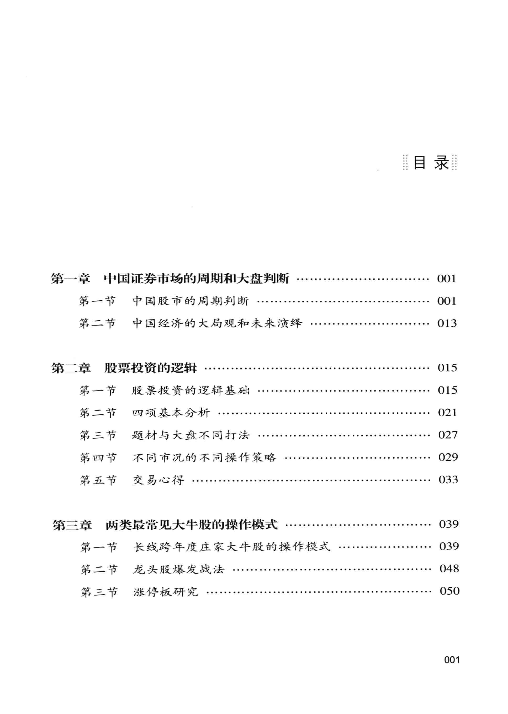

</details>

<details>
<summary>展开完整 OCR 识别记录（含页眉、页码及图表文字）</summary>

```text
目录
第一章中国证券市场的周期和大盘判断
001
第一节中国股市的周期判断··
001
第二节中国经济的大局观和未来演绎
013
第二章股票投资的逻辑
015
第一节
股票投资的逻辑基础
015
第二节
四项基本分析·
021
第三节
题材与大盘不同打法
027
第四节
不同市况的不同操作策略
029
第五节
交易心得
033
第三章两类最常见大牛股的操作模式·
039
第一节
长线跨年度庄家大牛股的操作模式
039
第二节
龙头股爆发战法·
048
第三节
涨停板研究
050
001
```

</details>

<a id="pdf-page-0007"></a>

### PDF 第 7 页｜前置页

[查看 PDF](30914975.pdf#page=7) · [原页图像](30914975.assets/page-0007.jpeg) · [OCR 坐标与置信度](30914975.assets/ocr/page-0007.json)

第四章九种确定性较大的盈利模式

第一节模式一：低吸“价格确定，时间不确定”的股票··069

第二节

模式二：快速建仓处于横盘末期位置的优质股··

第三节

模式三：30%仓位买进处于第一次回调位置的前期连续

涨停股·

第四节

模式四：布局处于稳定上升通道的龙头股

第五节

模式五：年度长线持有主流题材股

第六节

模式六：死磕跟庄筹码集中股

第七节

模式七：果断满仓出击“时间确定，价格不确定”

的股票

第八节

模式八：牛市满仓券商+行业龙头股

第九节

模式九：图形定式与条件反射技术买点

第五章笔者的交易系统

第一节技术分析的应用范围

第二节

MACD：终极指标

第三节

市场本质的数学原理

第四节

笔者的交易系统

第六章三位世界级高手的投机思想

第一节投机界鼻祖大作手杰西·利弗莫尔

第二节

全球宏观策略鼻祖乔治·W.索罗斯

第三节

期货王者斯坦利·克罗

后记

<details>
<summary>展开原页图像</summary>

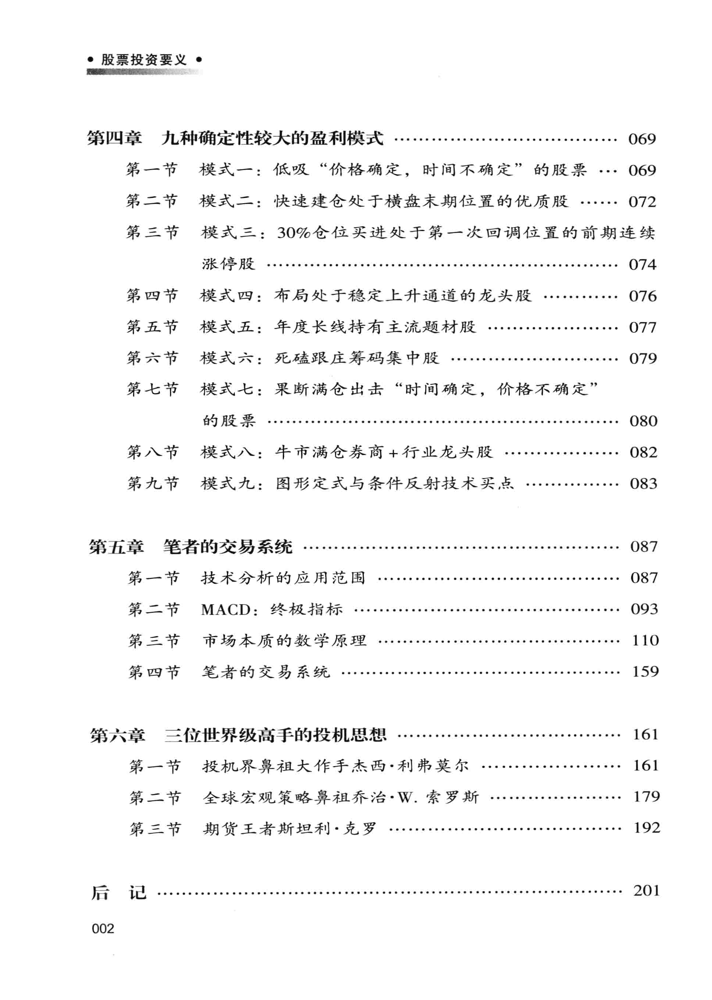

</details>

<details>
<summary>展开完整 OCR 识别记录（含页眉、页码及图表文字）</summary>

```text
股票投资要义
第四章九种确定性较大的盈利模式
069
第一节模式一：低吸“价格确定，时间不确定”的股票··069
第二节
模式二：快速建仓处于横盘末期位置的优质股··
第三节
模式三：30%仓位买进处于第一次回调位置的前期连续
涨停股·
074
第四节
模式四：布局处于稳定上升通道的龙头股
076
第五节
模式五：年度长线持有主流题材股
077
第六节
模式六：死磕跟庄筹码集中股
079
第七节
模式七：果断满仓出击“时间确定，价格不确定”
的股票
080
第八节
模式八：牛市满仓券商+行业龙头股
082
第九节
模式九：图形定式与条件反射技术买点
083
第五章笔者的交易系统
087
第一节技术分析的应用范围
087
第二节
MACD：终极指标
093
第三节
市场本质的数学原理
110
第四节
笔者的交易系统
159
第六章三位世界级高手的投机思想
161
第一节投机界鼻祖大作手杰西·利弗莫尔
161
第二节
全球宏观策略鼻祖乔治·W.索罗斯
179
第三节
期货王者斯坦利·克罗
192
后记
201
002
```

</details>

<a id="pdf-page-0008"></a>

### PDF 第 8 页｜正文第 1 页

[查看 PDF](30914975.pdf#page=8) · [原页图像](30914975.assets/page-0008.jpeg) · [OCR 坐标与置信度](30914975.assets/ocr/page-0008.json)

#### 第一章中国证券市场的周期和大盘判断

“普通人不愿意被告知这是牛市还是熊市，他们只想知道具体哪只股票该买，哪只股票该卖，他们希望不劳而获，甚至不愿意去思考。”

大作手杰西·利弗莫尔

#### 第一节中国股市的周期判断

自1986年起，中国正式发行了股票，有了真正的股票交易。股票是有涨有跌的，谁能够预测到股市和股票的涨跌的大规律，谁就能赚钱发财。中国股市是众所周知的典型政策市，这样的政策市究竟有没有独特的运行规律呢？

从中国股市过去的运行轨迹里，我们发现了中国股市运行的简单规律，这一规律只是从统计学的层面得出来的，但奇怪的是，这一规律竟然同中国农历历法规律有着惊人的巧合。

我们先用中国的农历年份来对应中国股市的涨跌年份，我们会惊奇地发现其中的奥妙：

第一财富周期：持续10年，6年牛市，4年熊市。

<details>
<summary>展开原页图像</summary>

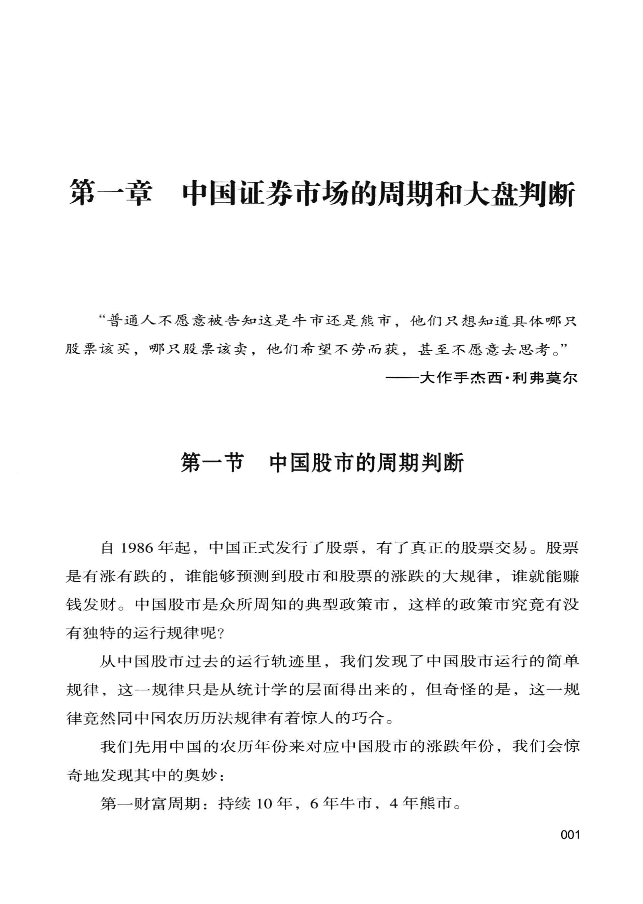

</details>

<details>
<summary>展开完整 OCR 识别记录（含页眉、页码及图表文字）</summary>

```text
第一章中国证券市场的周期和大盘判断
“普通人不愿意被告知这是牛市还是熊市，他们只想知道具体哪只
股票该买，哪只股票该卖，他们希望不劳而获，甚至不愿意去思考。”
大作手杰西·利弗莫尔
第一节中国股市的周期判断
自1986年起，中国正式发行了股票，有了真正的股票交易。股票
是有涨有跌的，谁能够预测到股市和股票的涨跌的大规律，谁就能赚
钱发财。中国股市是众所周知的典型政策市，这样的政策市究竟有没
有独特的运行规律呢？
从中国股市过去的运行轨迹里，我们发现了中国股市运行的简单
规律，这一规律只是从统计学的层面得出来的，但奇怪的是，这一规
律竟然同中国农历历法规律有着惊人的巧合。
我们先用中国的农历年份来对应中国股市的涨跌年份，我们会惊
奇地发现其中的奥妙：
第一财富周期：持续10年，6年牛市，4年熊市。
001
```

</details>

<a id="pdf-page-0009"></a>

### PDF 第 9 页｜正文第 2 页

[查看 PDF](30914975.pdf#page=9) · [原页图像](30914975.assets/page-0009.jpeg) · [OCR 坐标与置信度](30914975.assets/ocr/page-0009.json)

1986年（丙寅年）9月26日，延中实业与飞乐音响两只股票率先在中国工商银行上海信托投资公司静安证券部柜台交易，这是我国首批上市交易的股票。上海老八股疯狂表演，持续牛市。

1987年（丁卯年）持续牛市，1987年10月19日发生全球股灾。

1988年（戊辰年）

持续牛市。

1989年（已已年）

持续牛市。

1990年（庚午年）上海证券交易所成立，老八股上市交易并扩容，持续牛市。

1991年（辛未年）持续牛市，直到1992年5月见顶1429.01点，涨幅达到14倍。

1992年（壬申年）1992年5月起，大盘连跌5个月，股指从1429点跌到387点，大跌73%，投资者损失惨重，许多人血本无归。

1993年（癸酉年）1993年2月起，大盘连跌17个月，股指从1558点狂跌到1994年7月的325点，大跌79%，更多人血本无归。

1994年（甲戌年）7月见低点333.92点，然后反弹两个月，9月见1052.94点，全年就两个月上涨，其余10个月下跌，可见风险之大。

1995年（乙亥年）1月见333.92点后反弹到5月的全年高点926.41点，后跌到年底的512.83点，股灾，惨不忍睹，中国的第一波牛市特性是大涨大跌，悲欢离合，据说当时有股民受不了，差点卖掉自己刚生下来的孩子。

第二财富周期：持续10年，6年牛市，4年熊市。

1996年（丙子年）中国历史上的第二波大牛市开始，大盘连拉阳线从2月开始的512点一直涨到1997年5月的1510点，涨幅195%，这段时间，赚10倍的人不在少数，很多股票一个月就翻倍，有的一日就翻番，暴利比比皆是。

<details>
<summary>展开原页图像</summary>

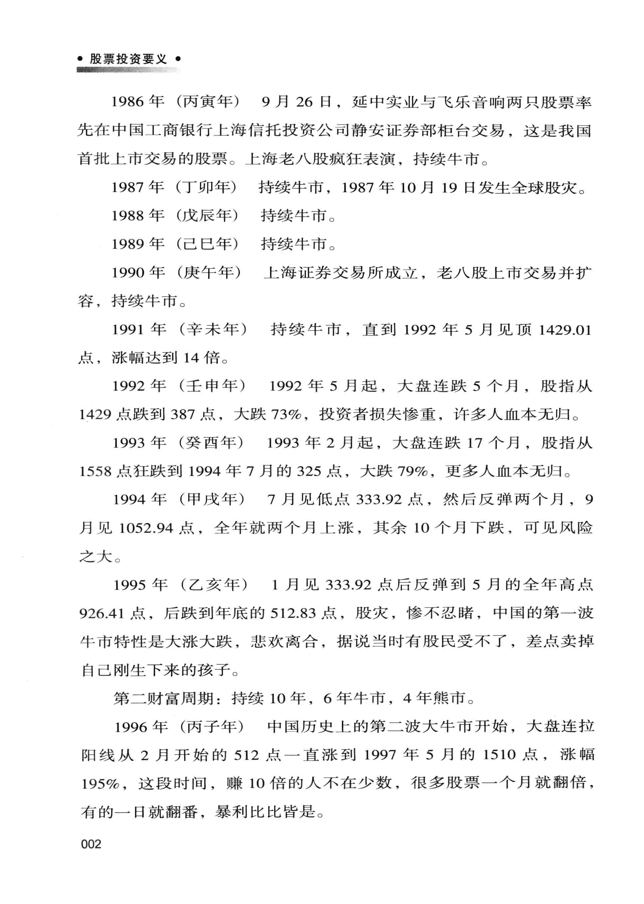

</details>

<details>
<summary>展开完整 OCR 识别记录（含页眉、页码及图表文字）</summary>

```text
?股票投资要义?
1986年（丙寅年）9月26日，延中实业与飞乐音响两只股票率
先在中国工商银行上海信托投资公司静安证券部柜台交易，这是我国
首批上市交易的股票。上海老八股疯狂表演，持续牛市。
1987年（丁卯年）持续牛市，1987年10月19日发生全球股灾。
1988年（戊辰年）
持续牛市。
1989年（已已年）
持续牛市。
1990年（庚午年）上海证券交易所成立，老八股上市交易并扩
容，持续牛市。
1991年（辛未年）持续牛市，直到1992年5月见顶1429.01
点，涨幅达到14倍。
1992年（壬申年）1992年5月起，大盘连跌5个月，股指从
1429点跌到387点，大跌73%，投资者损失惨重，许多人血本无归。
1993年（癸酉年）1993年2月起，大盘连跌17个月，股指从
1558点狂跌到1994年7月的325点，大跌79%，更多人血本无归。
1994年（甲戌年）7月见低点333.92点，然后反弹两个月，9
月见1052.94点，全年就两个月上涨，其余10个月下跌，可见风险
之大。
1995年（乙亥年）1月见333.92点后反弹到5月的全年高点
926.41点，后跌到年底的512.83点，股灾，惨不忍睹，中国的第一波
牛市特性是大涨大跌，悲欢离合，据说当时有股民受不了，差点卖掉
自己刚生下来的孩子。
第二财富周期：持续10年，6年牛市，4年熊市。
1996年（丙子年）中国历史上的第二波大牛市开始，大盘连拉
阳线从2月开始的512点一直涨到1997年5月的1510点，涨幅
195%，这段时间，赚10倍的人不在少数，很多股票一个月就翻倍，
有的一日就翻番，暴利比比皆是。
002
```

</details>

<a id="pdf-page-0010"></a>

### PDF 第 10 页｜正文第 3 页

[查看 PDF](30914975.pdf#page=10) · [原页图像](30914975.assets/page-0010.jpeg) · [OCR 坐标与置信度](30914975.assets/ocr/page-0010.json)

1997年（丁丑年）上半年承接牛市，下半年调整，1997年6月开始到1998年年底，发生亚洲金融危机。

1998年（戊寅年）上半年上涨，下半年调整。

1999年（已卯年）经过长达11个月的调整，终于迎来了著名的“5·19”行情，网络股暴涨，短短半年多的时间，网络股涨幅达到10倍。

2000年（庚辰年）从开年一月份起，股指一路上涨到年末，很多概念股涨了5倍。

2001年（辛巳年）

承接牛市，但已是强弩之末，是牛与熊的转折点。

2002年（壬午年）2002年全年呈现跌势，有两波下跌，3月21日的1693点跌到6月5日的1460点，6月28日的1747点跌到2003年的1月6日的1311点。

2003年（癸未年）2003年4月16日股指从1649点跌到11月13日的1307点，别看股指跌得少，大部分个股却跌得不少。

2004年（甲申年）经过大跌后的5个月大反弹，股指于4月见顶1783.01点，然后开始狂跌到2005年，全年高点1783.01点，低点1264.15点。

2005年（乙酉年））

承接甲申年的跌势，继续跌至6月的998.23点，个股跌得面目全非，实属股灾，但这个时候就是买股票的时候了。

第三财富周期：刚开始，还没有结束，大家拭目以待。

2006年（丙戌年）本年大盘月线连拉阳线，一直拉到年底，显示出极为强健的牛市行情，指数从1100点附近一路上涨到2700点，一些价值股有了20倍的涨幅。

2007年（丁亥年）继续2006年的牛市，到6月指数已经见到4300点，半年不到，许多股票翻了五倍以上，但到了5月风险开始显

<details>
<summary>展开原页图像</summary>

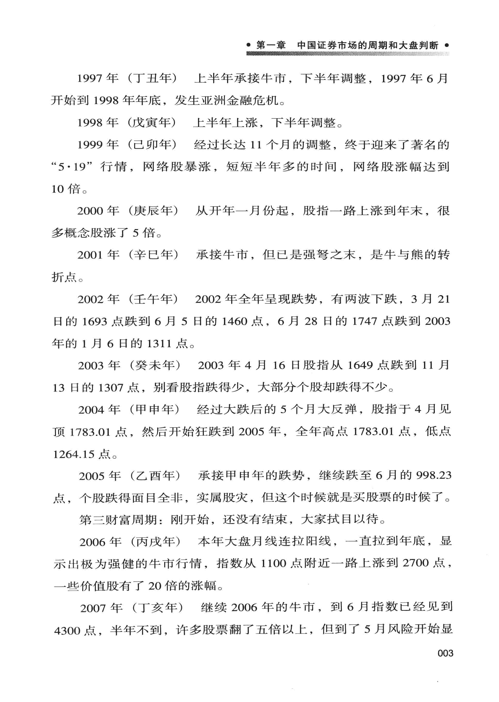

</details>

<details>
<summary>展开完整 OCR 识别记录（含页眉、页码及图表文字）</summary>

```text
·第一章中国证券市场的周期和大盘判断·
1997年（丁丑年）上半年承接牛市，下半年调整，1997年6月
开始到1998年年底，发生亚洲金融危机。
1998年（戊寅年）上半年上涨，下半年调整。
1999年（已卯年）经过长达11个月的调整，终于迎来了著名的
“5·19”行情，网络股暴涨，短短半年多的时间，网络股涨幅达到
10倍。
2000年（庚辰年）从开年一月份起，股指一路上涨到年末，很
多概念股涨了5倍。
2001年（辛巳年）
承接牛市，但已是强弩之末，是牛与熊的转
折点。
2002年（壬午年）2002年全年呈现跌势，有两波下跌，3月21
日的1693点跌到6月5日的1460点，6月28日的1747点跌到2003
年的1月6日的1311点。
2003年（癸未年）2003年4月16日股指从1649点跌到11月
13日的1307点，别看股指跌得少，大部分个股却跌得不少。
2004年（甲申年）经过大跌后的5个月大反弹，股指于4月见
顶1783.01点，然后开始狂跌到2005年，全年高点1783.01点，低点
1264.15点。
2005年（乙酉年））
承接甲申年的跌势，继续跌至6月的998.23
点，个股跌得面目全非，实属股灾，但这个时候就是买股票的时候了。
第三财富周期：刚开始，还没有结束，大家拭目以待。
2006年（丙戌年）本年大盘月线连拉阳线，一直拉到年底，显
示出极为强健的牛市行情，指数从1100点附近一路上涨到2700点，
一些价值股有了20倍的涨幅。
2007年（丁亥年）继续2006年的牛市，到6月指数已经见到
4300点，半年不到，许多股票翻了五倍以上，但到了5月风险开始显
003
```

</details>

<a id="pdf-page-0011"></a>

### PDF 第 11 页｜正文第 4 页

[查看 PDF](30914975.pdf#page=11) · [原页图像](30914975.assets/page-0011.jpeg) · [OCR 坐标与置信度](30914975.assets/ocr/page-0011.json)

> 整理注：此页包含对 2016、2017、2026、2027 年的事前预测；请与独立分析中的已发生事实区分。

现，6月底概念股已经跌了一半，基本相当于发生了股灾，2007年10月股指见顶6124点。

2008年（戊子年）

股灾最低跌至1664点。

2009年（已丑年）

国家推出刺激政策，类似1989年和1999年，股市暴涨牛市。

2010年（庚寅年）

结构牛市，结构熊市，结构牛熊转换，推出股指期货，股指调整。

2011年（辛卯年）

熊市。

2012年 (壬辰年)

熊市。

2013年（癸已年）

熊市末期。

2014年 (甲午年)

熊牛转换。

2015年(乙未年)

牛市初期。

第四财富周期：未来密码，有缘者财富将继续增长。

以下为预测内容：

2016年 (丙申年)

大牛市。

2017年 (丁酉年)

大牛市下半年见顶转熊。

2018年（戊戌年)

大熊市。

2019年 (已亥年)

牛市。

2020年 （庚子年)

结构性牛熊市。

2021年 (辛丑年)

熊市。

2022年（壬寅年）

熊市。

2023年 (癸卯年)

熊市。

2024年（甲辰年）

熊市转牛市的年份见底之年。

2025年（乙已年）

牛市。

2026年 (丙午年)

超级大牛市。

2027年 （丁未年）

超级大牛市。

<details>
<summary>展开原页图像</summary>

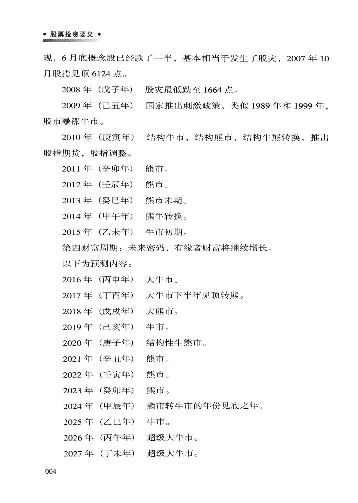

</details>

<details>
<summary>展开完整 OCR 识别记录（含页眉、页码及图表文字）</summary>

```text
股票投资要义
现，6月底概念股已经跌了一半，基本相当于发生了股灾，2007年10
月股指见顶6124点。
2008年（戊子年）
股灾最低跌至1664点。
2009年（已丑年）
国家推出刺激政策，类似1989年和1999年，
股市暴涨牛市。
2010年（庚寅年）
结构牛市，结构熊市，结构牛熊转换，推出
股指期货，股指调整。
2011年（辛卯年）
熊市。
2012年 (壬辰年)
熊市。
2013年（癸已年）
熊市末期。
2014年 (甲午年)
熊牛转换。
2015年(乙未年)
牛市初期。
第四财富周期：未来密码，有缘者财富将继续增长。
以下为预测内容：
2016年 (丙申年)
大牛市。
2017年 (丁酉年)
大牛市下半年见顶转熊。
2018年（戊戌年)
大熊市。
2019年 (已亥年)
牛市。
2020年 （庚子年)
结构性牛熊市。
2021年 (辛丑年)
熊市。
2022年（壬寅年）
熊市。
2023年 (癸卯年)
熊市。
2024年（甲辰年）
熊市转牛市的年份见底之年。
2025年（乙已年）
牛市。
2026年 (丙午年)
超级大牛市。
2027年 （丁未年）
超级大牛市。
004
```

</details>

<a id="pdf-page-0012"></a>

### PDF 第 12 页｜正文第 5 页

[查看 PDF](30914975.pdf#page=12) · [原页图像](30914975.assets/page-0012.jpeg) · [OCR 坐标与置信度](30914975.assets/ocr/page-0012.json)

2028年（戊申年）熊市。

2029年（己酉年）

牛市。

2030年（庚戌年）结构性熊牛市。

从上面的归纳中，相信细心的读者已经看出了规律性，现在作出如下总结：

中国股市以10年为一个周期，遇丙年开始新一轮的牛市，并持续到丁年，经过调整后继续牛市一直到辛年，年中开始下跌回吐，辛年孕育熊市，遇壬、癸年股市风险加大，跌市，大部分人开始亏钱，然后反弹后继续下跌，甲年和乙年经过最后的跌势，乙年孕育牛市。

为什么会出现这样的现象呢？我们似乎可以从中国的五行学说中找到解释。

中国古典哲学认为宇宙万物均由五行：金、木、水、火、土这五大元素构成，五行之间相互作用、相生相克，维系着我们的宇宙按照自然的规律运行。

对于时间，古人用十天干“甲、乙、丙、丁、戊、己、庚、辛、壬、癸”和十二地支“子、丑、寅、卯、辰、已、午、未、申、酉、戌、亥”来计算，读者朋友可以在万年历上查找每一年的农历天干地支，比如2006年是丙戌年、2007年是丁亥年。

由于天干有10个，因此10年天干就要轮回一次，就是说10年为一个周期，这个周期跟江恩讲的10年是一个很重要的时间周期是相同的，也跟中国的经济周期一致？还跟中国的文化周期一致。

那么为什么中国股市一旦碰到丙年和丁年就会开始大涨呢？要解释这一点，需要了解天干的属性和中国股市属于五行的哪一种：

甲为阳木，乙为阴木；丙为阳火，丁为阴火；戊为阳土，已为阴土；庚为阳金，辛为阴金；壬为阳水，癸为阴水。

中国股市的五行属性：

<details>
<summary>展开原页图像</summary>

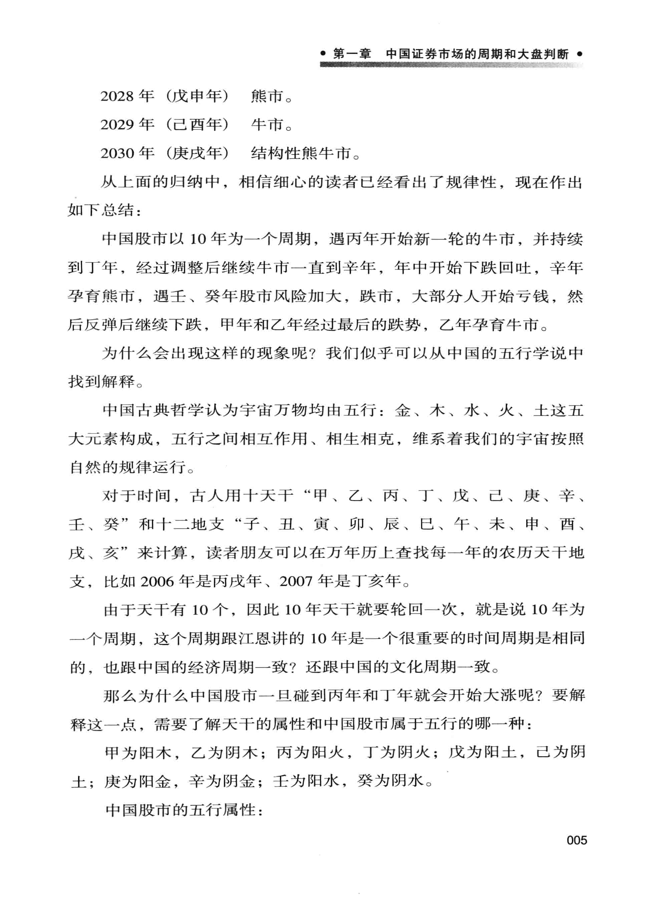

</details>

<details>
<summary>展开完整 OCR 识别记录（含页眉、页码及图表文字）</summary>

```text
·第一章中国证券市场的周期和大盘判断·
2028年（戊申年）熊市。
2029年（己酉年）
牛市。
2030年（庚戌年）结构性熊牛市。
从上面的归纳中，相信细心的读者已经看出了规律性，现在作出
如下总结：
中国股市以10年为一个周期，遇丙年开始新一轮的牛市，并持续
到丁年，经过调整后继续牛市一直到辛年，年中开始下跌回吐，辛年
孕育熊市，遇壬、癸年股市风险加大，跌市，大部分人开始亏钱，然
后反弹后继续下跌，甲年和乙年经过最后的跌势，乙年孕育牛市。
为什么会出现这样的现象呢？我们似乎可以从中国的五行学说中
找到解释。
中国古典哲学认为宇宙万物均由五行：金、木、水、火、土这五
大元素构成，五行之间相互作用、相生相克，维系着我们的宇宙按照
自然的规律运行。
对于时间，古人用十天干“甲、乙、丙、丁、戊、己、庚、辛、
壬、癸”和十二地支“子、丑、寅、卯、辰、已、午、未、申、酉、
戌、亥”来计算，读者朋友可以在万年历上查找每一年的农历天干地
支，比如2006年是丙戌年、2007年是丁亥年。
由于天干有10个，因此10年天干就要轮回一次，就是说10年为
一个周期，这个周期跟江恩讲的10年是一个很重要的时间周期是相同
的，也跟中国的经济周期一致？还跟中国的文化周期一致。
那么为什么中国股市一旦碰到丙年和丁年就会开始大涨呢？要解
释这一点，需要了解天干的属性和中国股市属于五行的哪一种：
甲为阳木，乙为阴木；丙为阳火，丁为阴火；戊为阳土，已为阴
土；庚为阳金，辛为阴金；壬为阳水，癸为阴水。
中国股市的五行属性：
005
```

</details>

<a id="pdf-page-0013"></a>

### PDF 第 13 页｜正文第 6 页

[查看 PDF](30914975.pdf#page=13) · [原页图像](30914975.assets/page-0013.jpeg) · [OCR 坐标与置信度](30914975.assets/ocr/page-0013.json)

我们的股市像水一样地流动，涨跌起伏，它必然是属水，不可能是属金、木、火、土，我们的股市是水性的，那么是王水还是癸水呢？

我们的股市如同大海一样可以容纳百川，百川即指各路资金，股市是各路资金的汇集地，能泄资金之洪。我们的股市也如同一条条小溪直流向大海，源远流长，其势最静，因此我们的股市就是王水，是大海之水，也是癸水，小溪之水，这就是我们股市的属性一“王水”。

下面用简短的文字给大家讲解清楚天干生克的规律：

金克木木克土土克水水克火火克金

金生水水生木木生火火生土土生金

那么我们还需要了解一下简单的易经《河图洛书》的知识：

我克者为财：金克木，木就是金的财，同性为偏财，异性为正财。

克我者为官杀：木克土，木就是土的官杀，同性为七杀，异性为正官。

我生者为食伤：火生土，土就是火的食伤，同性是食神，异性为伤官。

生我者为印星：水生木，水就是木的印星，同性为偏印，异性为正印。

同我者为比劫：木与木，木就是木的比劫，同性为比肩，异性为劫财。

这里的“我”在不同的地方有不同的含义，以谁为研究对象就以谁为“我”，是个主宾关系。股市密码是“壬”水，壬就是“我”，王水遇见“丙”、“丁”流年，水克火为财，就是财年，股市就大涨。就这么简单。如果遇见“戊”年，比如2008年戊子年，戊土是壬水的七杀，克制住王水，就大跌。

我们知道中国文化每一个流年都是由天干地支纪年的，比如2014

<details>
<summary>展开原页图像</summary>

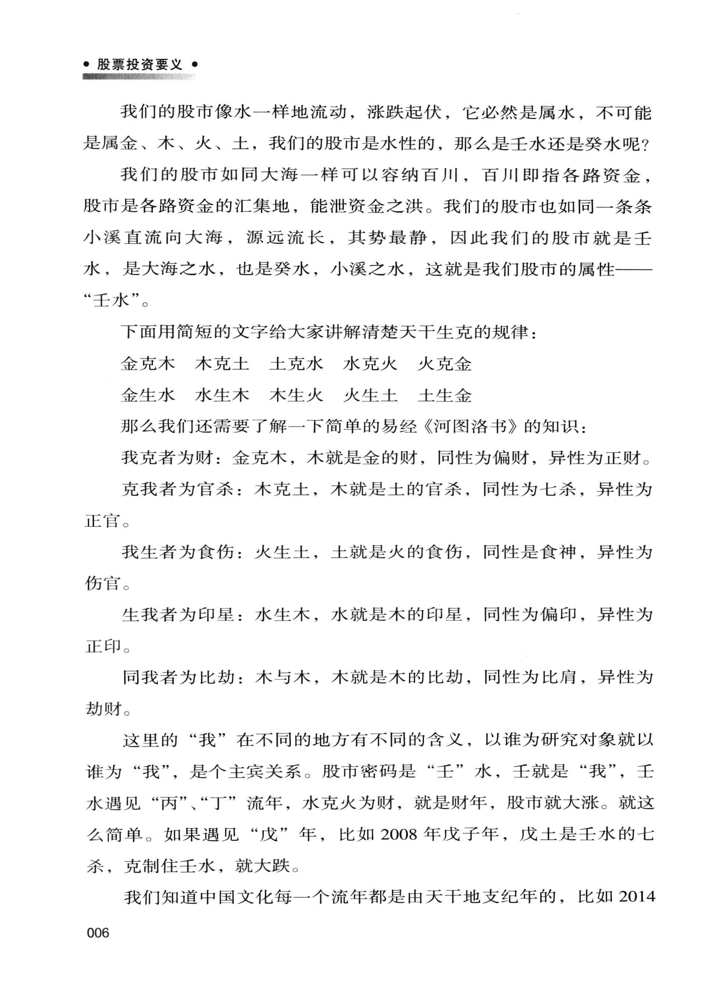

</details>

<details>
<summary>展开完整 OCR 识别记录（含页眉、页码及图表文字）</summary>

```text
·股票投资要义
我们的股市像水一样地流动，涨跌起伏，它必然是属水，不可能
是属金、木、火、土，我们的股市是水性的，那么是王水还是癸水呢？
我们的股市如同大海一样可以容纳百川，百川即指各路资金，
股市是各路资金的汇集地，能泄资金之洪。我们的股市也如同一条条
小溪直流向大海，源远流长，其势最静，因此我们的股市就是王
水，是大海之水，也是癸水，小溪之水，这就是我们股市的属性一
“王水”。
下面用简短的文字给大家讲解清楚天干生克的规律：
金克木木克土土克水水克火火克金
金生水水生木木生火火生土土生金
那么我们还需要了解一下简单的易经《河图洛书》的知识：
我克者为财：金克木，木就是金的财，同性为偏财，异性为正财。
克我者为官杀：木克土，木就是土的官杀，同性为七杀，异性为
正官。
我生者为食伤：火生土，土就是火的食伤，同性是食神，异性为
伤官。
生我者为印星：水生木，水就是木的印星，同性为偏印，异性为
正印。
同我者为比劫：木与木，木就是木的比劫，同性为比肩，异性为
劫财。
这里的“我”在不同的地方有不同的含义，以谁为研究对象就以
谁为“我”，是个主宾关系。股市密码是“壬”水，壬就是“我”，王
水遇见“丙”、“丁”流年，水克火为财，就是财年，股市就大涨。就这
么简单。如果遇见“戊”年，比如2008年戊子年，戊土是壬水的七
杀，克制住王水，就大跌。
我们知道中国文化每一个流年都是由天干地支纪年的，比如2014
006
```

</details>

<a id="pdf-page-0014"></a>

### PDF 第 14 页｜正文第 7 页

[查看 PDF](30914975.pdf#page=14) · [原页图像](30914975.assets/page-0014.jpeg) · [OCR 坐标与置信度](30914975.assets/ocr/page-0014.json)

年为甲午年，1998年为戊寅年。戊就是天干，寅就是地支。天干有十个，地支有十二个。

股市本体

流年天干

十神

意象

壬水

甲

食神

泄身生财，见底

壬水

乙

伤官

泄身生财，见底，有政策刺激

壬水

丙

偏财

得偏财，指数狂涨

壬水

丁

正财

得正财，涨势偏慢，找顶

壬水

戊

七杀

受克制，暴跌

壬水

己

正官

受约制，政策刺激

壬水

庚

偏印

克财，政策只有空号无刺激作用；震荡熊

壬水

辛

正印

克财，政策只有空号无刺激作用；震荡熊

壬水

壬

比肩

克财，稳中有跌

壬水

癸

劫财

克财到极点，暴跌，一部分股票现行见底以天干为主进行大势方向判断；地支是具体年内走势，地支还表示大部分股票的普遍走势

流年地支

十神

意象

子

劫财

丑

正官

寅

食神

卯

伤官

辰

七杀

已

偏财

同天干的十神意象

午

正财

未

正官

申

偏印

酉

正印

戌

七杀

亥

比肩

由于每个流年都是天干和地支组成的。那么如果天干和地支相同，我们可以预见，必然是单边走势。比如2018年（戊戌年），2015年（乙未年），2026年（丙午年）。如果天干地支一个是（财）一个是食伤，也能走牛市，比如2014年（甲午年）。如果天干地支一个是生财，另一个是克财，就比较复杂，需要区别对待。比如1994年（甲戌年），

<details>
<summary>展开原页图像</summary>

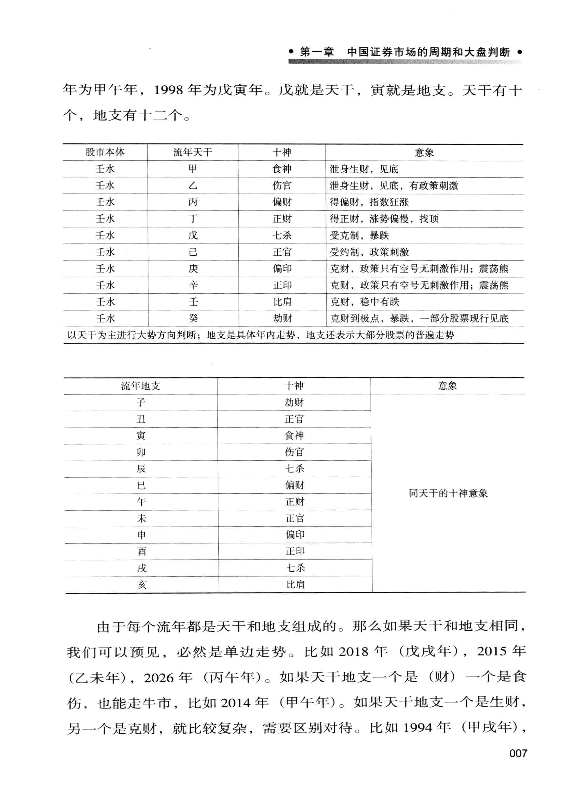

</details>

<details>
<summary>展开完整 OCR 识别记录（含页眉、页码及图表文字）</summary>

```text
·第一章中国证券市场的周期和大盘判断
年为甲午年，1998年为戊寅年。戊就是天干，寅就是地支。天干有十
个，地支有十二个。
股市本体
流年天干
十神
意象
壬水
甲
食神
泄身生财，见底
壬水
乙
伤官
泄身生财，见底，有政策刺激
壬水
丙
偏财
得偏财，指数狂涨
壬水
丁
正财
得正财，涨势偏慢，找顶
壬水
戊
七杀
受克制，暴跌
壬水
己
正官
受约制，政策刺激
壬水
庚
偏印
克财，政策只有空号无刺激作用；震荡熊
壬水
辛
正印
克财，政策只有空号无刺激作用；震荡熊
壬水
壬
比肩
克财，稳中有跌
壬水
癸
劫财
克财到极点，暴跌，一部分股票现行见底
以天干为主进行大势方向判断；地支是具体年内走势，地支还表示大部分股票的普遍走势
流年地支
十神
意象
子
劫财
丑
正官
寅
食神
卯
伤官
辰
七杀
已
偏财
同天干的十神意象
午
正财
未
正官
申
偏印
酉
正印
戌
七杀
亥
比肩
由于每个流年都是天干和地支组成的。那么如果天干和地支相同，
我们可以预见，必然是单边走势。比如2018年（戊戌年），2015年
（乙未年），2026年（丙午年）。如果天干地支一个是（财）一个是食
伤，也能走牛市，比如2014年（甲午年）。如果天干地支一个是生财，
另一个是克财，就比较复杂，需要区别对待。比如1994年（甲戌年），
007
```

</details>

<a id="pdf-page-0015"></a>

### PDF 第 15 页｜正文第 8 页

[查看 PDF](30914975.pdf#page=15) · [原页图像](30914975.assets/page-0015.jpeg) · [OCR 坐标与置信度](30914975.assets/ocr/page-0015.json)

天干食神生财，地支七杀克身，就是“暴涨+暴跌”的组合。

丙年是中国股市每一轮牛市的起点。

中国股市属水，遇到流年是丙年和丁年必然行财运。丙、丁属火，水遇到火就会蒸腾，就会向上发散，所以对于股市来讲，我们就看到红色的K线不断向上延伸，火越旺，延伸的高度越高，因此，丙年做股票宜捂股不动、等待收割。丙火属阳，指太阳炎炎炳照之意，丙火为火之兄，含有朝气蓬勃、热情开朗之意，还含有适合各种社交活动，但也易被误解为好大喜功。按照丙火的含义和丙火的特性，必然是有一波大牛市，股民欢欢喜喜，兴高采烈，赚到钱了，花钱也很大方，丙年的股市真是一片升腾景象。

1986年上海出现股疯，上海的老股民都知道，赚钱简直太容易了。1996年的大牛市很多股票一周就翻倍，那时候没有涨跌停板。2006年的这波大牛市从解决股权分置开始，很多股票复牌后都是大涨特涨，有很多价值性的股票已经涨了20倍。

丁年是持续丙年的牛市，下半年进人调整期。

到了丁年行正财运，很多人看到股市火爆，都争先恐后进场，造成成交量急增，这个时期股指和股票升幅都很大，能不能赚到钱就要看个人的真本事了，其间看多、看空分歧很大，政策调控也会经常搞突然袭击，丁火属阴，指灯火、炉火等，火势不稳定，得时有力，失时无力。丁火为火之妹，具有外静内进，思想缜密的性格，但是多疑与心机是其缺点，按照丁火的特性，股市必然涨跌起伏。，很多股民发现股票涨得太多了，要面临调整了，对股市走牛起了疑心，纷纷获利回吐，引发股指上下震荡，股指表现出不稳定的迹象，短线客流行，追涨杀跌容易亏钱，逢低吸纳者容易赚到短线暴利，这段时间长线持有者会继续持有股票，等待牛市结束，短线客每日忙碌，日渐消瘦者多些。

<details>
<summary>展开原页图像</summary>

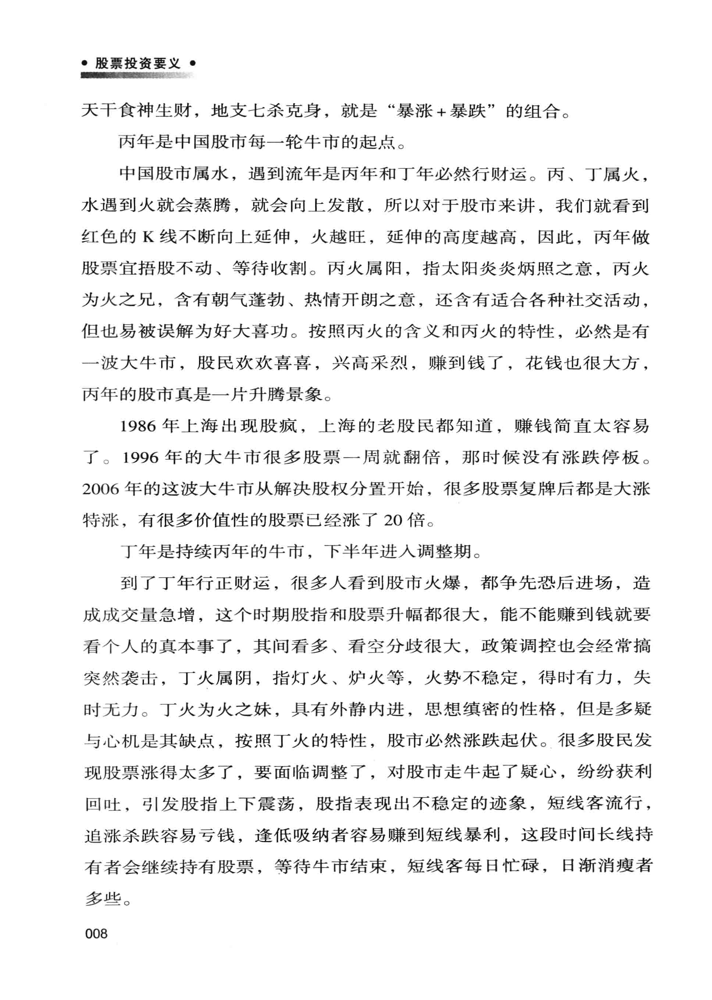

</details>

<details>
<summary>展开完整 OCR 识别记录（含页眉、页码及图表文字）</summary>

```text
·股票投资要义?
天干食神生财，地支七杀克身，就是“暴涨+暴跌”的组合。
丙年是中国股市每一轮牛市的起点。
中国股市属水，遇到流年是丙年和丁年必然行财运。丙、丁属火，
水遇到火就会蒸腾，就会向上发散，所以对于股市来讲，我们就看到
红色的K线不断向上延伸，火越旺，延伸的高度越高，因此，丙年做
股票宜捂股不动、等待收割。丙火属阳，指太阳炎炎炳照之意，丙火
为火之兄，含有朝气蓬勃、热情开朗之意，还含有适合各种社交活动，
但也易被误解为好大喜功。按照丙火的含义和丙火的特性，必然是有
一波大牛市，股民欢欢喜喜，兴高采烈，赚到钱了，花钱也很大方，
丙年的股市真是一片升腾景象。
1986年上海出现股疯，上海的老股民都知道，赚钱简直太容易
了。1996年的大牛市很多股票一周就翻倍，那时候没有涨跌停板。
2006年的这波大牛市从解决股权分置开始，很多股票复牌后都是大涨
特涨，有很多价值性的股票已经涨了20倍。
丁年是持续丙年的牛市，下半年进人调整期。
到了丁年行正财运，很多人看到股市火爆，都争先恐后进场，造
成成交量急增，这个时期股指和股票升幅都很大，能不能赚到钱就要
看个人的真本事了，其间看多、看空分歧很大，政策调控也会经常搞
突然袭击，丁火属阴，指灯火、炉火等，火势不稳定，得时有力，失
时无力。丁火为火之妹，具有外静内进，思想缜密的性格，但是多疑
与心机是其缺点，按照丁火的特性，股市必然涨跌起伏。，很多股民发
现股票涨得太多了，要面临调整了，对股市走牛起了疑心，纷纷获利
回吐，引发股指上下震荡，股指表现出不稳定的迹象，短线客流行，
追涨杀跌容易亏钱，逢低吸纳者容易赚到短线暴利，这段时间长线持
有者会继续持有股票，等待牛市结束，短线客每日忙碌，日渐消瘦者
多些。
008
```

</details>

<a id="pdf-page-0016"></a>

### PDF 第 16 页｜正文第 9 页

[查看 PDF](30914975.pdf#page=16) · [原页图像](30914975.assets/page-0016.jpeg) · [OCR 坐标与置信度](30914975.assets/ocr/page-0016.json)

1997年5月大盘见顶后，先向下调整了5个月，然后在9月开始回升，这期间很多股票也跌得很惨，有些后进场的股民保证金缩水很多，这种年份最容易发生金融危机和股灾，那些高利贷款炒股者将受到灭顶之灾。

戊年是整固年，股市会在一个区间波动。

到了戊年，中国股市行官杀运，被管制起来，受克制并继续丁年下半年的调整，股市涨得太快，容易引发经济危机和特大金融风险。国家在丁年出台一些政策对股市进行调控，调控政策会逐步发挥作用，使得股市从疯牛状变回安静状，戊土属阳，指大地的土，广厚茂盛，又指堤坝之土，可有力地防止河川泛滥。戊土诚实、厚重，性情笃实沉稳，为人憨直，按照戊土的特性，股指必然进行区间调整整固，得意的股民情绪逐步平稳，总结出不要太得意忘形的格言，很多人又离开了股市，专心做自己的本职工作了，这种年份股市的风险还是比较大的，会有一段时间的惨烈下跌。

已年持续戊年的调整后，开始结束调整，牛市又开始继续了。

到了已年，中国股市行官杀运，继续受到克制，但克制逐渐减弱，股市跌得太久了，跌不下去了，离场的人起了疑心，纷纷开始进场，一轮新行情又开始了。已土属阴，指田园之土，不如戊土广厚但易栽植，已土重视内涵，多才多艺，行事依循规矩，但度量欠广，易生疑心，按照已土的特性，克制股市的力量弱于戊土，克制力逐步减弱，股市逐渐见底，投资者宜把握住时机，选好下一阶段有潜力的股票，未来收益绝对不菲。

庚年牛市又开始激动人心，努力上涨中。

到了庚年，中国股市行印运，金生水，对股市有利好，有印绶附身，政策面又开始宽松，各路资金又开始活跃了。新的上涨行情开始了，但这个阶段是牛市最后一个阶段了，有些炒作得很高的股票开始

<details>
<summary>展开原页图像</summary>

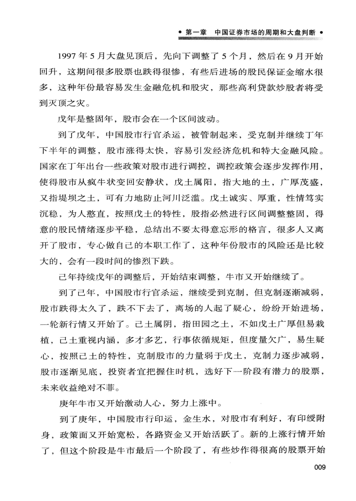

</details>

<details>
<summary>展开完整 OCR 识别记录（含页眉、页码及图表文字）</summary>

```text
·第一章中国证券市场的周期和大盘判断
1997年5月大盘见顶后，先向下调整了5个月，然后在9月开始
回升，这期间很多股票也跌得很惨，有些后进场的股民保证金缩水很
多，这种年份最容易发生金融危机和股灾，那些高利贷款炒股者将受
到灭顶之灾。
戊年是整固年，股市会在一个区间波动。
到了戊年，中国股市行官杀运，被管制起来，受克制并继续丁年
下半年的调整，股市涨得太快，容易引发经济危机和特大金融风险。
国家在丁年出台一些政策对股市进行调控，调控政策会逐步发挥作用，
使得股市从疯牛状变回安静状，戊土属阳，指大地的土，广厚茂盛，
又指堤坝之土，可有力地防止河川泛滥。戊土诚实、厚重，性情笃实
沉稳，为人憨直，按照戊土的特性，股指必然进行区间调整整固，得
意的股民情绪逐步平稳，总结出不要太得意忘形的格言，很多人又离
开了股市，专心做自己的本职工作了，这种年份股市的风险还是比较
大的，会有一段时间的惨烈下跌。
已年持续戊年的调整后，开始结束调整，牛市又开始继续了。
到了已年，中国股市行官杀运，继续受到克制，但克制逐渐减弱，
股市跌得太久了，跌不下去了，离场的人起了疑心，纷纷开始进场，
一轮新行情又开始了。已土属阴，指田园之土，不如戊土广厚但易栽
植，已土重视内涵，多才多艺，行事依循规矩，但度量欠广，易生疑
心，按照已土的特性，克制股市的力量弱于戊土，克制力逐步减弱，
股市逐渐见底，投资者宜把握住时机，选好下一阶段有潜力的股票，
未来收益绝对不菲。
庚年牛市又开始激动人心，努力上涨中。
到了庚年，中国股市行印运，金生水，对股市有利好，有印绶附
身，政策面又开始宽松，各路资金又开始活跃了。新的上涨行情开始
了，但这个阶段是牛市最后一个阶段了，有些炒作得很高的股票开始
009
```

</details>

<a id="pdf-page-0017"></a>

### PDF 第 17 页｜正文第 10 页

[查看 PDF](30914975.pdf#page=17) · [原页图像](30914975.assets/page-0017.jpeg) · [OCR 坐标与置信度](30914975.assets/ocr/page-0017.json)

下跌，大盘涨，这些股票却在下跌，说明机遇和风险同在。庚金属阳，指铁、刀剑、矿石等，质地坚硬，庚金精神粗犷、豪爽，意气轻燥，性情刚烈而重义气，个性好胜，具有破坏性，人缘佳，容易相处，按照庚金的特性，这阶段股市也很疯，很多股民也在享受着资产增值的狂喜，金生水，使得前段时间被蒸发上去的水得到补充，有升腾也有下降。

辛年牛市到顶，开始熊市。

到了辛年，中国股市行印运，机构一致唱多，大家一片乐观，没有股民愿意说自己亏了钱，这就到了阳极而衰的时候了。股指随时可能大幅下跌，辛金属阴，指珠玉、宝石、沙金。辛金性较阴沉，温润秀气，重感情，虚荣心强而爱好面子，有强烈的自尊心，但缺乏坚强的意志，按照辛金的特性，这阶段股指欲上还下，欲下还上，股市风险聚集，逐步显现。

王年股指大幅下跌。

到了壬年，中国股市行比劫运，有个术语叫“壬见壬、癸夺财”，为什么这样说呢？大家已经知道，丙、丁是王、癸的财，王是壬的兄弟（比肩），癸是壬的姐妹（劫财），有财大家是要分的，不能独自占用，水多了，又没有了大火，就像下大雨一样，升腾上去的水变成了云，现在云开始化成雨，大家开始比谁出货出得快，股指一路下跌，利润化为泡影。王水属阳，指大海之水，壬水为水之兄，含有清浊并容、宽宏大度之意，能潜伏和包容，富于勇气，但也有依赖性强，凡事漫不经心之意。按照壬水的特性，这阶段资金纷纷套现，有些投资者还在以为这是牛市的回调，逢低还在买人，但却挡不住股市的坚决下跌。1992年、1993年、2002年、2003年股指大跌，损失惨重，就是实例，那么2012年、2013年大家对股市是否要充满万分警惕呢？

<details>
<summary>展开原页图像</summary>

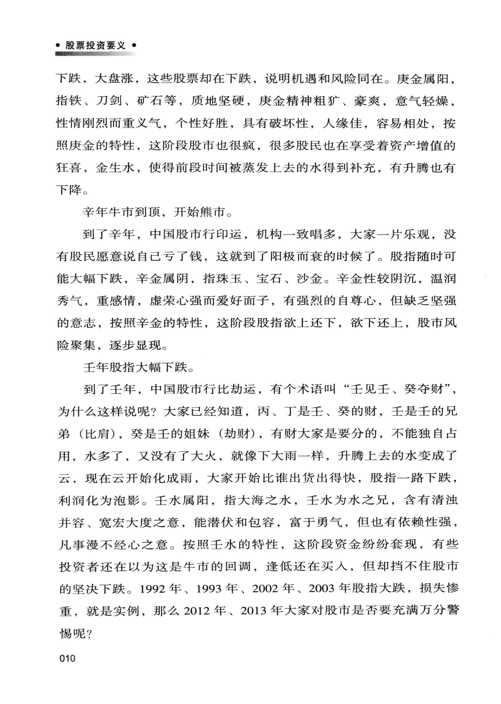

</details>

<details>
<summary>展开完整 OCR 识别记录（含页眉、页码及图表文字）</summary>

```text
?股票投资要义·
下跌，大盘涨，这些股票却在下跌，说明机遇和风险同在。庚金属阳，
指铁、刀剑、矿石等，质地坚硬，庚金精神粗犷、豪爽，意气轻燥，
性情刚烈而重义气，个性好胜，具有破坏性，人缘佳，容易相处，按
照庚金的特性，这阶段股市也很疯，很多股民也在享受着资产增值的
狂喜，金生水，使得前段时间被蒸发上去的水得到补充，有升腾也有
下降。
辛年牛市到顶，开始熊市。
到了辛年，中国股市行印运，机构一致唱多，大家一片乐观，没
有股民愿意说自己亏了钱，这就到了阳极而衰的时候了。股指随时可
能大幅下跌，辛金属阴，指珠玉、宝石、沙金。辛金性较阴沉，温润
秀气，重感情，虚荣心强而爱好面子，有强烈的自尊心，但缺乏坚强
的意志，按照辛金的特性，这阶段股指欲上还下，欲下还上，股市风
险聚集，逐步显现。
王年股指大幅下跌。
到了壬年，中国股市行比劫运，有个术语叫“壬见壬、癸夺财”，
为什么这样说呢？大家已经知道，丙、丁是王、癸的财，王是壬的兄
弟（比肩），癸是壬的姐妹（劫财），有财大家是要分的，不能独自占
用，水多了，又没有了大火，就像下大雨一样，升腾上去的水变成了
云，现在云开始化成雨，大家开始比谁出货出得快，股指一路下跌，
利润化为泡影。王水属阳，指大海之水，壬水为水之兄，含有清浊
并容、宽宏大度之意，能潜伏和包容，富于勇气，但也有依赖性强，
凡事漫不经心之意。按照壬水的特性，这阶段资金纷纷套现，有些
投资者还在以为这是牛市的回调，逢低还在买人，但却挡不住股市
的坚决下跌。1992年、1993年、2002年、2003年股指大跌，损失惨
重，就是实例，那么2012年、2013年大家对股市是否要充满万分警
惕呢？
010
```

</details>

<a id="pdf-page-0018"></a>

### PDF 第 18 页｜正文第 11 页

[查看 PDF](30914975.pdf#page=18) · [原页图像](30914975.assets/page-0018.jpeg) · [OCR 坐标与置信度](30914975.assets/ocr/page-0018.json)

癸年股指有反复，总体上依然下跌。

到了癸年，中国股市行劫财运，很多股民从盈利变成了亏损，特别是后期进人的股民，亏损惨重，但这期间股指依然会有反弹，跌幅相对小些。癸水属阴，指雨露之水，也有闭藏和内在萌生之意，癸水为水之妹，其人平静、柔和、内向、勤勉力行，然而每爱好猜臆，注重原则，不务实际，故内心常蓄不平，并时有破坏性，并且有重情调，喜钻牛角尖的倾向。按照癸水的特性，股指阴跌，有反复，同时也有暴跌、暴涨的时候、风险依然很大，没有短线经验的投资者宜采取回避的做法，等待数年后的新一轮牛市再现。

到了甲年，是股市的筑底之年。食神生财，食神也耗身。很多股票运行到了底部，大批股票跌破资产净值，大批市盈率只有五六倍的股票出现在市场，跌不动了。但是资金面比较紧，一有政策的风吹草动就会引发一波试盘的行情。

到了乙年，是伤官之年，股市真正的熊牛转换年。资金不断进场，好股票、坏股票都在涨，一会这里涨，一会那里涨，普涨。这是一波普及型上涨，经过普及型上涨之后，牛市才开始大分化，大上涨，迎来丙、丁年的主升浪。

也许您觉得上面的东西太复杂，那么简单的逻辑是什么呢？

首先，我普及一下天干的知识，中国《易经》的天干和公元纪年的尾数是固定对应的。

流年天干

公元尾数

市场状况

操作策略

庚

结构熊

短线玩

辛

熊市

持币

壬

·熊市

持币

癸

熊市

持币

甲

熊牛转换

抄底

乙

熊牛转换

抄底

丙

牛

持股

<details>
<summary>展开原页图像</summary>

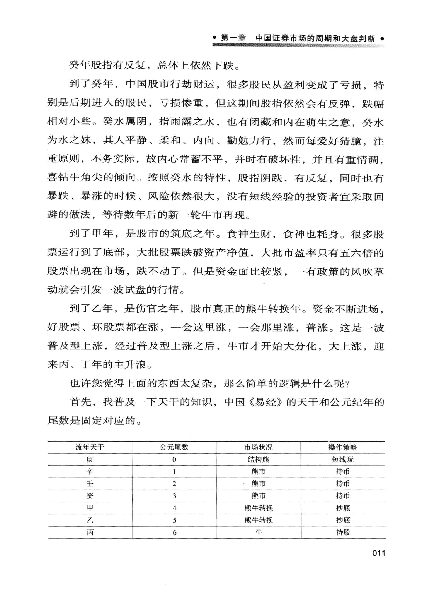

</details>

<details>
<summary>展开完整 OCR 识别记录（含页眉、页码及图表文字）</summary>

```text
·第一章中国证券市场的周期和大盘判断?
癸年股指有反复，总体上依然下跌。
到了癸年，中国股市行劫财运，很多股民从盈利变成了亏损，特
别是后期进人的股民，亏损惨重，但这期间股指依然会有反弹，跌幅
相对小些。癸水属阴，指雨露之水，也有闭藏和内在萌生之意，癸水
为水之妹，其人平静、柔和、内向、勤勉力行，然而每爱好猜臆，注
重原则，不务实际，故内心常蓄不平，并时有破坏性，并且有重情调，
喜钻牛角尖的倾向。按照癸水的特性，股指阴跌，有反复，同时也有
暴跌、暴涨的时候、风险依然很大，没有短线经验的投资者宜采取回
避的做法，等待数年后的新一轮牛市再现。
到了甲年，是股市的筑底之年。食神生财，食神也耗身。很多股
票运行到了底部，大批股票跌破资产净值，大批市盈率只有五六倍的
股票出现在市场，跌不动了。但是资金面比较紧，一有政策的风吹草
动就会引发一波试盘的行情。
到了乙年，是伤官之年，股市真正的熊牛转换年。资金不断进场，
好股票、坏股票都在涨，一会这里涨，一会那里涨，普涨。这是一波
普及型上涨，经过普及型上涨之后，牛市才开始大分化，大上涨，迎
来丙、丁年的主升浪。
也许您觉得上面的东西太复杂，那么简单的逻辑是什么呢？
首先，我普及一下天干的知识，中国《易经》的天干和公元纪年的
尾数是固定对应的。
流年天干
公元尾数
市场状况
操作策略
庚
0
结构熊
短线玩
辛
1
熊市
持币
壬
2
·熊市
持币
癸
3
熊市
持币
甲
4
熊牛转换
抄底
乙
5
熊牛转换
抄底
丙
6
牛
持股
011
```

</details>

<a id="pdf-page-0019"></a>

### PDF 第 19 页｜正文第 12 页

[查看 PDF](30914975.pdf#page=19) · [原页图像](30914975.assets/page-0019.jpeg) · [OCR 坐标与置信度](30914975.assets/ocr/page-0019.json)

续表

流年天干

公元尾数

市场状况

操作策略

丁

大牛+熊转换

持股+清仓

戊

大熊

持币

己

牛

持股

我在《期货投资策略一一期货大作手如是说》里也详细地讲解了这个道理。如果你利用基本面分析，在2010～2014年持有低市盈率的银行股、蓝筹股，你会4年一无所获。股票的本质搞不清楚，很难炒好。同理，如果你恰好在大牛市进场，赚到了钱，这时你会产生幻觉，认为自己能力超强，误把市场的馈赠当成自己的能力，那么当接下来的流年来临时，你会很受伤，这也就是巴菲特说的“当潮水退却时，我们才知道谁在裸泳”。

不要去追问牛熊的原因，是什么政策之类的。谁坐了那个位置都会行使相应的职权，推出相应的政策，这些都只是表象而已，本质就在这里。到了那个年份就会发生那样的事情。

已经有很多实力庄家因为不懂得中国股市大牛熊周期，导致全军覆没。比如新疆德隆，它当时是中国最有实力的庄家，2002年、2003年满仓持股，甚至拉升，终于在2004年夏天资金链断裂，全军覆没。再坚持几个月股市就进人牛市周期了。没文化真可怕！当然也有很多大户在2002年因为满仓而爆仓的，可见牛熊周期不以人的意志为转移，我们炒股一定要顺应天时，顺应牛熊周期。我们一定要尊重中国文化，这是由社会文化特性决定的。

当然由于地支不同，不同年份的市场状况不同，庚子年和庚寅年那肯定不一样。庚子年的市场就不如庚寅年，寅木地支是股票“壬”水的食神，生着财呢。丁亥年和丁酉年也不会一样，丁酉年（2017年）不如丁亥年（2007年），因为酉金印星纯正，耗费了财神，丁亥年里面的劫财助身，甲木食神得力，所以涨得凶猛无比。

<details>
<summary>展开原页图像</summary>

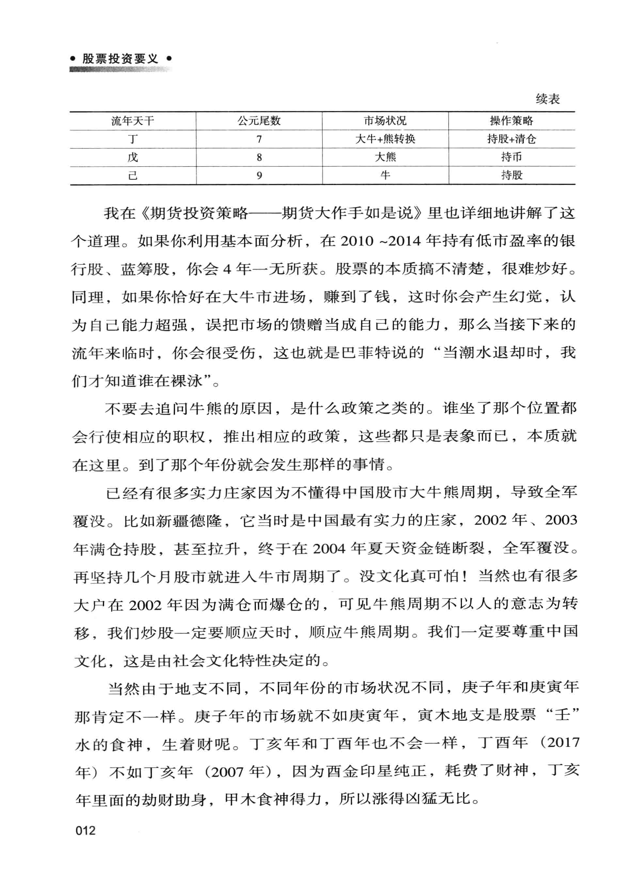

</details>

<details>
<summary>展开完整 OCR 识别记录（含页眉、页码及图表文字）</summary>

```text
·股票投资要义?
续表
流年天干
公元尾数
市场状况
操作策略
丁
7
大牛+熊转换
持股+清仓
戊
8
大熊
持币
己
9
牛
持股
我在《期货投资策略一一期货大作手如是说》里也详细地讲解了这
个道理。如果你利用基本面分析，在2010～2014年持有低市盈率的银
行股、蓝筹股，你会4年一无所获。股票的本质搞不清楚，很难炒好。
同理，如果你恰好在大牛市进场，赚到了钱，这时你会产生幻觉，认
为自己能力超强，误把市场的馈赠当成自己的能力，那么当接下来的
流年来临时，你会很受伤，这也就是巴菲特说的“当潮水退却时，我
们才知道谁在裸泳”。
不要去追问牛熊的原因，是什么政策之类的。谁坐了那个位置都
会行使相应的职权，推出相应的政策，这些都只是表象而已，本质就
在这里。到了那个年份就会发生那样的事情。
已经有很多实力庄家因为不懂得中国股市大牛熊周期，导致全军
覆没。比如新疆德隆，它当时是中国最有实力的庄家，2002年、2003
年满仓持股，甚至拉升，终于在2004年夏天资金链断裂，全军覆没。
再坚持几个月股市就进人牛市周期了。没文化真可怕！当然也有很多
大户在2002年因为满仓而爆仓的，可见牛熊周期不以人的意志为转
移，我们炒股一定要顺应天时，顺应牛熊周期。我们一定要尊重中国
文化，这是由社会文化特性决定的。
当然由于地支不同，不同年份的市场状况不同，庚子年和庚寅年
那肯定不一样。庚子年的市场就不如庚寅年，寅木地支是股票“壬”
水的食神，生着财呢。丁亥年和丁酉年也不会一样，丁酉年（2017
年）不如丁亥年（2007年），因为酉金印星纯正，耗费了财神，丁亥
年里面的劫财助身，甲木食神得力，所以涨得凶猛无比。
012
```

</details>

<a id="pdf-page-0020"></a>

### PDF 第 20 页｜正文第 13 页

[查看 PDF](30914975.pdf#page=20) · [原页图像](30914975.assets/page-0020.jpeg) · [OCR 坐标与置信度](30914975.assets/ocr/page-0020.json)

> 整理注：此页包含上证指数未来点位预测，属于 2015 年作者观点。

因此下一个大牛市2026年（丙午）～2027年（丁未年）将是何等的波澜壮阔需要我们展开想象的翅膀。天干丙火，自坐午火，午火是最纯正的火，午子对冲，任何杂质劫财都被冲走了，天干是财地支也是财，2027年丁未年，未土是丁火的余气，自坐强根，未土是乙木的库，乙木伤官生财必然全球领先。我可以在此断言，2026年、2027年的大牛市，上证综指将会突破5万点向10万点迈进。

在2026年将会出现大小股票一起涨，没有二八现象，只要是优质股，都会出现连续几个月天天大阳线涨停板的旷世奇观，让地球人都震惊，我们拭目以待。请大家把这段话打印出来，贴到办公室和卧室，我们到时间一起见证奇迹！不见不散！

2014年底开始的这轮牛市结束时间是2017年夏天，届时上证综指的点位是12000~16000点，大家一起验证。

#### 第二节中国经济的大局观和未来演绎

“基建+工业”仍然是中国未来30年的“发动机”。

这个时间点的开始是2018年底到2022年，以后就会一直持续下去，直到30年后中国的工业化、城镇化彻底完成。到时间一定会有人重新真正深刻地认识到这个问题，会重新开动基建工业发动机。中国的产能根本不过剩，是稀缺的。基础设施还很落后，农村人口占大多数甚至还有很多人吃不上饭，西部地区有很多县没有高速公路，我说的不是教科书，是事实。你出门高铁，回家会所，就说产能过剩了、不发展了，这对十几亿人口的大国不适用。换句话说，基建工业的长期性是存在的，只要一点火就会立即开动。

<details>
<summary>展开原页图像</summary>

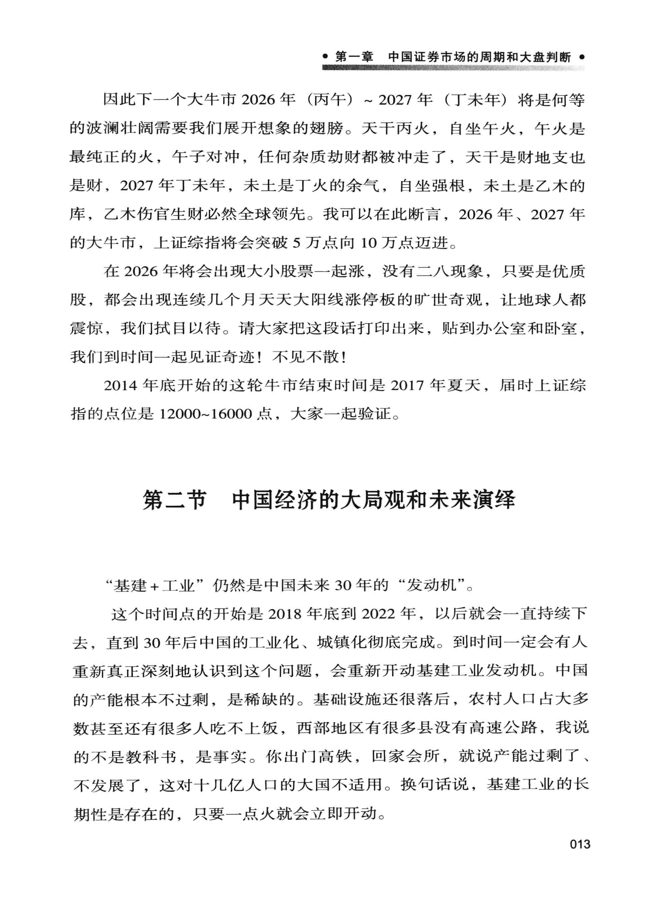

</details>

<details>
<summary>展开完整 OCR 识别记录（含页眉、页码及图表文字）</summary>

```text
●第一章中国证券市场的周期和大盘判断·
因此下一个大牛市2026年（丙午）～2027年（丁未年）将是何等
的波澜壮阔需要我们展开想象的翅膀。天干丙火，自坐午火，午火是
最纯正的火，午子对冲，任何杂质劫财都被冲走了，天干是财地支也
是财，2027年丁未年，未土是丁火的余气，自坐强根，未土是乙木的
库，乙木伤官生财必然全球领先。我可以在此断言，2026年、2027年
的大牛市，上证综指将会突破5万点向10万点迈进。
在2026年将会出现大小股票一起涨，没有二八现象，只要是优质
股，都会出现连续几个月天天大阳线涨停板的旷世奇观，让地球人都
震惊，我们拭目以待。请大家把这段话打印出来，贴到办公室和卧室，
我们到时间一起见证奇迹！不见不散！
2014年底开始的这轮牛市结束时间是2017年夏天，届时上证综
指的点位是12000~16000点，大家一起验证。
第二节中国经济的大局观和未来演绎
“基建+工业”仍然是中国未来30年的“发动机”。
这个时间点的开始是2018年底到2022年，以后就会一直持续下
去，直到30年后中国的工业化、城镇化彻底完成。到时间一定会有人
重新真正深刻地认识到这个问题，会重新开动基建工业发动机。中国
的产能根本不过剩，是稀缺的。基础设施还很落后，农村人口占大多
数甚至还有很多人吃不上饭，西部地区有很多县没有高速公路，我说
的不是教科书，是事实。你出门高铁，回家会所，就说产能过剩了、
不发展了，这对十几亿人口的大国不适用。换句话说，基建工业的长
期性是存在的，只要一点火就会立即开动。
013
```

</details>

<a id="pdf-page-0021"></a>

### PDF 第 21 页｜正文第 14 页

[查看 PDF](30914975.pdf#page=21) · [原页图像](30914975.assets/page-0021.jpeg) · [OCR 坐标与置信度](30914975.assets/ocr/page-0021.json)

提高发展速度要靠内在的禀赋。

中国的内在禀赋就是人口多可以保持低工资，资源总量大可以提高总体效能，这两个是最大的禀赋，其他的高科技工商改革算是制度禀赋。制度禀赋无人敢改，我也不多说。现在人口禀赋没有了，工资年年涨（央行放水），工业制造业就没竞争力。资源禀赋呢，由于各种原因无法充分利用，拿土地资源来说，应该发展大农场，解放全国8亿农民，取消户籍自由迁徙。所以内在禀赋的充分利用才是关键。好车的标准是看发动机而不是看内饰。

<details>
<summary>展开原页图像</summary>

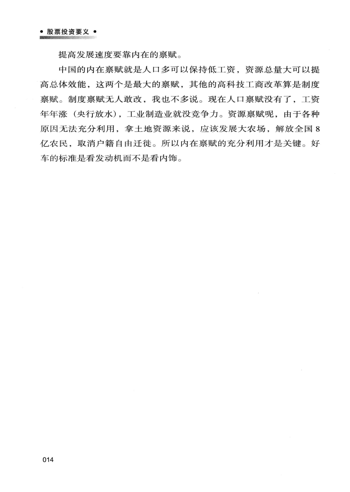

</details>

<details>
<summary>展开完整 OCR 识别记录（含页眉、页码及图表文字）</summary>

```text
·股票投资要义?
提高发展速度要靠内在的禀赋。
中国的内在禀赋就是人口多可以保持低工资，资源总量大可以提
高总体效能，这两个是最大的禀赋，其他的高科技工商改革算是制度
禀赋。制度禀赋无人敢改，我也不多说。现在人口禀赋没有了，工资
年年涨（央行放水），工业制造业就没竞争力。资源禀赋呢，由于各种
原因无法充分利用，拿土地资源来说，应该发展大农场，解放全国8
亿农民，取消户籍自由迁徙。所以内在禀赋的充分利用才是关键。好
车的标准是看发动机而不是看内饰。
014
```

</details>

<a id="pdf-page-0022"></a>

### PDF 第 22 页｜正文第 15 页

[查看 PDF](30914975.pdf#page=22) · [原页图像](30914975.assets/page-0022.jpeg) · [OCR 坐标与置信度](30914975.assets/ocr/page-0022.json)

#### 第二章股票投资的逻辑

做商品期货首先要搞清楚美联储的货币政策，做股票首先要搞清楚现在是牛市还是熊市。

一胡斐

#### 第一节股票投资的逻辑基础

做任何投资，特别是大投资，只有自上而下研究，从大到小细分逻辑才是有效的。600年西方金融史和几十年中国交易史表明：做短线交易的都是不人流的三脚猫游戏。利弗莫尔、巴菲特、斯坦利克罗、乔治·W.索罗斯、美国大投行、对冲基金都是玩中长线的，至少也是年内大波段。

**一、期货投资的大逻辑**

1.任何一个商品都要分解为宏观属性+基本面属性，农产品和化工品还有政策属性。

2.简单有效的最大逻辑是美联储加息或者有加息预期，商品暴跌，

<details>
<summary>展开原页图像</summary>

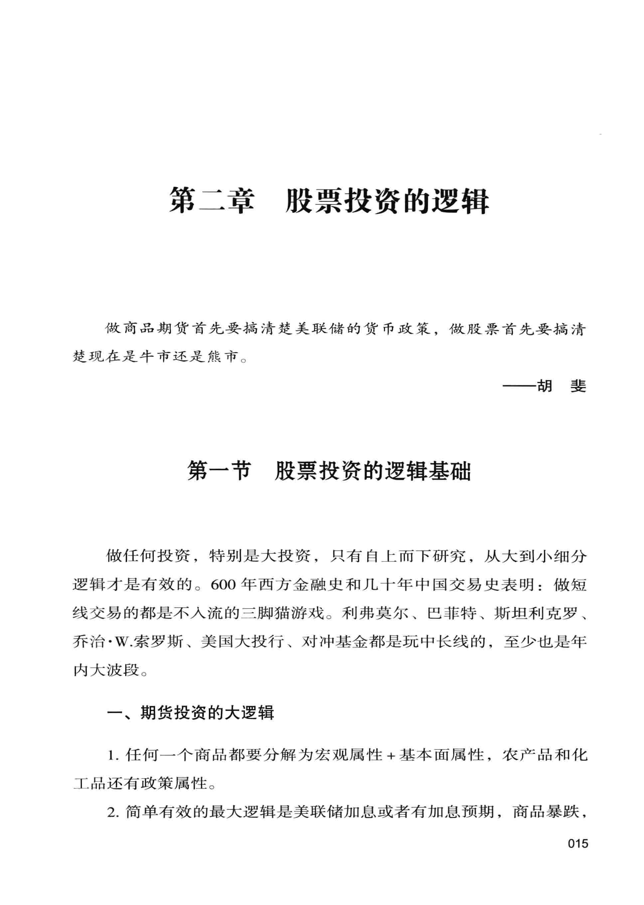

</details>

<details>
<summary>展开完整 OCR 识别记录（含页眉、页码及图表文字）</summary>

```text
第二章股票投资的逻辑
做商品期货首先要搞清楚美联储的货币政策，做股票首先要搞清
楚现在是牛市还是熊市。
一胡斐
第一节股票投资的逻辑基础
做任何投资，特别是大投资，只有自上而下研究，从大到小细分
逻辑才是有效的。600年西方金融史和几十年中国交易史表明：做短
线交易的都是不人流的三脚猫游戏。利弗莫尔、巴菲特、斯坦利克罗、
乔治·W.索罗斯、美国大投行、对冲基金都是玩中长线的，至少也是年
内大波段。
一、期货投资的大逻辑
1.任何一个商品都要分解为宏观属性+基本面属性，农产品和化
工品还有政策属性。
2.简单有效的最大逻辑是美联储加息或者有加息预期，商品暴跌，
015
```

</details>

<a id="pdf-page-0023"></a>

### PDF 第 23 页｜正文第 16 页

[查看 PDF](30914975.pdf#page=23) · [原页图像](30914975.assets/page-0023.jpeg) · [OCR 坐标与置信度](30914975.assets/ocr/page-0023.json)

黄金、白银、铜最狠，其他比如橡胶次之，农产品再次之；美联储推出量化宽松印钞票，所有商品都会暴涨，宏观属性越强涨得越狠，基本面属性越强，涨得越轻。

3.把握住宏观逻辑，再根据具体商品的供求分析，如果供需方向和宏观方向一致，必然出大行情；不一致，出小行情和震荡行情。

做股票投资，需要把握住的最大逻辑是什么呢？就是本书第一章的时间周期。把握住那个最大的逻辑，就是“可以干”和“不可以干”的问题，就是“持股”和“持币”的问题。这个弄错了，神仙进场操作也必输无疑。输到内裤都没有的也有可能，不是他能力不强，是他不识时务。

明白了大逻辑，接下来就是小逻辑。如果市场是可以做的市场，那么应该如何做呢？

先让我们看看大众投资者（散户）的投资心理吧：买进一只，迅速翻倍（或者主升浪），出货，买人第二只，迅速翻倍（或者主升浪），出货；买人第三只，迅速进人主升浪，出货。然后赞叹：“复利是世界第八大奇迹。”

有过多年投资经验的人都知道这是妄想，是贪心的一种体现。这反而会导致追涨杀跌，导致牛市不挣钱，浪费好时机。历史也证明了这是不可取的。玩短线的人，注定登不了门，历史无数次的证明了！

**二、那么如何看待股市的逻辑呢？**

股市最重要的逻辑有四个：

1.价格确定，时间确定：这种机会经常出现在上市公司的“现金选择权”和定向增发中，比如2008年，攀钢钢钒000825的股票，鞍钢集团给出全面要约收购，证监会行使行政审批权审核通过，鞍钢给出不愿意换股的攀钢股票持有人9.58元现金选择权，并按照法律在半

<details>
<summary>展开原页图像</summary>

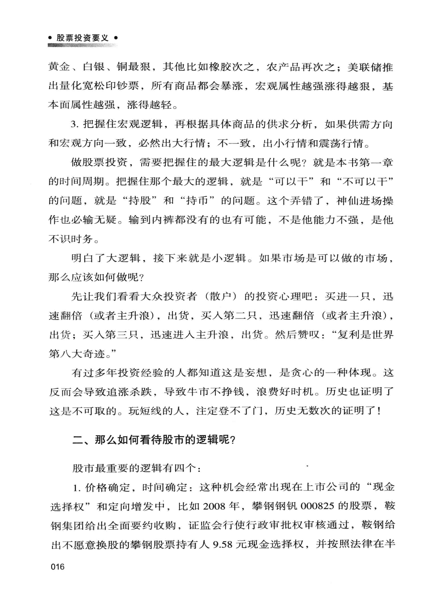

</details>

<details>
<summary>展开完整 OCR 识别记录（含页眉、页码及图表文字）</summary>

```text
股票投资要义
黄金、白银、铜最狠，其他比如橡胶次之，农产品再次之；美联储推
出量化宽松印钞票，所有商品都会暴涨，宏观属性越强涨得越狠，基
本面属性越强，涨得越轻。
3.把握住宏观逻辑，再根据具体商品的供求分析，如果供需方向
和宏观方向一致，必然出大行情；不一致，出小行情和震荡行情。
做股票投资，需要把握住的最大逻辑是什么呢？就是本书第一章
的时间周期。把握住那个最大的逻辑，就是“可以干”和“不可以干”
的问题，就是“持股”和“持币”的问题。这个弄错了，神仙进场操
作也必输无疑。输到内裤都没有的也有可能，不是他能力不强，是他
不识时务。
明白了大逻辑，接下来就是小逻辑。如果市场是可以做的市场，
那么应该如何做呢？
先让我们看看大众投资者（散户）的投资心理吧：买进一只，迅
速翻倍（或者主升浪），出货，买人第二只，迅速翻倍（或者主升浪），
出货；买人第三只，迅速进人主升浪，出货。然后赞叹：“复利是世界
第八大奇迹。”
有过多年投资经验的人都知道这是妄想，是贪心的一种体现。这
反而会导致追涨杀跌，导致牛市不挣钱，浪费好时机。历史也证明了
这是不可取的。玩短线的人，注定登不了门，历史无数次的证明了！
二、那么如何看待股市的逻辑呢？
股市最重要的逻辑有四个：
1.价格确定，时间确定：这种机会经常出现在上市公司的“现金
选择权”和定向增发中，比如2008年，攀钢钢钒000825的股票，鞍
钢集团给出全面要约收购，证监会行使行政审批权审核通过，鞍钢给
出不愿意换股的攀钢股票持有人9.58元现金选择权，并按照法律在半
016
```

</details>

<a id="pdf-page-0024"></a>

### PDF 第 24 页｜正文第 17 页

[查看 PDF](30914975.pdf#page=24) · [原页图像](30914975.assets/page-0024.jpeg) · [OCR 坐标与置信度](30914975.assets/ocr/page-0024.json)

年内完成并购。这就是时间确定，价格确定。二级市场攀钢的股票只要低于9.58元就是无风险机会。这种情况还有很多，大家可以自已深度挖掘一下，每年总会有几家。

2.价格确定，时间不确定：这种机会经常出现在历史性大底部，股票已经跌破净资产，加上股息分红简直就是捡钱，可是大众是“羊群心理”，越便宜的越没人要，继续往下砸，图形往往很难看，让人不敢买，或者说等买更便宜的，往往错过机会。一个最近的例子就是2014年上半年的蓝筹股，市盈率四五倍、六七倍的都有。股票就是没人要，动不动还往下砸个坑。

3.价格不确定，时间不确定：大部分股票都是这样，即使在牛市也是这样，这是人们追涨杀跌的情绪在作怪。在熊市更是这样。

4.时间确定，价格不确定：这种机会指的是一个大的外部事件冲击市场，导致市场暴涨。比如2014年11月央行突然降息，金融股暴涨，我们都知道这时要涨，但不知道涨多少。还有就是重大题材爆发的时刻，比如2013年7月国家推出上海自贸区，外高桥、陆家嘴等股票暴涨，我们那时都知道要涨，但是也不知道涨多少。本书第一章讲述的时间周期也是属于“时间确定，价格不确定”，到了那个年份大致的市场状况是那样的，具体涨跌点位是不清楚的。

在任何一个时刻，拿起任何一只股票，首先要对照本书第一章的内容看看大势背景，然后按照这四个确定的分析看看属于哪个象限。它一定会属于这四个象限中的某一个。确定了象限，再确定其他的东西。

**三、适合大众的三个小逻辑**

有了正确的战略，下面给出三个战术小逻辑：

笔者提供的三个小逻辑前提是可以操作的年份，也即尾数逢“4”、

<details>
<summary>展开原页图像</summary>

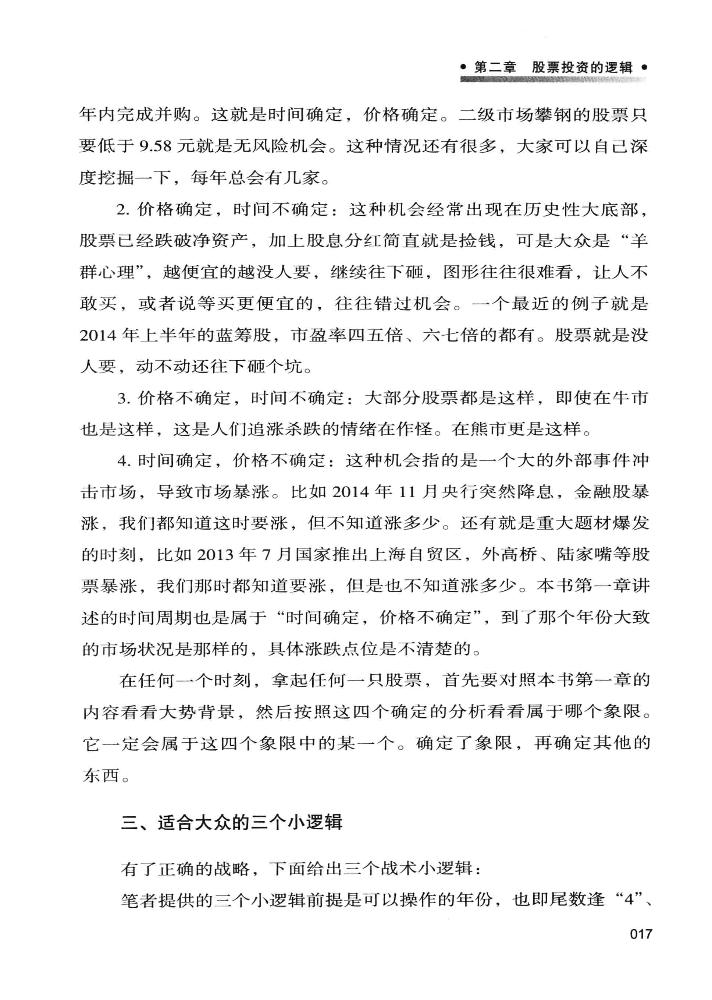

</details>

<details>
<summary>展开完整 OCR 识别记录（含页眉、页码及图表文字）</summary>

```text
·第二章股票投资的逻辑
年内完成并购。这就是时间确定，价格确定。二级市场攀钢的股票只
要低于9.58元就是无风险机会。这种情况还有很多，大家可以自已深
度挖掘一下，每年总会有几家。
2.价格确定，时间不确定：这种机会经常出现在历史性大底部，
股票已经跌破净资产，加上股息分红简直就是捡钱，可是大众是“羊
群心理”，越便宜的越没人要，继续往下砸，图形往往很难看，让人不
敢买，或者说等买更便宜的，往往错过机会。一个最近的例子就是
2014年上半年的蓝筹股，市盈率四五倍、六七倍的都有。股票就是没
人要，动不动还往下砸个坑。
3.价格不确定，时间不确定：大部分股票都是这样，即使在牛市
也是这样，这是人们追涨杀跌的情绪在作怪。在熊市更是这样。
4.时间确定，价格不确定：这种机会指的是一个大的外部事件冲
击市场，导致市场暴涨。比如2014年11月央行突然降息，金融股暴
涨，我们都知道这时要涨，但不知道涨多少。还有就是重大题材爆发
的时刻，比如2013年7月国家推出上海自贸区，外高桥、陆家嘴等股
票暴涨，我们那时都知道要涨，但是也不知道涨多少。本书第一章讲
述的时间周期也是属于“时间确定，价格不确定”，到了那个年份大致
的市场状况是那样的，具体涨跌点位是不清楚的。
在任何一个时刻，拿起任何一只股票，首先要对照本书第一章的
内容看看大势背景，然后按照这四个确定的分析看看属于哪个象限。
它一定会属于这四个象限中的某一个。确定了象限，再确定其他的
东西。
三、适合大众的三个小逻辑
有了正确的战略，下面给出三个战术小逻辑：
笔者提供的三个小逻辑前提是可以操作的年份，也即尾数逢“4”、
017
```

</details>

<a id="pdf-page-0025"></a>

### PDF 第 25 页｜正文第 18 页

[查看 PDF](30914975.pdf#page=25) · [原页图像](30914975.assets/page-0025.jpeg) · [OCR 坐标与置信度](30914975.assets/ocr/page-0025.json)

“5”、“6”、“7”、“9”的年份。其他的年份市场不好，只有高手能操作。建议大众持币观望。那些潮水退去还在裸泳的人不是在牛市不赚钱，而是在熊市又还了回去。这是因为他们不懂得这个大逻辑，永远持股肯定输钱。

适合大众的小逻辑一：牛市“捂”券商股不动，直到牛市结束，不操作。

在逢“4”、逢“5”年份，券商股（参股券商，泛金融股；地产股；互联网金融股）已经跌到不可再跌，其实这时大部分股票都已经跌无可跌，只有向上的一条路。无非就是持有哪些股票而已，是挣多少钱的问题。摒除“操作”、“交易”、“买卖”，踏踏实实选股，不操作，只做A点到B点的行情。券商、券商服务、互联网券商将会是牛市最大的受益者，也是资金追捧的对象。

根据统计，一轮2.5~3年的牛市下来，券商和互联网券商龙头股的涨幅一般在10倍左右。要想赚足这10倍涨幅，从一开始就要持股不动，直到牛市结束。杜绝波段操作，因为你不知道哪里是波段高点哪里是波段低点，往往新高之后还是新高，你觉得现在是高点，过几天就变成低点。一个又一个“高点”被踩在脚下，这就是牛市。牛市就是钱不断进来，消灭低价股，牛市初期的最低价股（一般都是券商银行蓝筹）都变成高价股（市盈率奇高）时，牛市就结束了。这中间的过程谁也说不清楚，想进行“高抛低吸”的人往往都做成了“高吸低抛”，这是人性的弱点决定的，我们真的没必要跟人性做斗争，斗不过的。

为什么券商股持股到底可以翻这么多倍？有以下几个原因：

第一，股市交易量大增会提升券商的业绩，形成正反馈，牛市越牛，钱越多，券商股业绩越好，正循环，历来如此。业绩提升往往是跃进式的，一年暴涨500%~1000%连续两年是常态。

<details>
<summary>展开原页图像</summary>

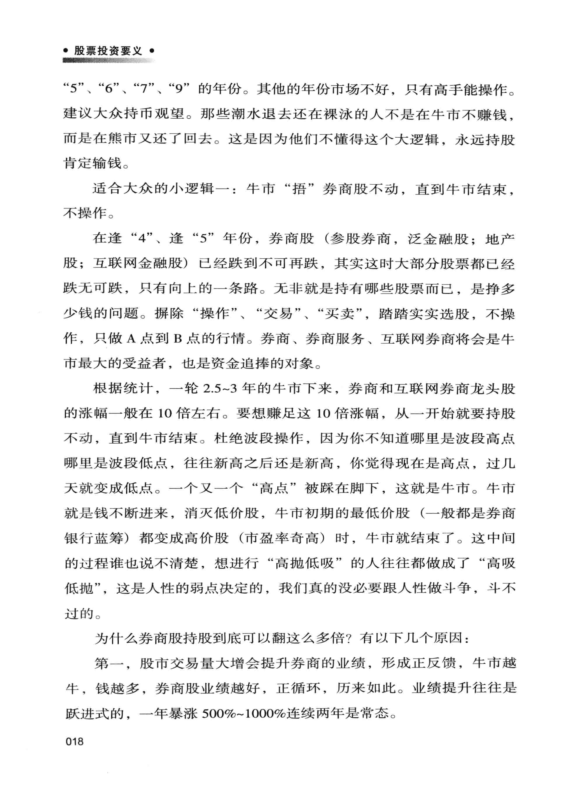

</details>

<details>
<summary>展开完整 OCR 识别记录（含页眉、页码及图表文字）</summary>

```text
·股票投资要义?
“5”、“6”、“7”、“9”的年份。其他的年份市场不好，只有高手能操作。
建议大众持币观望。那些潮水退去还在裸泳的人不是在牛市不赚钱，
而是在熊市又还了回去。这是因为他们不懂得这个大逻辑，永远持股
肯定输钱。
适合大众的小逻辑一：牛市“捂”券商股不动，直到牛市结束，
不操作。
在逢“4”、逢“5”年份，券商股（参股券商，泛金融股；地产
股；互联网金融股）已经跌到不可再跌，其实这时大部分股票都已经
跌无可跌，只有向上的一条路。无非就是持有哪些股票而已，是挣多
少钱的问题。摒除“操作”、“交易”、“买卖”，踏踏实实选股，不操
作，只做A点到B点的行情。券商、券商服务、互联网券商将会是牛
市最大的受益者，也是资金追捧的对象。
根据统计，一轮2.5~3年的牛市下来，券商和互联网券商龙头股
的涨幅一般在10倍左右。要想赚足这10倍涨幅，从一开始就要持股
不动，直到牛市结束。杜绝波段操作，因为你不知道哪里是波段高点
哪里是波段低点，往往新高之后还是新高，你觉得现在是高点，过几
天就变成低点。一个又一个“高点”被踩在脚下，这就是牛市。牛市
就是钱不断进来，消灭低价股，牛市初期的最低价股（一般都是券商
银行蓝筹）都变成高价股（市盈率奇高）时，牛市就结束了。这中间
的过程谁也说不清楚，想进行“高抛低吸”的人往往都做成了“高吸
低抛”，这是人性的弱点决定的，我们真的没必要跟人性做斗争，斗不
过的。
为什么券商股持股到底可以翻这么多倍？有以下几个原因：
第一，股市交易量大增会提升券商的业绩，形成正反馈，牛市越
牛，钱越多，券商股业绩越好，正循环，历来如此。业绩提升往往是
跃进式的，一年暴涨500%~1000%连续两年是常态。
018
```

</details>

<a id="pdf-page-0026"></a>

### PDF 第 26 页｜正文第 19 页

[查看 PDF](30914975.pdf#page=26) · [原页图像](30914975.assets/page-0026.jpeg) · [OCR 坐标与置信度](30914975.assets/ocr/page-0026.json)

第二，不管券商的形式如何变化，互联网也好，其他也好，投行业务和经纪业务都是支柱，资金追捧更大的银行股不如拿盘小、流动性好的券商股，不同的资金都会做配置，筹码有一定的稀缺性。

第三，券商本身都会推出一些东西概念刺激自身股价。因为熊市比较难熬，一到牛市所有的券商都积极起来，以前懒得推动的业务现在也挂上时髦的标签推出来。当然随着未来的变迁，一些互联网券商，也许020券商也会出来，但这不会改变牛市券商暴涨的本质。特别是稳健型大资金、配置券商股，安然度过牛市，牛市结束卖出是不二选择。

适合大众的小逻辑二：布局行业龙头股，直到牛市结束，不操作。

首先笔者想说的是板块轮动不好把握，容易演变成追涨杀跌。历史交易经验证明，在牛市里，无休止地追逐市场热点一年下来的收益经常不如死捂一两只牛股的收益。历史无数次地这样证明了这个真理，但是市场每年的波动都很大，这是因为新进来的人太多了，他们有新鲜感，胆子大，全仓猛买猛卖加剧了市场波动，每轮“牛熊周期”下来，除了把牛市新进场的人挣的钱还回去之外，还会教会更多人教训，人们渐渐明白了“牛市捂股”的“至真至纯”的道理之后，新一轮的“熊牛”周期又展开了。市场就是“长江后浪推前浪，前浪死在沙滩上”的过程，算是新陈代谢吧。

龙头股怎么选择？笔者建议选择两组，一组不超过5只，以4只为宜，可少不可多。

其中一组为“金融龙头股+基建龙头股+轻资产公司龙头股+消费龙头股”。

另外一组为“券商类券商龙头股+小盘龙头股+医药龙头股+科技互联网龙头股”。

大家可以看到笔者并没有按照具体的行业细分，这是很必要的。

<details>
<summary>展开原页图像</summary>

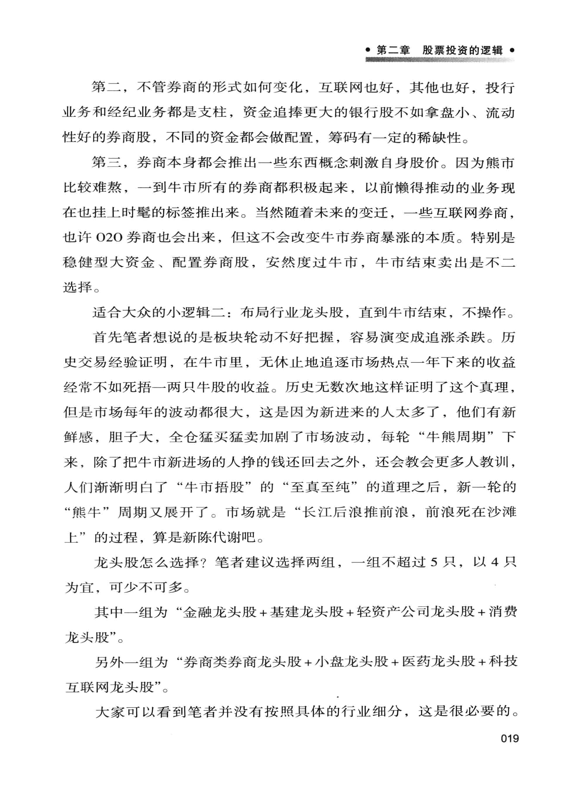

</details>

<details>
<summary>展开完整 OCR 识别记录（含页眉、页码及图表文字）</summary>

```text
·第二章股票投资的逻辑?
第二，不管券商的形式如何变化，互联网也好，其他也好，投行
业务和经纪业务都是支柱，资金追捧更大的银行股不如拿盘小、流动
性好的券商股，不同的资金都会做配置，筹码有一定的稀缺性。
第三，券商本身都会推出一些东西概念刺激自身股价。因为熊市
比较难熬，一到牛市所有的券商都积极起来，以前懒得推动的业务现
在也挂上时髦的标签推出来。当然随着未来的变迁，一些互联网券商，
也许020券商也会出来，但这不会改变牛市券商暴涨的本质。特别是
稳健型大资金、配置券商股，安然度过牛市，牛市结束卖出是不二
选择。
适合大众的小逻辑二：布局行业龙头股，直到牛市结束，不操作。
首先笔者想说的是板块轮动不好把握，容易演变成追涨杀跌。历
史交易经验证明，在牛市里，无休止地追逐市场热点一年下来的收益
经常不如死捂一两只牛股的收益。历史无数次地这样证明了这个真理，
但是市场每年的波动都很大，这是因为新进来的人太多了，他们有新
鲜感，胆子大，全仓猛买猛卖加剧了市场波动，每轮“牛熊周期”下
来，除了把牛市新进场的人挣的钱还回去之外，还会教会更多人教训，
人们渐渐明白了“牛市捂股”的“至真至纯”的道理之后，新一轮的
“熊牛”周期又展开了。市场就是“长江后浪推前浪，前浪死在沙滩
上”的过程，算是新陈代谢吧。
龙头股怎么选择？笔者建议选择两组，一组不超过5只，以4只
为宜，可少不可多。
其中一组为“金融龙头股+基建龙头股+轻资产公司龙头股+消费
龙头股”。
另外一组为“券商类券商龙头股+小盘龙头股+医药龙头股+科技
互联网龙头股”。
大家可以看到笔者并没有按照具体的行业细分，这是很必要的。
019
```

</details>

<a id="pdf-page-0027"></a>

### PDF 第 27 页｜正文第 20 页

[查看 PDF](30914975.pdf#page=27) · [原页图像](30914975.assets/page-0027.jpeg) · [OCR 坐标与置信度](30914975.assets/ocr/page-0027.json)

具体的行业划分会限制我们的思维。

如果从属于一个组别的股票过多，可以按照下面的步骤删选。

第一步按照市盈率排序；第二步按照流通盘排序；第三步按照价格排序，选择盘小、业绩好、价格低的即可。

注意笔者的操作策略是牛市一开始就持有，直到牛市结束。除非你有确切的证据证明这只股票确实不行，否则就一直持有。只要盘小、业绩好、价格低，又从属于上述题材，必然一轮牛市下来，你赚到的一定会比大部分人多。

适合大众的小逻辑三：二八节奏切换，大小股票轮流做。

板块轮动的波段策略不是追逐市场热点和行业板块，而是在大盘股和中小盘股之间进行切换。一般牛市第一波、中间一波、最后一波都是蓝筹股的大行情，一波翻一倍。在蓝筹股大行情时，资金朝着大股票集中，中小股票就调整或者吸筹，拉升力度不大。在大蓝筹股进行调整的时候，中小盘股，特别是其中绩优股、题材股、庄股会爆发出强有力的大行情，一倍都是最少的，三倍、五倍、十倍的都会有。因此，最大的轮动是大小股票的切换，而不是大股票之间的切换和中小股票之间的切换，这一点一定要注意。

牛市一般都是2.5~3年。大小切换也就最多三四次，太多就会不灵。第一波做大股票蓝筹大行情，第二波做中小盘大牛股行情，第三波继续做蓝筹大行情（主升浪），第四波就玩绩优股、题材股、切换也就是这么几次，一次持续半年至一年。

能把握准这个节奏，你就算是一顶一的高手了。别人翻十倍，你就能翻二三十倍。

<details>
<summary>展开原页图像</summary>

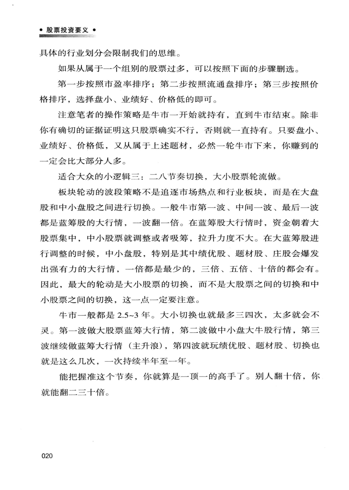

</details>

<details>
<summary>展开完整 OCR 识别记录（含页眉、页码及图表文字）</summary>

```text
·股票投资要义·
具体的行业划分会限制我们的思维。
如果从属于一个组别的股票过多，可以按照下面的步骤删选。
第一步按照市盈率排序；第二步按照流通盘排序；第三步按照价
格排序，选择盘小、业绩好、价格低的即可。
注意笔者的操作策略是牛市一开始就持有，直到牛市结束。除非
你有确切的证据证明这只股票确实不行，否则就一直持有。只要盘小、
业绩好、价格低，又从属于上述题材，必然一轮牛市下来，你赚到的
一定会比大部分人多。
适合大众的小逻辑三：二八节奏切换，大小股票轮流做。
板块轮动的波段策略不是追逐市场热点和行业板块，而是在大盘
股和中小盘股之间进行切换。一般牛市第一波、中间一波、最后一波
都是蓝筹股的大行情，一波翻一倍。在蓝筹股大行情时，资金朝着大
股票集中，中小股票就调整或者吸筹，拉升力度不大。在大蓝筹股进
行调整的时候，中小盘股，特别是其中绩优股、题材股、庄股会爆发
出强有力的大行情，一倍都是最少的，三倍、五倍、十倍的都会有。
因此，最大的轮动是大小股票的切换，而不是大股票之间的切换和中
小股票之间的切换，这一点一定要注意。
牛市一般都是2.5~3年。大小切换也就最多三四次，太多就会不
灵。第一波做大股票蓝筹大行情，第二波做中小盘大牛股行情，第三
波继续做蓝筹大行情（主升浪），第四波就玩绩优股、题材股、切换也
就是这么几次，一次持续半年至一年。
能把握准这个节奏，你就算是一顶一的高手了。别人翻十倍，你
就能翻二三十倍。
020
```

</details>

<a id="pdf-page-0028"></a>

### PDF 第 28 页｜正文第 21 页

[查看 PDF](30914975.pdf#page=28) · [原页图像](30914975.assets/page-0028.jpeg) · [OCR 坐标与置信度](30914975.assets/ocr/page-0028.json)

#### 第二节四项基本分析

**一、基本面分析**

主要是让大家熟悉股票品种，最好是3000多只都熟悉，以及各个股票的股性、历史规律，还有各个板块题材，概念的股票规律。不适宜单纯的财务分析，财务分析不能解决任何问题。基本分析是基础，是所有分析的基础，熟悉了股票后什么问题都好说。

基本面分析最基本的就是熟悉交易品种，除了常规的正常交易的股票之外，还包括权证、债券、ST股、停牌个股、问题个股等特殊品种。对于常规品种，应该注意了解每只股票在行业内的地位、关联的概念、股性的活跃度、主力的偏爱度，还应该了解该只个股的历史表现、每年的周期表现。对于特殊品种，应该关注交易的活跃度，是否存在重大暴利的可能，特殊品种最容易出现爆破点。在完善基本分析的基础上，应该建议自己的股票池，注意不是自选股，是股票池，股票池应该分为四类：

第一类，各行业板块概念地域第一名的龙头股。

第二类，热点股、老庄股、次新股。

第三类，特殊品种。冷门股、ST、权证、债券。

第四类，消息股。消息来源因人而异，可以购买、听说、阅读研究报告等。

基本面分析还应该选出每一个时期的以下股票：

第一类，小盘次新股。

<details>
<summary>展开原页图像</summary>

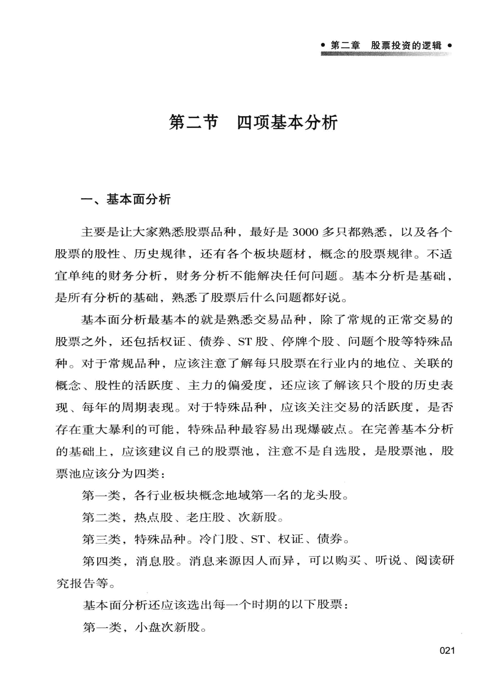

</details>

<details>
<summary>展开完整 OCR 识别记录（含页眉、页码及图表文字）</summary>

```text
·第二章股票投资的逻辑
第二节四项基本分析
一、基本面分析
主要是让大家熟悉股票品种，最好是3000多只都熟悉，以及各个
股票的股性、历史规律，还有各个板块题材，概念的股票规律。不适
宜单纯的财务分析，财务分析不能解决任何问题。基本分析是基础，
是所有分析的基础，熟悉了股票后什么问题都好说。
基本面分析最基本的就是熟悉交易品种，除了常规的正常交易的
股票之外，还包括权证、债券、ST股、停牌个股、问题个股等特殊品
种。对于常规品种，应该注意了解每只股票在行业内的地位、关联的
概念、股性的活跃度、主力的偏爱度，还应该了解该只个股的历史表
现、每年的周期表现。对于特殊品种，应该关注交易的活跃度，是否
存在重大暴利的可能，特殊品种最容易出现爆破点。在完善基本分析
的基础上，应该建议自己的股票池，注意不是自选股，是股票池，股
票池应该分为四类：
第一类，各行业板块概念地域第一名的龙头股。
第二类，热点股、老庄股、次新股。
第三类，特殊品种。冷门股、ST、权证、债券。
第四类，消息股。消息来源因人而异，可以购买、听说、阅读研
究报告等。
基本面分析还应该选出每一个时期的以下股票：
第一类，小盘次新股。
021
```

</details>

<a id="pdf-page-0029"></a>

### PDF 第 29 页｜正文第 22 页

[查看 PDF](30914975.pdf#page=29) · [原页图像](30914975.assets/page-0029.jpeg) · [OCR 坐标与置信度](30914975.assets/ocr/page-0029.json)

第二类，中盘绩优股。

第三类，具备股本扩张能力股。

第四类，具备高送配能力股。

第五类，具备高利润留存股。

具体地说，笔者是如何从基本面找到大牛股的股票呢？

**（一）J=当季每股收益：对于一只股票来说，J值越高越好**

无论是股市新手还是老手，都不要投资最近一季每股收益较去年同期增长率未达到18%或20%的股票。通过对股票市场最成功的公司的研究，我们发现，这些公司在股价大幅度上涨之前，当季每股收益都有大幅度的增长。许多成功的投资人都将当季每股收益增长率达到25%或30%作为选择股票的最低标准。如果近几个季度的每股收益较去年同期都有明显增长，那么更有可能确保投资的成功率。当然这个根据投资周期不同，也可改为当年度收益率的同比增长。笔者仔细研究了港股、纳斯达克市场、美股主板市场、中国沪深A股市场里面的能连续涨两三年甚至以上的超级大牛股。比如港股的腾讯控股（00700）、A股里的贵州茅台、纳斯达克的Google、美股主板的苹果(apl)。

特别是在牛市行情里，笔者喜欢大量买进每股收益增长率为50%~500%甚至以上的黑马股。既然你有成千上万的股票可以选择，为什么不选择投资那些最好的股票呢？因为在熊市行情里，绩优股也有可能被杀。

**（二）Z=每股收益年度增长率：找出每股收益真正增长的潜力股**

在笔者的研究中，那些大牛股除了有当前收益增长的强势记录外，还有一个稳定的、重要的每股收益年度增长。笔者针对每股收益年度增长筛选，要求在过去3年的每一年里每股收益都有所增长。业绩只要年度增长超过300%，并且能连续2年，股价基本都会翻10倍以上。

<details>
<summary>展开原页图像</summary>

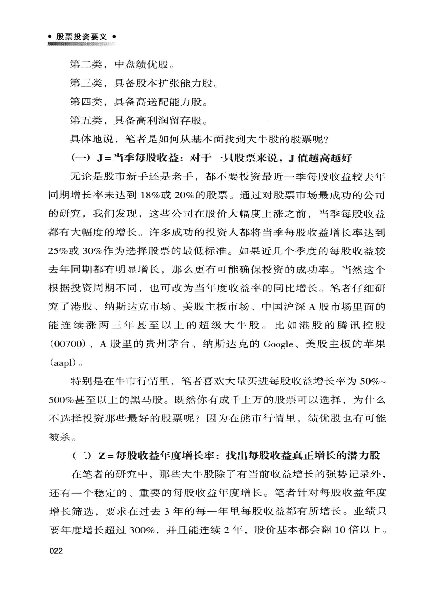

</details>

<details>
<summary>展开完整 OCR 识别记录（含页眉、页码及图表文字）</summary>

```text
·股票投资要义·
第二类，中盘绩优股。
第三类，具备股本扩张能力股。
第四类，具备高送配能力股。
第五类，具备高利润留存股。
具体地说，笔者是如何从基本面找到大牛股的股票呢？
（一）J=当季每股收益：对于一只股票来说，J值越高越好
无论是股市新手还是老手，都不要投资最近一季每股收益较去年
同期增长率未达到18%或20%的股票。通过对股票市场最成功的公司
的研究，我们发现，这些公司在股价大幅度上涨之前，当季每股收益
都有大幅度的增长。许多成功的投资人都将当季每股收益增长率达到
25%或30%作为选择股票的最低标准。如果近几个季度的每股收益较
去年同期都有明显增长，那么更有可能确保投资的成功率。当然这个
根据投资周期不同，也可改为当年度收益率的同比增长。笔者仔细研
究了港股、纳斯达克市场、美股主板市场、中国沪深A股市场里面的
能连续涨两三年甚至以上的超级大牛股。比如港股的腾讯控股
（00700）、A股里的贵州茅台、纳斯达克的Google、美股主板的苹果
(apl)。
特别是在牛市行情里，笔者喜欢大量买进每股收益增长率为50%~
500%甚至以上的黑马股。既然你有成千上万的股票可以选择，为什么
不选择投资那些最好的股票呢？因为在熊市行情里，绩优股也有可能
被杀。
（二）Z=每股收益年度增长率：找出每股收益真正增长的潜力股
在笔者的研究中，那些大牛股除了有当前收益增长的强势记录外，
还有一个稳定的、重要的每股收益年度增长。笔者针对每股收益年度
增长筛选，要求在过去3年的每一年里每股收益都有所增长。业绩只
要年度增长超过300%，并且能连续2年，股价基本都会翻10倍以上。
022
```

</details>

<a id="pdf-page-0030"></a>

### PDF 第 30 页｜正文第 23 页

[查看 PDF](30914975.pdf#page=30) · [原页图像](30914975.assets/page-0030.jpeg) · [OCR 坐标与置信度](30914975.assets/ocr/page-0030.json)

港股的腾讯就是最好的例子。腾讯的股价真正腾飞是从2009年的大约50元涨到2014年的约650元，真正的10年10倍股。腾讯恰好是在2006年、2007年、2008年连续三年业绩大增，2009年业绩增长达

基本面就看盈利增速：国投电力从2011年3亿元利润增长到现在六七十个亿元利润。4~5年的时间跨度内。2012年利润增加4倍，股价涨了40%~50%；2013年利润增加3倍，因为不是市场热点，全年股价才涨了大概10%；而到2014年，盈利增长60%~80%，股价涨了

笔者建议搜索那些在过去3年里每年增长率为30%的强势公司，这正是选择投资股票的要点。一只好的股票，过去3年里每年每股收益都应该较上一年度有显著的增长。通常不希望其中第二年的每股收益增长率稍稍滑落，即使它能够在下一年内得到回升，甚至达到历史新高。一只股票，如果在过去几个季度保持着较高的季度每股收益，而且过去几年中有着很好的历史增长记录，那么这只股票必将成为或者至少可能成为大牛股。

**（三）G=新概念**

股票必须要有概念才灵光，概念越新潮，越没人懂才好。2015年的全通教育、2014年的中科曙光、2013年的中青宝，这些概念一定是三最：最新的互联网物联网科技，甚至是互联网+，最新的商业模式，最酷的划时代产品。总之这些股票给人的感觉就是下一个苹果，google、微软、特斯拉、脸书、优步、推特。

**（四）P=中盘或者小盘**

在平常年份，只要能路身涨幅超过300%的大牛股，流通盘超过5亿元的很少。流通盘小，拉升资金需求就少，另外股本还可以扩张、作高、送转，这就是大牛股都是中小盘的秘密。

<details>
<summary>展开原页图像</summary>

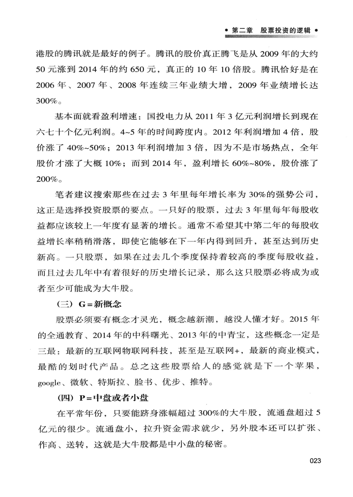

</details>

<details>
<summary>展开完整 OCR 识别记录（含页眉、页码及图表文字）</summary>

```text
·第二章股票投资的逻辑?
港股的腾讯就是最好的例子。腾讯的股价真正腾飞是从2009年的大约
50元涨到2014年的约650元，真正的10年10倍股。腾讯恰好是在
2006年、2007年、2008年连续三年业绩大增，2009年业绩增长达
300%
基本面就看盈利增速：国投电力从2011年3亿元利润增长到现在
六七十个亿元利润。4~5年的时间跨度内。2012年利润增加4倍，股
价涨了40%~50%；2013年利润增加3倍，因为不是市场热点，全年
股价才涨了大概10%；而到2014年，盈利增长60%~80%，股价涨了
200%
笔者建议搜索那些在过去3年里每年增长率为30%的强势公司，
这正是选择投资股票的要点。一只好的股票，过去3年里每年每股收
益都应该较上一年度有显著的增长。通常不希望其中第二年的每股收
益增长率稍稍滑落，即使它能够在下一年内得到回升，甚至达到历史
新高。一只股票，如果在过去几个季度保持着较高的季度每股收益，
而且过去几年中有着很好的历史增长记录，那么这只股票必将成为或
者至少可能成为大牛股。
（三）G=新概念
股票必须要有概念才灵光，概念越新潮，越没人懂才好。2015年
的全通教育、2014年的中科曙光、2013年的中青宝，这些概念一定是
三最：最新的互联网物联网科技，甚至是互联网+，最新的商业模式，
最酷的划时代产品。总之这些股票给人的感觉就是下一个苹果，
google、微软、特斯拉、脸书、优步、推特。
（四）P=中盘或者小盘
在平常年份，只要能路身涨幅超过300%的大牛股，流通盘超过5
亿元的很少。流通盘小，拉升资金需求就少，另外股本还可以扩张、
作高、送转，这就是大牛股都是中小盘的秘密。
023
```

</details>

<a id="pdf-page-0031"></a>

### PDF 第 31 页｜正文第 24 页

[查看 PDF](30914975.pdf#page=31) · [原页图像](30914975.assets/page-0031.jpeg) · [OCR 坐标与置信度](30914975.assets/ocr/page-0031.json)

**（五）I=机构投资者的认同：里面的机构或者个人**

研究大牛股的股东列表，因为十大流通股东的列表是每季度更新一次。因此大牛股可以通过研究大股东列表来发现到底是什么人或者机构在里面翻云覆雨。笔者发现，全是基金的几乎没有可能是大牛股。大牛股的股东有三个非常显著的特点：

第一，十大流通股东表里，至少有三四个是个人股东。这些身份证也许是代持的，但一定说明了有一些大炒家在里面运作。

第二，法人股东特别的公司法人股东不能太多，最好不超过三个。因为机构法人股东的风格全部都是偏稳健的，没有哪家公司的老板愿意让自己投资的公司亏损，因此公司法人股东多，说明机构还没有形成合力。

第三，一定要有基金、社保、年金等大型投资机构。这说明运作的庄家非常有实力，可以拉来有实力的国家机构。如果没有这些机构，全部都是个人股东，也很难成为超级大牛股。

**二、技术面分析**

笔者主要看重的技术分析是量价分析，均价线、均量线、K线，趋势分析，技术指标有PSY、OBV、MACD等，技术指标是重要的参考，给人以直观的表现，具体正确与否一定要慎重，主力什么都骗，骗线、骗量、骗指标，但是他不能永远骗、长期骗，只能在一个短时期内作假。在一个很短的时间内，主力很难作假，一些最重要的技术分析或者说最常见的技术分析很管用、很实用、很好用。以下试举几例：

1.大盘持续维持大成交量强势阶段，可以重点应用均线与K线结合的理论，比如三线共振、放量跳线、突破箱体、K线上攻还可结合KDJ、MACD的买点，此时应特别注意那些放量突破30均线的龙头

<details>
<summary>展开原页图像</summary>

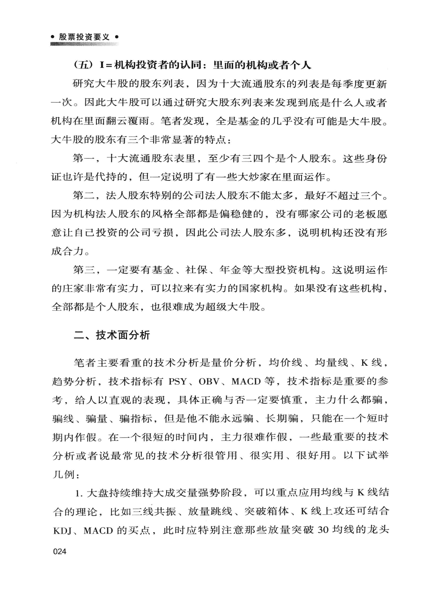

</details>

<details>
<summary>展开完整 OCR 识别记录（含页眉、页码及图表文字）</summary>

```text
?股票投资要义?
（五）I=机构投资者的认同：里面的机构或者个人
研究大牛股的股东列表，因为十大流通股东的列表是每季度更新
一次。因此大牛股可以通过研究大股东列表来发现到底是什么人或者
机构在里面翻云覆雨。笔者发现，全是基金的几乎没有可能是大牛股。
大牛股的股东有三个非常显著的特点：
第一，十大流通股东表里，至少有三四个是个人股东。这些身份
证也许是代持的，但一定说明了有一些大炒家在里面运作。
第二，法人股东特别的公司法人股东不能太多，最好不超过三个。
因为机构法人股东的风格全部都是偏稳健的，没有哪家公司的老板愿
意让自己投资的公司亏损，因此公司法人股东多，说明机构还没有形
成合力。
第三，一定要有基金、社保、年金等大型投资机构。这说明运作
的庄家非常有实力，可以拉来有实力的国家机构。如果没有这些机构，
全部都是个人股东，也很难成为超级大牛股。
二、技术面分析
笔者主要看重的技术分析是量价分析，均价线、均量线、K线，
趋势分析，技术指标有PSY、OBV、MACD等，技术指标是重要的参
考，给人以直观的表现，具体正确与否一定要慎重，主力什么都骗，
骗线、骗量、骗指标，但是他不能永远骗、长期骗，只能在一个短时
期内作假。在一个很短的时间内，主力很难作假，一些最重要的技术
分析或者说最常见的技术分析很管用、很实用、很好用。以下试举
几例：
1.大盘持续维持大成交量强势阶段，可以重点应用均线与K线结
合的理论，比如三线共振、放量跳线、突破箱体、K线上攻还可结合
KDJ、MACD的买点，此时应特别注意那些放量突破30均线的龙头
024
```

</details>

<a id="pdf-page-0032"></a>

### PDF 第 32 页｜正文第 25 页

[查看 PDF](30914975.pdf#page=32) · [原页图像](30914975.assets/page-0032.jpeg) · [OCR 坐标与置信度](30914975.assets/ocr/page-0032.json)

股，一般都有一个主升段。

2.大盘处于见底阶段的时候，应该注意地量又放量的个股，此时不应该看技术指标，应该看成交量，量越大越好，二次放量更好。

3.大盘处于没有明确方向的时候，应该注意应用短线法则，结合热点和均线进行波段操作，不应该再继续完全地相信所有的技术分析。

推荐的技术分析应用：

1.均线技术：设置10日和30日均线，在金叉处结合量价和基本面分析，大盘配合的话可以跟进。

2.周线技术：周K线处于绝对地位，周MACD良好，间歇两次（含以上）放量的个股具备中线牛股潜力。

3.形态技术：双底V形底。

4.指标技术：MACD。

**三、主力面分析**

包括主力的持有成本，筹码的集中度，主力机构的作风、偏好，以及相关机构的调研报告，私募内参消息，这些可以从侧面去验证走势的判断，主力分析最重要的目的是找出一段时期内的强庄股。主力：分析的一个重要应用是找出主力喜好的个股，从而同步运作，如果实在找不出来，只有依靠其他的分析才跟随了。目前市场上的主力包括大股东、大小非股东的控股母公司和关联集团、基金、券商，还有游资。与上市公司关联的主力一般都是与上市公司的重大重组，定向增发、并购、资产注人相联系。与基金券商机构相联系的主力一般都伴随着新项目、新发现、调研等。与游资相联系的主力一般都存在接力换庄的现象，因为游资最不喜欢选股，喜欢买股，更喜欢把股票买涨。所以他们往往等到股票被炒热的时候快速出击，连续作战。

进人2010年之后，股市的主力面发生了重大变化和分化。第一个

<details>
<summary>展开原页图像</summary>

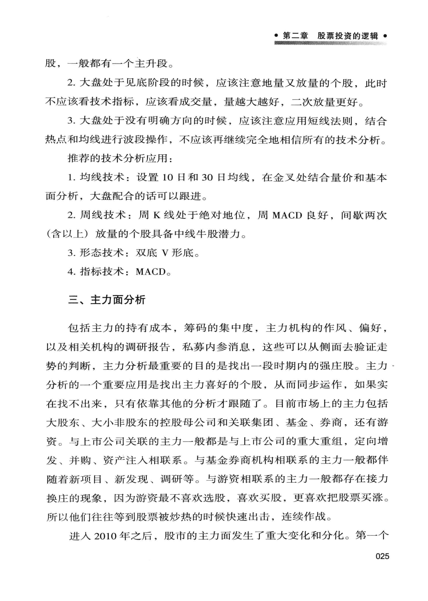

</details>

<details>
<summary>展开完整 OCR 识别记录（含页眉、页码及图表文字）</summary>

```text
?第二章股票投资的逻辑
股，一般都有一个主升段。
2.大盘处于见底阶段的时候，应该注意地量又放量的个股，此时
不应该看技术指标，应该看成交量，量越大越好，二次放量更好。
3.大盘处于没有明确方向的时候，应该注意应用短线法则，结合
热点和均线进行波段操作，不应该再继续完全地相信所有的技术分析。
推荐的技术分析应用：
1.均线技术：设置10日和30日均线，在金叉处结合量价和基本
面分析，大盘配合的话可以跟进。
2.周线技术：周K线处于绝对地位，周MACD良好，间歇两次
（含以上）放量的个股具备中线牛股潜力。
3.形态技术：双底V形底。
4.指标技术：MACD。
三、主力面分析
包括主力的持有成本，筹码的集中度，主力机构的作风、偏好，
以及相关机构的调研报告，私募内参消息，这些可以从侧面去验证走
势的判断，主力分析最重要的目的是找出一段时期内的强庄股。主力：
分析的一个重要应用是找出主力喜好的个股，从而同步运作，如果实
在找不出来，只有依靠其他的分析才跟随了。目前市场上的主力包括
大股东、大小非股东的控股母公司和关联集团、基金、券商，还有游
资。与上市公司关联的主力一般都是与上市公司的重大重组，定向增
发、并购、资产注人相联系。与基金券商机构相联系的主力一般都伴
随着新项目、新发现、调研等。与游资相联系的主力一般都存在接力
换庄的现象，因为游资最不喜欢选股，喜欢买股，更喜欢把股票买涨。
所以他们往往等到股票被炒热的时候快速出击，连续作战。
进人2010年之后，股市的主力面发生了重大变化和分化。第一个
025
```

</details>

<a id="pdf-page-0033"></a>

### PDF 第 33 页｜正文第 26 页

[查看 PDF](30914975.pdf#page=33) · [原页图像](30914975.assets/page-0033.jpeg) · [OCR 坐标与置信度](30914975.assets/ocr/page-0033.json)

变化是2007年大牛市解放了之前20年所有的庄家，庄家不费一枪一弹，赚足了大钱，因为他们的筹码成本低。主动庄家的实力更强、更隐蔽。他们不断地做差价降低成本（因为他们知道什么时间短线会涨，什么时间短线会跌），筹码成本几乎全部为0，有的一家庄家同时控股好几家股票，这就是2010年之后大牛股明显增多、上涨连续性明显增加、独立走势的庄家股票特别多的最本质原因。第二个变化就是上市公司大股东主动地参与二级市场，这使得题材花样不断翻新，上市公司的公告“恰到好处”，低位高管减持出利空拿筹码，高位各种并购，资产注人、重组，业绩增厚，公告不断涌出来。有时候其实上市公司并没有和二级市场的炒作庄家事先谈好，但是上市公司非常聪明，因为大部分筹码在它们手里，一旦它们锁仓，就可以观察出二级市场里到底有没有真正的主动庄家在炒。如果上市公司发现有庄家在炒，就会主动配合，在盘面达成默契。这种现象越来越普遍，未来还会更加普及。

**四、心理面分析**

包括散户、机构、大户、政府等各个方面的反映和承受能力，以及当前的市场走势反映什么样的心态，这种心态又如何去影响以后的走势。心理分析主要通过大部分个股的运行态势来分析目前市场各个参与主体的盈亏状况，从而分析出来目前各个市场主体的操作策略和心理状态，得出市场走势的进一步脉络。心理面分析可以用一句谚语来概括“行情在绝望中诞生，在犹豫中上涨，在欢乐中死亡”。

<details>
<summary>展开原页图像</summary>

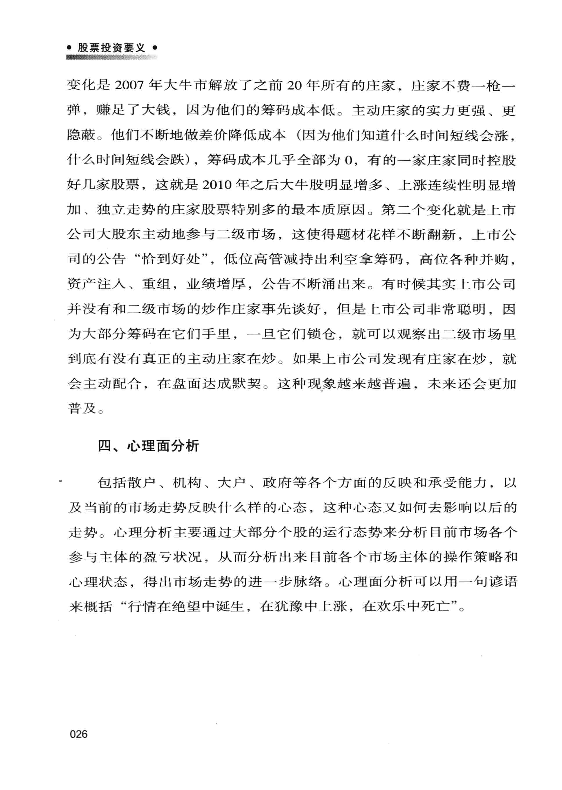

</details>

<details>
<summary>展开完整 OCR 识别记录（含页眉、页码及图表文字）</summary>

```text
·股票投资要义?
变化是2007年大牛市解放了之前20年所有的庄家，庄家不费一枪一
弹，赚足了大钱，因为他们的筹码成本低。主动庄家的实力更强、更
隐蔽。他们不断地做差价降低成本（因为他们知道什么时间短线会涨，
什么时间短线会跌），筹码成本几乎全部为0，有的一家庄家同时控股
好几家股票，这就是2010年之后大牛股明显增多、上涨连续性明显增
加、独立走势的庄家股票特别多的最本质原因。第二个变化就是上市
公司大股东主动地参与二级市场，这使得题材花样不断翻新，上市公
司的公告“恰到好处”，低位高管减持出利空拿筹码，高位各种并购，
资产注人、重组，业绩增厚，公告不断涌出来。有时候其实上市公司
并没有和二级市场的炒作庄家事先谈好，但是上市公司非常聪明，因
为大部分筹码在它们手里，一旦它们锁仓，就可以观察出二级市场里
到底有没有真正的主动庄家在炒。如果上市公司发现有庄家在炒，就
会主动配合，在盘面达成默契。这种现象越来越普遍，未来还会更加
普及。
四、心理面分析
包括散户、机构、大户、政府等各个方面的反映和承受能力，以
及当前的市场走势反映什么样的心态，这种心态又如何去影响以后的
走势。心理分析主要通过大部分个股的运行态势来分析目前市场各个
参与主体的盈亏状况，从而分析出来目前各个市场主体的操作策略和
心理状态，得出市场走势的进一步脉络。心理面分析可以用一句谚语
来概括“行情在绝望中诞生，在犹豫中上涨，在欢乐中死亡”。
026
```

</details>

<a id="pdf-page-0034"></a>

### PDF 第 34 页｜正文第 27 页

[查看 PDF](30914975.pdf#page=34) · [原页图像](30914975.assets/page-0034.jpeg) · [OCR 坐标与置信度](30914975.assets/ocr/page-0034.json)

#### 第三节题材与大盘不同打法

**一、大盘的四种情况与打法**

对大盘，也分四种情况、四种打法。

第一种情况：市场具备价值，极其严重超跌。

比如2005年9月、2008年底、2013年底、2014年初，买一线蓝筹股（中信证券）、行业龙头股（中国远洋、露天煤业）、银华锐进、信诚500、申万进取。

第二种情况：市场人气已经极旺，严重癫疯、疯狂。

比如2007年530点到3000点再到6000点的过程中，2009年6月到8月，买二线蓝筹（平煤股份）。

第三种情况：强龙回首，强势股的第二波机会。

比如2008年4月、2009年11月，买前期强势股，越强势越好。笔者2008年4月操作的有紫鑫药业、隆平高科、新五丰。

第四种情况：指数中性，个股轮炒机会。

比如2010年11月到2011年3月、2013年6月到9月，买筹码集中，5根均线发散支撑上位横盘很久的，有螺旋桨更好。

**二、题材的判断**

如何判断一个题材的大小？

有人说，除了新闻，股票涨了，就叫题材；除了新闻，股票没涨，那就叫普通新闻。这事确实有点玄。根据笔者长久的经验和研究，对

<details>
<summary>展开原页图像</summary>

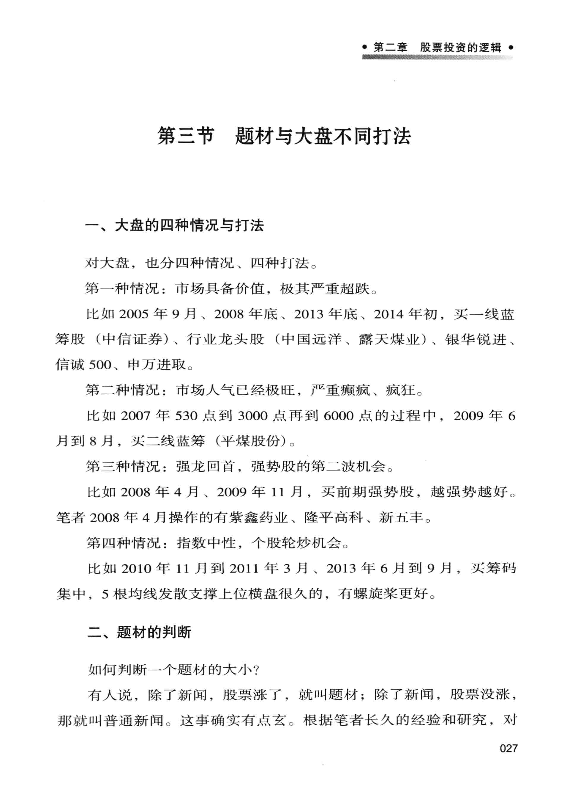

</details>

<details>
<summary>展开完整 OCR 识别记录（含页眉、页码及图表文字）</summary>

```text
·第二章股票投资的逻辑
第三节题材与大盘不同打法
一、大盘的四种情况与打法
对大盘，也分四种情况、四种打法。
第一种情况：市场具备价值，极其严重超跌。
比如2005年9月、2008年底、2013年底、2014年初，买一线蓝
筹股（中信证券）、行业龙头股（中国远洋、露天煤业）、银华锐进、
信诚500、申万进取。
第二种情况：市场人气已经极旺，严重癫疯、疯狂。
比如2007年530点到3000点再到6000点的过程中，2009年6
月到8月，买二线蓝筹（平煤股份）。
第三种情况：强龙回首，强势股的第二波机会。
比如2008年4月、2009年11月，买前期强势股，越强势越好。
笔者2008年4月操作的有紫鑫药业、隆平高科、新五丰。
第四种情况：指数中性，个股轮炒机会。
比如2010年11月到2011年3月、2013年6月到9月，买筹码
集中，5根均线发散支撑上位横盘很久的，有螺旋桨更好。
二、题材的判断
如何判断一个题材的大小？
有人说，除了新闻，股票涨了，就叫题材；除了新闻，股票没涨，
那就叫普通新闻。这事确实有点玄。根据笔者长久的经验和研究，对
027
```

</details>

<a id="pdf-page-0035"></a>

### PDF 第 35 页｜正文第 28 页

[查看 PDF](30914975.pdf#page=35) · [原页图像](30914975.assets/page-0035.jpeg) · [OCR 坐标与置信度](30914975.assets/ocr/page-0035.json)

于题材的判断，制作了一个算法，将复杂的财经新闻和题材判断用数学量化了一下：

**（一）题材条件（原表人工整理）**

| 烈度 | 三级 | 二级 | 一级 |
| --- | --- | --- | --- |
| 新闻标题 | 传言、据说、据传、传闻 | 拟、可能、准备、即将、未来、计划 | 正式、实施、颁布、发布、发行、下文、指示 |

| 发文层级 | 原表描述 |
| --- | --- |
| 一锤定音 | 高层领导人讲话、指示、视察等；国务院令，由国务院代表的国家发出的指令、号召、规划、全国人大审议的法律、行政命令、行政规定 |
| 二号指令 | 国务院部委特别是工信部、国资委、一行三会、发改委、财政部、国税总局、统计局这十大部委的新实行的条例和部门法规 |
| 三线建议 | 地方（31 个省、市、自治区、直辖市）法规、规定，发出的指令、号召、规划、立法的法律、行政命令、行政规定；其他国务院部委的、部委级的条例和部门法规 |

共 9 个级别：

| 题材条件新闻标题和发文单位 | 得分 |
| --- | --- |
| 一级一锤定音 | 10 分 |
| 二级一锤定音 | 9 分 |
| 三级一锤定音 | 8 分 |
| 一级二号指令 | 7 分 |
| 二级二号指令 | 6 分 |
| 三级二号指令 | 5 分 |
| 一级三线建议 | 4 分 |
| 二级三线建议 | 3 分 |
| 三级三线建议 | 2 分 |

**（二）盘面条件**

盘面条件的前提是根据设定好的行业和概念的直属以及关联股票作出判断：

| 盘面条件龙头股个数对应得分表 | 消息出的当天 | 消息出的次日 | 消息出的第三日 |
| --- | --- | --- | --- |
| 第一龙头（无论哪只）涨停板连续天数 | 1 只〔原表单位〕 | 2 只〔原表单位〕 | 3 只〔原表单位〕 |
| 龙头股个数（涨幅 >5%） | 3 只 | 5 只 | 10 只 |
| 得分（满足任何一个即可得分） | 2 分 | 4 分 | 6 分 |

> 整理注：保留原表“连续天数”与“只”的单位冲突；本表描述 2015 年作者的分类，不表示今天的机构设置。下一页承接“12 分以上”的原文判据。


<details>
<summary>展开原页图像</summary>

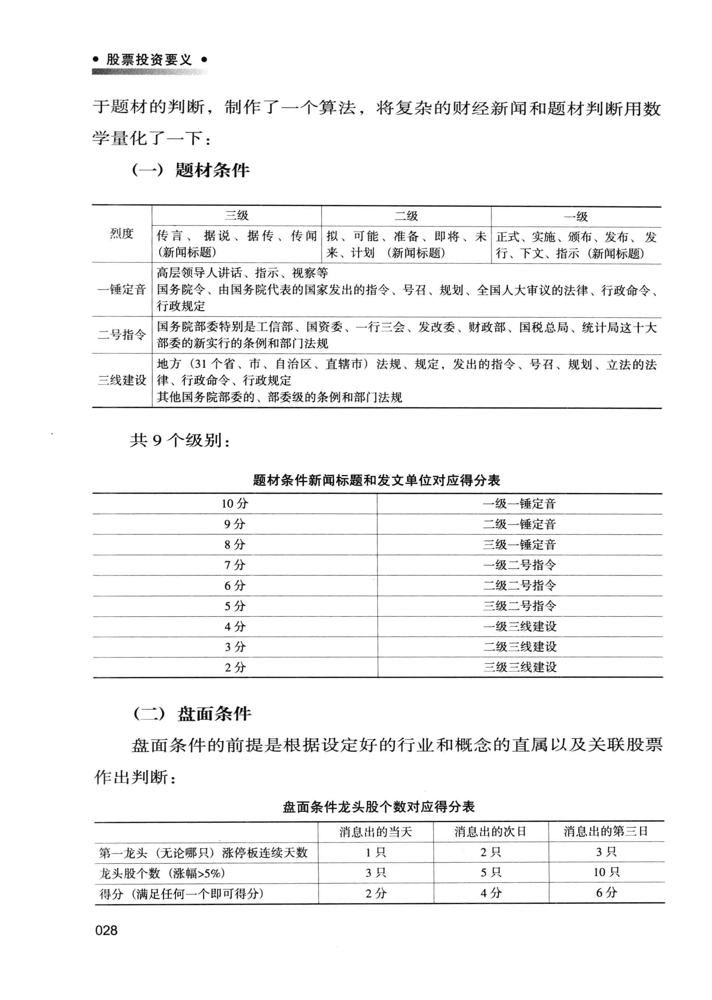

</details>

<details>
<summary>展开完整 OCR 识别记录（含页眉、页码及图表文字）</summary>

```text
·股票投资要义
于题材的判断，制作了一个算法，将复杂的财经新闻和题材判断用数
学量化了一下：
（一）题材条件
三级
二级
一级
烈度
传言、据说、据传、传闻拟、可能、准备、即将、未
正式、实施、颁布、发布、发
（新闻标题）
来、计划 (新闻标题)
行、下文、指示（新闻标题）
高层领导人讲话、指示、视察等
一锤定音
国务院令、由国务院代表的国家发出的指令、号召、规划、全国人大审议的法律、行政命令、
行政规定
国务院部委特别是工信部、国资委、一行三会、发改委、财政部、国税总局、统计局这十大
二号指令
部委的新实行的条例和部门法规
地方（31个省、市、自治区、直辖市）法规、规定，发出的指令、号召、规划、立法的法
三线建设
律、行政命令、行政规定
其他国务院部委的、部委级的条例和部门法规
共9个级别：
题材条件新闻标题和发文单位对应得分表
10分
一级一锤定音
9分
二级一锤定音
8分
三级一锤定音
7分
一级二号指令
6分
二级二号指令
5分
三级二号指令
4分
一级三线建设
3分
二级三线建设
2分
三级三线建设
（二）盘面条件
盘面条件的前提是根据设定好的行业和概念的直属以及关联股票
作出判断：
盘面条件龙头股个数对应得分表
消息出的当天
消息出的次日
消息出的第三日
第一龙头（无论哪只）涨停板连续天数
1只
2只
3只
龙头股个数（涨幅>5%）
3只
5只
10只
得分（满足任何一个即可得分）
2分
4分
6分
028
```

</details>

<a id="pdf-page-0036"></a>

### PDF 第 36 页｜正文第 29 页

[查看 PDF](30914975.pdf#page=36) · [原页图像](30914975.assets/page-0036.jpeg) · [OCR 坐标与置信度](30914975.assets/ocr/page-0036.json)

“题材条件得分与盘面条件得分”，两者相加即为总得分，得分12分以上为合格。这个题材成立，会有中线行情，可以重仓买进，不够12分的题材根本不成立，忽略之。

#### 第四节不同市况的不同操作策略

股市里只有两种操作：持股和持币。在经过数轮牛熊周期，特别是牛熊大周期之后，笔者深深地明白，牛市持股、熊市持币就是最厉害的操作策略。关键是你要知道什么时候是牛，什么时候是熊，这个问题本书第一章已经解决了，所以操作策略就有了完备性。知道了什么时候是牛市，什么时候是熊市，操作就简单得多了。

**一、大牛市的操作策略**

逢大牛市，特别是尾数为“5”、“6”、“7”的大牛市，总体操作策略是“只买不卖”，要全部清仓只有一种情况，你确认大牛市已经结束，大牛市结束一般都是在逢“7”的年份的下半年，那时全市场找不到市盈率低于50的股票，股价50元的股票都算是低价股，只有出现这种情况，才要肴清仓离场，否则应该以持股待涨为主。

逢大牛市如何换股？换股的一个最重要条件就是持股涨幅超过200%，如果持股涨幅是100%，那它很可能还会再很快地继续涨到200%甚至300%；所以，一个翻倍的股票在牛市初期才是应该持有的，才是应该值得拿住的，如果手里的某只股票涨了200%，可以考虑换股。

历史无数次地证明，玩短线的是人不了门的选手。我们做一只股票，就做从A点到B点的行情，比如从10元到30元、从50元到100

<details>
<summary>展开原页图像</summary>

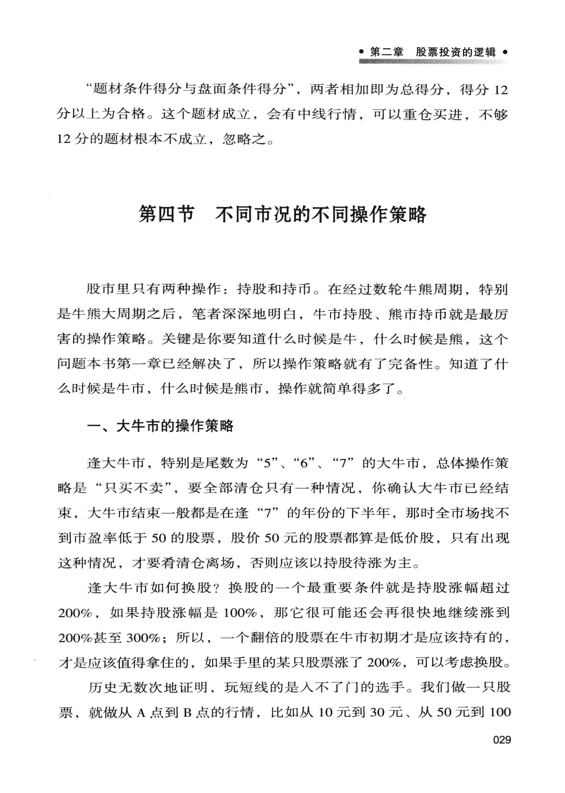

</details>

<details>
<summary>展开完整 OCR 识别记录（含页眉、页码及图表文字）</summary>

```text
·第二章股票投资的逻辑·
“题材条件得分与盘面条件得分”，两者相加即为总得分，得分12
分以上为合格。这个题材成立，会有中线行情，可以重仓买进，不够
12分的题材根本不成立，忽略之。
第四节不同市况的不同操作策略
股市里只有两种操作：持股和持币。在经过数轮牛熊周期，特别
是牛熊大周期之后，笔者深深地明白，牛市持股、熊市持币就是最厉
害的操作策略。关键是你要知道什么时候是牛，什么时候是熊，这个
问题本书第一章已经解决了，所以操作策略就有了完备性。知道了什
么时候是牛市，什么时候是熊市，操作就简单得多了。
一、大牛市的操作策略
逢大牛市，特别是尾数为“5”、“6”、“7”的大牛市，总体操作策
略是“只买不卖”，要全部清仓只有一种情况，你确认大牛市已经结
束，大牛市结束一般都是在逢“7”的年份的下半年，那时全市场找不
到市盈率低于50的股票，股价50元的股票都算是低价股，只有出现
这种情况，才要肴清仓离场，否则应该以持股待涨为主。
逢大牛市如何换股？换股的一个最重要条件就是持股涨幅超过
200%，如果持股涨幅是100%，那它很可能还会再很快地继续涨到
200%甚至300%；所以，一个翻倍的股票在牛市初期才是应该持有的，
才是应该值得拿住的，如果手里的某只股票涨了200%，可以考虑换股。
历史无数次地证明，玩短线的是人不了门的选手。我们做一只股
票，就做从A点到B点的行情，比如从10元到30元、从50元到100
029
```

</details>

<a id="pdf-page-0037"></a>

### PDF 第 37 页｜正文第 30 页

[查看 PDF](30914975.pdf#page=37) · [原页图像](30914975.assets/page-0037.jpeg) · [OCR 坐标与置信度](30914975.assets/ocr/page-0037.json)

元的这段。中间的过程是复杂、曲折的，我们不去管它。要注重目标位管理而不是根据图表随机地追涨杀跌。

目标位设定：大牛市所有的股票都会翻3~12倍。庄股的目标位为成本价的3倍；优质股的自标位是股价让市盈率翻3倍，比如从15倍市盈率翻到45倍市盈率。

换股最主要的是大小股票之间的切换，不是热点之间的切换，大盘股猛涨持有大盘股，中小盘股猛涨就持有小盘股，大盘股内部和中小盘股内部不宜作过多切换。

牛市里不要讲什么调整，不看指数，只选牛股拿牛股，指数调整必然意味着市场风格切换，可以适当换股。

牛市里就应该逢大阴线大买，小阴线小买。笔者在大牛市里最惨痛的教训就是过早地抛出手里的筹码去追逐所谓的“热点”、“主升浪”，这样追来追去浪费了时机，得不偿失。越跌越买，账户里不能有闲钱。

利润=重仓投人+持有时间。再大的行情，拿不住单子就赚不到钱，拿个三天两天走了，永远不人流。大家往往重视“重仓投人”，而忽视了“持有时间”。重仓进出最不可取，资金滚动的次数才重要！

为什么在大牛市里大部分人没有赚到钱？

笔者认为有三个原因：

第一，你能否确认这是大牛市。你真的确认吗？比如现在是3000点，你确认是大牛市吗？如果你确认的话，目标点位是多少（上一轮大牛市很多是在6000点才确认大牛市的，看到10000点，悲剧）？这点是关键，是关键的关键。

如果你确认它是大牛市，假设你看到12000点，请记住，笔者是说假设（关于是否是大牛市，笔者有自己的看法），那最好的操作策略是什么？

很简单啊，有9000点的利润空间，买进股指，或者等同于股指的

<details>
<summary>展开原页图像</summary>

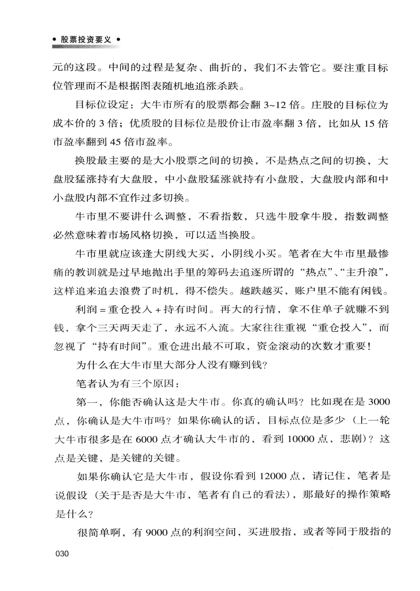

</details>

<details>
<summary>展开完整 OCR 识别记录（含页眉、页码及图表文字）</summary>

```text
·股票投资要义·
元的这段。中间的过程是复杂、曲折的，我们不去管它。要注重目标
位管理而不是根据图表随机地追涨杀跌。
目标位设定：大牛市所有的股票都会翻3~12倍。庄股的目标位为
成本价的3倍；优质股的自标位是股价让市盈率翻3倍，比如从15倍
市盈率翻到45倍市盈率。
换股最主要的是大小股票之间的切换，不是热点之间的切换，大
盘股猛涨持有大盘股，中小盘股猛涨就持有小盘股，大盘股内部和中
小盘股内部不宜作过多切换。
牛市里不要讲什么调整，不看指数，只选牛股拿牛股，指数调整
必然意味着市场风格切换，可以适当换股。
牛市里就应该逢大阴线大买，小阴线小买。笔者在大牛市里最惨
痛的教训就是过早地抛出手里的筹码去追逐所谓的“热点”、“主升浪”，
这样追来追去浪费了时机，得不偿失。越跌越买，账户里不能有闲钱。
利润=重仓投人+持有时间。再大的行情，拿不住单子就赚不到
钱，拿个三天两天走了，永远不人流。大家往往重视“重仓投人”，而
忽视了“持有时间”。重仓进出最不可取，资金滚动的次数才重要！
为什么在大牛市里大部分人没有赚到钱？
笔者认为有三个原因：
第一，你能否确认这是大牛市。你真的确认吗？比如现在是3000
点，你确认是大牛市吗？如果你确认的话，目标点位是多少（上一轮
大牛市很多是在6000点才确认大牛市的，看到10000点，悲剧）？这
点是关键，是关键的关键。
如果你确认它是大牛市，假设你看到12000点，请记住，笔者是
说假设（关于是否是大牛市，笔者有自己的看法），那最好的操作策略
是什么？
很简单啊，有9000点的利润空间，买进股指，或者等同于股指的
030
```

</details>

<a id="pdf-page-0038"></a>

### PDF 第 38 页｜正文第 31 页

[查看 PDF](30914975.pdf#page=38) · [原页图像](30914975.assets/page-0038.jpeg) · [OCR 坐标与置信度](30914975.assets/ocr/page-0038.json)

东西，抱紧直到达到12000点。可惜很多人不是这么做的，他认为自己够聪明，可以赚到每一个波段，抓住每一只牛股，可以高抛每一个顶点，低吸在每一个涨停前夜。

第二，笔者想告诉大家，很多股票最安全的买点是涨幅达到100%以后，傻了吧，不是说不追高吗？

证券市场的疯狂性就在于此，500年前，在世界上第一个股票市场诞生地荷兰，一株郁金香都能炒到换取一栋豪宅，还有什么事情是不可能发生的。这是一对疯狂与理性的矛盾，你有几多疯狂，就会先赚后赔；你有几多理性，就会先踏空后赔；你有几多傻瓜，就能多少赚点。装傻吧，在几亿人中，只有做个傻瓜才能多少赚点钱，你别去嘲笑傻瓜，那样你赚不到钱。

牛市里一切都有可能发生！大部分人是倒金字塔建仓，开始都是试探性地建仓，到最后猛涨了，重仓，一回调，输进去了。正确的是，刚开始时重仓，每涨2000点或者1000点减一次仓，直至减光。现在该多重仓？

第三，频繁换股，临盘选股，追涨停板。事实是牛市不炒股票才能赚钱，不操作才能赚钱。一轮大牛市操作次数低于10次，可以翻30倍，操作次数低于5次，可以翻50倍，操作次数低于3次，可以翻100倍。这些都是无数先烈的英勇斗争才换回来的教训，都是无数牛熊市切换的风霜才换回来的教训，都是百岁老人吃过的盐比你吃过的饭还多才换回来的教训。

一场大戏就要上演，满纸荒唐言，一把辛酸泪，谁解其中味？

牛市的具体操作方法有三种：

第一种：70%仓位做能翻3倍以上的大牛股。30%的资金做短线的主升浪股。

主要的资金长线捂股不动，短线的资金不断进人主升浪，至少也

<details>
<summary>展开原页图像</summary>

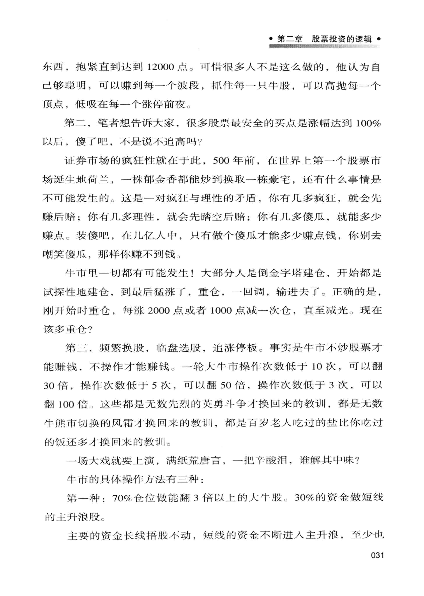

</details>

<details>
<summary>展开完整 OCR 识别记录（含页眉、页码及图表文字）</summary>

```text
·第二章股票投资的逻辑
东西，抱紧直到达到12000点。可惜很多人不是这么做的，他认为自
己够聪明，可以赚到每一个波段，抓住每一只牛股，可以高抛每一个
顶点，低吸在每一个涨停前夜。
第二，笔者想告诉大家，很多股票最安全的买点是涨幅达到100%
以后，傻了吧，不是说不追高吗？
证券市场的疯狂性就在于此，500年前，在世界上第一个股票市
场诞生地荷兰，一株郁金香都能炒到换取一栋豪宅，还有什么事情是
不可能发生的。这是一对疯狂与理性的矛盾，你有几多疯狂，就会先
赚后赔；你有几多理性，就会先踏空后赔；你有几多傻瓜，就能多少
赚点。装傻吧，在几亿人中，只有做个傻瓜才能多少赚点钱，你别去
嘲笑傻瓜，那样你赚不到钱。
牛市里一切都有可能发生！大部分人是倒金字塔建仓，开始都是
试探性地建仓，到最后猛涨了，重仓，一回调，输进去了。正确的是，
刚开始时重仓，每涨2000点或者1000点减一次仓，直至减光。现在
该多重仓？
第三，频繁换股，临盘选股，追涨停板。事实是牛市不炒股票才
能赚钱，不操作才能赚钱。一轮大牛市操作次数低于10次，可以翻
30倍，操作次数低于5次，可以翻50倍，操作次数低于3次，可以
翻100倍。这些都是无数先烈的英勇斗争才换回来的教训，都是无数
牛熊市切换的风霜才换回来的教训，都是百岁老人吃过的盐比你吃过
的饭还多才换回来的教训。
一场大戏就要上演，满纸荒唐言，一把辛酸泪，谁解其中味？
牛市的具体操作方法有三种：
第一种：70%仓位做能翻3倍以上的大牛股。30%的资金做短线
的主升浪股。
主要的资金长线捂股不动，短线的资金不断进人主升浪，至少也
031
```

</details>

<a id="pdf-page-0039"></a>

### PDF 第 39 页｜正文第 32 页

[查看 PDF](30914975.pdf#page=39) · [原页图像](30914975.assets/page-0039.jpeg) · [OCR 坐标与置信度](30914975.assets/ocr/page-0039.json)

是两三个涨停板。

任何一个行情的铁律都是“一段简单的趋势+一段复杂的调整”，因此，做完一只股票的主升浪必须退出，在一段时期内不要反复再次进场这只股票，调整的时间会很长。所谓的节奏的定义就是“从一个主升浪到另一个主升浪”。

第二种：100%资金做翻倍大牛股，一旦牛股进人调整期，立即退出，介人另外一只有翻番潜力的大牛股。

一般大牛股都是控盘的，一旦进人调整期可能会调整很长时间，所以一定要回避调整期。翻番潜力的大牛股你有可能拿不住，那是因为你的买点不对，一定要对自已的买点进行优化再优化争取一进去就是主升浪。所有的容易抓住的主升浪都是从一个起点起来的，K线连续地在5根多头排列的均线上方出现小阳线、小阴线，实体逐渐变大，MACD黄白线从0轴下方上到0轴上方之后红柱子就连续放出，从来没绿过。

第三种：80%资金做一个中长线的投资组合或者做指数（分级基金、指数期货、ETF）；20%的资金追逐主升浪。

牛市其实大多数人很难跑赢指数，说起来你可能都不信，跑不赢指数的大有人在，因此80%的资金做指数，加上一点杠杆，真是一件最保险的事情。剩下的资金自由搏击，“主升浪+涨停板”，可以主动进攻一点。

**二、大熊市的操作策略**

大熊市没有操作策略，最重要的就是防守，空仓作固定收益，打新股放逆回购。

可以轻仓长线做空股指。

大盘极度超跌可以适当做反弹。

<details>
<summary>展开原页图像</summary>

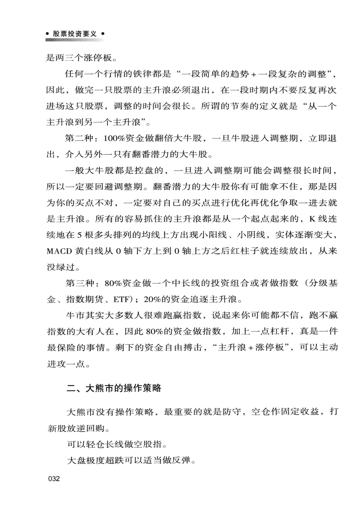

</details>

<details>
<summary>展开完整 OCR 识别记录（含页眉、页码及图表文字）</summary>

```text
·股票投资要义?
是两三个涨停板。
任何一个行情的铁律都是“一段简单的趋势+一段复杂的调整”，
因此，做完一只股票的主升浪必须退出，在一段时期内不要反复再次
进场这只股票，调整的时间会很长。所谓的节奏的定义就是“从一个
主升浪到另一个主升浪”。
第二种：100%资金做翻倍大牛股，一旦牛股进人调整期，立即退
出，介人另外一只有翻番潜力的大牛股。
一般大牛股都是控盘的，一旦进人调整期可能会调整很长时间，
所以一定要回避调整期。翻番潜力的大牛股你有可能拿不住，那是因
为你的买点不对，一定要对自已的买点进行优化再优化争取一进去就
是主升浪。所有的容易抓住的主升浪都是从一个起点起来的，K线连
续地在5根多头排列的均线上方出现小阳线、小阴线，实体逐渐变大，
MACD黄白线从0轴下方上到0轴上方之后红柱子就连续放出，从来
没绿过。
第三种：80%资金做一个中长线的投资组合或者做指数（分级基
金、指数期货、ETF）；20%的资金追逐主升浪。
牛市其实大多数人很难跑赢指数，说起来你可能都不信，跑不赢
指数的大有人在，因此80%的资金做指数，加上一点杠杆，真是一件
最保险的事情。剩下的资金自由搏击，“主升浪+涨停板”，可以主动
进攻一点。
二、大熊市的操作策略
大熊市没有操作策略，最重要的就是防守，空仓作固定收益，打
新股放逆回购。
可以轻仓长线做空股指。
大盘极度超跌可以适当做反弹。
032
```

</details>

<a id="pdf-page-0040"></a>

### PDF 第 40 页｜正文第 33 页

[查看 PDF](30914975.pdf#page=40) · [原页图像](30914975.assets/page-0040.jpeg) · [OCR 坐标与置信度](30914975.assets/ocr/page-0040.json)

#### 第五节交易心得

**一、交易应遵循的定理**

所有的交易错误，都是贪婪引起的，如果不贪，便不会有交易错误一一这一点务必万分注意！

恐惧最多让你踏空或者少赚点，贪婪才是毁灭之源。

“知行合一”：知行合一三个境界，知道自己知道，行动跟不上；知道自已知道，知指挥行，行动慢半拍；行动已经影响了结果，发现是自己无知。

“当下与预期”：预期是提前设好的，不能看着盘面谈预期。当下是指当下的价格，当下的价格你预期要涨就买，你预期要跌就卖。

“高与低”：高与低在一个阶段是绝对的，过了这个阶段就是相对的。

“舍不得平仓”：没有把握当下，总是说再涨我就卖，再跌我就买，不是根据当下做决策。

“急与缓”：缓才是正路。着急的操作都不是好操作。好的操作时机都会有充足的时间开平仓的，不管你使用任何周期。

“低接与高拍”：一旦到达一个平台、一个台阶，都可以高拍低接，走出一个新的趋势少则两周，多则2~6个月。

所有的大趋势行情的运行铁律就是“一段简单的趋势+一段复杂的调整（震荡）”，这就是节奏的定义。

假行情对应的情绪是恐惧；真行情对应的情绪是贪婪！

<details>
<summary>展开原页图像</summary>

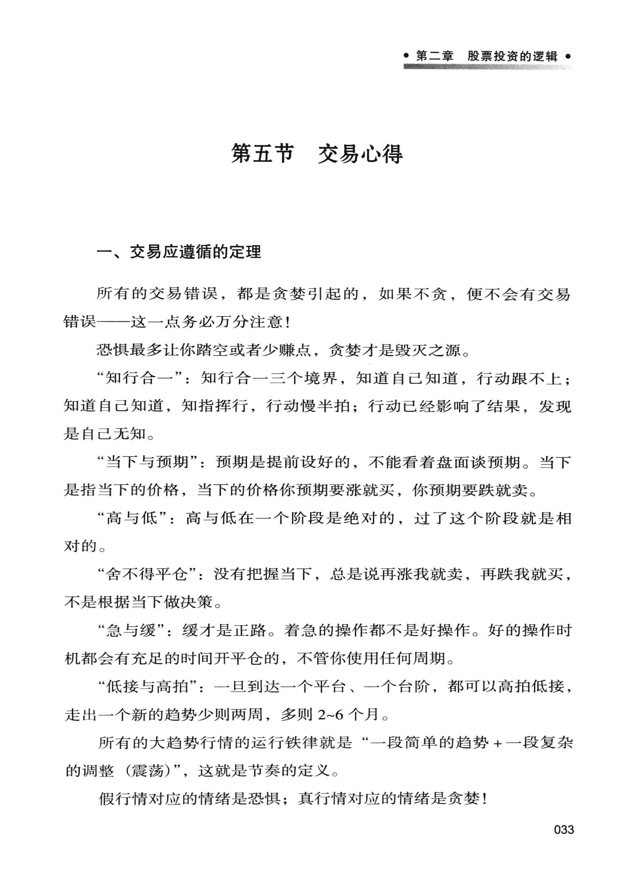

</details>

<details>
<summary>展开完整 OCR 识别记录（含页眉、页码及图表文字）</summary>

```text
·第二章股票投资的逻辑·
第五节交易心得
一、交易应遵循的定理
所有的交易错误，都是贪婪引起的，如果不贪，便不会有交易
错误一一这一点务必万分注意！
恐惧最多让你踏空或者少赚点，贪婪才是毁灭之源。
“知行合一”：知行合一三个境界，知道自己知道，行动跟不上；
知道自已知道，知指挥行，行动慢半拍；行动已经影响了结果，发现
是自己无知。
“当下与预期”：预期是提前设好的，不能看着盘面谈预期。当下
是指当下的价格，当下的价格你预期要涨就买，你预期要跌就卖。
“高与低”：高与低在一个阶段是绝对的，过了这个阶段就是相
对的。
“舍不得平仓”：没有把握当下，总是说再涨我就卖，再跌我就买，
不是根据当下做决策。
“急与缓”：缓才是正路。着急的操作都不是好操作。好的操作时
机都会有充足的时间开平仓的，不管你使用任何周期。
“低接与高拍”：一旦到达一个平台、一个台阶，都可以高拍低接，
走出一个新的趋势少则两周，多则2~6个月。
所有的大趋势行情的运行铁律就是“一段简单的趋势+一段复杂
的调整（震荡）”，这就是节奏的定义。
假行情对应的情绪是恐惧；真行情对应的情绪是贪婪！
033
```

</details>

<a id="pdf-page-0041"></a>

### PDF 第 41 页｜正文第 34 页

[查看 PDF](30914975.pdf#page=41) · [原页图像](30914975.assets/page-0041.jpeg) · [OCR 坐标与置信度](30914975.assets/ocr/page-0041.json)

那么第一条绝对应该遵循的定理就是在一段简单的趋势里，什么也不应该操作。就应该持仓。

第二条绝对应该遵循的定理就是：在一段复杂的调整（震荡），才涉及如何操作这个问题。

**二、投资中的问题**

关于如何操作，一系列的问题就来了，几乎所有投资的问题都集中爆发了：

第一，“买与卖”：预期要涨就买，预期要跌就卖（这真不是废话）；可以先买后卖，也可以先卖后买。买的时候一定买，否则将来无法卖，买错了怕什么，我们既然来到这个世界，就没想过活着离开。卖的时候一定卖，否则将来无法再买，卖错了无非少赚点，卖对了你可以庆幸一辈子。

第二，“先与后”：前面忘了买了，现在是卖的时刻，仍然可以先卖；前面忘了卖了，现在是买的时刻，仍然可以再买。

第三，“节奏”：判断出是趋势还是震荡就是最大的节奏，只有抓住同一个品种的节奏，才涉及其他品种的节奏，才涉及资金管理的节奏。没有单一的节奏，就没有后面的一切。

第四，“空间的大与小”：明知要涨，空间再小，哪怕只有50点，也要重仓。明知可能跌，哪怕未来涨的空间再大，也要先空仓。

第五，“恐惧与贪婪”：单子下进去，睡不着觉的单子不是好单子。犹豫浮盈太大该不该平仓的时刻就一定要平仓。

第六，“怕与不怕”：收益是对风险的奖励，建仓时不敢重仓，盼望着加仓或者补仓，那就是怕。

第七，“舍与得”：不做期货的风险比做期货的风险大得多。做生意，上班耗费的风险收益比完全不对称，亏大了。人来到世上，只有

<details>
<summary>展开原页图像</summary>

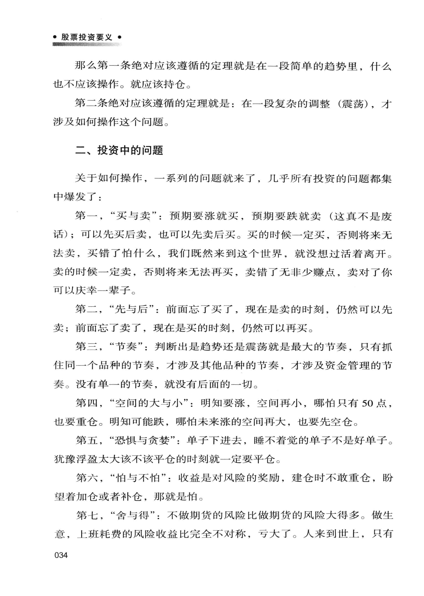

</details>

<details>
<summary>展开完整 OCR 识别记录（含页眉、页码及图表文字）</summary>

```text
·股票投资要义·
那么第一条绝对应该遵循的定理就是在一段简单的趋势里，什么
也不应该操作。就应该持仓。
第二条绝对应该遵循的定理就是：在一段复杂的调整（震荡），才
涉及如何操作这个问题。
二、投资中的问题
关于如何操作，一系列的问题就来了，几乎所有投资的问题都集
中爆发了：
第一，“买与卖”：预期要涨就买，预期要跌就卖（这真不是废
话）；可以先买后卖，也可以先卖后买。买的时候一定买，否则将来无
法卖，买错了怕什么，我们既然来到这个世界，就没想过活着离开。
卖的时候一定卖，否则将来无法再买，卖错了无非少赚点，卖对了你
可以庆幸一辈子。
第二，“先与后”：前面忘了买了，现在是卖的时刻，仍然可以先
卖；前面忘了卖了，现在是买的时刻，仍然可以再买。
第三，“节奏”：判断出是趋势还是震荡就是最大的节奏，只有抓
住同一个品种的节奏，才涉及其他品种的节奏，才涉及资金管理的节
奏。没有单一的节奏，就没有后面的一切。
第四，“空间的大与小”：明知要涨，空间再小，哪怕只有50点，
也要重仓。明知可能跌，哪怕未来涨的空间再大，也要先空仓。
第五，“恐惧与贪婪”：单子下进去，睡不着觉的单子不是好单子。
犹豫浮盈太大该不该平仓的时刻就一定要平仓。
第六，“怕与不怕”：收益是对风险的奖励，建仓时不敢重仓，盼
望着加仓或者补仓，那就是怕。
第七，“舍与得”：不做期货的风险比做期货的风险大得多。做生
意，上班耗费的风险收益比完全不对称，亏大了。人来到世上，只有
034
```

</details>

<a id="pdf-page-0042"></a>

### PDF 第 42 页｜正文第 35 页

[查看 PDF](30914975.pdf#page=42) · [原页图像](30914975.assets/page-0042.jpeg) · [OCR 坐标与置信度](30914975.assets/ocr/page-0042.json)

进人做期货（广义金融投资），才能让自己的风险收益比很高。

第八，“犹豫与果断”：单子进进出出是犹豫，简洁地一进一出是果断。如果真的犹豫了，就选择账户里的固定结果空仓，后面将会涌现出无数更好的机会。

第九，“对与错”：对与错的判断是主观的，操作其实没有对错。从某种意义上说，操作都是对的，止损了，你选择了损失，规避了更大的风险。减仓后朝目标价前行了，那是你选择了避免反向波动；增仓后回档了，利润略微回撤，那是为了后面更大的机会。操作里，没有对错，只有取舍，若你非要分出对错，那迟早会酿成大错。

第十，“空仓与持仓”：最基本的动作，节奏控制器。空仓，说明你马上要抓住下一个大机会。持仓，不管是不是大机会，都要小心地应对。是走是留，其实是“是生是死”的大问题。

有时候，行情是真行情；有时候，行情是假行情。

真行情经常是加速上涨，加速下跌；平稳上涨，平稳下跌；放量暴涨，放量暴跌。

假行情经常是趋势中的反向急涨急跌；震荡时期的假突破，诱多诱空；震荡末期的反向急速拉升或下坠。

真行情的操作策略以持仓和减仓为主。假行情的操作以加仓和建仓为主。

假行情因为走得虚假，所以第二天或者最迟第三天都会急剧回复到真行情上，所以假行情的判断和操作要及时，不能幻想，否则会继续扩大丧失操作机会。留给你的操作时间通常是不充分的，没有足够的反思和反应时间。

真行情因为走得太真，所以往往导致贪欲加大、人戏太深，往往会引发持仓不动甚至加仓，擅自扩大目标点位，从而在真行情结束时的“真的反向行情”中回撤。

<details>
<summary>展开原页图像</summary>

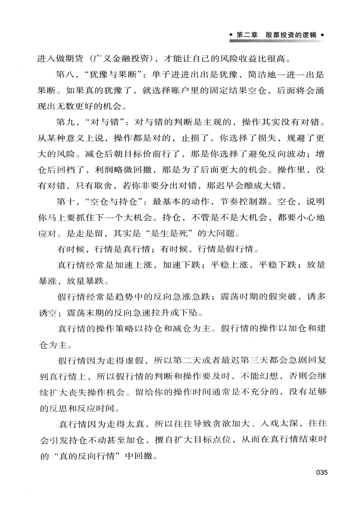

</details>

<details>
<summary>展开完整 OCR 识别记录（含页眉、页码及图表文字）</summary>

```text
·第二章股票投资的逻辑·
进人做期货（广义金融投资），才能让自己的风险收益比很高。
第八，“犹豫与果断”：单子进进出出是犹豫，简洁地一进一出是
果断。如果真的犹豫了，就选择账户里的固定结果空仓，后面将会涌
现出无数更好的机会。
第九，“对与错”：对与错的判断是主观的，操作其实没有对错。
从某种意义上说，操作都是对的，止损了，你选择了损失，规避了更
大的风险。减仓后朝目标价前行了，那是你选择了避免反向波动；增
仓后回档了，利润略微回撤，那是为了后面更大的机会。操作里，没
有对错，只有取舍，若你非要分出对错，那迟早会酿成大错。
第十，“空仓与持仓”：最基本的动作，节奏控制器。空仓，说明
你马上要抓住下一个大机会。持仓，不管是不是大机会，都要小心地
应对。是走是留，其实是“是生是死”的大问题。
有时候，行情是真行情；有时候，行情是假行情。
真行情经常是加速上涨，加速下跌；平稳上涨，平稳下跌；放量
暴涨，放量暴跌。
假行情经常是趋势中的反向急涨急跌；震荡时期的假突破，诱多
诱空；震荡末期的反向急速拉升或下坠。
真行情的操作策略以持仓和减仓为主。假行情的操作以加仓和建
仓为主。
假行情因为走得虚假，所以第二天或者最迟第三天都会急剧回复
到真行情上，所以假行情的判断和操作要及时，不能幻想，否则会继
续扩大丧失操作机会。留给你的操作时间通常是不充分的，没有足够
的反思和反应时间。
真行情因为走得太真，所以往往导致贪欲加大、人戏太深，往往
会引发持仓不动甚至加仓，擅自扩大目标点位，从而在真行情结束时
的“真的反向行情”中回撤。
035
```

</details>

<a id="pdf-page-0043"></a>

### PDF 第 43 页｜正文第 36 页

[查看 PDF](30914975.pdf#page=43) · [原页图像](30914975.assets/page-0043.jpeg) · [OCR 坐标与置信度](30914975.assets/ocr/page-0043.json)

假行情往往发生在建仓初期和一轮趋势行情的目标位前半段，以及前半段的震荡期。

真行情往往发生在趋势刚开始的那一段和一轮趋势行情的目标位后半段，特别是大行情的末尾。在大行情的末尾，都是大K线，这时，真作假时真亦假，不可人戏太深。

所有的大趋势行情的运行铁律就是“一段简单的趋势+一段复杂的调整（震荡）”，这就是节奏的定义。

假行情对应的情绪是恐惧；真行情对应的情绪是贪婪。

感性一点，假行情往往走得特别的吓人和恐怖。真行情往往走得特别的稳重和低调。

真行情的末期会演变成两种可能：一是假行情，二是真的反向行情。

假行情的结束没有其他的，只有一种可能，那就是真行情。

真实心得，能读懂的，一定会懂。

**三、常见的交易错误**

第一，明知已经犯错的情况下，无助持仓，被动傻等，不知道止损平仓。直面账户不逃避。

第二，在刚开始的时候恐惧，进进出出，拿不住单子。浪费建仓成本和子弹。

第三，在行情进人中局震荡的时候再次进进出出，拿不住单子。浪费建仓成本和子弹。

第四，在行情进人下半局的时候，死拿单子，加仓，不知道减仓。

第五，刚开始的时候轻仓，追着建仓，导致成本太高。

第六，不自信，看对不敢建仓，导致错过大行情。建仓要克服心理障碍，调整心态，克服建仓和平仓的心理障碍。

<details>
<summary>展开原页图像</summary>

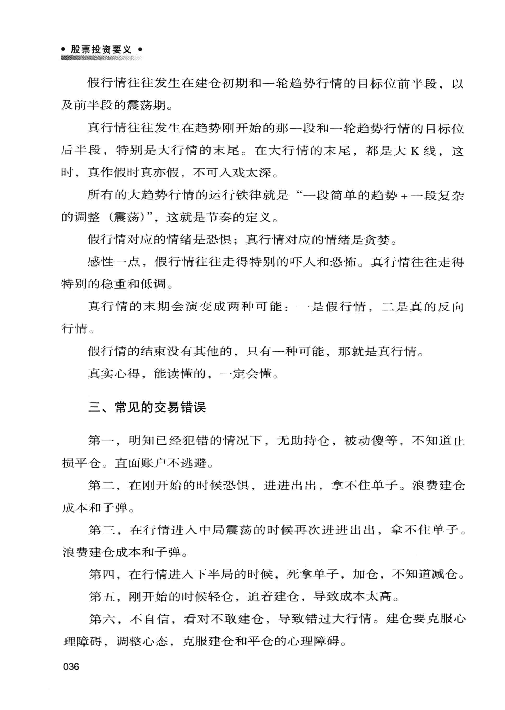

</details>

<details>
<summary>展开完整 OCR 识别记录（含页眉、页码及图表文字）</summary>

```text
·股票投资要义?
假行情往往发生在建仓初期和一轮趋势行情的目标位前半段，以
及前半段的震荡期。
真行情往往发生在趋势刚开始的那一段和一轮趋势行情的目标位
后半段，特别是大行情的末尾。在大行情的末尾，都是大K线，这
时，真作假时真亦假，不可人戏太深。
所有的大趋势行情的运行铁律就是“一段简单的趋势+一段复杂
的调整（震荡）”，这就是节奏的定义。
假行情对应的情绪是恐惧；真行情对应的情绪是贪婪。
感性一点，假行情往往走得特别的吓人和恐怖。真行情往往走得
特别的稳重和低调。
真行情的末期会演变成两种可能：一是假行情，二是真的反向
行情。
假行情的结束没有其他的，只有一种可能，那就是真行情。
真实心得，能读懂的，一定会懂。
三、常见的交易错误
第一，明知已经犯错的情况下，无助持仓，被动傻等，不知道止
损平仓。直面账户不逃避。
第二，在刚开始的时候恐惧，进进出出，拿不住单子。浪费建仓
成本和子弹。
第三，在行情进人中局震荡的时候再次进进出出，拿不住单子。
浪费建仓成本和子弹。
第四，在行情进人下半局的时候，死拿单子，加仓，不知道减仓。
第五，刚开始的时候轻仓，追着建仓，导致成本太高。
第六，不自信，看对不敢建仓，导致错过大行情。建仓要克服心
理障碍，调整心态，克服建仓和平仓的心理障碍。
036
```

</details>

<a id="pdf-page-0044"></a>

### PDF 第 44 页｜正文第 37 页

[查看 PDF](30914975.pdf#page=44) · [原页图像](30914975.assets/page-0044.jpeg) · [OCR 坐标与置信度](30914975.assets/ocr/page-0044.json)

**四、资金管理心得**

第一，建仓后（30%仓位）不加仓，到位后平仓一—简洁到极点，一进一出。

第二，盈利后反思与等待一个礼拜，防止回吐，这点一定要切记切记切记。

第三，增加耐心，在正确的时机（爆发点）建仓，建仓后不反复就直接爆发行情。

第四，只做有安全边界的确定性行情。

第五，少即是多，慢即是快，准即是狠。

**五、交易逻辑**

第一，基本面与技术面共振进场（其中有一点是贴近MACD的0轴的小K线进场，远离X的大K线出场或者减仓）。

第二，板块轮动决定是震荡还是趋势。

第三，出场点为震荡全出，趋势过目标位中线出一半。

第四，特别注意趋势与震荡的结合部，此时技术分析很有效（一段简单的趋势+一段复杂的震荡，就是所有的行情必然遵循的结构）。

第五，一个股票趋势为主，一个股票波段为辅。

第六，不被自已的观点和头寸绑架、辩护、影响。

<details>
<summary>展开原页图像</summary>

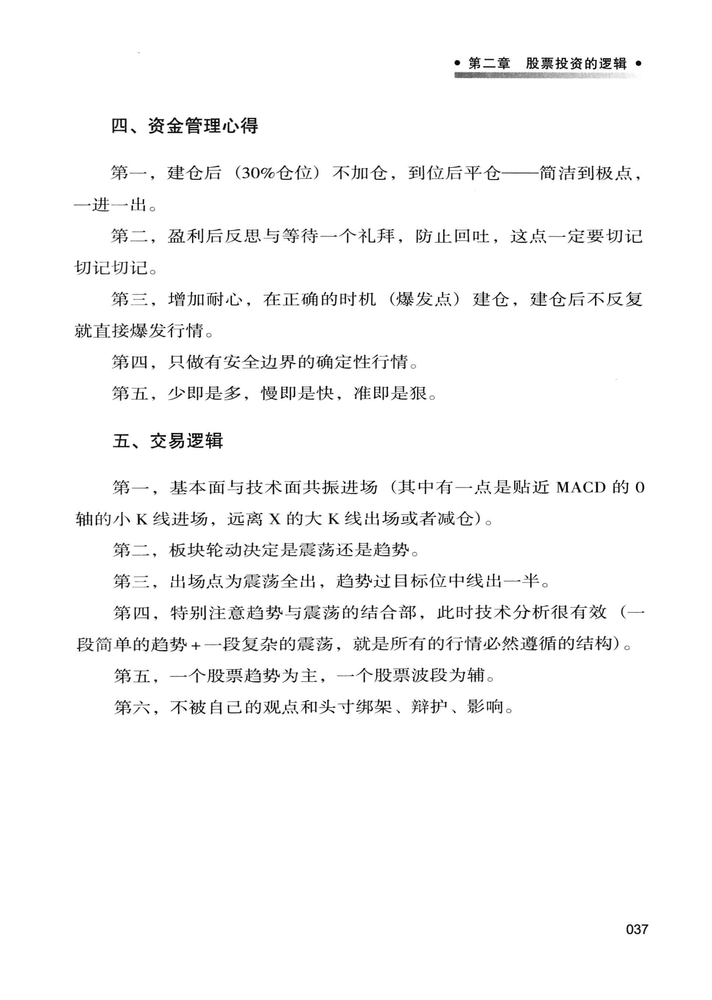

</details>

<details>
<summary>展开完整 OCR 识别记录（含页眉、页码及图表文字）</summary>

```text
·第二章股票投资的逻辑·
四、资金管理心得
第一，建仓后（30%仓位）不加仓，到位后平仓一—简洁到极点，
一进一出。
第二，盈利后反思与等待一个礼拜，防止回吐，这点一定要切记
切记切记。
第三，增加耐心，在正确的时机（爆发点）建仓，建仓后不反复
就直接爆发行情。
第四，只做有安全边界的确定性行情。
第五，少即是多，慢即是快，准即是狠。
五、交易逻辑
第一，基本面与技术面共振进场（其中有一点是贴近MACD的0
轴的小K线进场，远离X的大K线出场或者减仓）。
第二，板块轮动决定是震荡还是趋势。
第三，出场点为震荡全出，趋势过目标位中线出一半。
第四，特别注意趋势与震荡的结合部，此时技术分析很有效（一
段简单的趋势+一段复杂的震荡，就是所有的行情必然遵循的结构）。
第五，一个股票趋势为主，一个股票波段为辅。
第六，不被自已的观点和头寸绑架、辩护、影响。
037
```

</details>

<a id="pdf-page-0045"></a>

### PDF 第 45 页｜空白页，对应正文序列第 38 页

[查看 PDF](30914975.pdf#page=45) · [原页图像](30914975.assets/page-0045.jpeg) · [OCR 坐标与置信度](30914975.assets/ocr/page-0045.json)

本页为空白页，已人工查看原图确认。

<details>
<summary>展开原页图像</summary>


</details>

<details>
<summary>展开完整 OCR 识别记录（含页眉、页码及图表文字）</summary>

```text
〔未识别到文字；本页为空白页〕
```

</details>

<a id="pdf-page-0046"></a>

### PDF 第 46 页｜正文第 39 页

[查看 PDF](30914975.pdf#page=46) · [原页图像](30914975.assets/page-0046.jpeg) · [OCR 坐标与置信度](30914975.assets/ocr/page-0046.json)

#### 第三章两类最常见大牛股的操作模式

当你正确的时候，就要有做一头猪的勇气。

乔治·W.索罗斯

#### 第一节长线跨年度庄家大牛股的操作模式

**一、大牛股的产生条件**

哪些股票有潜力成为跨年度十倍大牛股？我们从两个角度来思考这个问题。第一个角度是大牛股产生的必要条件（非充分条件）是什么。第二个角度是假如你有100亿~200亿元资金，你要独立运作一只大牛股，或者一只股你想运作一波大行情，这需要什么条件。

首先，一只大牛股产生需要什么条件？笔者仔细研究了25年的沪深股市，每年选3只涨幅最大的股票，但又不是拿过去解释现在，发现这些大牛股有一些共同的原因、共同的必要条件。必要条件的意思就是缺了不行，但是有了不一定必须是大牛股。

这些条件是：

<details>
<summary>展开原页图像</summary>

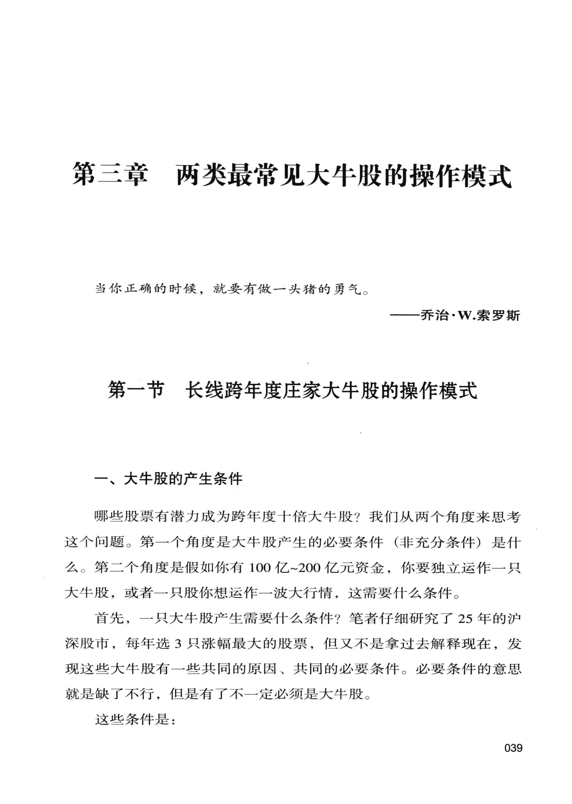

</details>

<details>
<summary>展开完整 OCR 识别记录（含页眉、页码及图表文字）</summary>

```text
第三章两类最常见大牛股的操作模式
当你正确的时候，就要有做一头猪的勇气。
乔治·W.索罗斯
第一节长线跨年度庄家大牛股的操作模式
一、大牛股的产生条件
哪些股票有潜力成为跨年度十倍大牛股？我们从两个角度来思考
这个问题。第一个角度是大牛股产生的必要条件（非充分条件）是什
么。第二个角度是假如你有100亿~200亿元资金，你要独立运作一只
大牛股，或者一只股你想运作一波大行情，这需要什么条件。
首先，一只大牛股产生需要什么条件？笔者仔细研究了25年的沪
深股市，每年选3只涨幅最大的股票，但又不是拿过去解释现在，发
现这些大牛股有一些共同的原因、共同的必要条件。必要条件的意思
就是缺了不行，但是有了不一定必须是大牛股。
这些条件是：
039
```

</details>

<a id="pdf-page-0047"></a>

### PDF 第 47 页｜正文第 40 页

[查看 PDF](30914975.pdf#page=47) · [原页图像](30914975.assets/page-0047.jpeg) · [OCR 坐标与置信度](30914975.assets/ocr/page-0047.json)

第一位：引领时代潮流，切合当时最热门的题材，媒体聚焦的主流大题材，是当时的新兴产业。过去的电子科技，现在的互联网+、

第二位：盘子不大，10亿流通盘就算大的，20亿以上的就很难产生超级大牛股。未来可以股本扩张送股，玩高送转。历史上很多超级大牛股都是流通盘在1亿~5亿股的。

第三位：业绩在牛股启动时间不好，但也不坏，是行业的中位数，但是庄家买进一年后业绩变好，两年后业绩达到高潮，随之退出。

那么如果你是一个庄家，或者说叫机构，或者叫主力，有一大笔资金，要起个庄，你选择哪些股票呢？

第一位：盘小，最好的5亿股流通以内或者上下，但是不能太小，低于1亿股算小的，因为低于1亿股不好进出，别的资金也不容易进来，没法运转。

第二位：既有未来两年的大题材，而这只股票有没有历史遗留问题，比如前面被大的庄家炒过，比如市场形象不好。

第三位：上市公司有切实的业绩支撑或者未来有条件改善业绩。这样股价到了高位，业绩提升+高送转+题材就可以完成出货而股价不至于大跌。

我们发现，客观条件和主观条件是契合的，这就是说遵循以下三个思路基本就可以挖掘出长线超级大牛股。

首先符合属于当时的新兴产业的股票数量是极其有限的，但是有一部分属于老产业套新概念，也可能产生超级大牛股。流通盘在5亿股以下，1亿股以上，又删选掉一大批。

业绩条件宽泛一些，这样你会说基本等于没选，还又是很多只。怎么办？

那好往下再进行两步，基本就OK了：

<details>
<summary>展开原页图像</summary>

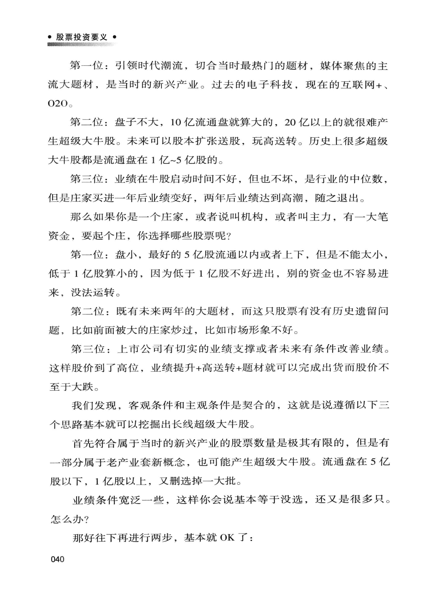

</details>

<details>
<summary>展开完整 OCR 识别记录（含页眉、页码及图表文字）</summary>

```text
·股票投资要义?
第一位：引领时代潮流，切合当时最热门的题材，媒体聚焦的主
流大题材，是当时的新兴产业。过去的电子科技，现在的互联网+、
020
第二位：盘子不大，10亿流通盘就算大的，20亿以上的就很难产
生超级大牛股。未来可以股本扩张送股，玩高送转。历史上很多超级
大牛股都是流通盘在1亿~5亿股的。
第三位：业绩在牛股启动时间不好，但也不坏，是行业的中位数，
但是庄家买进一年后业绩变好，两年后业绩达到高潮，随之退出。
那么如果你是一个庄家，或者说叫机构，或者叫主力，有一大笔
资金，要起个庄，你选择哪些股票呢？
第一位：盘小，最好的5亿股流通以内或者上下，但是不能太小，
低于1亿股算小的，因为低于1亿股不好进出，别的资金也不容易进
来，没法运转。
第二位：既有未来两年的大题材，而这只股票有没有历史遗留问
题，比如前面被大的庄家炒过，比如市场形象不好。
第三位：上市公司有切实的业绩支撑或者未来有条件改善业绩。
这样股价到了高位，业绩提升+高送转+题材就可以完成出货而股价不
至于大跌。
我们发现，客观条件和主观条件是契合的，这就是说遵循以下三
个思路基本就可以挖掘出长线超级大牛股。
首先符合属于当时的新兴产业的股票数量是极其有限的，但是有
一部分属于老产业套新概念，也可能产生超级大牛股。流通盘在5亿
股以下，1亿股以上，又删选掉一大批。
业绩条件宽泛一些，这样你会说基本等于没选，还又是很多只。
怎么办？
那好往下再进行两步，基本就OK了：
040
```

</details>

<a id="pdf-page-0048"></a>

### PDF 第 48 页｜正文第 41 页

[查看 PDF](30914975.pdf#page=48) · [原页图像](30914975.assets/page-0048.jpeg) · [OCR 坐标与置信度](30914975.assets/ocr/page-0048.json)

根据经验可以在股东列表里面选既有个人股东也有基金股东的。个人股东也要占一半，最好基金占一半，这样容易有大行情。

再下一步就更重要了：

在过去的半年内，这只股票的走势是不是独立于大盘？独立走势基本可以确定有人在买，甚至是连续买。

*图3-1*

*图3-1就是某只大牛股的独立走势，这是日线图，股价在这么多*

交易日内始终不理会大盘，缓慢地爬升，有机构建仓吸筹。

如果没有独立走势，那么就寻找规律走势，规律走势一般是指走势围绕着某个中轴线上下反复波动，显示出较强的人为控制因素。

*图3-2是某只大牛股启动前的规律走势。*

如果你筛选出的股票既有“规律走势”又有“独立走势”，我们可以判断这只股票会出大行情，这是最理想的。只要市场背景好，就有可能产生翻两倍以上的大行情。需要注意的是并不是所有既有“独立走势”又有“规律走势”的个股都会产生大行情。

<details>
<summary>展开原页图像</summary>

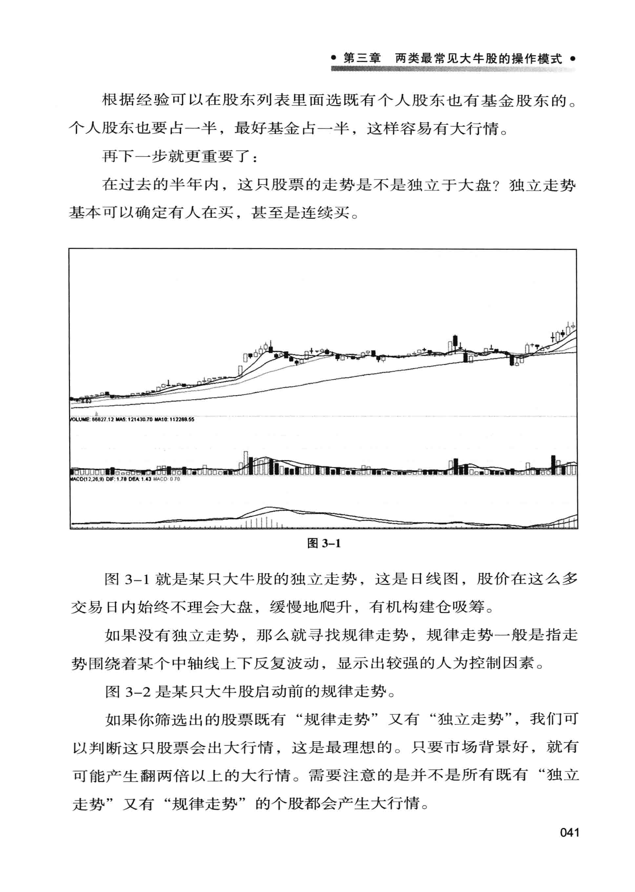

</details>

<details>
<summary>展开完整 OCR 识别记录（含页眉、页码及图表文字）</summary>

```text
·第三章两类最常见大牛股的操作模式?
根据经验可以在股东列表里面选既有个人股东也有基金股东的。
个人股东也要占一半，最好基金占一半，这样容易有大行情。
再下一步就更重要了：
在过去的半年内，这只股票的走势是不是独立于大盘？独立走势
基本可以确定有人在买，甚至是连续买。
JOLUME:86627.12MA5:121430.70MA10:112288.55
MACD(12,26.9)DIF:1.78DEA1.43MACD070
图3-1
图3-1就是某只大牛股的独立走势，这是日线图，股价在这么多
交易日内始终不理会大盘，缓慢地爬升，有机构建仓吸筹。
如果没有独立走势，那么就寻找规律走势，规律走势一般是指走
势围绕着某个中轴线上下反复波动，显示出较强的人为控制因素。
图3-2是某只大牛股启动前的规律走势。
如果你筛选出的股票既有“规律走势”又有“独立走势”，我们可
以判断这只股票会出大行情，这是最理想的。只要市场背景好，就有
可能产生翻两倍以上的大行情。需要注意的是并不是所有既有“独立
走势”又有“规律走势”的个股都会产生大行情。
041
```

</details>

<a id="pdf-page-0049"></a>

### PDF 第 49 页｜正文第 42 页

[查看 PDF](30914975.pdf#page=49) · [原页图像](30914975.assets/page-0049.jpeg) · [OCR 坐标与置信度](30914975.assets/ocr/page-0049.json)

*图3-2*

选出了具备超级大牛股可能的股票之后，就是买进持有。买进条件有三个，一是出现了“买点”（关于“买点”，本书会在第五章详细讲述），二是出现了“黄金坑”，三是回踩重要均线。

其实如果是在牛市背景，也即尾数为公元“4”、“5”、“6”、“7”、“9”的年份里，具备上述所有条件的股票几乎都有接近100%的确定性翻倍，有70%的可能翻两倍。有50%的可能翻三到四倍。

寻找大牛股只是让你有一个理由重仓而已。因为从哲学的角度讲，大部分散户不赚钱都是这边5000股那边5000股地乱玩，永远挣不到钱或者说挣不到大钱。赚钱=重仓投人+持有时间。利润是靠时间来展现的，持有不够一定的时间，涨幅走不出来，怎么赚钱？大牛股的持有周期一般都大于半年，在一年左右。你持有几周如何赚钱，更不要说几天了。

也即持有周期短必然挣不到钱。我们寻找超级大牛股是为了拉长你的持股周期（特别是在牛市），如果你已经是一位长线投资者，可以

<details>
<summary>展开原页图像</summary>

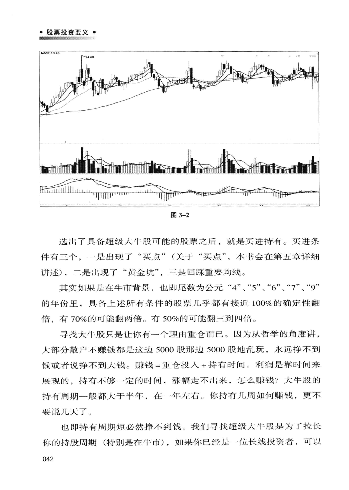

</details>

<details>
<summary>展开完整 OCR 识别记录（含页眉、页码及图表文字）</summary>

```text
·股票投资要义
图3-2
选出了具备超级大牛股可能的股票之后，就是买进持有。买进条
件有三个，一是出现了“买点”（关于“买点”，本书会在第五章详细
讲述），二是出现了“黄金坑”，三是回踩重要均线。
其实如果是在牛市背景，也即尾数为公元“4”、“5”、“6”、“7”、“9”
的年份里，具备上述所有条件的股票几乎都有接近100%的确定性翻
倍，有70%的可能翻两倍。有50%的可能翻三到四倍。
寻找大牛股只是让你有一个理由重仓而已。因为从哲学的角度讲，
大部分散户不赚钱都是这边5000股那边5000股地乱玩，永远挣不到
钱或者说挣不到大钱。赚钱=重仓投人+持有时间。利润是靠时间来
展现的，持有不够一定的时间，涨幅走不出来，怎么赚钱？大牛股的
持有周期一般都大于半年，在一年左右。你持有几周如何赚钱，更不
要说几天了。
也即持有周期短必然挣不到钱。我们寻找超级大牛股是为了拉长
你的持股周期（特别是在牛市），如果你已经是一位长线投资者，可以
042
```

</details>

<a id="pdf-page-0050"></a>

### PDF 第 50 页｜正文第 43 页

[查看 PDF](30914975.pdf#page=50) · [原页图像](30914975.assets/page-0050.jpeg) · [OCR 坐标与置信度](30914975.assets/ocr/page-0050.json)

在单只股票持仓一年甚至两年。你就更需要看这篇了，因为你只需要换一下股就能赚大钱。

好股票的筹码都是稀缺的，我们不能老是从涨跌的外在现象来观察股市，这样的话太肤浅，容易被来回洗，双向挨耳光。那么内在的信息人家又不透露给你，你的社会地位、综合资源也是有限的，不可能经常性地、稳定地、永远地获取一些比较好的牛股信息。那么怎么可以看出来一些“背后”的端倪呢？

20世纪90年代大家都在谈论和运作“吸一拉一派一落”，也即庄家运作一只股票要进行“吸货一拉升一派发一回落”四个必经过程。无论时代如何变迁，外形如何变形，这个过程的基本逻辑还是存在的。

如果你是庄，你一定会尽可能低地拿到足够多的筹码，拉升的过程锁住筹码，减少拉升成本，派发的时候才去对倒拉抬产生大阳线，最后一个涨停全部甩货，产生一根带上影的大阴线，这个流程很多人很熟悉。那么对应的，我们不知道庄在干什么，但是我们可以在买卖股票的时候根据“筹码的供应”来判断庄的意图、成本和阶段。如果你买一只有题材、价位适中、有上涨潜力但是不知道未来涨不涨，什么时候涨，涨多少的股票，假设你的资金是1000万元到3000万元，如果你很轻易地就建好了仓，那么恭喜你，你很有可能被套或者拿很久。如果你买到了部分筹码，但是第二天、第三天价位只是在原来的低价处轻轻碰一下就走了，而且你一买它就涨，盘面的筹码供应很稀少。这种股票就比较好，而且不用追着买，往往主力拉升一下就会洗盘几下，逢大阴线就接货，达到了自己的合理仓位就守仓即可。因为主力不想损失筹码，更不想有人买在比他低的位置，所以就会有时间往下打，但是不碰前面的密集建仓区，这股票就有希望。

<details>
<summary>展开原页图像</summary>

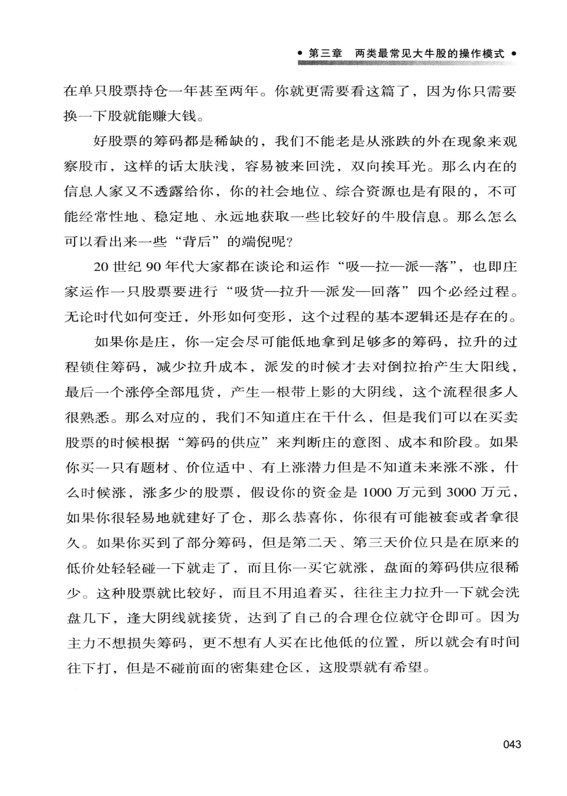

</details>

<details>
<summary>展开完整 OCR 识别记录（含页眉、页码及图表文字）</summary>

```text
·第三章两类最常见大牛股的操作模式·
在单只股票持仓一年甚至两年。你就更需要看这篇了，因为你只需要
换一下股就能赚大钱。
好股票的筹码都是稀缺的，我们不能老是从涨跌的外在现象来观
察股市，这样的话太肤浅，容易被来回洗，双向挨耳光。那么内在的
信息人家又不透露给你，你的社会地位、综合资源也是有限的，不可
能经常性地、稳定地、永远地获取一些比较好的牛股信息。那么怎么
可以看出来一些“背后”的端倪呢？
20世纪90年代大家都在谈论和运作“吸一拉一派一落”，也即庄
家运作一只股票要进行“吸货一拉升一派发一回落”四个必经过程。
无论时代如何变迁，外形如何变形，这个过程的基本逻辑还是存在的。
如果你是庄，你一定会尽可能低地拿到足够多的筹码，拉升的过
程锁住筹码，减少拉升成本，派发的时候才去对倒拉抬产生大阳线，
最后一个涨停全部甩货，产生一根带上影的大阴线，这个流程很多人
很熟悉。那么对应的，我们不知道庄在干什么，但是我们可以在买卖
股票的时候根据“筹码的供应”来判断庄的意图、成本和阶段。如果
你买一只有题材、价位适中、有上涨潜力但是不知道未来涨不涨，什
么时候涨，涨多少的股票，假设你的资金是1000万元到3000万元，
如果你很轻易地就建好了仓，那么恭喜你，你很有可能被套或者拿很
久。如果你买到了部分筹码，但是第二天、第三天价位只是在原来的
低价处轻轻碰一下就走了，而且你一买它就涨，盘面的筹码供应很稀
少。这种股票就比较好，而且不用追着买，往往主力拉升一下就会洗
盘几下，逢大阴线就接货，达到了自己的合理仓位就守仓即可。因为
主力不想损失筹码，更不想有人买在比他低的位置，所以就会有时间
往下打，但是不碰前面的密集建仓区，这股票就有希望。
043
```

</details>

<a id="pdf-page-0051"></a>

### PDF 第 51 页｜正文第 44 页

[查看 PDF](30914975.pdf#page=51) · [原页图像](30914975.assets/page-0051.jpeg) · [OCR 坐标与置信度](30914975.assets/ocr/page-0051.json)

**二、发现了大牛股，应该如何操作呢？**

第一类，建好了仓，守住了。但是行情是波动的，不断出现买点和卖点（这里买点和卖点的定义是因人而异的，每个人的定义不同，我把我的买卖点告诉你，你学不会，甚至看不懂，其实就是你自已认为的买点和卖点）。这时怎么办？最佳选择是不动。

第二类，如果行情波动非常大，到了非动不可的地步，怎么办？答案是默默地问自己：现在是买点还是卖点？现在是什么位置？如果是买点，把钱通通换成股票，哪怕小涨之后再抛一点留一点备用金。如果是卖点，手起刀落，把筹码通通套现，哪怕当日回跌当日接回。能买就要多买，你不买，日后怎么卖？大不了获利吐一点嘛！能多卖就要多卖，你不卖日后怎么有钱买回？买错了大不了少赚一个涨停板嘛！

第三类，如果操作错误导致情绪失控了怎么办？大家记住了，这里有一个天大的秘密和误区。很多人心态一旦坏了个开头就刹不住车，导致很长时间不挣钱。记住，在大行情里甚至在任何行情里，任何操作都不是绝对错误的。因为必然有更好的买点和卖点，必然有更好的位置、更舒服的操作。操作的“错”与“对”是事后主观认定的。很多人都在纠结，因此产生情绪，导致更大的错误，实在是可惜，这本身就是逻辑上的谬论。

第四类，如果确实要动而且已经动了，那么又感觉又错了，上次卖错了，这次接着卖，大概率是对的。上次买高了，这次接着买，大概率是对的。就这样，不纠错，特别是不事后纠错。

**三、如何判断主力的成本区？**

如果主力吸筹较为坚决，则涨时大幅放量，跌时急剧缩量将成为

<details>
<summary>展开原页图像</summary>

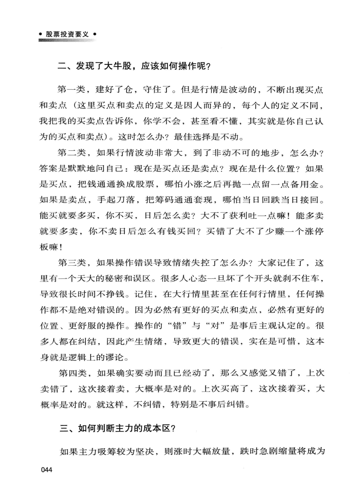

</details>

<details>
<summary>展开完整 OCR 识别记录（含页眉、页码及图表文字）</summary>

```text
·股票投资要义?
二、发现了大牛股，应该如何操作呢？
第一类，建好了仓，守住了。但是行情是波动的，不断出现买点
和卖点（这里买点和卖点的定义是因人而异的，每个人的定义不同，
我把我的买卖点告诉你，你学不会，甚至看不懂，其实就是你自已认
为的买点和卖点）。这时怎么办？最佳选择是不动。
第二类，如果行情波动非常大，到了非动不可的地步，怎么办？
答案是默默地问自己：现在是买点还是卖点？现在是什么位置？如果
是买点，把钱通通换成股票，哪怕小涨之后再抛一点留一点备用金。
如果是卖点，手起刀落，把筹码通通套现，哪怕当日回跌当日接回。
能买就要多买，你不买，日后怎么卖？大不了获利吐一点嘛！能多卖
就要多卖，你不卖日后怎么有钱买回？买错了大不了少赚一个涨停
板嘛！
第三类，如果操作错误导致情绪失控了怎么办？大家记住了，这
里有一个天大的秘密和误区。很多人心态一旦坏了个开头就刹不住车，
导致很长时间不挣钱。记住，在大行情里甚至在任何行情里，任何操
作都不是绝对错误的。因为必然有更好的买点和卖点，必然有更好的
位置、更舒服的操作。操作的“错”与“对”是事后主观认定的。很
多人都在纠结，因此产生情绪，导致更大的错误，实在是可惜，这本
身就是逻辑上的谬论。
第四类，如果确实要动而且已经动了，那么又感觉又错了，上次
卖错了，这次接着卖，大概率是对的。上次买高了，这次接着买，大
概率是对的。就这样，不纠错，特别是不事后纠错。
三、如何判断主力的成本区？
如果主力吸筹较为坚决，则涨时大幅放量，跌时急剧缩量将成为
044
```

</details>

<a id="pdf-page-0052"></a>

### PDF 第 52 页｜正文第 45 页

[查看 PDF](30914975.pdf#page=52) · [原页图像](30914975.assets/page-0052.jpeg) · [OCR 坐标与置信度](30914975.assets/ocr/page-0052.json)

建仓阶段成交量变化的主旋律。

尽管很多情况下，主力吸筹的动作会比较隐蔽，成交量变化的规律性并不明显，但也不是无踪可觅。

一个重要的手段就是观察成交量均线。如果成交量在均线附近频繁震动，股价上涨时成交量超出均线较多，而股价下跌时成交量低于均线较多，则该股就应被纳人密切关注的对象中。这表明，筹码正在连续不断地集中到主力手中。

需要注意的是，投资者从成交量的变化寻找“黑马”时，必须结合股价的变化进行分析。因为绝大部分股票中都有一些大户，他们的短线进出同样会导致成交量出现波动，关键是要把这种随机买卖所造成的波动与主力有意吸纳造成的波动区分开来。

我们知道，随机性波动不存在刻意打压股价的问题，成交量放出时股价容易出现跳跃式上升，而主力吸筹必然要压低买价，因此股价和成交量的上升有一定的连续性。依据这一原理，可以在成交量变化和股价涨跌之间建立某种联系，通过技术手段过滤掉那些股价跳跃式的成交量放大，了解真实的筹码集中情况。

目前市面上流行多种分析指标，不过一般来说，这种指标使用的范围越窄，效果就越好，因为一旦传播开来，容易被主力反技术操作。但无论如何，上述原理却是永恒适用的，因为主力无论如何掩饰，集中筹码是根本目标。

成交量堆积是另一个重要的观察对象，它对于判断主力的建仓成本有着重要作用。除了刚上市的新股外，大部分股票都有一个密集成交区域，股价要突破该区域就需要消耗大量的能量，而它也就成为主力重要的建仓区域，往往可以在此处以相对较低的成本收集到大量筹码。

所以，那些刚刚突破历史上重要套牢区，并且在以下区域内累积

<details>
<summary>展开原页图像</summary>


</details>

<details>
<summary>展开完整 OCR 识别记录（含页眉、页码及图表文字）</summary>

```text
?第三章两类最常见大牛股的操作模式
建仓阶段成交量变化的主旋律。
尽管很多情况下，主力吸筹的动作会比较隐蔽，成交量变化的规
律性并不明显，但也不是无踪可觅。
一个重要的手段就是观察成交量均线。如果成交量在均线附近频
繁震动，股价上涨时成交量超出均线较多，而股价下跌时成交量低于
均线较多，则该股就应被纳人密切关注的对象中。这表明，筹码正在
连续不断地集中到主力手中。
需要注意的是，投资者从成交量的变化寻找“黑马”时，必须结
合股价的变化进行分析。因为绝大部分股票中都有一些大户，他们的
短线进出同样会导致成交量出现波动，关键是要把这种随机买卖所造
成的波动与主力有意吸纳造成的波动区分开来。
我们知道，随机性波动不存在刻意打压股价的问题，成交量放出
时股价容易出现跳跃式上升，而主力吸筹必然要压低买价，因此股价
和成交量的上升有一定的连续性。依据这一原理，可以在成交量变化
和股价涨跌之间建立某种联系，通过技术手段过滤掉那些股价跳跃式
的成交量放大，了解真实的筹码集中情况。
目前市面上流行多种分析指标，不过一般来说，这种指标使用的
范围越窄，效果就越好，因为一旦传播开来，容易被主力反技术操作。
但无论如何，上述原理却是永恒适用的，因为主力无论如何掩饰，集
中筹码是根本目标。
成交量堆积是另一个重要的观察对象，它对于判断主力的建仓成
本有着重要作用。除了刚上市的新股外，大部分股票都有一个密集成
交区域，股价要突破该区域就需要消耗大量的能量，而它也就成为主
力重要的建仓区域，往往可以在此处以相对较低的成本收集到大量
筹码。
所以，那些刚刚突破历史上重要套牢区，并且在以下区域内累积
045
```

</details>

<a id="pdf-page-0053"></a>

### PDF 第 53 页｜正文第 46 页

[查看 PDF](30914975.pdf#page=53) · [原页图像](30914975.assets/page-0053.jpeg) · [OCR 坐标与置信度](30914975.assets/ocr/page-0053.json)

成交量创出历史新高的个股，就非常值得关注，因为它表明新买进主力的实力远胜于以往，其建仓成本也较高，如果后市没有较大空间，大资金是不会轻易为场内资金解套的。

但如果累积成交量并不大，即所谓“轻松过顶”，则需要提高警惕，因为这往往系原有主力所为，由于筹码已有大量积累，使得拉拾较为轻松。尽管这并不一定意味着股价不能创出新高，但主力的成本无疑比表面看到的要低一些，因此，操作时需要更加重视风险控制，股市整体走势趋弱时尤其需要谨慎。

需要指出的是，在主力开始建仓后，某一区域的成交量越密集，则主力的建仓成本就越靠近这一区域，因为无论是真实买人还是主力对敲，均需耗费成本。密集成交区也就是主力最重要的成本区，累积成交量和换手率越高，则主力的筹码积累就越充分，而且往往实力也较强，此类股票一旦时机成熟，往往有可能一鸣惊人，成为一匹“超级大黑马”！

一般而言，庄股的目标位是成本价的3倍。

**四、操作大庄牛股应该具备的气魄和精神面貌**

[蒋介石]徐州地方，历代大规模征战五十余次，是非曲直难以论说，但史家无不注意到，正是这个古战场决定了多少代王朝的盛衰兴亡、此兴彼落，所以古来就有问鼎中原之说。

[毛泽东]战役发起以前，对隔断徐州、蚌埠，完全孤立徐州这么一大坨敌人，我们尚不敢做这种估计。对黄维兵团加入淮海战场，我们一直很担心。现在看来，正是蒋介石破釜沉舟的时候，他调集了他最大的一个战略集团，因此南线战略决战才显得这样非同小可，这样有声有色。

[蒋介石]当年先总理领革命军，分三路会合徐州，兴师北上，光

<details>
<summary>展开原页图像</summary>


</details>

<details>
<summary>展开完整 OCR 识别记录（含页眉、页码及图表文字）</summary>

```text
·股票投资要义?
成交量创出历史新高的个股，就非常值得关注，因为它表明新买进主
力的实力远胜于以往，其建仓成本也较高，如果后市没有较大空间，
大资金是不会轻易为场内资金解套的。
但如果累积成交量并不大，即所谓“轻松过顶”，则需要提高警
惕，因为这往往系原有主力所为，由于筹码已有大量积累，使得拉拾
较为轻松。尽管这并不一定意味着股价不能创出新高，但主力的成本
无疑比表面看到的要低一些，因此，操作时需要更加重视风险控制，
股市整体走势趋弱时尤其需要谨慎。
需要指出的是，在主力开始建仓后，某一区域的成交量越密集，
则主力的建仓成本就越靠近这一区域，因为无论是真实买人还是主力
对敲，均需耗费成本。密集成交区也就是主力最重要的成本区，累积
成交量和换手率越高，则主力的筹码积累就越充分，而且往往实力也
较强，此类股票一旦时机成熟，往往有可能一鸣惊人，成为一匹“超
级大黑马”！
一般而言，庄股的目标位是成本价的3倍。
四、操作大庄牛股应该具备的气魄和精神面貌
[蒋介石]徐州地方，历代大规模征战五十余次，是非曲直难以论
说，但史家无不注意到，正是这个古战场决定了多少代王朝的盛衰兴
亡、此兴彼落，所以古来就有问鼎中原之说。
[毛泽东]战役发起以前，对隔断徐州、蚌埠，完全孤立徐州这么
一大坨敌人，我们尚不敢做这种估计。对黄维兵团加入淮海战场，我
们一直很担心。现在看来，正是蒋介石破釜沉舟的时候，他调集了他
最大的一个战略集团，因此南线战略决战才显得这样非同小可，这样
有声有色。
[蒋介石]当年先总理领革命军，分三路会合徐州，兴师北上，光
046
```

</details>

<a id="pdf-page-0054"></a>

### PDF 第 54 页｜正文第 47 页

[查看 PDF](30914975.pdf#page=54) · [原页图像](30914975.assets/page-0054.jpeg) · [OCR 坐标与置信度](30914975.assets/ocr/page-0054.json)

复徐州的第二天，清帝见大势已去，宣告退位。民国十六年四月，也正是在徐州城郊，我有幸亲率数十万健儿，征讨北洋军阀孙传芳、张宗昌，大获全胜！

[毛泽东】我讲过，抗日战争快不得，解放战争拖不得。现在看来，这个话没有错。照一般规律，总兵力和装备不超过对方，绝不可进入战略决战，事实上也不尽然。解放战争两年多，我们滚大了，我们打精了，我们积累了有利决战的条件。好比凹凸镜，向着炎炎的烈日，百倍、千倍的光度聚合到一点上，白热化了，冒烟了，不能不燃烧了！

[蒋介石]我不明白，为什么大家都在谈论着项羽被困垓下，仿佛这中原古战场，我们注定凶多吉少。20年前，我从徐州踏上征途，开始了第二次北伐，中华秋海棠叶遂归于一统。本党本军所到之处，民众竭诚欢迎，真可谓占尽天时，那种勃勃生机、万物竞发的境界，犹在眼前。短短20年后，这里竟至于一变而为我的葬身之地了吗？！

[毛泽东]所谓战略决战，简单地说，就是赌国家的命运，赌军队的命运。这个“赌”字啊很不好听，可又找不出一个更恰切的字来代替它，就是这么一回事，“啪”地一下，押上去咯！正是因为如此，事情临到了面前，心又禁不住扑扑地跳，哪有这个道理呀，心跳什么呢？我们不怕燃烧，我们不怕白热化，我们不怕烫着这里、烫着那里，我们的手，不能发抖哇！

[蒋介石]无论怎么讲，会战兵力，是80万对60万，优势在我！

[毛泽东］60万对80万，这是一锅夹生饭，夹生就夹生，也要把它吃下去！

我们发现了大牛股的时候也要有这种气魄，“啪”地一下押上去了。进行战略决战，60万对80万，这是一锅夹生饭，夹生就夹生，

<details>
<summary>展开原页图像</summary>


</details>

<details>
<summary>展开完整 OCR 识别记录（含页眉、页码及图表文字）</summary>

```text
·第三章两类最常见大牛股的操作模式
复徐州的第二天，清帝见大势已去，宣告退位。民国十六年四月，也
正是在徐州城郊，我有幸亲率数十万健儿，征讨北洋军阀孙传芳、张
宗昌，大获全胜！
[毛泽东】我讲过，抗日战争快不得，解放战争拖不得。现在看
来，这个话没有错。照一般规律，总兵力和装备不超过对方，绝不可
进入战略决战，事实上也不尽然。解放战争两年多，我们滚大了，我
们打精了，我们积累了有利决战的条件。好比凹凸镜，向着炎炎的烈
日，百倍、千倍的光度聚合到一点上，白热化了，冒烟了，不能不燃
烧了！
[蒋介石]我不明白，为什么大家都在谈论着项羽被困垓下，仿佛
这中原古战场，我们注定凶多吉少。20年前，我从徐州踏上征途，开
始了第二次北伐，中华秋海棠叶遂归于一统。本党本军所到之处，民
众竭诚欢迎，真可谓占尽天时，那种勃勃生机、万物竞发的境界，犹
在眼前。短短20年后，这里竟至于一变而为我的葬身之地了吗？！
[毛泽东]所谓战略决战，简单地说，就是赌国家的命运，赌军队
的命运。这个“赌”字啊很不好听，可又找不出一个更恰切的字来代
替它，就是这么一回事，“啪”地一下，押上去咯！正是因为如此，事
情临到了面前，心又禁不住扑扑地跳，哪有这个道理呀，心跳什么呢？
我们不怕燃烧，我们不怕白热化，我们不怕烫着这里、烫着那里，我
们的手，不能发抖哇！
[蒋介石]无论怎么讲，会战兵力，是80万对60万，优势在我！
[毛泽东］60万对80万，这是一锅夹生饭，夹生就夹生，也要把
它吃下去！
我们发现了大牛股的时候也要有这种气魄，“啪”地一下押上去
了。进行战略决战，60万对80万，这是一锅夹生饭，夹生就夹生，
047
```

</details>

<a id="pdf-page-0055"></a>

### PDF 第 55 页｜正文第 48 页

[查看 PDF](30914975.pdf#page=55) · [原页图像](30914975.assets/page-0055.jpeg) · [OCR 坐标与置信度](30914975.assets/ocr/page-0055.json)

也要把它吃下去，我们的手不能发抖啊（下单的时候手抖吗？心跳吗）；这就是战略决战。我们要好好看看电影《大决战之淮海战役》的这段隔空对话，来体味“战略决策”时我们应该具备的气魄和精神面貌。钱就像兵，押进去，打赢一仗，再打下一仗；总有一天，你能全面胜利。

#### 第二节龙头股爆发战法

**一、龙头股的特征判断**

1.牛市龙头股，能左右大市的大盘蓝筹股。

2.行业（题材）的涨幅第一名，第二名就不可以。

比如重大题材股的特征：横盘很久，突然涨停，后连续涨停。抓住了重大题材股就是暴利。抓重大题材股的方法：关注第一个涨停的股票，认真分析有没有重大利好的迹象。一定要空仓！准备好资金，再观察第二天的走势。如第二天继续涨停，一定有重大题材！操作方法：当目标股只有涨停迹象时果断涨停价提前抢入，一般第二天有机会买人，后会连续涨停。涨停中抓黑马，有两个涨停以上的一定是大黑马，抓住了黑马，就会财源滚滚来，也就获取了暴利。

3.著名的庄股，长期横盘突然涨停。

**二、龙头股的操作方法**

1.龙头股持股法。龙头股都能翻番，逮住了龙头股资金也就翻番了，有的翻了几十倍。所以，买了龙头股一定要持有，坚决持有！不

<details>
<summary>展开原页图像</summary>


</details>

<details>
<summary>展开完整 OCR 识别记录（含页眉、页码及图表文字）</summary>

```text
?股票投资要义
也要把它吃下去，我们的手不能发抖啊（下单的时候手抖吗？心跳
吗）；这就是战略决战。我们要好好看看电影《大决战之淮海战役》的
这段隔空对话，来体味“战略决策”时我们应该具备的气魄和精神
面貌。钱就像兵，押进去，打赢一仗，再打下一仗；总有一天，你能
全面胜利。
第二节龙头股爆发战法
一、龙头股的特征判断
1.牛市龙头股，能左右大市的大盘蓝筹股。
2.行业（题材）的涨幅第一名，第二名就不可以。
比如重大题材股的特征：横盘很久，突然涨停，后连续涨停。抓
住了重大题材股就是暴利。抓重大题材股的方法：关注第一个涨停的
股票，认真分析有没有重大利好的迹象。一定要空仓！准备好资金，
再观察第二天的走势。如第二天继续涨停，一定有重大题材！操作方
法：当目标股只有涨停迹象时果断涨停价提前抢入，一般第二天有机
会买人，后会连续涨停。涨停中抓黑马，有两个涨停以上的一定是大
黑马，抓住了黑马，就会财源滚滚来，也就获取了暴利。
3.著名的庄股，长期横盘突然涨停。
二、龙头股的操作方法
1.龙头股持股法。龙头股都能翻番，逮住了龙头股资金也就翻番
了，有的翻了几十倍。所以，买了龙头股一定要持有，坚决持有！不
048
```

</details>

<a id="pdf-page-0056"></a>

### PDF 第 56 页｜正文第 49 页

[查看 PDF](30914975.pdf#page=56) · [原页图像](30914975.assets/page-0056.jpeg) · [OCR 坐标与置信度](30914975.assets/ocr/page-0056.json)

用理会短期波动，不翻番不用看它。擒住龙头，一定一定一定要按龙头翻番法持股，坚决持股到目标位，买了“领头羊”去旅游吧。

2.龙头股波断操作法。涨不停先卖掉，打低必接，高抛低吸，采用高抛低吸可获利更大。

3.龙头股突破高点必追。

4.龙头股打回10日线必接。

5.龙头股涨停必买人！

6.龙头股开板必人！像连续涨停的龙头股，开板必人！

只买龙头股，断指捍卫！

**三、怎样在熊市中获利？**

牛市中买什么股票都能赚钱，牛市中获利的方法就是买了龙头股一直持有，牛市不结束不卖出股票。而熊市中获利就没那么容易了。

笔者通过总结，得出在“熊”市中获利的方法买逆市上升的股票。逆市上升的股票有以下几种情况：

第一，大市龙头，起到护盘作用。

第二，涨幅不大，处在底部区域的股票，庄家刚刚建仓的股票只。

第三，公司突然有重大利好，庄家抢盘，拉高建仓。

第四，公司成长性极高。

第五，主力高度控盘。逆市上升的股票是熊市赚钱的工具。买了这些股票，既能安全获利，又能躲避大市下跌的风险，是我们超越他人的机会。超跌股也是获取暴利的工具，大家可以拿着尺子，对着电脑屏幕量一量哪个股价离60日均线最远，然后就买哪个。

如何买到“厂”字涨停股？（前提：该股票必须符合龙头股的条件。）

早上9：30~10：00，观察涨速和涨幅榜，迅速挂单买那些已经涨

<details>
<summary>展开原页图像</summary>


</details>

<details>
<summary>展开完整 OCR 识别记录（含页眉、页码及图表文字）</summary>

```text
?第三章两类最常见大牛股的操作模式·
用理会短期波动，不翻番不用看它。擒住龙头，一定一定一定要按龙
头翻番法持股，坚决持股到目标位，买了“领头羊”去旅游吧。
2.龙头股波断操作法。涨不停先卖掉，打低必接，高抛低吸，采
用高抛低吸可获利更大。
3.龙头股突破高点必追。
4.龙头股打回10日线必接。
5.龙头股涨停必买人！
6.龙头股开板必人！像连续涨停的龙头股，开板必人！
只买龙头股，断指捍卫！
三、怎样在熊市中获利？
牛市中买什么股票都能赚钱，牛市中获利的方法就是买了龙头股
一直持有，牛市不结束不卖出股票。而熊市中获利就没那么容易了。
笔者通过总结，得出在“熊”市中获利的方法买逆市上升的股票。
逆市上升的股票有以下几种情况：
第一，大市龙头，起到护盘作用。
第二，涨幅不大，处在底部区域的股票，庄家刚刚建仓的股票只。
第三，公司突然有重大利好，庄家抢盘，拉高建仓。
第四，公司成长性极高。
第五，主力高度控盘。逆市上升的股票是熊市赚钱的工具。买了
这些股票，既能安全获利，又能躲避大市下跌的风险，是我们超越他
人的机会。超跌股也是获取暴利的工具，大家可以拿着尺子，对着电
脑屏幕量一量哪个股价离60日均线最远，然后就买哪个。
如何买到“厂”字涨停股？（前提：该股票必须符合龙头股的
条件。）
早上9：30~10：00，观察涨速和涨幅榜，迅速挂单买那些已经涨
049
```

</details>

<a id="pdf-page-0057"></a>

### PDF 第 57 页｜正文第 50 页

[查看 PDF](30914975.pdf#page=57) · [原页图像](30914975.assets/page-0057.jpeg) · [OCR 坐标与置信度](30914975.assets/ocr/page-0057.json)

停但是上面还有一两个卖盘的股票。

备注：

第一，只能以涨停价成交，不涨停不算数。

第二，底部盘衡日K“阳包阴”最好。

第三，这种股一般先是无量涨停，后连续放量涨停，熊市里至少有三个交易日的机会。

如何买到“二”字涨停股？（前提：该股票必须符合龙头股的条件。)

在集合竞价时段，开盘前的一分钟买人那些以涨停开盘的股票。

备注：

第一，长期横盘，突然“一”字涨停最好。

第二，近期连续下跌，突然“二”字涨停次好。

第三，近期震荡，出现小阳线，突然“一”字涨停也好。

#### 第三节涨停板研究

**一、涨停板上攻类型**

1.“—”字涨停。

2015年4月7日，中国北车直接封住“—”字涨停，显示多头资金对南北车合并极其看好，随后股价连续上涨，掀起一轮大行情。

<details>
<summary>展开原页图像</summary>


</details>

<details>
<summary>展开完整 OCR 识别记录（含页眉、页码及图表文字）</summary>

```text
·股票投资要义?
停但是上面还有一两个卖盘的股票。
备注：
第一，只能以涨停价成交，不涨停不算数。
第二，底部盘衡日K“阳包阴”最好。
第三，这种股一般先是无量涨停，后连续放量涨停，熊市里至少
有三个交易日的机会。
如何买到“二”字涨停股？（前提：该股票必须符合龙头股的条件。)
在集合竞价时段，开盘前的一分钟买人那些以涨停开盘的股票。
备注：
第一，长期横盘，突然“一”字涨停最好。
第二，近期连续下跌，突然“二”字涨停次好。
第三，近期震荡，出现小阳线，突然“一”字涨停也好。
第三节涨停板研究
一、涨停板上攻类型
1.“—”字涨停。
2015年4月7日，中国北车直接封住“—”字涨停，显示多头资
金对南北车合并极其看好，随后股价连续上涨，掀起一轮大行情。
050
```

</details>

<a id="pdf-page-0058"></a>

### PDF 第 58 页｜正文第 51 页

[查看 PDF](30914975.pdf#page=58) · [原页图像](30914975.assets/page-0058.jpeg) · [OCR 坐标与置信度](30914975.assets/ocr/page-0058.json)

*图3-3*

2.“厂”字涨停。哈飞股份（600038）2007年11月16日星期五

哈飞股份分时均线成交里

*图3-4*

2007年11月16日哈飞股份开盘呈厂字涨停，之后连续上攻。N字涨停：

<details>
<summary>展开原页图像</summary>


</details>

<details>
<summary>展开完整 OCR 识别记录（含页眉、页码及图表文字）</summary>

```text
·第三章两类最常见大牛股的操作模式
中国化车（601299）2015年04月07日星路二Peg/D
中国北车2015-0407分时均城成交量
统计
14:53
20.25
508
999%
1453
20.25
S
14:53
20.25
10S
19.0
857年
14:53
20.25
47S
14:53
20.25
8S
1972
7148
14:54
20.25
10S
14:54
20.25
4S
19.48
5.71%
14:54
20.25
2S
14:54
28.25
1920
4288
14:54
20.25
1S
14:54
20.25
2S
0.94
14:55
20.25
3S
14:55
20.25
1867
14:55
26.25
23S
14:55
20.25
15S
18.41
14:55
20.25
3S
0.00%
14:55
20.25
14:55
28.25
142S
1815
.43%
14:56
20.25
221S
14:56
20.25
1788
S
2.86%
14:56
20.25
52S
14:58
20.25
50S
17.62
1.28%
14:56
26.25
18S
14:57
20.25
1S
17.36
14:57
20,25
S
14:57
20.25
S
17.10
7.14%
14:57
20.25
40
S
14:57
20.25
8s
16.83
8.57%
14:57
28.25
1s
14:57
20.25
14S
99900
14:57
20.25
12S
14:57
20.25
1S
14:57
20.25
2S
412200
412200
14:58
20.25
103S
14:58
20.25
22S
343500
343500
14:58
20.25
2s
14:58
28.25
2S
274800
274800
14:58
28.25
17S
1458
20.25
1S
06100
206100
14:59
20.25
3s
240
图3-3
2.“厂”字涨停。
哈飞股份（600038）2007年11月16日星期五
哈飞股份分时均线成交里
17.38
17.15
16.93
16.70
16.48
16.25
16.03
15.00
图3-4
2007年11月16日哈飞股份开盘呈厂字涨停，之后连续上攻。
N字涨停：
051
```

</details>

<a id="pdf-page-0059"></a>

### PDF 第 59 页｜正文第 52 页

[查看 PDF](30914975.pdf#page=59) · [原页图像](30914975.assets/page-0059.jpeg) · [OCR 坐标与置信度](30914975.assets/ocr/page-0059.json)

太行水泥（600553）2008年11月06日星周四

太行水泥分时均线成交量

*图3-5*

2008年11月6日，太行水泥呈N字涨停，之后迅速翻番。3.三波涨停。

投能票500674）2007年10月29日星期-PageUp/Down：前后日空格键操作通达信（R）

川投能源2007-10-29分时均线成交里

统计

110S

30S

27S

3S

5S

7S

45S

27S

38S

2S

7S

39S

1S

9S

17S

操作

分笔

分钟

数值

*图3-6*

<details>
<summary>展开原页图像</summary>


</details>

<details>
<summary>展开完整 OCR 识别记录（含页眉、页码及图表文字）</summary>

```text
·股票投资要义
太行水泥（600553）2008年11月06日星周四
太行水泥分时均线成交量
2.86
2.82
2.79
2.75
2.71
2.67
2.64
2.60
图3-5
2008年11月6日，太行水泥呈N字涨停，之后迅速翻番。
3.三波涨停。
投能票500674）2007年10月29日星期-PageUp/Down：前后日空格键操作通达信（R）
川投能源2007-10-29分时均线成交里
统计
14:56
18.10
110S
18.10
10.03%
14:57
18.10
114S
1786
8.60%
14:57
18.10
30S
17.63
7.16%
14:57
18.10
27S
17.39
5.73%
14:57
18.10
3S
17.16
.30%
14:57
18.10
5S
18.92
2.87%
14:57
18.10
7S
16.69
143%
14:57
18.10
45S
16.45
0.00%
14:58
18.10
20
16.21
1.43%
14:58
18.10
27S
15.98
2.87%
14:58
18.10
38S
4.30%
14:58
18.10
2S
15.74
14:58
18.10
7S
15.51
5.73%
14:58
18.10
34S
15.27
7.16%
14:59
18.10
39S
15.04
8.60%
14:59
18.10
10S
6898
6898
14:59
18.10
1S
5913
5913
14:59
18.10
11S
4927
4927
14:59
18.10
28
S
3942
3942
14:59
18.10
56
2956
2956
14:59
18.10
1
S
1971
1971
14:59
18.10
9S
985
985
15:00
18.10
17S
09:30
10:30
3:00
14.00
操作
分笔
分钟
数值
图3-6
052
```

</details>

<a id="pdf-page-0060"></a>

### PDF 第 60 页｜正文第 53 页

[查看 PDF](30914975.pdf#page=60) · [原页图像](30914975.assets/page-0060.jpeg) · [OCR 坐标与置信度](30914975.assets/ocr/page-0060.json)

2007年10月29日，川投能源逐波上攻封住涨停，开启牛股之旅。

4.竖线涨停。ST古汉（000590）2007年03月09日星期五PageUp/DoWn：前后日空格键操作通达信（R）

统计

5S

4S

9S

14S

5S

5S

2S

13S

15S

10S

8S

操作

分笔

分钟

数值

*图3-7*

2007年3月9日，紫光古汉开盘竖线涨停，之后连续涨停。

**二、时间分析涨停类型**

1.处女涨停：新股第一次涨停，第一日涨停，或者上市第一个月、第一周涨停，或者不管上市多久，从来没涨停过，这次涨停了。这样的涨停最有意义、最有价值。不光中国男人有处女情结，中国的操盘手更有处女情结，这样的例子比比皆是，不胜枚举，一旦涨停，必然连续涨停，连续大阳线，至少有80%以上涨幅，一般都会翻番。

罗平锌电：2008年12月2日，该股上市以来首次涨停，之后连续上涨。

<details>
<summary>展开原页图像</summary>


</details>

<details>
<summary>展开完整 OCR 识别记录（含页眉、页码及图表文字）</summary>

```text
·第三章两类最常见大牛股的操作模式·
2007年10月29日，川投能源逐波上攻封住涨停，开启牛股之旅。
4.竖线涨停。
ST古汉（000590）2007年03月09日星期五PageUp/DoWn：前后日空格键操作通达信（R）
*ST古汉2007-03-09分时均线成交量
统计
14:09
6.88
10S
0.88
10.08%
14:11
6.88
10S
679
8.64%
14:14
6.88
5S
6.70
7.20%
14:15
6.88
4S
661
576%
14:16
6.88
10S
6.52
4.32%
14:17
6.88
24S
6.43
2.88%
14:17
6.88
9S
6.34
14%
14:21
6.88
5S
6.25
0.00%
14:26
6.88
14S
6.16
1.44%
14:27
6.88
10S
6.07
2.88%
14:31
6.88
14S
5.98
4.32%
14:42
6.88
10S
14:42
6.88
5S
5.89
5.76%
7.20%
14:47
6.88
101S
5.80
14:49
6.88
5S
5.71
8.64%
14:52
6.88
2S
16386
16386
14:53
6.88
10S
14045
14045
14:55
6.88
13S
11704
11704
14:55
6.88
15S
9363
9363
14:55
6.88
10S
7022
7022
14:56
6.88
20S
4682
4682
14:56
6.88
8S
2341
2341
15:00
6.88
3S
09:30
操作
分笔
10
30
分钟
数值
图3-7
2007年3月9日，紫光古汉开盘竖线涨停，之后连续涨停。
二、时间分析涨停类型
1.处女涨停：新股第一次涨停，第一日涨停，或者上市第一个月、
第一周涨停，或者不管上市多久，从来没涨停过，这次涨停了。这样
的涨停最有意义、最有价值。不光中国男人有处女情结，中国的操盘
手更有处女情结，这样的例子比比皆是，不胜枚举，一旦涨停，必然
连续涨停，连续大阳线，至少有80%以上涨幅，一般都会翻番。
罗平锌电：2008年12月2日，该股上市以来首次涨停，之后连
续上涨。
053
```

</details>

<a id="pdf-page-0061"></a>

### PDF 第 61 页｜正文第 54 页

[查看 PDF](30914975.pdf#page=61) · [原页图像](30914975.assets/page-0061.jpeg) · [OCR 坐标与置信度](30914975.assets/ocr/page-0061.json)

买四

最高

量比

50外盘

*图3-8*

2.节日涨停：遇有重大节日的前几天，特别是春节，一般大盘收阳线，这是政治行情，神秘资金出手买进大盘股，板块活跃，会有股票涨停。这样的涨停一般只有两三天，赚了就走，当然处于大牛市

*图3-9*

<details>
<summary>展开原页图像</summary>


</details>

<details>
<summary>展开完整 OCR 识别记录（含页眉、页码及图表文字）</summary>

```text
·股票投资要义
00
802114罗平锌电
委比
委差
10
卖五
0
00
买四
买五
550
现价
今开
罗平婷电
2008-12-02分时均线交重
统计
14:37
4.70
10
S
张跌
最高
470
14:37
4.70
5
8
400
454
张幅
最低
14:38
4.70
9
S
4.58
719%
1.57
总量
14:39
70
量比
2
S
50外盘
452
57膳%
14:39
4.70
2
内盘
S
4毒
14:40
10S
换手
股本
4.70
2.
39
14:40
4.70
16S
卸净资
2.87流通
86:
4.33
4%
14:41
.70
68
收益（）-0.056PE运动力
4.27
0.00%
14:42
4.70
10S
350
421
144%
14:43
.70
7s
4.15
2.88%
14:43
4.70
1
S
4.09
4.329
14:47
18S
200
4.02
5.75%
14:48
4.70
102
S
3.96
7.19%
14:49
70
18
S
3.90
14:50
.70
10
S
1000
86第
2435
2435
14:53
.70
7
S
14:53
4.70
50
S
2087
2087
14:55
.70
7
S
1740
1740
14:55
4.70
a
S
1392
1392
14:56
70
3
S
1044
1044
14:56
店.70
10
S
696
69
14:56
4.70
1
S
349
348
15:00
鹿.70
39日
操作
分笔
分钟
数值
图3-8
2.节日涨停：遇有重大节日的前几天，特别是春节，一般大盘收
阳线，这是政治行情，神秘资金出手买进大盘股，板块活跃，会有股
票涨停。这样的涨停一般只有两三天，赚了就走，当然处于大牛市
浙江医药（日线前复权）MA1000:MA10:25.07MA302MA1000
29.52
图3-9
054
```

</details>

<a id="pdf-page-0062"></a>

### PDF 第 62 页｜正文第 55 页

[查看 PDF](30914975.pdf#page=62) · [原页图像](30914975.assets/page-0062.jpeg) · [OCR 坐标与置信度](30914975.assets/ocr/page-0062.json)

例外。

浙江医药：2008年春节后第一个情人节涨停，又是浙江股，后期涨幅巨大。

3.时间窗口涨停：这样的事件窗口有重要公告日、政策发布日、概念临近日等，一般股价会加速，同时伴随涨停板的出现，是一种赶顶行情，应注意出货。

最后的疯狂，最后的赚钱，不赚白不赚，赚了不白赚。

*ST金果（日线.前复权）MA1000:-MA10:5.47MA30.6.07MA1000-

*图3-10*

*ST金果：2008年5月30日，因有据收购传言临近日，直接涨停。

**三、量分析涨停类型**

1.巨量涨停。成交量放大三倍以上称为巨量，此种涨停在两极应视为趋势的反转，在底部也就意味着肯定要翻番，肯定要连续上攻。

2.缩量涨停：交易量逐步萎缩，突然缩量涨停，一定蕴含重大未公布事项，或者主力高控盘，被套得受不了了，坐主力的轿子，喝庄

<details>
<summary>展开原页图像</summary>


</details>

<details>
<summary>展开完整 OCR 识别记录（含页眉、页码及图表文字）</summary>

```text
·第三章两类最常见大牛股的操作模式
例外。
浙江医药：2008年春节后第一个情人节涨停，又是浙江股，后期
涨幅巨大。
3.时间窗口涨停：这样的事件窗口有重要公告日、政策发布日、
概念临近日等，一般股价会加速，同时伴随涨停板的出现，是一种赶
顶行情，应注意出货。
最后的疯狂，最后的赚钱，不赚白不赚，赚了不白赚。
*ST金果（日线.前复权）MA1000:-MA10:5.47MA30.6.07MA1000-
8.33
图3-10
*ST金果：2008年5月30日，因有据收购传言临近日，直接涨停。
三、量分析涨停类型
1.巨量涨停。成交量放大三倍以上称为巨量，此种涨停在两极应
视为趋势的反转，在底部也就意味着肯定要翻番，肯定要连续上攻。
2.缩量涨停：交易量逐步萎缩，突然缩量涨停，一定蕴含重大未
公布事项，或者主力高控盘，被套得受不了了，坐主力的轿子，喝庄
055
```

</details>

<a id="pdf-page-0063"></a>

### PDF 第 63 页｜正文第 56 页

[查看 PDF](30914975.pdf#page=63) · [原页图像](30914975.assets/page-0063.jpeg) · [OCR 坐标与置信度](30914975.assets/ocr/page-0063.json)

家的血，吃庄家的肉。

*图3-11*

2008年2月5日，三联商社缩量涨停，主力拉升巨猛。3.无量涨停：绝对的强主力庄股，这种无量涨停一般都伴随着庄

*图3-12*

<details>
<summary>展开原页图像</summary>


</details>

<details>
<summary>展开完整 OCR 识别记录（含页眉、页码及图表文字）</summary>

```text
·股票投资要义
家的血，吃庄家的肉。
17.98
10:113178.76
图3-11
2008年2月5日，三联商社缩量涨停，主力拉升巨猛。
3.无量涨停：绝对的强主力庄股，这种无量涨停一般都伴随着庄
2.36
VOLUME:44.00MA5:65.01MA10:16170.60
图3-12
056
```

</details>

<a id="pdf-page-0064"></a>

### PDF 第 64 页｜正文第 57 页

[查看 PDF](30914975.pdf#page=64) · [原页图像](30914975.assets/page-0064.jpeg) · [OCR 坐标与置信度](30914975.assets/ocr/page-0064.json)

家故意打开送钱，一方面提高股票的市场形象，另一方面减少资金成本，实在是与庄家交流的好机会。

2007年11月23日，ST长运无量涨停，筹码高度锁定，主力志在高远。

4.增量涨停：成交量逐步放大，突然出现涨停，很可能是吸筹完毕，第一次抬升股价脱离成本区，虽然涨幅不会超过50%，但是主升段行情，何乐而不为呢？

*图3-13*

猜猜看，这是哪只个股？

**四、形态分析涨停类型**

1.V形涨停：发生在底部，当然是最后的挖坑阶段，你最好先学会普通的技术分析、主力分析、心理分析、基本分析、题材分析、有比较大的把握是V形反转之后才能确定在V形的右边涨停时归人此类。这种绝对会翻番。

<details>
<summary>展开原页图像</summary>


</details>

<details>
<summary>展开完整 OCR 识别记录（含页眉、页码及图表文字）</summary>

```text
·第三章两类最常见大牛股的操作模式
家故意打开送钱，一方面提高股票的市场形象，另一方面减少资金成
本，实在是与庄家交流的好机会。
2007年11月23日，ST长运无量涨停，筹码高度锁定，主力志在
高远。
4.增量涨停：成交量逐步放大，突然出现涨停，很可能是吸筹完
毕，第一次抬升股价脱离成本区，虽然涨幅不会超过50%，但是主升
段行情，何乐而不为呢？
图3-13
猜猜看，这是哪只个股？
四、形态分析涨停类型
1.V形涨停：发生在底部，当然是最后的挖坑阶段，你最好先学
会普通的技术分析、主力分析、心理分析、基本分析、题材分析、有
比较大的把握是V形反转之后才能确定在V形的右边涨停时归人此
类。这种绝对会翻番。
057
```

</details>

<a id="pdf-page-0065"></a>

### PDF 第 65 页｜正文第 58 页

[查看 PDF](30914975.pdf#page=65) · [原页图像](30914975.assets/page-0065.jpeg) · [OCR 坐标与置信度](30914975.assets/ocr/page-0065.json)

*图3-14*

广州冷机：2008年4月25日涨停，之后股价翻番。

2.双底涨停：发生在底部，当然是最后的筑底阶段，最好先学会普通的技术分析，主力分析、心理分析、基本分析、题材分析，有比

*图3-15*

<details>
<summary>展开原页图像</summary>


</details>

<details>
<summary>展开完整 OCR 识别记录（含页眉、页码及图表文字）</summary>

```text
·股票投资要义
图3-14
广州冷机：2008年4月25日涨停，之后股价翻番。
2.双底涨停：发生在底部，当然是最后的筑底阶段，最好先学会
普通的技术分析，主力分析、心理分析、基本分析、题材分析，有比
业（日线.前复权）MA1000:-MA10:8.83MA30.9.61MA1000-
-15.98
图3-15
058
```

</details>

<a id="pdf-page-0066"></a>

### PDF 第 66 页｜正文第 59 页

[查看 PDF](30914975.pdf#page=66) · [原页图像](30914975.assets/page-0066.jpeg) · [OCR 坐标与置信度](30914975.assets/ocr/page-0066.json)

较大的把握是双底反转之后才能确定在右底涨停时归人此类，这种股票绝对会翻番。

2008年7月2日，界龙实业完美双底涨停，股价迅速翻番。

3.突破涨停：突破箱体，突破重要的压力，突破重要的均线，比如30日线发生的涨停视为此类涨停，这种上涨的幅度不定，要根据传统分析加以判断。

*图3-16*

该股突破30日线，并留下支撑缺口，股价迅速翻番。

4.金叉涨停：在技术指标的金叉处发生涨停，比如MACD、均线金叉，这种涨停具有一定的骗线、骗技术指标的可能，但是涨个三两天没问题，可以第二天出货。

2008年4月28日新五丰五日线上穿10日线，当日涨停，股价涨幅巨大。

<details>
<summary>展开原页图像</summary>


</details>

<details>
<summary>展开完整 OCR 识别记录（含页眉、页码及图表文字）</summary>

```text
第三章两类最常见大牛股的操作模式
较大的把握是双底反转之后才能确定在右底涨停时归人此类，这种股
票绝对会翻番。
2008年7月2日，界龙实业完美双底涨停，股价迅速翻番。
3.突破涨停：突破箱体，突破重要的压力，突破重要的均线，比
如30日线发生的涨停视为此类涨停，这种上涨的幅度不定，要根据传
统分析加以判断。
-2.28
图3-16
该股突破30日线，并留下支撑缺口，股价迅速翻番。
4.金叉涨停：在技术指标的金叉处发生涨停，比如MACD、均线
金叉，这种涨停具有一定的骗线、骗技术指标的可能，但是涨个三两
天没问题，可以第二天出货。
2008年4月28日新五丰五日线上穿10日线，当日涨停，股价涨
幅巨大。
059
```

</details>

<a id="pdf-page-0067"></a>

### PDF 第 67 页｜正文第 60 页

[查看 PDF](30914975.pdf#page=67) · [原页图像](30914975.assets/page-0067.jpeg) · [OCR 坐标与置信度](30914975.assets/ocr/page-0067.json)

*图3-17*

**五、技术面涨停类型**

1.射击涨停：在底部或者突破的时候，前一根是下探针的阳线，接上一个射击之星涨停板，可以视为主升段无疑，买进、持有，主力

共卖卖卖买买买买

的的的的的的功的的#的的领的的销牌的的购的的

*图3-18*

<details>
<summary>展开原页图像</summary>


</details>

<details>
<summary>展开完整 OCR 识别记录（含页眉、页码及图表文字）</summary>

```text
·股票投资要义?
新五丰（日线·前夏权）MA1000：MA5:6.68MA10:6.99MA1000：
16.46
图3-17
五、技术面涨停类型
1.射击涨停：在底部或者突破的时候，前一根是下探针的阳线，
接上一个射击之星涨停板，可以视为主升段无疑，买进、持有，主力
000998隆平高科
9.75
50
委比
-77.31%委差
-3018
909
卖五
32.84
131
卖
四
3203
301
50
共卖卖卖买买买买
32.02
233
00
32.01
133
32.00
2663
50
31.99
82
00
31.9
121
31.25
136
四
1.4
76
买五
800
31.93
28
现价
32.00今开
36.03
50
张默
1.42最高
32.30
00
张幅
4.6%最低
29.70
总量
507945集比
0.93
50
外盘
282551内盘
225394
11x股本
9.96亿
2.07流通
8.31亿
镜计
14:51
29.14
的的的的的的功的的#的的领的的销牌的的购的的
1.148PE动
10%
54.1
291
14:51
29.14
29.14
14:51
117
S
4
14:51
29.14
94
7
S
20.00
1.34
259
S
15
14:51
29.14
2761
1.94
290
14:52
29-10
S
3
14:52
29.14
106
E
1-94
420
S
10
14:52
29.1
14:52
29.1通
1.94
26.49
0.00%
210
日
5
E
2611
1.43%
14:53
29.14
14:54
29.14
1.98
157
19
25.13
2.86%
14:54
29.14
1.97
80
B
5
25.35
20%
97
160
S
17
24
572
14:54
29.14
102
715%
14:54
29.14
14:55
29.14
43
1.99
80
S
专
2422
8.51%
1.99
14:55
29.14
332
S
E
29290
25986
14:55
29.14
2.00
10
B
4
25105
25105
2.0
14:55
29.14
125
17
20921
20921
14:55
29.14
1.99
B
25
16737
$6737
14:56
29-14
1.99
40
B
8
12653
12553
36
14:56
29.14
3
9369
14:56
29.14
2.00
460
4384
4184
15:00
29.14
200
劳县酒
09:30
授作
分钟
卡书
图3-18
060
```

</details>

<a id="pdf-page-0068"></a>

### PDF 第 68 页｜正文第 61 页

[查看 PDF](30914975.pdf#page=68) · [原页图像](30914975.assets/page-0068.jpeg) · [OCR 坐标与置信度](30914975.assets/ocr/page-0068.json)

不出货你就不出货。

2008年6月27日，隆平高科发生射击形态，股价涨停，后市继续涨。

2.探针涨停：在底部或者突破的时候，带有长下影线的涨停板，这种如果结合成交量，一般能涨到前期高点，咬定龙头不放松，主力出货你轻松。

3.攻击涨停：K线的攻击组合最后一根阳线是涨停板，是加速上扬的重要信号，特别是站上30日线，能跟上如果跟不上可以稍等片刻。

外

收益

*图3-19攻击涨停*

2008年4月30日，隆平高科两阳夹一阴，发生涨停，后市看涨。

**六、主力面分析涨停类型**

1.老妖涨停：著名的妖股，谁都知道的老庄，突然无理由地涨停，或者大盘稍微给点阳光，该股随即奋起涨停，是主升段的重要信号，操作此类股票一定参考该妖股的前期走势，历史一定会重演，在这里

<details>
<summary>展开原页图像</summary>


</details>

<details>
<summary>展开完整 OCR 识别记录（含页眉、页码及图表文字）</summary>

```text
·第三章两类最常见大牛股的操作模式·
不出货你就不出货。
2008年6月27日，隆平高科发生射击形态，股价涨停，后市继
续涨。
2.探针涨停：在底部或者突破的时候，带有长下影线的涨停板，
这种如果结合成交量，一般能涨到前期高点，咬定龙头不放松，主力
出货你轻松。
3.攻击涨停：K线的攻击组合最后一根阳线是涨停板，是加速上
扬的重要信号，特别是站上30日线，能跟上如果跟不上可以稍等片刻。
808998雕平高科
委比
-77.31%委差
3011
卖五
131
卖四
3.0
301
三
32.02
23
二
32.01
133
卖
32.05
2662
买
31.9
T.C
买
二
31.9
121
买三
31.95
130
.88
买四
31.94
7
买五
31.93
24
现价
320今开
30.0
1.量高
12.3
500
张幅
港6最低
29.70
总量
507945量比
0.9
1871510
外
腊单高科2008-0430分封均线成交盟
旋诗
14:55
2#.83
2栋2551内盘
22539
10.00%
14:55
2883
自换手
6.11%股本
9.S6亿
14:55
净资
2.07流通
8.31亿
14:55
28.83
收益
01PE
54.1
14:55
01456
1175
14:55
20
14:56
31.94
75
14:55
2
S
259S
434
14:55
S
14:56
31-94
2909
28.21
0.00%
14:55
14:56
106租
14:55
1
$
14:56
31.94
420S
28.03
14
2号
14:55
14:56
210起
4.29%
14:56
12
S
14:58
14:56
12
319号
2471
57号
14:56
14:56
7
11
毒
14:56
1.7
80
14:56
2803
10
G
14:56
31强
160S
16977
16977
14:56
14:56
9
1028
14:56
28.83
30
14552
14552
14:56
80
14:56
50
1217
12127
14:56
14:56
38
332
S
9701
9701
14:55
32.00
1:56
14
10
S
7276
7270
14:56
15
14:56
4851
步车
14:57
14:57
31.99
5
2425
2425
15:00
20.83
14:57
14:57
32.00
35
2008
报作
分钟
15:00
OL-TSRSTTE SAR
图3-19攻击涨停
2008年4月30日，隆平高科两阳夹一阴，发生涨停，后市看涨。
六、主力面分析涨停类型
1.老妖涨停：著名的妖股，谁都知道的老庄，突然无理由地涨停，
或者大盘稍微给点阳光，该股随即奋起涨停，是主升段的重要信号，
操作此类股票一定参考该妖股的前期走势，历史一定会重演，在这里
061
```

</details>

<a id="pdf-page-0069"></a>

### PDF 第 69 页｜正文第 62 页

[查看 PDF](30914975.pdf#page=69) · [原页图像](30914975.assets/page-0069.jpeg) · [OCR 坐标与置信度](30914975.assets/ocr/page-0069.json)

体现得淋漓尽致。

*图3-20*

2007年7月23日，老妖股江苏开元涨停，之后连续拉升不停歇。2.老龙涨停：龙头股发生涨停，一定要追，无论如何都得追，一般都会翻番。

*图3-21*

<details>
<summary>展开原页图像</summary>


</details>

<details>
<summary>展开完整 OCR 识别记录（含页眉、页码及图表文字）</summary>

```text
·股票投资要义
体现得淋漓尽致。
江苏开元（日线.前复权）MA1000:MA10:13.68MA30:13.29MA1000
图3-20
2007年7月23日，老妖股江苏开元涨停，之后连续拉升不停歇。
2.老龙涨停：龙头股发生涨停，一定要追，无论如何都得追，一
般都会翻番。
洪都航空（日线前复权）MA1000：
MA10:15.27MA30.18.41MA1000
####
图3-21
062
```

</details>

<a id="pdf-page-0070"></a>

### PDF 第 70 页｜正文第 63 页

[查看 PDF](30914975.pdf#page=70) · [原页图像](30914975.assets/page-0070.jpeg) · [OCR 坐标与置信度](30914975.assets/ocr/page-0070.json)

2006年4月25日，行业龙头洪都航空奋起涨停，掀起一轮大行情。

3.扫货涨停：在主力吸筹的末期，会出现的涨停，往往伴随着成交量的放大，这是一个主升段的开始，往往都会翻番。

*图3-22*

2007年6月18日，中国平安涨停，之后一轮行情，股价再也没低于本日价格，连创新高。

买人时的8大动作：

1.涨停板挂单。

这是最简单的一种方法，在股票第一次放量或者第一次缩量涨停的时候，特别是处于技术低位的股票或者有题材可能的股票，都可以直接在快涨停的时候挂单。

2.“N”字涨停右边挂单。

开盘的分时线上，走出一个“N”字，即开盘强势上扬，随后买盘堆积，又第二次直奔涨停，可以在第二次奔涨停的时候买进。

<details>
<summary>展开原页图像</summary>


</details>

<details>
<summary>展开完整 OCR 识别记录（含页眉、页码及图表文字）</summary>

```text
?第三章两类最常见大牛股的操作模式·
2006年4月25日，行业龙头洪都航空奋起涨停，掀起一轮大行情。
3.扫货涨停：在主力吸筹的末期，会出现的涨停，往往伴随着成
交量的放大，这是一个主升段的开始，往往都会翻番。
中国平安（日线前莫权）MA1000:-MA10:130.09MA30:110.24MA1000
图3-22
2007年6月18日，中国平安涨停，之后一轮行情，股价再也没
低于本日价格，连创新高。
买人时的8大动作：
1.涨停板挂单。
这是最简单的一种方法，在股票第一次放量或者第一次缩量涨停
的时候，特别是处于技术低位的股票或者有题材可能的股票，都可以
直接在快涨停的时候挂单。
2.“N”字涨停右边挂单。
开盘的分时线上，走出一个“N”字，即开盘强势上扬，随后买
盘堆积，又第二次直奔涨停，可以在第二次奔涨停的时候买进。
063
```

</details>

<a id="pdf-page-0071"></a>

### PDF 第 71 页｜正文第 64 页

[查看 PDF](30914975.pdf#page=71) · [原页图像](30914975.assets/page-0071.jpeg) · [OCR 坐标与置信度](30914975.assets/ocr/page-0071.json)

太行水泥（600553）2008年11月06日星期四

太行水泥分时均线成交量

买点

*图3-23*

3.“二”字涨停开盘一刹那挂单。

观察几个竞价，用很短的时间分析涨停的股票的技术面、主力面、题材面、基本面，如果判断是爆破点的龙头股，即可在开盘的瞬间挂单，把来不及成交的卖单打掉。SST集琦（000750）2009年01月19日星期一

/SST集琦分时均线成交量

买点

*图3-24*

<details>
<summary>展开原页图像</summary>


</details>

<details>
<summary>展开完整 OCR 识别记录（含页眉、页码及图表文字）</summary>

```text
·股票投资要义
太行水泥（600553）2008年11月06日星期四
太行水泥分时均线成交量
2.86
买点
2.82
2.79
2.75
2.71
2.67
2.64
2.60
图3-23
3.“二”字涨停开盘一刹那挂单。
观察几个竞价，用很短的时间分析涨停的股票的技术面、主力面、
题材面、基本面，如果判断是爆破点的龙头股，即可在开盘的瞬间挂
单，把来不及成交的卖单打掉。
SST集琦（000750）2009年01月19日星期一
/SST集琦分时均线成交量
3.6
3.59
买点
3.56
3.54
3.51
3.49
3.46
3.44
342
图3-24
064
```

</details>

<a id="pdf-page-0072"></a>

### PDF 第 72 页｜正文第 65 页

[查看 PDF](30914975.pdf#page=72) · [原页图像](30914975.assets/page-0072.jpeg) · [OCR 坐标与置信度](30914975.assets/ocr/page-0072.json)

4.“厂”

字涨停夹角挂单。“厂”字涨停也是很经典的一种涨停走势，直接在左上角的“厂”字角挂单即可。哈飞股份（600038）2007年11月16日星期五

哈飞股份分时均线成交量

买点

*图3-25*

5.三波涨停左肩挂单。

三波涨停的，最好等最后一波快要涨停的时候成交，这样比较川投能源（600674）2007年10月29日星期

川投能源分时均线成交里

买点

*图3-26*

<details>
<summary>展开原页图像</summary>


</details>

<details>
<summary>展开完整 OCR 识别记录（含页眉、页码及图表文字）</summary>

```text
·第三章两类最常见大牛股的操作模式
4.“厂”
字涨停夹角挂单。
“厂”字涨停也是很经典的一种涨停走势，直接在左上角的“厂”
字角挂单即可。
哈飞股份（600038）2007年11月16日星期五
哈飞股份分时均线成交量
17.38
17.15
16.93
买点
16.70
16.48
16.25
16.03
15.80
图3-25
5.三波涨停左肩挂单。
三波涨停的，最好等最后一波快要涨停的时候成交，这样比较
川投能源（600674）2007年10月29日星期
川投能源分时均线成交里
18.10
10.03%
8.60%
17.86
17.63
7.16%
17.39
买点
-5.73%
17.16
4.30%
16.92
2.87%
16.69
1.43%
16.45
0.00%
16.21
1.43%
15.98
2.87%
15.74
4.30%
15.51
5.73%
7.16%
15.27
15.04
8.60%
CODTE
图3-26
065
```

</details>

<a id="pdf-page-0073"></a>

### PDF 第 73 页｜正文第 66 页

[查看 PDF](30914975.pdf#page=73) · [原页图像](30914975.assets/page-0073.jpeg) · [OCR 坐标与置信度](30914975.assets/ocr/page-0073.json)

保险。

6.上扬涨停追单。

虽然之前的走势不规则，但是在一个不经意的时间内，涨速突然加快，直奔涨停而去，也可涨停追单，不涨停不成交。

7.涨停打开V字缺口右边挂单。

开盘涨停或者“厂”字涨停的中间打开V形一个缺口，应该在该缺口的右边成交。

8.竖线上冲涨停抢单。

停牌的忽然开牌，或者无理由直线上冲，一般有重大题材或者强庄，买定无疑。

蒙3光古汉（000590）2007年03月09日星期五

一紫光古汉分时均线成交里

买点

*图3-27*

注意要点：高级别选手可以预判，提前埋伏单子进去，低级别选手一定只能在涨停板上成交。

股价发生爆破后的目标位测算：

第一，低位爆破后的股价：翻番。

<details>
<summary>展开原页图像</summary>


</details>

<details>
<summary>展开完整 OCR 识别记录（含页眉、页码及图表文字）</summary>

```text
·股票投资要义
保险。
6.上扬涨停追单。
虽然之前的走势不规则，但是在一个不经意的时间内，涨速突然
加快，直奔涨停而去，也可涨停追单，不涨停不成交。
7.涨停打开V字缺口右边挂单。
开盘涨停或者“厂”字涨停的中间打开V形一个缺口，应该在该
缺口的右边成交。
8.竖线上冲涨停抢单。
停牌的忽然开牌，或者无理由直线上冲，一般有重大题材或者强
庄，买定无疑。
蒙3光古汉（000590）2007年03月09日星期五
一紫光古汉分时均线成交里
6.88
6.79
买点
6.70
6.61
6.52
6.43
6.34
6.25
图3-27
注意要点：高级别选手可以预判，提前埋伏单子进去，低级别选
手一定只能在涨停板上成交。
股价发生爆破后的目标位测算：
第一，低位爆破后的股价：翻番。
066
```

</details>

<a id="pdf-page-0074"></a>

### PDF 第 74 页｜正文第 67 页

[查看 PDF](30914975.pdf#page=74) · [原页图像](30914975.assets/page-0074.jpeg) · [OCR 坐标与置信度](30914975.assets/ocr/page-0074.json)

第二，横盘或者吸筹完毕或者题材爆发后的股价：前期的另外一个高点，或者股价声后开始放量出货的时候，这种情况取决于当时的市况和主力的强度。

第三，短线爆破的股价：三根最多五根阳线，这个数字是一般性的绝对经验，具有很高的参考价值。

股价发生爆破后的出货，高级别选手根据市况自已决定，低级别选手在估算完自标位后应该按照自标位出货，如果实在不知道，只有实行“一票否决制”，即“不涨停就出货”。这种方法虽然不能保证你每次赚很多钱，但是能保证你每次都赚钱，更能保证你每次都很安全，是最万无一失的方法。其实这可以结合“庄股”的目标位测算，庄股的目标位一般是成本价的3倍。

<details>
<summary>展开原页图像</summary>


</details>

<details>
<summary>展开完整 OCR 识别记录（含页眉、页码及图表文字）</summary>

```text
·第三章两类最常见大牛股的操作模式
第二，横盘或者吸筹完毕或者题材爆发后的股价：前期的另外一
个高点，或者股价声后开始放量出货的时候，这种情况取决于当时
的市况和主力的强度。
第三，短线爆破的股价：三根最多五根阳线，这个数字是一般性
的绝对经验，具有很高的参考价值。
股价发生爆破后的出货，高级别选手根据市况自已决定，低级别
选手在估算完自标位后应该按照自标位出货，如果实在不知道，只有
实行“一票否决制”，即“不涨停就出货”。这种方法虽然不能保证你
每次赚很多钱，但是能保证你每次都赚钱，更能保证你每次都很安全，
是最万无一失的方法。其实这可以结合“庄股”的目标位测算，庄股
的目标位一般是成本价的3倍。
067
```

</details>

<a id="pdf-page-0075"></a>

### PDF 第 75 页｜空白页，对应正文序列第 68 页

[查看 PDF](30914975.pdf#page=75) · [原页图像](30914975.assets/page-0075.jpeg) · [OCR 坐标与置信度](30914975.assets/ocr/page-0075.json)

本页为空白页，已人工查看原图确认。

<details>
<summary>展开原页图像</summary>


</details>

<details>
<summary>展开完整 OCR 识别记录（含页眉、页码及图表文字）</summary>

```text
〔未识别到文字；本页为空白页〕
```

</details>

<a id="pdf-page-0076"></a>

### PDF 第 76 页｜正文第 69 页

[查看 PDF](30914975.pdf#page=76) · [原页图像](30914975.assets/page-0076.jpeg) · [OCR 坐标与置信度](30914975.assets/ocr/page-0076.json)

#### 第四章九种确定性较大的盈利模式

摒除随意“操作”、“交易”、“买卖”，踏踏实实选股，选到好股并持有到牛市结束。

胡斐

#### 第一节模式一：低吸“价格确定，时间不确定”的

股票

有三种股票符合“价格确定，时间不确定”。第一种是熊市末期的蓝筹股，第二种是牛市初期的低价股，第三种是市场运行过程中，涨幅滞后的优质股。

熊市末期的蓝筹股，特指尾数为“3”、“4”年份的蓝筹股，此时，股价已经低于净资产，加上股息就是送钱，是属于绝对的“价格确定，时间不确定”。大资金可以尽情吃货，基本上是筹码拿得越多，赚钱越猛烈，比的是谁钱多。

牛市初期的低价股，比如2015年的低价股，最终都会变成高价股，这时的低价股也属于“价格确定，时间不确定”。能赚多少钱取决

<details>
<summary>展开原页图像</summary>


</details>

<details>
<summary>展开完整 OCR 识别记录（含页眉、页码及图表文字）</summary>

```text
第四章九种确定性较大的盈利模式
摒除随意“操作”、“交易”、“买卖”，踏踏实实选股，选到好股并
持有到牛市结束。
胡斐
第一节模式一：低吸“价格确定，时间不确定”的
股票
有三种股票符合“价格确定，时间不确定”。第一种是熊市末期的
蓝筹股，第二种是牛市初期的低价股，第三种是市场运行过程中，涨
幅滞后的优质股。
熊市末期的蓝筹股，特指尾数为“3”、“4”年份的蓝筹股，此时，
股价已经低于净资产，加上股息就是送钱，是属于绝对的“价格确定，
时间不确定”。大资金可以尽情吃货，基本上是筹码拿得越多，赚钱越
猛烈，比的是谁钱多。
牛市初期的低价股，比如2015年的低价股，最终都会变成高价
股，这时的低价股也属于“价格确定，时间不确定”。能赚多少钱取决
069
```

</details>

<a id="pdf-page-0077"></a>

### PDF 第 77 页｜正文第 70 页

[查看 PDF](30914975.pdf#page=77) · [原页图像](30914975.assets/page-0077.jpeg) · [OCR 坐标与置信度](30914975.assets/ocr/page-0077.json)

于你的持股周期。

市场运行中的滞涨股，属于相对的“价格确定，时间不确定”，高价股逐渐卖掉，低价股吃进，补涨的概率相当大。这是一个很大的规律。

008买四

*图4-1*

*图4-1是2004~2015年中信证券的月线图，2005年中信证券不过*

5元左右，牛市顶点接近120元。“如果您整天满仓追涨杀跌，您在那波牛市里可以翻60倍吗？”6倍估计都很悬。同样，2014年和2015年上半年几乎每个行业都有大批低价股。未来大有可为，关键看你能否拿得住。

什么是低价股？不拿历史说事（您也可以研究2004~2005年的低价股，或者1993年的低价股），就说现在2015年的低价股，像“中通客车”这样的盘小、业绩好、价格低的优质低价股，未来涨到五六十元跟玩儿似的，类似的股票还有哪些？

<details>
<summary>展开原页图像</summary>


</details>

<details>
<summary>展开完整 OCR 识别记录（含页眉、页码及图表文字）</summary>

```text
·股票投资要义?
于你的持股周期。
市场运行中的滞涨股，属于相对的“价格确定，时间不确定”，高
价股逐渐卖掉，低价股吃进，补涨的概率相当大。这是一个很大的
规律。
恒品638中信证办
静102比
-7.218%委差
-19
卖五
34.28
95
008买四
34.27
卖三
34.26
0.00
央二
34.25
卖
34.24
80.00
34.21
34.20
0.00
34.19
买四
34.18
34.17
现价
34.22今开
33.
0.70录高
34.
2.33%录低
33.
575.5万量比
259.J
换手
5.6%般本
110
2准0净资
$.00流通
S6.1
收益购
1.829PE幼)
33
14:50
34.11
4713
14:50
3413
12252
4:58
34.16
12882
4:58
34,15
8012
34.17
13603
34.15
4019
458
34.15
4213
34,16
5890
459
34.17
23502
4:59
34.19
27905
459
34.17
6958
CD(12.2590:0.200EA0.00AD.25
4:59
34.20
50111
4:59
34.20
12629
59
34.20
21224
34.25
7524
4:59
34.25
6122
15:00
34.24
15:00
34.25
3113
15:00
34.21
3929
15:00
34.22
图4-1
图4-1是2004~2015年中信证券的月线图，2005年中信证券不过
5元左右，牛市顶点接近120元。“如果您整天满仓追涨杀跌，您在那
波牛市里可以翻60倍吗？”6倍估计都很悬。同样，2014年和2015年
上半年几乎每个行业都有大批低价股。未来大有可为，关键看你能否
拿得住。
什么是低价股？不拿历史说事（您也可以研究2004~2005年的低
价股，或者1993年的低价股），就说现在2015年的低价股，像“中通
客车”这样的盘小、业绩好、价格低的优质低价股，未来涨到五六十
元跟玩儿似的，类似的股票还有哪些？
070
```

</details>

<a id="pdf-page-0078"></a>

### PDF 第 78 页｜正文第 71 页

[查看 PDF](30914975.pdf#page=78) · [原页图像](30914975.assets/page-0078.jpeg) · [OCR 坐标与置信度](30914975.assets/ocr/page-0078.json)

8.90外盒

*图4-2*

1200委比

*图4-3*

什么是滞胀股？我们看看张裕A，图4-3是2015年4月5日软件打出来的张裕A的月线图，我们发现最近几个月根本没涨，跟不上大盘的涨幅。而张裕A主营的是葡萄酒，并不是三公消费限制的对象；

<details>
<summary>展开原页图像</summary>


</details>

<details>
<summary>展开完整 OCR 识别记录（含页眉、页码及图表文字）</summary>

```text
·第四章九种确定性较大的盈利模式
090957中通客车
18.10
18.00
委比
-56.76%委差
-2384
17.00
卖五
17.95
638
卖四
17.94
407
16.00
卖三
17.93
821
1500
卖
17.32
1124
卖
17.91
302
14.00
买
17.90
34
13.00
买
17.89
190
17.88
445
12.00
买四
17.87
166
买五
17.86
73
11
现价
17.90今开
17.75
10.00
0.12最高
18.10
张幅
0.67%最低
9.00
17.61
总量
107087壹比
0.90
8.90外盒
54578内盘
52589
4.49%股本
2.39亿
净资
4.46流通
2.38亿
6.00收益
1.172PE动1
15.3
14:55
17.90
108
6.8
14:55
17.90
43B
14:55
17.90
25
S
14:55
17.90
S
15000
14:56
17.91
130
B
11
14:56
17.90
158
S
6
10030
14:56
17.91
94
B
7
14:58
17.91
s
500014:56
17.89
151
S
13
14:56
17.92
527
B
22
X100
14:56
17.92
8
1
1.50
14:56
17.92
27
B
5
14:56
17.92
14
S
2
1.00
14:56
17.91
29
s
3
14:56
17.92
601
S
24
0.50
14:56
17.93
145
B
0.02
14:57
17.92
225
S
7
T4:57
17.92
38
14:57
17.92
100
1
11/0401五8
0
15:00
17.90
1518
69
ENIVVOL-TDISITESAREJOCTBOCETHBOLL
图4-2
38:01M41038.30MA2028.85A5019.06
赠品00069张格A
25148
1200委比
2.00%委
卖五
39.97
110.62
TUS
卖四
39.96
：
卖三
33.95
1
1000卖
二
39.93
卖
39.92
!
0.00
买
39.91
1
二
35.90
1！
买三
33.09
11
买四
39.38
70.00
买五
39.06
现价
38.91今开
39.1
.00
张跌
0.00录高
40.1
0.00%录低
39.t
50.00
总量
50467量比
0.1
外盒
22619内盘
270
40.00
换手
1.11%胶本
6.851
净资
9.72流通
4.531
30.00
收益件
1.166PE
25
23.48
20.0014:55
39.92
28
14:55
39.92
508
14:55
39.92
38
0MA5:140435.80MA1:152285.80
14:56
39.91
10S
14:58
39.91
5S
100001456
39.92
1B
14:56
38.91
28
14:58
39.91
15S
14:56
39.91
GS
14:56
39.91
95S
X100
14:56
39.91
30B
14:56
33.99
7S
10.00
14:56
39.90
100S
14:56
33.91
13
B
14:56
35.90
12
S
0.0
14:56
39.90
5
S
14:57
33.90
20
S
14:57
39.91
208
8
14:57
33.90
10071010
网线15:00
11
33.91
497
图4-3
什么是滞胀股？我们看看张裕A，图4-3是2015年4月5日软件
打出来的张裕A的月线图，我们发现最近几个月根本没涨，跟不上大
盘的涨幅。而张裕A主营的是葡萄酒，并不是三公消费限制的对象；
071
```

</details>

<a id="pdf-page-0079"></a>

### PDF 第 79 页｜正文第 72 页

[查看 PDF](30914975.pdf#page=79) · [原页图像](30914975.assets/page-0079.jpeg) · [OCR 坐标与置信度](30914975.assets/ocr/page-0079.json)

相反，还是消费升级的对象，未来业绩提升也可以期待。这样的牛股，就是未来两年翻个5倍也不稀奇。

*图4-4*

*图4-4是2015年4月5日打出来的安环能的月线图，每轮牛市*

都会对资源股进行价值重估，否则还叫什么牛市。

#### 第二节模式二：快速建仓处于横盘末期位置的

优质股

股价经过长期横盘，而大盘在涨，一方面有补涨要求，另一方面股价涨不起来，大概率有人压盘吸货。再者，优质股一定会超越同类的股票。横盘末期有可能直接突破拉起来走一波大行情，也可能做一个空头陷阱，深蹲一下再起跳。无论哪一种情况，都值得去尝试一搏，

<details>
<summary>展开原页图像</summary>


</details>

<details>
<summary>展开完整 OCR 识别记录（含页眉、页码及图表文字）</summary>

```text
·股票投资要义?
相反，还是消费升级的对象，未来业绩提升也可以期待。这样的牛股，
就是未来两年翻个5倍也不稀奇。
费配网0511.50A1010.3503.79
集01699遇安环能
72.30
委比
64.50%委蔓
-8356
卖五
12.81
1144
卖四
12.80
5089
12.79
1324
12.78
1780
12.77
$319
12.76
75
12.75
32
12.74
988
12.73
634
12.72
571
12.51
12.06
12.50
201459
23.0亿
净资
8.82流通
23.8亿
0.427PE动
29.9
：0014:58
12.74
323S
14:58
12.74
490S
OUUE:173075700MA5:7729174.50MA074175170
14:58
12.74
415S
1500014:50
12.74
10229
14;58
12.75
248
14:58
12.75
158
14:50
12.76
018
14:58
12.75
500014:59
12.76
4508
14:59
12.75
KTO50
14:59
12.76
1588
ACD1226.9D1-1.980Ek-3.14
14:59
12.75
1030
50014:59
12.76
1508
14:59
12.76
4478
12:0014:59
12.75
14:59
12.75
211B
4.19
15:00
12.76
4418
15:00
12.76
265B
15:00
12.75
74S
图4-4
图4-4是2015年4月5日打出来的安环能的月线图，每轮牛市
都会对资源股进行价值重估，否则还叫什么牛市。
第二节模式二：快速建仓处于横盘末期位置的
优质股
股价经过长期横盘，而大盘在涨，一方面有补涨要求，另一方面
股价涨不起来，大概率有人压盘吸货。再者，优质股一定会超越同类
的股票。横盘末期有可能直接突破拉起来走一波大行情，也可能做一
个空头陷阱，深蹲一下再起跳。无论哪一种情况，都值得去尝试一搏，
072
```

</details>

<a id="pdf-page-0080"></a>

### PDF 第 80 页｜正文第 73 页

[查看 PDF](30914975.pdf#page=80) · [原页图像](30914975.assets/page-0080.jpeg) · [OCR 坐标与置信度](30914975.assets/ocr/page-0080.json)

买人部分筹码。

语西

*图4-5*

*图4-5是2015年4月5日打出来的荣盛发展的月线图，我们发现*

股价长期横盘，目前突破了前期平台高点，并且股票的基本面很好，市盈率13倍，业绩超好。这样的股票必然是超级大牛股。

*图4-6*

<details>
<summary>展开原页图像</summary>


</details>

<details>
<summary>展开完整 OCR 识别记录（含页眉、页码及图表文字）</summary>

```text
·第四章九种确定性较大的盈利模式·
买人部分筹码。
国00乐：10.60110:1460120.11.57
R082146荣盛宽屏
75895
委比
16.73委费
122
卖五
23.55
149
卖四
21.54
语西
老三
23.53
23.52
35
62
23.51
23.50
3721
23.49
10:
23.48
271
买妙
23.47
21
实五
23.46
现价
23.59今开
22.87
0.27最高
23.01
1.16%最低
22.5.
521130量比
0.61
外盆
271462内
249661
换字
3.11%股本
净资
7.29通
16.82
收站神
1.718PEI
121
14:55
23.51
23
1456
23.51
213
OUUME2010184
14:56
23.52
B
1455
23.51
56
23.51
424
45S
23.51
137
22.51
23.51
14:56
23.51
251
23.51
7S
23.51
258
21
23.51
23.51
121
e:55
23.50
4.55
23.50
14:56
23.50
236
14:57
23.49
574
14:57
23.5a
101
23.50
22
图4-5
图4-5是2015年4月5日打出来的荣盛发展的月线图，我们发现
股价长期横盘，目前突破了前期平台高点，并且股票的基本面很好，
市盈率13倍，业绩超好。这样的股票必然是超级大牛股。
土收起Q重塞大园
5商左陵转
C同右旋转
16.35
15.34
16.33
22
16.32
120
16.31
168
16.30
124
16.23
1755
16.28
437
16.27
451
16.26
18.38
161
17.1
16.1
图4-6
073
```

</details>

<a id="pdf-page-0081"></a>

### PDF 第 81 页｜正文第 74 页

[查看 PDF](30914975.pdf#page=81) · [原页图像](30914975.assets/page-0081.jpeg) · [OCR 坐标与置信度](30914975.assets/ocr/page-0081.json)

其实笔者的微博在更早的时间就已经介绍了这只股票，是在1月11日。

笔者在微博上说了很多超级大牛股，基本都是在起涨点说的。当然不可能在公开微博说得那么清楚，大部分都是配一张图，一句话而已，大家可以逐条回翻，一一验证。

*图4-7*

*图4-7是2015年4月5日福星股份的月线图，这种优质股票，盘*

子属于5亿多流通盘，刚好适合炒作，业绩优秀，横盘很久滞涨，值得持有。

#### 第三节模式三：30%仓位买进处于第一次回调

位置的前期连续涨停股

股价经过连续涨停，突然调整，形成一个“高位”弧形底，这种

<details>
<summary>展开原页图像</summary>


</details>

<details>
<summary>展开完整 OCR 识别记录（含页眉、页码及图表文字）</summary>

```text
?股票投资要义
其实笔者的微博在更早的时间就已经介绍了这只股票，是在1月
11日。
笔者在微博上说了很多超级大牛股，基本都是在起涨点说的。当
然不可能在公开微博说得那么清楚，大部分都是配一张图，一句话而
已，大家可以逐条回翻，一一验证。
M51.2210.44级2920
34.85
3394
2.15
2092
12.14
1054
12.13
342
12.12
5347
12.11
2326
12.10
994
12.09
2154
12.00
30-40
12.87
1094
1275
12.02
12.14
11.92
61
7.12亿
12.11
12.11
ACO12.26,OF:0.87DEA0.26HACO12
12.12
12.12
12.14
4
4:57
12.11
318
IE
12.12
164
12.11
261
13
12.11
日
220
图4-7
图4-7是2015年4月5日福星股份的月线图，这种优质股票，盘
子属于5亿多流通盘，刚好适合炒作，业绩优秀，横盘很久滞涨，值
得持有。
第三节模式三：30%仓位买进处于第一次回调
位置的前期连续涨停股
股价经过连续涨停，突然调整，形成一个“高位”弧形底，这种
074
```

</details>

<a id="pdf-page-0082"></a>

### PDF 第 82 页｜正文第 75 页

[查看 PDF](30914975.pdf#page=82) · [原页图像](30914975.assets/page-0082.jpeg) · [OCR 坐标与置信度](30914975.assets/ocr/page-0082.json)

股票一般都会来第二波，做这种第二波，比较确定，仓位轻一点参与。有时能够比第一波还要高，有时不如第一波，第一波其实是试盘拉高建仓。

*图4-8*

*图4-8是中航资本的日线走势图，我们看到2015年1月14日处*

于连续涨停后回调的低点，大部分人认为这是高位。笔者的实际交易经验证明这样的位置其实是安全的，第二波是可以期待的。笔者也实际参与了。

*图4-9*

*图4-9是笔者微博展示的中航资本战役的截图。笔者遇见这种前*

期涨停的股票，喜欢参与第二波。

<details>
<summary>展开原页图像</summary>


</details>

<details>
<summary>展开完整 OCR 识别记录（含页眉、页码及图表文字）</summary>

```text
·第四章九种确定性较大的盈利模式·
股票一般都会来第二波，做这种第二波，比较确定，仓位轻一点参与。
有时能够比第一波还要高，有时不如第一波，第一波其实是试盘拉高
建仓。
专款读本（日3线编黄袋）4A乐：1159MA1017.113A39139MA6010:02
$00705中航资本
委比
21.52%差
3194
卖五
209
24.85
1074
知
24.04
764
24.80
789
22.00
共二
24.82
1178
24.81
2026
20.00
买
24.80
2071
实二
24.79
2990
12.
买三
24.78
2350
买四
24.77
435
1597
买五
24.76
1165
现价
24.00今开
24.65
0.91聚高
25.25
张锅
最
24.48
总量
163.6万量比
0.78
12:00
外盘
845664内盒
766131
换手
7.51%股本
7.3亿
10.00
净资
3.60流通
21.亿
收益尚
0.500PE幼)
51.1
0014:50
24.79
14:58
24.79
VOLUE650944.B1MA5:06527.19A1O:1449241.75
14:50
24.79
1450
24,00
928
14:58
24.79
2015/01/12
14:58
24.73
4988
15.571
14:54
24.79
4748
0.5
14:58
24.79
3278
14:58
24.79
3858
1620
16:59
24.80
1308
650044.0
K10O
MACD(12,26.90:2.07DEA209
14:59
24.80
1996
10.42
14:59
24.79
1304S
050.3
14:59
0.512%）
24.79
4S
14:59
24.79
2379
14.59
24.79
19S
.
14:59
24,80
4098
14:59
24.80
4
15:00
24.80
379S
15:00
24.80
406S
201501nC
15:00
24,00
99
$
矿人关彩验价
公商福业调下爱献受处注，免录齐户银好礼！
买入上端具
绿上证1亿1
45.701.11%70℃电2510134.M1.1%1255亿
OTLL
图4-8
图4-8是中航资本的日线走势图，我们看到2015年1月14日处
于连续涨停后回调的低点，大部分人认为这是高位。笔者的实际交易
经验证明这样的位置其实是安全的，第二波是可以期待的。笔者也实
际参与了。
委托日期
委托时间
证券代码
证券名称
买卖标志
委托类型
委托价格
委托数量
委托金额
成交数量
成交均价
成交金额
出
20150122
09:51:21
600705
中航资本
买入
融资买入
21.720
273000
5929560 000
273000
21.719
59292650C
20150122
09:4819
600705
中航资本
融资买入
21.300
200000
4260000000
200000
21.299
4259830.0C
20150122
09:4515
600705
中航资本
普通买卖
21.470
116100
2492667.000
116100
21470
24926670C
20150122
094450
600705
中航资本
普通买卖
21.340
116800
0.000
0
0.000
0.00
20150122
03431
500705
中航编本
21.340
116600
2492512.000
0.000
00
20150122
09:37:00
600705
中航资本
买入
普通买卖
21.200
471600
0.000
0
0.000
0.0C
委托日期
委托时间
证券代码
证券名称
买卖标志
委托类型
委托价格
委托数量
委托金额
成交数里
成交均价
成交金额
20150121
10:43:51
600705
中航资本
买入
融资买入
20.120
885100
17808212.000
885100
20120
17807933.000
20150121
10.44:30
600705
中航资本
买入
普通买卖
20120
120600
2426472.000
120600
20.120
2426472000
图4-9
图4-9是笔者微博展示的中航资本战役的截图。笔者遇见这种前
期涨停的股票，喜欢参与第二波。
075
```

</details>

<a id="pdf-page-0083"></a>

### PDF 第 83 页｜正文第 76 页

[查看 PDF](30914975.pdf#page=83) · [原页图像](30914975.assets/page-0083.jpeg) · [OCR 坐标与置信度](30914975.assets/ocr/page-0083.json)

这种股票有很多，第二波一旦拉起来，就会有大量的涨停敢死队和游资参与，可靠性极高。

比如2014年的成飞集成、大智慧、物产中大、丹甫股份、陕西金叶。2015年2月、3月、4月的中国北车，中国南车。2015年4月份的上海电气，皖通科技。

#### 第四节模式四：布局处于稳定上升通道的龙头股

稳定上升通道的股票，如果是行业龙头股，早晚会有一波主升浪，因此持有这类股票，可作为大资金配置的首选。这类股票的特征是股价始终在多头排列的均线之上，回踩重要均线必买。

*图4-10*

*图4-10是2009~2010年三安光电的周线图，在2009年初看日线*

<details>
<summary>展开原页图像</summary>


</details>

<details>
<summary>展开完整 OCR 识别记录（含页眉、页码及图表文字）</summary>

```text
股票投资要义
这种股票有很多，第二波一旦拉起来，就会有大量的涨停敢死队
和游资参与，可靠性极高。
比如2014年的成飞集成、大智慧、物产中大、丹甫股份、陕西
金叶。2015年2月、3月、4月的中国北车，中国南车。2015年4月
份的上海电气，皖通科技。
第四节模式四：布局处于稳定上升通道的龙头股
稳定上升通道的股票，如果是行业龙头股，早晚会有一波主升浪，
因此持有这类股票，可作为大资金配置的首选。这类股票的特征是股
价始终在多头排列的均线之上，回踩重要均线必买。
一
三安光电线前0A5：1.84MA10143片2总0：.51
600703三安光电
委比
21.21%委差
500
1170
卖五
21.88
柔四
21.87
21.86
21.05
21.84
21,83
21.82
买豆
21.80
173
买四
21.79
150
8.00
买五
21.76
2531
现价
21.03今开
21.90
张跌
-0.12最高
22.18
张福
0.55%最低
21.40
总量
641438量比
0.60
外盆
321153内盘
328285
200换手
2.71%股本
23.9亿
净资
4.73流福
23.7亿
收益神
8.611P动力
35.7
14:58
21.84
116S
14:58
21,84
3558
VOLUME:354480.00MA5189761.20A10:143235.20
054480,
14:58
21.84
508
14:58
21.84
283B
14:58
21.85
3308
14:58
21,84
14:.58
21.83
1665
14:58
21.83
208日
14:58
21.84
1578
14:59
21.83
59/
14:59
21.84
CD(12,26,）OF.0.35DEA023
14:59
21.84
223B
14:59
21,83
14:59
21.84
1188
14:59
21.83
S
14:59
21.83
324
1459
21,83
135B
15:08
21.83
2578
15:00
21.83
219.8
200902076
15:08
21.83
16S
全
ONTASTEYLTRISTSAEOJCTNEELSTRST
官票V美展按价
写的自5购联值
公事基金同下兼最更关注，免易弄户继好礼
上00151亿100485%20中小848.131110%20亿4070.5
上21013041411255
图4-10
图4-10是2009~2010年三安光电的周线图，在2009年初看日线
076
```

</details>

<a id="pdf-page-0084"></a>

### PDF 第 84 页｜正文第 77 页

[查看 PDF](30914975.pdf#page=84) · [原页图像](30914975.assets/page-0084.jpeg) · [OCR 坐标与置信度](30914975.assets/ocr/page-0084.json)

图就发现它连续上涨走单边上升通道且从来不跌，显示有人在天天吃货、多头排列。该股契合当时的光电概念。笔者跟进了一部分仓位，一路持有到2010年10月才走。机构运作一只股票哪有那么快的，利润必须靠时间给你展现出来。

卖卖买

*图4-11*

*图4-11是2015年4月5日打出来的隆基机械的周线图，我们看*

到从2013年开始，该股始终走长期上升通道，最低调整到60日均线旋即拉起来，这种股票既可长期持有，也可波段滚动。2015年3月份的罗莱家纺也是如此！

#### 第五节模式五：年度长线持有主流题材股

每一年都有一个最大的题材，2009年的产业振兴计划、2013年的

<details>
<summary>展开原页图像</summary>


</details>

<details>
<summary>展开完整 OCR 识别记录（含页眉、页码及图表文字）</summary>

```text
●第四章九种确定性较大的盈利模式
图就发现它连续上涨走单边上升通道且从来不跌，显示有人在天天吃
货、多头排列。该股契合当时的光电概念。笔者跟进了一部分仓位，
一路持有到2010年10月才走。机构运作一只股票哪有那么快的，利
润必须靠时间给你展现出来。
MA60.8.57
002363
基机械
委比
五
32.82
32.81
32.88
卖卖买
32.79
00
32.78
32.77
50
买
32.76
实
32.75
买四
32.73
2.50
买五
32.72
2000
现价
32.77今开
3:
张跌
-1.16最高
3:
柒福
-3.42%最低
3:
15.00
总量
141666量比
外盘
59721内盘
12.50
01
换手
4.74%股本
2.9
10:00
净资
4.38流通
2.9
.50收益
0.152PE（动21
14:56
32.81
30S
5.00
14:56
32.82
438
14:56
32.82
23S
00000
14:56
32.81
8S
14:56
32.82
138
32.82
13B
4:56
32.81
23S
32.81
178
458
32.80
272S
4:56
32.89
206B
32.80
188
4:56
32.80
38
4:56
32.78
48S
14:56
32,80
58
14:56
32.78
92
S
4:57
32.77
8
S
4:57
32.77
5S
S
14:57
32.77
B
14:57
32.76
图4-11
图4-11是2015年4月5日打出来的隆基机械的周线图，我们看
到从2013年开始，该股始终走长期上升通道，最低调整到60日均线
旋即拉起来，这种股票既可长期持有，也可波段滚动。2015年3月份
的罗莱家纺也是如此！
第五节模式五：年度长线持有主流题材股
每一年都有一个最大的题材，2009年的产业振兴计划、2013年的
077
```

</details>

<a id="pdf-page-0085"></a>

### PDF 第 85 页｜正文第 78 页

[查看 PDF](30914975.pdf#page=85) · [原页图像](30914975.assets/page-0085.jpeg) · [OCR 坐标与置信度](30914975.assets/ocr/page-0085.json)

*图4-12*

自贸区、2015年的“一带一路”，这些都是国家级的重大题材，一般延续性在一年左右，会蹦出一两只年内翻倍的大牛股。

2013年国家推出上海自由贸易区政策，图4-12是中央级的年度

0.00净资

*图4-13*

<details>
<summary>展开原页图像</summary>


</details>

<details>
<summary>展开完整 OCR 识别记录（含页眉、页码及图表文字）</summary>

```text
股票投资要义
600648外高桥
委比
-81.37%委差
-1320
60.00
卖五
35.49
347
卖四
35.48
598
55.00
卖
三
35.47
365
卖
35.46
261
50.00
卖
35.45
175
买
35.44
、
45.00
买
二
35.43
79
买三
35.42
5
40.00
买四
35.41
17
买五
35.40
316
35.00
现价
35.44今开
35.00
张铁
0.28最高
35.49
28.35
张酒
0.80%最低
34.80
总量
105539量比
0.05
25.00
外盘
54273内盘
51266
20.00
换手
1.30%股本
11.4亿
净资
7.38流通
8.10亿
收益三
15.00
0.500PE(动)
55.3
14:58
35.44
412S
14:58
35.44
68
14:58
35.43
93S
60000
14:58
35.45
2858
14:58
35.43
261S
45000
14:58
35.44
58
30000
14:58
35.45
3日
14:58
35.45
408
1500014:58
35.44
5
14:59
35.45
29B
X10
14:59
35.44
52
14:59
35.44
78
10.0014:59
35.45
2048
14:59
35.44
152S
5.0014:59
35.44
81
B
14:59
35.43
42
14:59
35.44
1
15:00
35.44
5
S
15:00
35.45
28
10
日线
15:00
35.44
578
图4-12
自贸区、2015年的“一带一路”，这些都是国家级的重大题材，一般
延续性在一年左右，会蹦出一两只年内翻倍的大牛股。
2013年国家推出上海自由贸易区政策，图4-12是中央级的年度
￥600545新疆城盒
20.00
委比
18.71%委差
1682
19.00
卖五
18.90
1611
卖四
18.89
939
18.00
卖
三
18.88
341
17.00
卖
二
18.87
156
卖
18.06
1栋.00买
18.82
334
买
二
18.81
187
15.00
买三
16.80
3806
买四
18.79
80
14.00
买五
18.78
930
现价
18.80今开
13.00
19.50
张肤
-0.05最高
19.88
12.00张幅
0.26%最低
18.42
总量
196.5万比
1.84
11.60外盘
102.1万内盒
944535
换手
29.09%股本
6.76亿
0.00净资
3.05流通
6.76亿
收益白
0.066PE动1
165.0
14:58
18.90
19598
14:58
18.90
2252B
14:58
18.89
1980S
2000014:58
18.88
846
S
14:58
18.89
19068
15000
14:58
18.87
1100S
14:58
18.87
10178
10000
14:58
18.87
S71B
500014:58
18.87
8308
14:59
10.86
759S
X100
14:59
18.87
28768
14:59
16.87
13458
150
14:59
19.86
3448S
14:59
10.85
1555$
1.00
14:59
18.85
47128
14:59
18.85
13548
0.50
14:59
18.87
15058
15:00
18.86
15:00
18.05
145TS
日线
15:00
18.86
SABXOJCCIBOCTOLLPSY
。
价细
日购联值等
图4-13
078
```

</details>

<a id="pdf-page-0086"></a>

### PDF 第 86 页｜正文第 79 页

[查看 PDF](30914975.pdf#page=86) · [原页图像](30914975.assets/page-0086.jpeg) · [OCR 坐标与置信度](30914975.assets/ocr/page-0086.json)

大题材，很多上海自贸区概念股纷纷走出大行情，图4-12这是外高桥在2013年的走势图。

*图4-13是2015年4月5日的新疆城建日线图。“一带一路”是新*

一届政府的大战略，是国家级的大题材，新疆城建经过前期1月和2月的吸筹之后，于3月30日突然爆发，连续几个涨停板。目前这波行情还没走完，未来也会有更多的“一带一路”的股票被机构发掘、资金追捧，走出更大的行情。2015年下半年会有环保股行情2016年会有金融股行情。

#### 第六节模式六：死磕跟庄筹码集中股

短线庄股极难把握，中长线庄股比较好把握。中长线庄家进驻后一般目标价至少是建仓成本价的3倍，运作周期一般不会低于1年，

2500买五

20.00张跌

$5:00外盘

10.00净资

*图4-14*

<details>
<summary>展开原页图像</summary>


</details>

<details>
<summary>展开完整 OCR 识别记录（含页眉、页码及图表文字）</summary>

```text
·第四章九种确定性较大的盈利模式
大题材，很多上海自贸区概念股纷纷走出大行情，图4-12这是外高桥
在2013年的走势图。
图4-13是2015年4月5日的新疆城建日线图。“一带一路”是新
一届政府的大战略，是国家级的大题材，新疆城建经过前期1月和2
月的吸筹之后，于3月30日突然爆发，连续几个涨停板。目前这波行
情还没走完，未来也会有更多的“一带一路”的股票被机构发掘、资
金追捧，走出更大的行情。2015年下半年会有环保股行情2016年会
有金融股行情。
第六节模式六：死磕跟庄筹码集中股
短线庄股极难把握，中长线庄股比较好把握。中长线庄家进驻后
一般目标价至少是建仓成本价的3倍，运作周期一般不会低于1年，
5MAO8.55
008503海虹控股
4门.59
委比
委差
卖五
40.00
0.60
买四
2500买五
现价
今开
20.00张跌
最高
张幅
最纸
总量
童比
$5:00外盘
内盒
换手
股本
8.99亿
10.00净资
1.41流通8.98亿
收益付0.603PE动112803.6
30040
图4-14
079
```

</details>

<a id="pdf-page-0087"></a>

### PDF 第 87 页｜正文第 80 页

[查看 PDF](30914975.pdf#page=87) · [原页图像](30914975.assets/page-0087.jpeg) · [OCR 坐标与置信度](30914975.assets/ocr/page-0087.json)

大部分都是两三年。因此既可以单一长线持有到目标位，也可以波段滚动操作。有些庄股其实是明盘运作，大家都知道他是庄股，庄家甚至经常在盘中跟大家“交流”，有时也会走出规律图形走势让大家获利。庄股的操作不是臆测他是庄股，而是已知他是庄股，进去陪他玩。

*图4-14是2012~2015年4月5日的海虹控股周线图。海虹控股本*

来就是一只新老股民皆知的庄股，90年代就是著名的庄股。股价运行的特点是一旦启动就会只涨不跌，这次2012年启动之后又是这样，一口气涨到2015年3月的46元，并且现在股价停牌，牛股就是牛股。股不在牛，有庄就灵。

大家，特别是老股民可以列举一下最著名的庄股都有哪些，都专门放到一个自选股文件夹里。

#### 第七节模式七：果断满仓出击“时间确定，

价格不确定”的股票

“时间确定，价格不确定”就是指外部事件刺激导致股价重估，比如大盘的降息救市利好，个股的重大利好题材爆发。此时价格一定会涨，涨多少不知道，先冲进去再说。

2014年11月21日中国央行突然降息，图4-15就是典型的“时间确定，价格不确定”，股市一定要涨，涨多少不知道。满仓杀进券商股是最优选择，也是一个高手的第一选择。

这是笔者微博展示的账户，2014年笔者赚得最多的也就是券商股，无论期货还是股票，就要“重仓做大行情”，然后“拿住单子”平时的短线，就当是锻炼操盘技术，玩玩练兵。

<details>
<summary>展开原页图像</summary>


</details>

<details>
<summary>展开完整 OCR 识别记录（含页眉、页码及图表文字）</summary>

```text
·股票投资要义?
大部分都是两三年。因此既可以单一长线持有到目标位，也可以波段
滚动操作。有些庄股其实是明盘运作，大家都知道他是庄股，庄家甚
至经常在盘中跟大家“交流”，有时也会走出规律图形走势让大家获
利。庄股的操作不是臆测他是庄股，而是已知他是庄股，进去陪他玩。
图4-14是2012~2015年4月5日的海虹控股周线图。海虹控股本
来就是一只新老股民皆知的庄股，90年代就是著名的庄股。股价运行
的特点是一旦启动就会只涨不跌，这次2012年启动之后又是这样，一
口气涨到2015年3月的46元，并且现在股价停牌，牛股就是牛股。
股不在牛，有庄就灵。
大家，特别是老股民可以列举一下最著名的庄股都有哪些，都专
门放到一个自选股文件夹里。
第七节模式七：果断满仓出击“时间确定，
价格不确定”的股票
“时间确定，价格不确定”就是指外部事件刺激导致股价重估，比
如大盘的降息救市利好，个股的重大利好题材爆发。此时价格一定会
涨，涨多少不知道，先冲进去再说。
2014年11月21日中国央行突然降息，图4-15就是典型的“时
间确定，价格不确定”，股市一定要涨，涨多少不知道。满仓杀进券商
股是最优选择，也是一个高手的第一选择。
这是笔者微博展示的账户，2014年笔者赚得最多的也就是券商
股，无论期货还是股票，就要“重仓做大行情”，然后“拿住单子”
平时的短线，就当是锻炼操盘技术，玩玩练兵。
080
```

</details>

<a id="pdf-page-0088"></a>

### PDF 第 88 页｜正文第 81 页

[查看 PDF](30914975.pdf#page=88) · [原页图像](30914975.assets/page-0088.jpeg) · [OCR 坐标与置信度](30914975.assets/ocr/page-0088.json)

36.60委比

20.00张幅

18.00外盘

净资

14.00收益（

*图4-15*

阅读2.6万推广

评论10

去年我赔最多的一只票，中信证券！有了大行情就要重仓拿货，持有！上收起10直看大回0向左旋转

阅读19万推广

评论31

去年在券商股上赚了不少钱@胡斐-戊午V都说中信证券是龙头，我也不太懂。就信大伙一次吧！

阅读8.8万转发32评论3343

*图4-16*

<details>
<summary>展开原页图像</summary>


</details>

<details>
<summary>展开完整 OCR 识别记录（含页眉、页码及图表文字）</summary>

```text
·第四章九种确定性较大的盈利模式
MA0U.13.4U
680030中信证券
36.60委比
-7.21%委差
卖五
34.28
34.00
卖四
34.27
卖三
34,25
32.00
卖二
34.25
30.00
卖
34.24
买
34.21
28.00
买
二
34.20
5
买三
26.00
34.19
买四
34.18
24.00
买五
34.17
现价
34.22今开
3
22.00
涨跌
0.78最高
3.
20.00张幅
2.33%最低
3
总量
575.5万量比
18.00外盘
316.2万内盘
259.
换手
5.86%股本
11
15.08
净资
9.00流通
98
14.00收益（
1.029PE（动）
14:58
34.11
开盘：14.64
471
120014:58
34.13
1225
高：15.68
14:58
最低14.47
34.16
1288
14:58
收盘：15.57
34.15
总量：5031656.6
14:58
34.17
1368
1000014:58
美手：5.13%
34.15
601
总76.2亿
14:58
34.15
21
0.97
14:58
34.16
5000
：6.64%
14:59
34.17
2350
14:59
34.19
2796
X1000
14:59
34.17
095
14:59
34.20
5811
14:59
34.20
1262
3.0014:59
34.20
2122
图4-15
阅读2.6万推广
转发7
评论10
21
去年我赔最多的一只票，中信证券！有了大行情就要重仓拿货，持有！
上收起10直看大回0向左旋转
C向右旋转
资产：15713780749
号：1315041
证券代码证物名称体秀办级司卖教量#本价当带销单贡市值
600030中6F弄4533400453340031.11334.660157127644.000
3月9日22:42来自iPh0ne6Plus
阅读19万推广
转发12
评论31
49
去年在券商股上赚了不少钱
@胡斐-戊午V
都说中信证券是龙头，我也不太懂。就信大伙一次吧！
2014-12-1819:17来自1Ph0ne6Plus
阅读8.8万转发32评论3343
图4-16
081
```

</details>

<a id="pdf-page-0089"></a>

### PDF 第 89 页｜正文第 82 页

[查看 PDF](30914975.pdf#page=89) · [原页图像](30914975.assets/page-0089.jpeg) · [OCR 坐标与置信度](30914975.assets/ocr/page-0089.json)

#### 第八节模式八：牛市满仓券商+行业龙头股

这里的券商股是指广义的券商股，也可叫做类金融股、泛金融股，包括互联网金融股，以及未来的物联网金融股。如2014年的参股国信证券的北京城建（600266）；2014的互联网金融股东方财富（300059)以及2015年参股国泰君安证券的交大昂立（600530）。

牛市来临，满仓券商+行业龙头，可以一动不动，也可以定期调整行业龙头股，这是最有效、最简单、最确定的盈利模式。

30.00涨跌

*图4-17*

这是2007年牛市江西铜业的周线图，如果您当时满仓了“中信证券+江西铜业”，您还有兴趣进行短线所谓的“操作”、“交易”吗？

<details>
<summary>展开原页图像</summary>


</details>

<details>
<summary>展开完整 OCR 识别记录（含页眉、页码及图表文字）</summary>

```text
·股票投资要义
第八节模式八：牛市满仓券商+行业龙头股
这里的券商股是指广义的券商股，也可叫做类金融股、泛金融股，
包括互联网金融股，以及未来的物联网金融股。如2014年的参股国信
证券的北京城建（600266）；2014的互联网金融股东方财富（300059)
以及2015年参股国泰君安证券的交大昂立（600530）。
牛市来临，满仓券商+行业龙头，可以一动不动，也可以定期调
整行业龙头股，这是最有效、最简单、最确定的盈利模式。
曙600362江西铜业
委比
20.98%委差
-1721
70.00
卖五
22.11
1041
卖四
22.10
831
三
22.09
225
22.08
2517
卖
22.07
362
实
22.06
72t
二
22.05
3
买三
22.03
415
40.00
买四
22.02
1175
买五
22.01
364
35.00
现价
22.06今开
21.71
30.00涨跌
0.01最高
22.87
25.00张
0.85%最低
21.61
总量
857271量比
1.3
20.00
外盘
417808内盒
439461
15.00换手
4.13%股本
34.6亿
0.00净资
13.21流通
20.8亿
数益（0.823PE民动）
25.E
14:58
22.06
495B
14:58
22.06
364S
14:58
22.05
159B
2000014:58
22.06
2716
14:58
22.06
3848
1500014:58
22.06
314S
14:58
22.06
95 S
10000
14:58
22.05
187 S
500014:59
22.07
574B
14:59
22.07
1154日
100
14:59
22.06
289
14:59
22.06
629日
100014:59
22.06
373B
14:59
22.07
5738
1.50
14:59
22.06
268S
5.0014:59
22.07
222
15:00
22.06
1405S
15:00
22.06
125S
15:00
22.07
12日
10
11
12
15:00
22.06
0
TEIRSTTESAEDJCCIBOCTBOLL
图4-17
这是2007年牛市江西铜业的周线图，如果您当时满仓了“中信证
券+江西铜业”，您还有兴趣进行短线所谓的“操作”、“交易”吗？
082
```

</details>

<a id="pdf-page-0090"></a>

### PDF 第 90 页｜正文第 83 页

[查看 PDF](30914975.pdf#page=90) · [原页图像](30914975.assets/page-0090.jpeg) · [OCR 坐标与置信度](30914975.assets/ocr/page-0090.json)

#### 第九节模式九：图形定式与条件反射技术买点

我们知道股票的买卖决策是靠图形背后的题材和筹码决定的，是靠自己的市场人脉资源渠道和市场经验决定的，但是我们天天面对的就是这个盘面，就是这个图形，那怎么办？笔者以前也困惑这个问题，不过当笔者建立了“条件反射”之后了这个问题就迎刃而解了。每当笔者选好了自己的股票之后，一旦出现这些适合自己的“图形买点”之后，就会买进，当然这些只是个人的经验总结，也许你有更好的买点。重要的是，要建立“条件反射”，出现这些图形定式之后立即买人。

买人图形定式1：九阴真经。

*图4-18*

日K线股价出现连续9根以上小阴小阳，振幅很小，然后突然一根

<details>
<summary>展开原页图像</summary>


</details>

<details>
<summary>展开完整 OCR 识别记录（含页眉、页码及图表文字）</summary>

```text
·第四章九种确定性较大的盈利模式
第九节模式九：图形定式与条件反射技术买点
我们知道股票的买卖决策是靠图形背后的题材和筹码决定的，是
靠自己的市场人脉资源渠道和市场经验决定的，但是我们天天面对的
就是这个盘面，就是这个图形，那怎么办？笔者以前也困惑这个问题，
不过当笔者建立了“条件反射”之后了这个问题就迎刃而解了。每当
笔者选好了自己的股票之后，一旦出现这些适合自己的“图形买点”
之后，就会买进，当然这些只是个人的经验总结，也许你有更好的买
点。重要的是，要建立“条件反射”，出现这些图形定式之后立即买人。
买人图形定式1：九阴真经。
2015.02096-
图4-18
日K线股价出现连续9根以上小阴小阳，振幅很小，然后突然一根
083
```

</details>

<a id="pdf-page-0091"></a>

### PDF 第 91 页｜正文第 84 页

[查看 PDF](30914975.pdf#page=91) · [原页图像](30914975.assets/page-0091.jpeg) · [OCR 坐标与置信度](30914975.assets/ocr/page-0091.json)

涨幅超过3%的阳线，出现这样的图形定式，笔者称为九阴真经，必买。

买人图形定式2：树上开花，如图4-19所示。

*图4-19*

股价连续5个交易日收盘价大于5日均线价，且4根或者5根均

*图4-20*

<details>
<summary>展开原页图像</summary>


</details>

<details>
<summary>展开完整 OCR 识别记录（含页眉、页码及图表文字）</summary>

```text
·股票投资要义
涨幅超过3%的阳线，出现这样的图形定式，笔者称为九阴真经，必买。
买人图形定式2：树上开花，如图4-19所示。
图4-19
股价连续5个交易日收盘价大于5日均线价，且4根或者5根均
时调
2014/11/21/五
数值
3.71
开盘价
高价
13.62
收盘价
成交量
596516
代交装
换手享
2318
250
图4-20
084
```

</details>

<a id="pdf-page-0092"></a>

### PDF 第 92 页｜正文第 85 页

[查看 PDF](30914975.pdf#page=92) · [原页图像](30914975.assets/page-0092.jpeg) · [OCR 坐标与置信度](30914975.assets/ocr/page-0092.json)

线呈现多头排列。若最近一个交易日涨幅&gt;3%，必买。

买人图形定式3：猛牛犁地。

如果MACD与5日均线和10日均线在同一天金叉，且改天收出涨幅&gt;3%的阳线，则必买。

买人图形定式4：星星点灯。

*图4-21*

在10个交易日内，股价收出两根振幅比较大的长下影线，不管收阴还是收阳，笔者都会随后买人，预期中线波段行情。

买人图形定式5：牛回头。

股价正走上升通道，突然回抽重要均线一般是10日均线，然后次日再次站稳，此时必买。

买人图形定式6：牛市抢钱。

在牛市里，股价沿着4根或者5根多头排列的均线连续上攻，MACD红柱持续放出，这种股票在某天出现股价&gt;5%的阳线时，必买。

<details>
<summary>展开原页图像</summary>


</details>

<details>
<summary>展开完整 OCR 识别记录（含页眉、页码及图表文字）</summary>

```text
·第四章九种确定性较大的盈利模式
线呈现多头排列。若最近一个交易日涨幅>3%，必买。
买人图形定式3：猛牛犁地。
如果MACD与5日均线和10日均线在同一天金叉，且改天收出
涨幅>3%的阳线，则必买。
买人图形定式4：星星点灯。
图4-21
在10个交易日内，股价收出两根振幅比较大的长下影线，不管收
阴还是收阳，笔者都会随后买人，预期中线波段行情。
买人图形定式5：牛回头。
股价正走上升通道，突然回抽重要均线一般是10日均线，然后次
日再次站稳，此时必买。
买人图形定式6：牛市抢钱。
在牛市里，股价沿着4根或者5根多头排列的均线连续上攻，
MACD红柱持续放出，这种股票在某天出现股价>5%的阳线时，必买。
085
```

</details>

<a id="pdf-page-0093"></a>

### PDF 第 93 页｜正文第 86 页

[查看 PDF](30914975.pdf#page=93) · [原页图像](30914975.assets/page-0093.jpeg) · [OCR 坐标与置信度](30914975.assets/ocr/page-0093.json)

*图4-22*

*图4-23*

<details>
<summary>展开原页图像</summary>


</details>

<details>
<summary>展开完整 OCR 识别记录（含页眉、页码及图表文字）</summary>

```text
●股票投资要义
图4-22
15.30
图4-23
086
```

</details>

<a id="pdf-page-0094"></a>

### PDF 第 94 页｜正文第 87 页

[查看 PDF](30914975.pdf#page=94) · [原页图像](30914975.assets/page-0094.jpeg) · [OCR 坐标与置信度](30914975.assets/ocr/page-0094.json)

#### 第五章笔者的交易系统

技术分析的原则：务求简单，要简单到不必用大脑的地步，不必迷信复杂的技术分析法。

斯坦利·克罗

#### 第一节技术分析的应用范围

**一、技术分析的理论基础**

市场价格行为包容一切、价格以趋势方式演变以及历史会重演构成了技术分析的理论基础。当我们在技术分析的迷宫当中不能自拔的时候，回归原始是一种最好的选择。回归这三个原始的基础（假设）是一种对技术分析的再认识和再思考，在对技术进行分析三大假设的根本性思考中，思维会随着记忆的延伸获取新的材料，忽视表面的诸多指标或形状不可靠的技巧性，更加坚持对原始的执着。在思维的过程中，三个原始的基础能否被正确理解是技术分析能否产生正确结论的必要条件。三大假设构成了技术分析理论的坚实基础。如果愿意理

<details>
<summary>展开原页图像</summary>


</details>

<details>
<summary>展开完整 OCR 识别记录（含页眉、页码及图表文字）</summary>

```text
第五章笔者的交易系统
技术分析的原则：务求简单，要简单到不必用大脑的地步，不必
迷信复杂的技术分析法。
斯坦利·克罗
第一节技术分析的应用范围
一、技术分析的理论基础
市场价格行为包容一切、价格以趋势方式演变以及历史会重演构
成了技术分析的理论基础。当我们在技术分析的迷宫当中不能自拔的
时候，回归原始是一种最好的选择。回归这三个原始的基础（假设）
是一种对技术分析的再认识和再思考，在对技术进行分析三大假设的
根本性思考中，思维会随着记忆的延伸获取新的材料，忽视表面的诸
多指标或形状不可靠的技巧性，更加坚持对原始的执着。在思维的过
程中，三个原始的基础能否被正确理解是技术分析能否产生正确结论
的必要条件。三大假设构成了技术分析理论的坚实基础。如果愿意理
087
```

</details>

<a id="pdf-page-0095"></a>

### PDF 第 95 页｜正文第 88 页

[查看 PDF](30914975.pdf#page=95) · [原页图像](30914975.assets/page-0095.jpeg) · [OCR 坐标与置信度](30914975.assets/ocr/page-0095.json)

解技术分析，首先当然要承认这种基础，而当在运用中出现了些许的偏差之后，回顾基础的时候，技术分析可能会对基础加以虚化，对具体的例子采用的是基础不符合的解释。可是，如果它不能概括市场的特性，难道就能成为分析市场工具的基础吗？这是一个论。当反对性的辩论在思维中出现的时候，技术分析的支持性思维认为，只有对理论基础予以承认才能讨论的辩护是对反对性辩论的有力回击。毕竟这种基础太过原始，证伪在任何市场分析理论中都是有可能实现的，更何况这三个原始的理论基础承载了太多人的期望，即使在真正面对其失效的时刻，行动上的表现和心理上的痛惜还是远远不一致的。

思维并不是要在基础的问题上停留太久，在对基础的思考中，由此而来的是对传统和原始的思辨。在真实的应用中，市场的无效会导致价格无法包容，趋势的形成是一种心理对特定品种承受力的波动趋势。事实上操作中会遇到无趋势和有趋势两种状态，有趋势也会因为制度、结构和心理等因素而无法转换为现实，历史会重演是一种多大程度的重演和以何种形式重演仍然是一个疑问。面对原始的基础，用一种现时的市场观去理解技术分析并进行应用，对于技术分析的时效性是一种思维的弥补，而由此带来的市场观的变化以及更加宏观和全面地看待并把握市场会对理解市场的思维有着不言自明的意义，对技术分析基础的原始理解也是需要更加宏观的思维作有力的支撑，从而得到更多的开拓。

**（一）市场行为包容消化一切信息**

“市场行为包容消化一切”构成了技术分析的基础。除非您已经完全理解和接受这个前提条件，否则学习技术分析就毫无意义。技术分析者认为，能够影响某种商品期货价格的任何因素一基础的、政治的、心理的或任何其他方面的一实际上都反映在其价格之中。由此推论，我们必须做的事情就是研究价格变化。这句话乍一听也许过于

<details>
<summary>展开原页图像</summary>


</details>

<details>
<summary>展开完整 OCR 识别记录（含页眉、页码及图表文字）</summary>

```text
·股票投资要义?
解技术分析，首先当然要承认这种基础，而当在运用中出现了些许的
偏差之后，回顾基础的时候，技术分析可能会对基础加以虚化，对具
体的例子采用的是基础不符合的解释。可是，如果它不能概括市场的
特性，难道就能成为分析市场工具的基础吗？这是一个论。当反对
性的辩论在思维中出现的时候，技术分析的支持性思维认为，只有对
理论基础予以承认才能讨论的辩护是对反对性辩论的有力回击。毕竟
这种基础太过原始，证伪在任何市场分析理论中都是有可能实现的，
更何况这三个原始的理论基础承载了太多人的期望，即使在真正面对
其失效的时刻，行动上的表现和心理上的痛惜还是远远不一致的。
思维并不是要在基础的问题上停留太久，在对基础的思考中，由
此而来的是对传统和原始的思辨。在真实的应用中，市场的无效会导
致价格无法包容，趋势的形成是一种心理对特定品种承受力的波动趋
势。事实上操作中会遇到无趋势和有趋势两种状态，有趋势也会因为
制度、结构和心理等因素而无法转换为现实，历史会重演是一种多大
程度的重演和以何种形式重演仍然是一个疑问。面对原始的基础，用
一种现时的市场观去理解技术分析并进行应用，对于技术分析的时效
性是一种思维的弥补，而由此带来的市场观的变化以及更加宏观和全
面地看待并把握市场会对理解市场的思维有着不言自明的意义，对技
术分析基础的原始理解也是需要更加宏观的思维作有力的支撑，从而
得到更多的开拓。
（一）市场行为包容消化一切信息
“市场行为包容消化一切”构成了技术分析的基础。除非您已经完
全理解和接受这个前提条件，否则学习技术分析就毫无意义。技术分
析者认为，能够影响某种商品期货价格的任何因素一基础的、政治
的、心理的或任何其他方面的一实际上都反映在其价格之中。由此
推论，我们必须做的事情就是研究价格变化。这句话乍一听也许过于
088
```

</details>

<a id="pdf-page-0096"></a>

### PDF 第 96 页｜正文第 89 页

[查看 PDF](30914975.pdf#page=96) · [原页图像](30914975.assets/page-0096.jpeg) · [OCR 坐标与置信度](30914975.assets/ocr/page-0096.json)

武断，但是花工夫推敲推敲，确实如此。这个前提的实质就是价格变化必定反映供求关系，如果需求大于供给，价格必然上涨；如果供给过于需求，价格必然下跌。供求规律是所有经济预测方法的出发点。把它倒过来，那么只要价格上涨，不论是什么具体的原因，需求一定超过供给，从经济基础上说必定看好；如果价格下跌，从经济基础上说必定看淡。归根结底，技术分析者不过是通过价格的变化间接地研究基本面。大多数技术派人士也会同意，正是某种商品的供求关系，即基本面决定了该商品的看涨或者看跌。图表本身并不能导致市场的升跌，只是简明地显示了市场上流行的乐观或悲观心态。图表派通常不理会价格涨落的原因，而且在价格趋势形成的早期或者市场正处在关键转折点的时候，往往没确切了解市场为什么会如此这般古怪地动作。恰恰是在这种至关紧要的时刻，技术分析者常常独辟蹊径、一语中的。所以随着您市场经验日益丰富，遇到上面这种情况越多，“市场行为包容消化一切”这一句话就越发会显出不可抗拒的魅力。既然影响市场价格的所有因素最终必定要通过市场价格反映出来，那么研究价格就够了。实际上，图表分析师只不过是通过研究价格图表及大量的辅助技术指标，让市场自已揭示它最可能的走势，而并不是分析师凭他的精明“征服”了市场。今后讨论的所有技术工具只不过是市场分析的辅助手段。技术派当然知道市场涨落肯定有缘故，但他们认为这些因素对于分析预测无关痛痒。另外，市场行为包容消化一切，一方面，表明市场价格的变化反映了外在信息的变化；另一方面，外在信息的变化在价格变化上是否完全体现或过度体现，也值得重点思考。一条或多条利多信息在被市场得知时，价格可能已经有了一段上涨，那么我们需要去理解和分析这些利多信息是完全被价格的上涨消化了，还是未被消化（能继续推动价格上涨），抑或是已经被透支消化（价格涨过了头，会进行反向回落，也是通常意义上的利多变成利空）。

<details>
<summary>展开原页图像</summary>


</details>

<details>
<summary>展开完整 OCR 识别记录（含页眉、页码及图表文字）</summary>

```text
·第五章笔者的交易系统·
武断，但是花工夫推敲推敲，确实如此。这个前提的实质就是价格变
化必定反映供求关系，如果需求大于供给，价格必然上涨；如果供给
过于需求，价格必然下跌。供求规律是所有经济预测方法的出发点。
把它倒过来，那么只要价格上涨，不论是什么具体的原因，需求一定
超过供给，从经济基础上说必定看好；如果价格下跌，从经济基础上
说必定看淡。归根结底，技术分析者不过是通过价格的变化间接地研
究基本面。大多数技术派人士也会同意，正是某种商品的供求关系，
即基本面决定了该商品的看涨或者看跌。图表本身并不能导致市场的
升跌，只是简明地显示了市场上流行的乐观或悲观心态。图表派通常
不理会价格涨落的原因，而且在价格趋势形成的早期或者市场正处在
关键转折点的时候，往往没确切了解市场为什么会如此这般古怪地动
作。恰恰是在这种至关紧要的时刻，技术分析者常常独辟蹊径、一语
中的。所以随着您市场经验日益丰富，遇到上面这种情况越多，“市场
行为包容消化一切”这一句话就越发会显出不可抗拒的魅力。既然影
响市场价格的所有因素最终必定要通过市场价格反映出来，那么研究
价格就够了。实际上，图表分析师只不过是通过研究价格图表及大量
的辅助技术指标，让市场自已揭示它最可能的走势，而并不是分析师
凭他的精明“征服”了市场。今后讨论的所有技术工具只不过是市场
分析的辅助手段。技术派当然知道市场涨落肯定有缘故，但他们认为
这些因素对于分析预测无关痛痒。另外，市场行为包容消化一切，一
方面，表明市场价格的变化反映了外在信息的变化；另一方面，外在
信息的变化在价格变化上是否完全体现或过度体现，也值得重点思考。
一条或多条利多信息在被市场得知时，价格可能已经有了一段上涨，
那么我们需要去理解和分析这些利多信息是完全被价格的上涨消化了，
还是未被消化（能继续推动价格上涨），抑或是已经被透支消化（价格
涨过了头，会进行反向回落，也是通常意义上的利多变成利空）。
089
```

</details>

<a id="pdf-page-0097"></a>

### PDF 第 97 页｜正文第 90 页

[查看 PDF](30914975.pdf#page=97) · [原页图像](30914975.assets/page-0097.jpeg) · [OCR 坐标与置信度](30914975.assets/ocr/page-0097.json)

**（二）市场运行以趋势方式演变“趋势”概念是技术分析的核心**

研究价格图表的全部意义，就是要在一个趋势发生发展的早期，及时、准确地把它揭示出来，从而达到顺着趋势交易的目的。事实上，技术分析在本质上就是顺应趋势，即以判定和追随既成趋势为目的。从“价格以趋势方式演变”可以自然而然地推断，对于一个既成的趋势来说，下一步常常是沿着现存趋势继续演变，而掉头反向的可能性要小得多。这当然也是牛顿惯性定律的应用。还可以换个说法：当前趋势将一直持续到掉头反向为止，虽然这句话差不多是同语反复，但这里要强调的是，坚定不移地顺应一个既成趋势，直至有反向的征兆为止。趋势终有转变的时刻，在趋势进行转变的时期，我们可能仍以原来的趋势对价格进行预判，而这正是导致我们在前一轮的牛市中获胜，而在后面的熊市中失败的原因。这正提醒了我们在研究分析价格变化的时候，不能以主观上的多（空）进行预推后市的多（空）；否则，分析将失去客观，从而陷人唯心主义了。

**（三）历史会重演**

技术分析和市场行为学与人类心理学有着千丝万缕的联系。比如价格形态，它们通过一些特定的价格图表形状表现出来，而这些图形表示了人们对某市场看好或看淡的心理。其实这些图形在过去的几百年里早已广为人知，并被分门别类了。既然它们在过去很管用，就不妨认为它们在未来同样有效，因为它们是以人类心理为根据的，而人类心理从来就是“江山易改，本性难移”。“历史会重演”说得具体点就是，打开未来之门的钥匙隐藏在历史里，或者说将来是过去的翻版。历史会重演，但却以不同方式进行“重演”！现实中没有完全相同的两片树叶，投资者经常在相似的历史变化中寻求投资“真理”，但最后却伤痕累累，这也正说明了市场是变幻无穷的。阴阳两种K线，却能构造华尔街百年来的风风雨雨，只因K线相似却神不似，历史重演却不

<details>
<summary>展开原页图像</summary>


</details>

<details>
<summary>展开完整 OCR 识别记录（含页眉、页码及图表文字）</summary>

```text
·股票投资要义
（二）市场运行以趋势方式演变“趋势”概念是技术分析的核心
研究价格图表的全部意义，就是要在一个趋势发生发展的早期，
及时、准确地把它揭示出来，从而达到顺着趋势交易的目的。事实上，
技术分析在本质上就是顺应趋势，即以判定和追随既成趋势为目的。
从“价格以趋势方式演变”可以自然而然地推断，对于一个既成的趋
势来说，下一步常常是沿着现存趋势继续演变，而掉头反向的可能性
要小得多。这当然也是牛顿惯性定律的应用。还可以换个说法：当前
趋势将一直持续到掉头反向为止，虽然这句话差不多是同语反复，但
这里要强调的是，坚定不移地顺应一个既成趋势，直至有反向的征兆
为止。趋势终有转变的时刻，在趋势进行转变的时期，我们可能仍以
原来的趋势对价格进行预判，而这正是导致我们在前一轮的牛市中获
胜，而在后面的熊市中失败的原因。这正提醒了我们在研究分析价格
变化的时候，不能以主观上的多（空）进行预推后市的多（空）；否
则，分析将失去客观，从而陷人唯心主义了。
（三）历史会重演
技术分析和市场行为学与人类心理学有着千丝万缕的联系。比如
价格形态，它们通过一些特定的价格图表形状表现出来，而这些图形
表示了人们对某市场看好或看淡的心理。其实这些图形在过去的几百
年里早已广为人知，并被分门别类了。既然它们在过去很管用，就不
妨认为它们在未来同样有效，因为它们是以人类心理为根据的，而人
类心理从来就是“江山易改，本性难移”。“历史会重演”说得具体点就
是，打开未来之门的钥匙隐藏在历史里，或者说将来是过去的翻版。
历史会重演，但却以不同方式进行“重演”！现实中没有完全相同的两
片树叶，投资者经常在相似的历史变化中寻求投资“真理”，但最后却
伤痕累累，这也正说明了市场是变幻无穷的。阴阳两种K线，却能构
造华尔街百年来的风风雨雨，只因K线相似却神不似，历史重演却不
090
```

</details>

<a id="pdf-page-0098"></a>

### PDF 第 98 页｜正文第 91 页

[查看 PDF](30914975.pdf#page=98) · [原页图像](30914975.assets/page-0098.jpeg) · [OCR 坐标与置信度](30914975.assets/ocr/page-0098.json)

重复。在金融投资市场中使用技术分析方法来进行研究分析，就犹如基本面分析一般，必须在正确理解的基础上，才能更进一步地用好技术分析的基础，从而做出正确的分析结论，而好的投资决策需要正确的分析方法。因此，我们进行技术分析时，需要正确理解技术分析的三大假设。

**二、技术分析的局限性**

正是由于技术分析是基于市场行为本身来解释市场行为的，所以它有很大的局限性与后验性。事后看，全部符合技术分析；事前看，一无是处。这是为什么呢？

**（一）其哲学基础有假设成分**

不少人十分质疑，过去的行为（最直接的是近期的行为）能指示未来的行为吗？有些人认为用过去来预测未来是十分荒唐的。虽然说“太阳之下没有新鲜事”，但是每天发生的事情仍然不完全相同。那么用类似的形态和量价关系来推断后面的走势一定相同，也存在很多问题。实际上，在价格形态的问题上类似，但是在宏观政治环境、证券标的的自身情景来说可能已经完全不同，再去单纯从形态做类比推论是刻舟求剑，方法论有问题。而且如果价格隐含了所有信息，那么市场完全有效，是不可能有任何交易机会的。再说过去的交易价格怎么可能隐含未来的信息呢？最多只能反映部分投资者的预期。这些假设说白了只能算是理论研究有用，实战没有用。

**（二）定性的判断较为“马后炮”，定量的判断常常不准确**

在定性分析中，当技术分析者确认趋势的时候，可能趋势已经走了一段时间，这时候已经错过最佳的建仓时机，但是技术分析就是这样走出来才被确认的。但是极有可能刚刚建仓，趋势又发生反转。技术分析派做时间和空间上的定量预测时，常常发现黄金分割等工具失

<details>
<summary>展开原页图像</summary>


</details>

<details>
<summary>展开完整 OCR 识别记录（含页眉、页码及图表文字）</summary>

```text
·第五章笔者的交易系统
重复。在金融投资市场中使用技术分析方法来进行研究分析，就犹如
基本面分析一般，必须在正确理解的基础上，才能更进一步地用好技
术分析的基础，从而做出正确的分析结论，而好的投资决策需要正确
的分析方法。因此，我们进行技术分析时，需要正确理解技术分析的
三大假设。
二、技术分析的局限性
正是由于技术分析是基于市场行为本身来解释市场行为的，所以
它有很大的局限性与后验性。事后看，全部符合技术分析；事前看，
一无是处。这是为什么呢？
（一）其哲学基础有假设成分
不少人十分质疑，过去的行为（最直接的是近期的行为）能指示
未来的行为吗？有些人认为用过去来预测未来是十分荒唐的。虽然说
“太阳之下没有新鲜事”，但是每天发生的事情仍然不完全相同。那么
用类似的形态和量价关系来推断后面的走势一定相同，也存在很多问
题。实际上，在价格形态的问题上类似，但是在宏观政治环境、证券
标的的自身情景来说可能已经完全不同，再去单纯从形态做类比推论
是刻舟求剑，方法论有问题。而且如果价格隐含了所有信息，那么市
场完全有效，是不可能有任何交易机会的。再说过去的交易价格怎么
可能隐含未来的信息呢？最多只能反映部分投资者的预期。这些假设
说白了只能算是理论研究有用，实战没有用。
（二）定性的判断较为“马后炮”，定量的判断常常不准确
在定性分析中，当技术分析者确认趋势的时候，可能趋势已经走
了一段时间，这时候已经错过最佳的建仓时机，但是技术分析就是这
样走出来才被确认的。但是极有可能刚刚建仓，趋势又发生反转。技
术分析派做时间和空间上的定量预测时，常常发现黄金分割等工具失
091
```

</details>

<a id="pdf-page-0099"></a>

### PDF 第 99 页｜正文第 92 页

[查看 PDF](30914975.pdf#page=99) · [原页图像](30914975.assets/page-0099.jpeg) · [OCR 坐标与置信度](30914975.assets/ocr/page-0099.json)

效，即使有效，到底是38.2%还是50%，还是61.2%，也常常存在不确定性，往往只能作为参考。牛市里，超买之后继续超买；熊市里，超卖之后继续超卖。甚至有人说“牛市里，任何一次买人都是对的，熊市里，任何一次卖出都是对的”。

**（三）忽略了人性的疯狂程度**

人性的疯狂，是没有办法用技术分析的逻辑和方法来处理和应对的，因为这完全是另外一个范畴和维度。比较玩笑的例子是某券商的股指期货下错单造成假突破，无数技术派死得很惨。更多的例子是一个大行情里，可以连续涨好几年或者跌好几年，所有的技术分析全部失灵。

**（四）技术分析是群体行为分析，相对来说，比较适合分析参与者**

众多、成交量巨大的证券产品，例如股指、外汇，而不太适合类似小盘股这种寡头市场

**（五）很多分析模棱两可，不同的人分析的结果可能不一样**

例如，对于艾略特波浪理论，每个人数的浪形都可能不一样，千人千浪；又例如，下降旗形整理和新的下降趋势怎么区分呢？无论是趋势分析还是中继形态分析，还是各种趋势反转点分析，都有瑕疵和特例，认为金融市场完全符合技术分析准则的是教条主义，人们对于不确定的事物，都热切盼望一种准则能解释和规范一切，这是一种不切实际的期望。技术分析的问题就是用完美和规则的形式解释不完美的、不规则的市场。这确实是无知、渺小的个体在黑暗和无助时能抓住的一根稻草，这根稻草有用，但是不能把它当作救命的游泳圈。

笔者以上详细介绍了技术分析的特征和适用范围。笔者认为在局部范围内是准的，在大行情里是失效的。我们不能不学技术分析，就好比军长必须会射击和冲锋一样。如果一个军长不会打枪，他一定不是一个好军长。但是以下两节的内容并不是技术分析，或者说只有技

<details>
<summary>展开原页图像</summary>


</details>

<details>
<summary>展开完整 OCR 识别记录（含页眉、页码及图表文字）</summary>

```text
·股票投资要义·
效，即使有效，到底是38.2%还是50%，还是61.2%，也常常存在不
确定性，往往只能作为参考。牛市里，超买之后继续超买；熊市里，
超卖之后继续超卖。甚至有人说“牛市里，任何一次买人都是对的，
熊市里，任何一次卖出都是对的”。
（三）忽略了人性的疯狂程度
人性的疯狂，是没有办法用技术分析的逻辑和方法来处理和应对
的，因为这完全是另外一个范畴和维度。比较玩笑的例子是某券商的
股指期货下错单造成假突破，无数技术派死得很惨。更多的例子是一
个大行情里，可以连续涨好几年或者跌好几年，所有的技术分析全部
失灵。
（四）技术分析是群体行为分析，相对来说，比较适合分析参与者
众多、成交量巨大的证券产品，例如股指、外汇，而不太适合类似小
盘股这种寡头市场
（五）很多分析模棱两可，不同的人分析的结果可能不一样
例如，对于艾略特波浪理论，每个人数的浪形都可能不一样，千
人千浪；又例如，下降旗形整理和新的下降趋势怎么区分呢？无论是
趋势分析还是中继形态分析，还是各种趋势反转点分析，都有瑕疵和
特例，认为金融市场完全符合技术分析准则的是教条主义，人们对于
不确定的事物，都热切盼望一种准则能解释和规范一切，这是一种不
切实际的期望。技术分析的问题就是用完美和规则的形式解释不完美
的、不规则的市场。这确实是无知、渺小的个体在黑暗和无助时能抓
住的一根稻草，这根稻草有用，但是不能把它当作救命的游泳圈。
笔者以上详细介绍了技术分析的特征和适用范围。笔者认为在局
部范围内是准的，在大行情里是失效的。我们不能不学技术分析，就
好比军长必须会射击和冲锋一样。如果一个军长不会打枪，他一定不
是一个好军长。但是以下两节的内容并不是技术分析，或者说只有技
092
```

</details>

<a id="pdf-page-0100"></a>

### PDF 第 100 页｜正文第 93 页

[查看 PDF](30914975.pdf#page=100) · [原页图像](30914975.assets/page-0100.jpeg) · [OCR 坐标与置信度](30914975.assets/ocr/page-0100.json)

术分析的名，没有技术分析的“实”，笔者把它称为“对市场运动本质的把握”。

#### 第二节MACD：终极指标

MACD的精华就8个字：买小卖小，缩头缩脚。小指的是红绿柱的堆，缩头缩脚是指红绿柱的长短。当股价一波比一波高时，反而红柱的堆一堆比一堆小，证明产生了顶背离现象，应该及时卖出；当股价一波比一波低时，反而绿柱的堆一堆比一堆小，证明产生了底背离，应该买进。买点在绿堆小时，一根比一根短买进，也就是说缩脚时买进。当红堆小时，红柱一根比一根短时，叫缩头，卖出。这里的“大”和“小”是指MACD中的大绿柱、小绿柱和大红柱、小红柱，而在操作时，图中的DIF和MACD两条白色和黄色的曲线，一般不被重视，我们只注重红绿柱的变化。

**一、MACD总结**

**（一）MACD应用原理**

1.0轴上方。

类型一：DIF上穿O轴—爬上红色陆地—准备买人—持股区间。

类型二：0轴上一—零上红—做多。

类型三：一次金叉—零上红金叉一坚决做多。

类型四：二次金叉——二次零上红金叉—更坚决做多。

类型五：0轴上金叉——水上金叉一系统的初中期，末期的就

<details>
<summary>展开原页图像</summary>


</details>

<details>
<summary>展开完整 OCR 识别记录（含页眉、页码及图表文字）</summary>

```text
?第五章笔者的交易系统·
术分析的名，没有技术分析的“实”，笔者把它称为“对市场运动本质
的把握”。
第二节MACD：终极指标
MACD的精华就8个字：买小卖小，缩头缩脚。小指的是红绿柱
的堆，缩头缩脚是指红绿柱的长短。当股价一波比一波高时，反而红
柱的堆一堆比一堆小，证明产生了顶背离现象，应该及时卖出；当股
价一波比一波低时，反而绿柱的堆一堆比一堆小，证明产生了底背离，
应该买进。买点在绿堆小时，一根比一根短买进，也就是说缩脚时买
进。当红堆小时，红柱一根比一根短时，叫缩头，卖出。这里的“大”
和“小”是指MACD中的大绿柱、小绿柱和大红柱、小红柱，而在操
作时，图中的DIF和MACD两条白色和黄色的曲线，一般不被重视，
我们只注重红绿柱的变化。
一、MACD总结
（一）MACD应用原理
1.0轴上方。
类型一：DIF上穿O轴—爬上红色陆地—准备买人—持股
区间。
类型二：0轴上一—零上红—做多。
类型三：一次金叉—零上红金叉一坚决做多。
类型四：二次金叉——二次零上红金叉—更坚决做多。
类型五：0轴上金叉——水上金叉一系统的初中期，末期的就
093
```

</details>

<a id="pdf-page-0101"></a>

### PDF 第 101 页｜正文第 94 页

[查看 PDF](30914975.pdf#page=101) · [原页图像](30914975.assets/page-0101.jpeg) · [OCR 坐标与置信度](30914975.assets/ocr/page-0101.json)

不好！

类型六：0轴上金叉一后金叉一做多。

类型七：0轴上死叉一

结合三死叉见顶卖出等。

类型八：MACD与股价——顶背离。

2.0轴下方。

类型一：DIF下穿0轴—跌进绿色海洋—准备卖出—持币区间。

类型二：0轴下—零下绿——做空。

类型三：一次死叉—

零下绿死叉一—坚决做空。

类型四：二次死叉一二次零下绿死叉—更坚决做空。

类型五：0轴下死叉——

水下死叉沉船快一做空。

类型六：0轴下金叉一一水下金叉易受潮

—观望。

类型七：MACD与股价——底背离。

类型八：水下死叉，则沉船的速度一般都很快，为什么会这样呢？

这是因为水下行情庄家一般都出货完毕了，即便没有出货完毕，也只剩下少量的砸盘用筹码了，这时的行情将由散户来主导，而散户有多少力量呢？所以发生水下金叉的时候，往往没法发动上攻行情，而一旦出现水下死叉，在市场股价自由落体作用下也能下跌，何况再加上各类中小散户及抢反弹者，甚至可能还包括庄家用手中的余货砸盘，这么多的力量作用下，当然往往沉船很快了。

所以每当出现水下金叉的时候，你千万不要激动；而当出现水下死叉的时候，你可得手脚快点，赶快寻找合适的点位出局，否则等待你的可能就是暴跌。

在长期下跌的末期，我们希望的是MACD指标能够出现底部抬高的走势，如果能够和股价形成底背离，那就有可能构筑一个中级行情的底部了，当然这还需要配合成交量、指数情况，甚至个股基本面等

<details>
<summary>展开原页图像</summary>


</details>

<details>
<summary>展开完整 OCR 识别记录（含页眉、页码及图表文字）</summary>

```text
·股票投资要义
不好！
类型六：0轴上金叉一后金叉一做多。
类型七：0轴上死叉一
结合三死叉见顶卖出等。
类型八：MACD与股价——顶背离。
2.0轴下方。
类型一：DIF下穿0轴—跌进绿色海洋—准备卖出—持币
区间。
类型二：0轴下—零下绿——做空。
类型三：一次死叉—
零下绿死叉一—坚决做空。
类型四：二次死叉一二次零下绿死叉—更坚决做空。
类型五：0轴下死叉——
水下死叉沉船快一做空。
类型六：0轴下金叉一一水下金叉易受潮
—观望。
类型七：MACD与股价——底背离。
类型八：水下死叉，则沉船的速度一般都很快，为什么会这样呢？
这是因为水下行情庄家一般都出货完毕了，即便没有出货完毕，
也只剩下少量的砸盘用筹码了，这时的行情将由散户来主导，而散户
有多少力量呢？所以发生水下金叉的时候，往往没法发动上攻行情，
而一旦出现水下死叉，在市场股价自由落体作用下也能下跌，何况再
加上各类中小散户及抢反弹者，甚至可能还包括庄家用手中的余货砸
盘，这么多的力量作用下，当然往往沉船很快了。
所以每当出现水下金叉的时候，你千万不要激动；而当出现水下
死叉的时候，你可得手脚快点，赶快寻找合适的点位出局，否则等待
你的可能就是暴跌。
在长期下跌的末期，我们希望的是MACD指标能够出现底部抬高
的走势，如果能够和股价形成底背离，那就有可能构筑一个中级行情
的底部了，当然这还需要配合成交量、指数情况，甚至个股基本面等
094
```

</details>

<a id="pdf-page-0102"></a>

### PDF 第 102 页｜正文第 95 页

[查看 PDF](30914975.pdf#page=102) · [原页图像](30914975.assets/page-0102.jpeg) · [OCR 坐标与置信度](30914975.assets/ocr/page-0102.json)

情况综合研判，所以当一个股票下跌末期出现底背离的时候，如果你前期抢反弹不小心被套了，那就先别忙着割肉了，等看看情况再说，但对于空仓的朋友，我们并不建议你马上买入，除非是指数出现底背离，我们说的是如果个股出现底背离，还是观察一下再说，这时候我们就要来反复告诫自己，别提早动手浪费了时间和机会成本。

**（二）一些纪律**

MACD零下做空，零上做多，零上红金叉坚决做多，二次零上红金叉更坚决做多。

MACD零上做多，零下做空，零下绿死叉坚决做空，二次零下绿死叉更坚决做空。

小结：我们对水下金叉是警惕的，虽然在上涨行情开始之前有一个水下金叉，那里是股价最低区间，但仍存在风险，因为水下金叉易受潮，我们要在DIF上穿零轴之后，俗语是“爬上红色陆地”之后，才去寻找合适的买点，而这个买点就是零上红金叉。

但我们知道了股价上扬三速度中，只有最后那次上扬的速度和角度最陡峭。那一波是利润最大区间，短期内就能实现，当然也是股价赶顶的区间了，而在加速的拐点区间如果能够买人就好了，于是我们就使用二次零上红金叉来寻找这个拐点。

上涨之前的那个水下金叉一般是第一上扬速度，而一次零上红金叉一般使股价进人第二上扬速度，只有二次零上红金叉才能使股价进人第三上扬速度。这就好像火箭发射时候一样，启动时候耗费的能量最大，但上升最慢，等启动后的另一次点火是助推段，上升速度再次加快，最后进人三级点火时，火箭速度最快，但耗费的能量却最小，这二次零上红金叉也就类似于火箭的第三次点火。

踩着金叉进去，背着死叉出来！金叉进去，时刻想着死叉！

<details>
<summary>展开原页图像</summary>


</details>

<details>
<summary>展开完整 OCR 识别记录（含页眉、页码及图表文字）</summary>

```text
·第五章笔者的交易系统·
情况综合研判，所以当一个股票下跌末期出现底背离的时候，如果你
前期抢反弹不小心被套了，那就先别忙着割肉了，等看看情况再说，
但对于空仓的朋友，我们并不建议你马上买入，除非是指数出现底背
离，我们说的是如果个股出现底背离，还是观察一下再说，这时候我
们就要来反复告诫自己，别提早动手浪费了时间和机会成本。
（二）一些纪律
MACD零下做空，零上做多，零上红金叉坚决做多，二次零上红
金叉更坚决做多。
MACD零上做多，零下做空，零下绿死叉坚决做空，二次零下绿
死叉更坚决做空。
小结：我们对水下金叉是警惕的，虽然在上涨行情开始之前有一
个水下金叉，那里是股价最低区间，但仍存在风险，因为水下金叉易
受潮，我们要在DIF上穿零轴之后，俗语是“爬上红色陆地”之后，
才去寻找合适的买点，而这个买点就是零上红金叉。
但我们知道了股价上扬三速度中，只有最后那次上扬的速度和角
度最陡峭。那一波是利润最大区间，短期内就能实现，当然也是股价
赶顶的区间了，而在加速的拐点区间如果能够买人就好了，于是我们
就使用二次零上红金叉来寻找这个拐点。
上涨之前的那个水下金叉一般是第一上扬速度，而一次零上红金
叉一般使股价进人第二上扬速度，只有二次零上红金叉才能使股价进
人第三上扬速度。这就好像火箭发射时候一样，启动时候耗费的能量
最大，但上升最慢，等启动后的另一次点火是助推段，上升速度再次
加快，最后进人三级点火时，火箭速度最快，但耗费的能量却最小，
这二次零上红金叉也就类似于火箭的第三次点火。
踩着金叉进去，背着死叉出来！金叉进去，时刻想着死叉！
095
```

</details>

<a id="pdf-page-0103"></a>

### PDF 第 103 页｜正文第 96 页

[查看 PDF](30914975.pdf#page=103) · [原页图像](30914975.assets/page-0103.jpeg) · [OCR 坐标与置信度](30914975.assets/ocr/page-0103.json)

**（三）MACD的红绿柱和股价涨跌的关系**

MACD是多空力道的体现，在实际的操作中具有很高的实用价值，可以帮助我们高抛低吸，踏准主力心跳和脉搏。这个指标在实际的使用中却被人忽视，现在整理一下，抛砖引玉，希望大家能够积极探讨、共勉。

1.红柱缩短：股价即将回调，对应策略是高抛。其含义是多方的力道正在衰退，虽然目前空方还没有占领主导地位，但是随着多方力道的减弱，空方力道会增强，所以出局观望是明智之举。缺点：经常出现伪信号，红柱再次加长，再次进人强势行情。

2.红柱加长：股价将连续上涨，对应策略是持有。其含义是多方的力道正在加强，空方毫无还手之力。

3.绿柱加长：股价将连续下跌，对应策略是空仓。其含义是空方的力道正在加强，多方毫无还手之力。

4.绿柱缩短：股价将止跌企稳，对应策略是中线资金进场低吸，一般都可以买在相对的低位。缺点：经常出现伪信号，绿柱再次加长是再次进人下跌行情。对应策略，破前期低点止损。

5.红柱翻绿柱=进人空头市场，后期走势以跌为主。

6.绿柱翻红柱=进人多头行情，后期走势以涨为主。

7.当MACD还是绿柱的时候，且绿柱一天比一天短，即将变成红柱的时候买进，要求红柱还没有出来，但是绿柱已经缩小得差不多的时候买进，其含义是在空方没有还手之力的时候，多方很容易对这个股票发动攻击行情。

MACD为了过滤伪信号，必须看前期的上涨和下跌是不是也符合条件，经常有正确信号的才可以操作，同时必须明确的是本次调整时的量能是缩小，基本上处在横盘小幅度整理的阶段最好。

以MACD指标上的红绿柱收缩和加长情况作为波段买卖的依据，

<details>
<summary>展开原页图像</summary>


</details>

<details>
<summary>展开完整 OCR 识别记录（含页眉、页码及图表文字）</summary>

```text
·股票投资要义?
（三）MACD的红绿柱和股价涨跌的关系
MACD是多空力道的体现，在实际的操作中具有很高的实用价值，
可以帮助我们高抛低吸，踏准主力心跳和脉搏。这个指标在实际的使
用中却被人忽视，现在整理一下，抛砖引玉，希望大家能够积极探讨、
共勉。
1.红柱缩短：股价即将回调，对应策略是高抛。其含义是多方的
力道正在衰退，虽然目前空方还没有占领主导地位，但是随着多方力
道的减弱，空方力道会增强，所以出局观望是明智之举。缺点：经常
出现伪信号，红柱再次加长，再次进人强势行情。
2.红柱加长：股价将连续上涨，对应策略是持有。其含义是多方
的力道正在加强，空方毫无还手之力。
3.绿柱加长：股价将连续下跌，对应策略是空仓。其含义是空方
的力道正在加强，多方毫无还手之力。
4.绿柱缩短：股价将止跌企稳，对应策略是中线资金进场低吸，
一般都可以买在相对的低位。缺点：经常出现伪信号，绿柱再次加长
是再次进人下跌行情。对应策略，破前期低点止损。
5.红柱翻绿柱=进人空头市场，后期走势以跌为主。
6.绿柱翻红柱=进人多头行情，后期走势以涨为主。
7.当MACD还是绿柱的时候，且绿柱一天比一天短，即将变成红
柱的时候买进，要求红柱还没有出来，但是绿柱已经缩小得差不多的
时候买进，其含义是在空方没有还手之力的时候，多方很容易对这个
股票发动攻击行情。
MACD为了过滤伪信号，必须看前期的上涨和下跌是不是也符合
条件，经常有正确信号的才可以操作，同时必须明确的是本次调整时
的量能是缩小，基本上处在横盘小幅度整理的阶段最好。
以MACD指标上的红绿柱收缩和加长情况作为波段买卖的依据，
096
```

</details>

<a id="pdf-page-0104"></a>

### PDF 第 104 页｜正文第 97 页

[查看 PDF](30914975.pdf#page=104) · [原页图像](30914975.assets/page-0104.jpeg) · [OCR 坐标与置信度](30914975.assets/ocr/page-0104.json)

去验证自己手里持有或者已经卖出的股票，波段的高低点一目了然。

MACD指标金叉必须配合均量线金叉、均价线金叉，才是真正启动时，这个就是所谓的三线开花，缺一不可。这三个指标必须同时有效才是真行情，一般单个金叉都是骗线居多。同时必须注意MACD指标在0轴附近金叉的比较好，尤其是二次金叉。MACD的短周期服从长周期，使用方法不外乎就是背离、协同、共振。频繁金叉、死叉的股票不要做。

**（四）MACD原理**

MACD又称指数离差指标，是移动平均线原理的进一步发展。这一技术分析工具自1970年由查拉尔德拉徘尔（GeraldApple）创造出来之后，一直深受股市投资者的欢迎。

MACD的原理是运用短期（快速）和长期（慢速）移动平均线聚合和分散的征兆加以双重平滑运算，用来研判买进与卖出的时机，在股市中这一指标有较大的实际意义。根据移动平均线的特性，在一段持续的涨势中短期移动平均线和长期移动平均线之间的距离将越拉越远，两者间的乖离越来越大，涨势如果趋向缓慢，两者间的距离也必然缩小，甚至互相交叉，发出卖出信号。同样，在持续的跌势中，短期线在长期线之下，相互之间的距离越来越远。

**（五）一些需要注意的点**

第一，由于MACD是一项长线指标，买进或卖出点和最高、最低价之间的价差较大。当行情忽上忽下或盘整时，买卖信号会过于频繁。

第二，当出现急升急跌行情时，MACD来不及反映，信号滞后。实战使用注意，必须配合股价移动平均线。

（1）DIF和MACD在O轴以下时的金叉，为反弹行情，参与时期望值不能太高。只有在突破0轴才能够演化成多头行情。

（2）DIF与MACD在O轴以上时的金叉，为多头行情，可在均线

<details>
<summary>展开原页图像</summary>


</details>

<details>
<summary>展开完整 OCR 识别记录（含页眉、页码及图表文字）</summary>

```text
?第五章笔者的交易系统
去验证自己手里持有或者已经卖出的股票，波段的高低点一目了然。
MACD指标金叉必须配合均量线金叉、均价线金叉，才是真正启
动时，这个就是所谓的三线开花，缺一不可。这三个指标必须同时有
效才是真行情，一般单个金叉都是骗线居多。同时必须注意MACD指
标在0轴附近金叉的比较好，尤其是二次金叉。MACD的短周期服从
长周期，使用方法不外乎就是背离、协同、共振。频繁金叉、死叉的
股票不要做。
（四）MACD原理
MACD又称指数离差指标，是移动平均线原理的进一步发展。这
一技术分析工具自1970年由查拉尔德拉徘尔（GeraldApple）创造出
来之后，一直深受股市投资者的欢迎。
MACD的原理是运用短期（快速）和长期（慢速）移动平均线聚
合和分散的征兆加以双重平滑运算，用来研判买进与卖出的时机，在
股市中这一指标有较大的实际意义。根据移动平均线的特性，在一段
持续的涨势中短期移动平均线和长期移动平均线之间的距离将越拉越
远，两者间的乖离越来越大，涨势如果趋向缓慢，两者间的距离也必
然缩小，甚至互相交叉，发出卖出信号。同样，在持续的跌势中，短
期线在长期线之下，相互之间的距离越来越远。
（五）一些需要注意的点
第一，由于MACD是一项长线指标，买进或卖出点和最高、最低
价之间的价差较大。当行情忽上忽下或盘整时，买卖信号会过于频繁。
第二，当出现急升急跌行情时，MACD来不及反映，信号滞后。
实战使用注意，必须配合股价移动平均线。
（1）DIF和MACD在O轴以下时的金叉，为反弹行情，参与时期
望值不能太高。只有在突破0轴才能够演化成多头行情。
（2）DIF与MACD在O轴以上时的金叉，为多头行情，可在均线
097
```

</details>

<a id="pdf-page-0105"></a>

### PDF 第 105 页｜正文第 98 页

[查看 PDF](30914975.pdf#page=105) · [原页图像](30914975.assets/page-0105.jpeg) · [OCR 坐标与置信度](30914975.assets/ocr/page-0105.json)

安全的情况下，逢低买进。在0轴处的两次金叉，MACD形成双底时信号比较纯正。

（3）股价横盘，而MACD指标死叉向下走，不破0轴，是为洗盘，再次放量，可在长阳首日买进。

（4）0轴之上金叉后的不死叉，和死叉后的快速金叉，是为最后的疯狂，实战中快进快出。

（5）以MACD指标为买进法的，可选择60分钟K线和60分钟的指标，要求和日指标共振。

（6）该指标以长期死叉后的金叉可靠性高。可在金叉后耐心等待股价回抽短期均线。

（7）MACD指标一般最有效、不容易骗线的时候是和均价线、均量线同时发生金叉的时候，也就是所谓的三线开花。要求同时放量开口向上，其成功的概率才会倍增。靠单一的MACD金叉、死叉作为买卖信号是很危险的。如果跌势减缓，两者之间的距离也将缩小，最后交叉发出买人信号。

**二、MACD的终极性**

分时量、分时线为第一，而后是盘口，再后是K线。K线是表象，分时是内质，成交量是引起质变、量变的动因。均线以及其他所有指标只是落后的表现形式，只能作为辅助。而且只能说指标不是万能的。当运用一个指标进行交易的时候，有80%的成功率，那就是一个成功的、有用的指标。在和前辈论及指标时，他们往往会一笑了之。在他们眼里，资金和手段才是他们的指标。判断基本面、大势、炒作理由、心理战术才是他们的研究方向。打和拉，只要有足够资金，那是轻而易举，是他们在引导指标的走向。传说中的骗线，大抵如斯。阅遍指标无数，KDJ、RSI、DMI、BOLL，归根结底还是大道至简MACD。不

<details>
<summary>展开原页图像</summary>


</details>

<details>
<summary>展开完整 OCR 识别记录（含页眉、页码及图表文字）</summary>

```text
·股票投资要义?
安全的情况下，逢低买进。在0轴处的两次金叉，MACD形成双底时
信号比较纯正。
（3）股价横盘，而MACD指标死叉向下走，不破0轴，是为洗盘，
再次放量，可在长阳首日买进。
（4）0轴之上金叉后的不死叉，和死叉后的快速金叉，是为最后的
疯狂，实战中快进快出。
（5）以MACD指标为买进法的，可选择60分钟K线和60分钟的
指标，要求和日指标共振。
（6）该指标以长期死叉后的金叉可靠性高。可在金叉后耐心等待
股价回抽短期均线。
（7）MACD指标一般最有效、不容易骗线的时候是和均价线、均
量线同时发生金叉的时候，也就是所谓的三线开花。要求同时放量开
口向上，其成功的概率才会倍增。靠单一的MACD金叉、死叉作为买
卖信号是很危险的。如果跌势减缓，两者之间的距离也将缩小，最后
交叉发出买人信号。
二、MACD的终极性
分时量、分时线为第一，而后是盘口，再后是K线。K线是表象，
分时是内质，成交量是引起质变、量变的动因。均线以及其他所有指
标只是落后的表现形式，只能作为辅助。而且只能说指标不是万能的。
当运用一个指标进行交易的时候，有80%的成功率，那就是一个成功
的、有用的指标。在和前辈论及指标时，他们往往会一笑了之。在他
们眼里，资金和手段才是他们的指标。判断基本面、大势、炒作理由、
心理战术才是他们的研究方向。打和拉，只要有足够资金，那是轻而
易举，是他们在引导指标的走向。传说中的骗线，大抵如斯。阅遍指
标无数，KDJ、RSI、DMI、BOLL，归根结底还是大道至简MACD。不
098
```

</details>

<a id="pdf-page-0106"></a>

### PDF 第 106 页｜正文第 99 页

[查看 PDF](30914975.pdf#page=106) · [原页图像](30914975.assets/page-0106.jpeg) · [OCR 坐标与置信度](30914975.assets/ocr/page-0106.json)

说指标无用论，只能说指标中最管用的还是MACD。其实各个指标都是相通的，其他的指标都是根据MACD发展出来的。

各大指标，包括经典的、非经典的、自创的、流传的，窃以为都是大同小异，窥一斑而知全豹，精通一个足矣。有时我们会说某某股真好，MACD金叉、KDJ低位金叉、RSI向上、突破BOLL中规等，其实这是牵一发而动全身。一个发出买人信号，其他基本也发出信号。非要认为各大指标共振了，何苦呢？这谁跟谁啊，本来就是一码事。大家不要骂笔者，笔者只是说出了自己对指标的一些看法，有不同意见可以讨论。有时间大家可以讨论、总结MACD所涉及的背离、趋势的反转、乖离、O轴上下金叉死叉、第N次金叉死叉、红绿柱子的长短多空含义、线的位置、形态、柱子的形态、线离0轴的远近、MACD上的支撑和压力、波浪结合MACD、加速点、多空点等。

0轴第一个金叉的力度有多大？有人认为这有什么呀，是0轴上第一个金叉地球人都知道的玩意儿。可就是不去用它，但是偏偏它简单实用，威力巨大。其他花花绿绿的指标比，它们就是屠龙刀、倚天剑、嗜魂法杖、无极棍、好看、好耍，MACD就一刮胡子刀，平淡无奇，却能割喉见血，殊途同归。但是我们反过来也要看到，这不是一个MACD指标的功劳，还要经过成交量、K线图的分析。所以我在这里还是那句话，想找到一个包打天下的指标，那类似于现在登火星，不太现实。不要浪费时间，整天像无头苍蝇一样趴在上面找所谓的万能公式，不如老老实实坐下来研究一个指标，精通一个指标。不管您是哪门哪派，不管您是KDJ、RSI、BOLL，不管您爱吃KFC还是麦当劳，套用伟人的话，不管白指标黑指标，能赚钱的指标就是好指标。当然，这几天行情好，如果行情不好，您的指标也得发出信号要让您逃顶。这才是真，您爱听不听，反正这是笔者的看法。

0轴的威力：MACD其实就是改良了的均线系统。DIF可以近似

<details>
<summary>展开原页图像</summary>


</details>

<details>
<summary>展开完整 OCR 识别记录（含页眉、页码及图表文字）</summary>

```text
·第五章笔者的交易系统·
说指标无用论，只能说指标中最管用的还是MACD。其实各个指标都
是相通的，其他的指标都是根据MACD发展出来的。
各大指标，包括经典的、非经典的、自创的、流传的，窃以为都
是大同小异，窥一斑而知全豹，精通一个足矣。有时我们会说某某股
真好，MACD金叉、KDJ低位金叉、RSI向上、突破BOLL中规等，其
实这是牵一发而动全身。一个发出买人信号，其他基本也发出信号。
非要认为各大指标共振了，何苦呢？这谁跟谁啊，本来就是一码事。
大家不要骂笔者，笔者只是说出了自己对指标的一些看法，有不同意
见可以讨论。有时间大家可以讨论、总结MACD所涉及的背离、趋势
的反转、乖离、O轴上下金叉死叉、第N次金叉死叉、红绿柱子的长
短多空含义、线的位置、形态、柱子的形态、线离0轴的远近、
MACD上的支撑和压力、波浪结合MACD、加速点、多空点等。
0轴第一个金叉的力度有多大？有人认为这有什么呀，是0轴上
第一个金叉地球人都知道的玩意儿。可就是不去用它，但是偏偏它简
单实用，威力巨大。其他花花绿绿的指标比，它们就是屠龙刀、倚天
剑、嗜魂法杖、无极棍、好看、好耍，MACD就一刮胡子刀，平淡无
奇，却能割喉见血，殊途同归。但是我们反过来也要看到，这不是一
个MACD指标的功劳，还要经过成交量、K线图的分析。所以我在这
里还是那句话，想找到一个包打天下的指标，那类似于现在登火星，
不太现实。不要浪费时间，整天像无头苍蝇一样趴在上面找所谓的万
能公式，不如老老实实坐下来研究一个指标，精通一个指标。不管您
是哪门哪派，不管您是KDJ、RSI、BOLL，不管您爱吃KFC还是麦当
劳，套用伟人的话，不管白指标黑指标，能赚钱的指标就是好指标。
当然，这几天行情好，如果行情不好，您的指标也得发出信号要让您
逃顶。这才是真，您爱听不听，反正这是笔者的看法。
0轴的威力：MACD其实就是改良了的均线系统。DIF可以近似
099
```

</details>

<a id="pdf-page-0107"></a>

### PDF 第 107 页｜正文第 100 页

[查看 PDF](30914975.pdf#page=107) · [原页图像](30914975.assets/page-0107.jpeg) · [OCR 坐标与置信度](30914975.assets/ocr/page-0107.json)

认为是12日线，DEA可以近似认为是26日线，0轴可以近似认为是60日线。O轴在MACD中很重要，占有很重要的地位，是多空分界线。相对应地，60日线在K线图也是短线牛熊分界线。所以，在选择股票的时候，要尽量选择60日线已经走平或者翘头向上的股票。所以均线呈多头排列，基本上可以认为双线在0轴上方就是多头市场，双线在0轴下方就是空头市场。

0轴是多空分界线，这个原则在MACD系统中显得很重要。一般都可以这么粗略地认为：双线在0轴上基本可以认为是多头行情，反之则为空头行情。同时，0轴也是很重要的一个变盘点位。大的行情的爆发，不管是上涨还是小跌，不管是大小周期，5分钟也好，周线也罢，基本从0轴附近开始。也就是说，双线在0轴附近容易爆发行情，0轴上下都可以，但是越贴近0轴越好，最好同时兼顾成交量。理论上，MACD双线DIF和DEA可以无限升高，无限拉低，但事实上是不可以的，两条线总是围绕着0轴上上下下。但是每次变盘位置都是在0轴附近。这点必须要引起重视。即均线系统上穿60日线和下破60日线，0轴上第一个金叉就是股价突破60日线后回踩60日线。同时回踩途中成交量缩小，然后基本上是放量金叉。放量的那天产生的股价最低点基本上就是未来一段时间的支撑点。

双线和0轴的远近关系：选股很简单的，就是这么个条件。本来考虑要加上DIF大于0这个条件，这个才会选出O上金叉的股，但是考虑到怕遗漏刚贴近0轴，但还上0轴的，所以不建议再加条件。一般这样的大好形势下，都会选出200只以上的股票，然后再用人工一只只翻过。不要嫌麻烦，结合成交量，K线形态，很快地，看一眼就知道有没有感觉了。不好的股票就像小W看小月月，怎么样都不会来感觉的。最后的步骤是，在选出的股票中，最好借助大智慧L2收费版，或者其他网站能看资金流量的，粗看下资金是进还是出。如果选

<details>
<summary>展开原页图像</summary>


</details>

<details>
<summary>展开完整 OCR 识别记录（含页眉、页码及图表文字）</summary>

```text
·股票投资要义·
认为是12日线，DEA可以近似认为是26日线，0轴可以近似认为是
60日线。O轴在MACD中很重要，占有很重要的地位，是多空分界
线。相对应地，60日线在K线图也是短线牛熊分界线。所以，在选择
股票的时候，要尽量选择60日线已经走平或者翘头向上的股票。所以
均线呈多头排列，基本上可以认为双线在0轴上方就是多头市场，双
线在0轴下方就是空头市场。
0轴是多空分界线，这个原则在MACD系统中显得很重要。一般
都可以这么粗略地认为：双线在0轴上基本可以认为是多头行情，反
之则为空头行情。同时，0轴也是很重要的一个变盘点位。大的行情
的爆发，不管是上涨还是小跌，不管是大小周期，5分钟也好，周线
也罢，基本从0轴附近开始。也就是说，双线在0轴附近容易爆发行
情，0轴上下都可以，但是越贴近0轴越好，最好同时兼顾成交量。
理论上，MACD双线DIF和DEA可以无限升高，无限拉低，但事实
上是不可以的，两条线总是围绕着0轴上上下下。但是每次变盘位置
都是在0轴附近。这点必须要引起重视。即均线系统上穿60日线和下
破60日线，0轴上第一个金叉就是股价突破60日线后回踩60日线。
同时回踩途中成交量缩小，然后基本上是放量金叉。放量的那天产生
的股价最低点基本上就是未来一段时间的支撑点。
双线和0轴的远近关系：选股很简单的，就是这么个条件。本来
考虑要加上DIF大于0这个条件，这个才会选出O上金叉的股，但是
考虑到怕遗漏刚贴近0轴，但还上0轴的，所以不建议再加条件。一
般这样的大好形势下，都会选出200只以上的股票，然后再用人工一
只只翻过。不要嫌麻烦，结合成交量，K线形态，很快地，看一眼就
知道有没有感觉了。不好的股票就像小W看小月月，怎么样都不会来
感觉的。最后的步骤是，在选出的股票中，最好借助大智慧L2收费
版，或者其他网站能看资金流量的，粗看下资金是进还是出。如果选
100
```

</details>

<a id="pdf-page-0108"></a>

### PDF 第 108 页｜正文第 101 页

[查看 PDF](30914975.pdf#page=108) · [原页图像](30914975.assets/page-0108.jpeg) · [OCR 坐标与置信度](30914975.assets/ocr/page-0108.json)

出的股票是放量的，查到资金是大单是净出的，建议放弃，这是诀窍。

一只只人工翻过去，不要嫌麻烦。如果你嫌麻烦，我只想说，你不适合炒股，你只适合投资，炒股炒股没有突出一个“炒”字，何乐之有？所以，在我眼里，炒股是快乐的，翻一只只股票，就如阅尽天下美色、人间美景。每天3000多只股票，笔者会一只一只翻阅，乐此不疲。股中自有黄金屋，股中自有颜如玉。想想等你赚了，账面红红的情况，享受拉升的乐趣，难道这点时间你都不愿意付出吗？非要去寻找所谓的万能钥匙、万能公式，去一步登天，找到绝世牛股，那是痴人说梦。同一个条件选出的股，K线形态、均线走法会大致相同，然后在你脑里不断重复、反复刺激，形成一种固定的模式。那么，一旦以后你看到这样的形态，你的潜意识就会跳出来，你对股票就会有感觉。有了感觉，还害怕做不好股票吗？那么对牛市和熊市怎么区分应用，接下来笔者会专门探讨，因为问题比较复杂，得先讲背离才能讲这个问题。然后买了怎么卖，很多人问这个，这是个大问题。股票其实就是两个很简单的动作：买、卖。

MACD指标的终极性，怎么强调都不过分。要天天学，日日学，时时学，读MACD的书，听MACD的话，做会用MACD的好战士。

**三、MACD的形态分析**

**（一）MACD的形态类型**

MACD指标中的DIF和MACD、DIF和DEA两线，按照其金叉时在零轴上、零轴下的位置，和金叉前是否发生过死叉，死叉发生的位置，有八种形态。它们分别是：佛手向上、小鸭出水、漫步青云、天鹅展翅、空中缆绳、空中缆车、海底电缆和海底捞月。

现分别配图描述如下：

<details>
<summary>展开原页图像</summary>


</details>

<details>
<summary>展开完整 OCR 识别记录（含页眉、页码及图表文字）</summary>

```text
?第五章笔者的交易系统·
出的股票是放量的，查到资金是大单是净出的，建议放弃，这是诀窍。
一只只人工翻过去，不要嫌麻烦。如果你嫌麻烦，我只想说，你
不适合炒股，你只适合投资，炒股炒股没有突出一个“炒”字，何乐
之有？所以，在我眼里，炒股是快乐的，翻一只只股票，就如阅尽天
下美色、人间美景。每天3000多只股票，笔者会一只一只翻阅，乐此
不疲。股中自有黄金屋，股中自有颜如玉。想想等你赚了，账面红红
的情况，享受拉升的乐趣，难道这点时间你都不愿意付出吗？非要去
寻找所谓的万能钥匙、万能公式，去一步登天，找到绝世牛股，那是
痴人说梦。同一个条件选出的股，K线形态、均线走法会大致相同，
然后在你脑里不断重复、反复刺激，形成一种固定的模式。那么，一
旦以后你看到这样的形态，你的潜意识就会跳出来，你对股票就会有
感觉。有了感觉，还害怕做不好股票吗？那么对牛市和熊市怎么区分
应用，接下来笔者会专门探讨，因为问题比较复杂，得先讲背离才能
讲这个问题。然后买了怎么卖，很多人问这个，这是个大问题。股票
其实就是两个很简单的动作：买、卖。
MACD指标的终极性，怎么强调都不过分。要天天学，日日学，
时时学，读MACD的书，听MACD的话，做会用MACD的好战士。
三、MACD的形态分析
（一）MACD的形态类型
MACD指标中的DIF和MACD、DIF和DEA两线，按照其金叉时
在零轴上、零轴下的位置，和金叉前是否发生过死叉，死叉发生的位
置，有八种形态。它们分别是：佛手向上、小鸭出水、漫步青云、天
鹅展翅、空中缆绳、空中缆车、海底电缆和海底捞月。
现分别配图描述如下：
101
```

</details>

<a id="pdf-page-0109"></a>

### PDF 第 109 页｜正文第 102 页

[查看 PDF](30914975.pdf#page=109) · [原页图像](30914975.assets/page-0109.jpeg) · [OCR 坐标与置信度](30914975.assets/ocr/page-0109.json)

> 整理注：原页明确写出本组形态采用 MACD 参数 12、26、27；不能未经说明改为 12、26、9。

1.佛手向上。

买人点

0 轴

*图5-1*

从图5-1中看出，DIF与DEA金叉后，随股价的上行而上行，而后，随股价的回调而下行，当主力洗盘时，股价回调，而DIF线回调到MACD线附近时，DIF线反转向上，便形成了佛手向上的形态。（注：MACD参数为12、26、27)

2.小鸭出水。

买人点

*图5-2*

DIF在O轴以下金叉DEA线以后，并没有上穿O轴或上穿一点就回到O轴之下，然后向下死叉DEA，几天以后再次金叉DEA线，该形态为股价在下跌探底之后，抛盘穷尽之时呈现的底部形态，应理解为见底反弹信号，可择机进场。

3.漫步青云。

漫步青云指的是DIF线在O轴以上死叉DEA线，下穿0轴，然后在O轴或O轴以上金叉DEA线，该形态形成是股价在探底回升途中做盘整，也有的是筑底形态，呈上攻之势，应理解为积极买进信号，应

<details>
<summary>展开原页图像</summary>


</details>

<details>
<summary>展开完整 OCR 识别记录（含页眉、页码及图表文字）</summary>

```text
股票投资要义
1.佛手向上。
买人点
0 轴
图5-1
从图5-1中看出，DIF与DEA金叉后，随股价的上行而上行，而
后，随股价的回调而下行，当主力洗盘时，股价回调，而DIF线回调
到MACD线附近时，DIF线反转向上，便形成了佛手向上的形态。
（注：MACD参数为12、26、27)
2.小鸭出水。
买人点
0轴
图5-2
DIF在O轴以下金叉DEA线以后，并没有上穿O轴或上穿一点就
回到O轴之下，然后向下死叉DEA，几天以后再次金叉DEA线，该形
态为股价在下跌探底之后，抛盘穷尽之时呈现的底部形态，应理解为
见底反弹信号，可择机进场。
3.漫步青云。
漫步青云指的是DIF线在O轴以上死叉DEA线，下穿0轴，然后
在O轴或O轴以上金叉DEA线，该形态形成是股价在探底回升途中做
盘整，也有的是筑底形态，呈上攻之势，应理解为积极买进信号，应
102
```

</details>

<a id="pdf-page-0110"></a>

### PDF 第 110 页｜正文第 103 页

[查看 PDF](30914975.pdf#page=110) · [原页图像](30914975.assets/page-0110.jpeg) · [OCR 坐标与置信度](30914975.assets/ocr/page-0110.json)

果断进场。

买人点

*图5-3*

4.天鹅展翅。

买人点

0轴

*图5-4*

天鹅展翅指的是DIFF在O轴以下金叉DEA线，随后没有上穿0轴就回调，向DEA靠拢，MACD 红柱缩短，但没有死叉DEA就再次反转向上，同时配合MACD红柱加长，便形成天鹅展翅形态。该形态的形成多为底部形态，是股价在下跌探底之后，抛盘穷尽之时呈现的底部形态，应理解为主力建仓区域，可择机买进。

5.空中缆绳。

买人点

*图5-5*

<details>
<summary>展开原页图像</summary>


</details>

<details>
<summary>展开完整 OCR 识别记录（含页眉、页码及图表文字）</summary>

```text
·第五章笔者的交易系统
果断进场。
买人点
0轴
图5-3
4.天鹅展翅。
买人点
0轴
图5-4
天鹅展翅指的是DIFF在O轴以下金叉DEA线，随后没有上穿0
轴就回调，向DEA靠拢，MACD 红柱缩短，但没有死叉DEA就再次
反转向上，同时配合MACD红柱加长，便形成天鹅展翅形态。该形态
的形成多为底部形态，是股价在下跌探底之后，抛盘穷尽之时呈现的
底部形态，应理解为主力建仓区域，可择机买进。
5.空中缆绳。
买人点
0轴
图5-5
103°
```

</details>

<a id="pdf-page-0111"></a>

### PDF 第 111 页｜正文第 104 页

[查看 PDF](30914975.pdf#page=111) · [原页图像](30914975.assets/page-0111.jpeg) · [OCR 坐标与置信度](30914975.assets/ocr/page-0111.json)

空中缆绳指的是MACD指标中的DIFF之前在O轴之下金叉DEA线，其后在O轴之上运行一段时间，然后随股价回调，DIFF也开始向下回调，当DIFF调到DEA线的时候，两条线黏合成一条线，当它们再次分离，多头散发的时候，形成买人时机，新的涨势开始。该形态的出现多为上档盘整合主力洗盘所为，股价在上升途中做短暂的盘整后，呈现强势上攻形态，应理解为积极买进信号，果断买人！

6.空中缆车。

买人点

*图5-6*

空中缆车主要指DIFF线在O轴之上死叉DEA线，但不下穿O轴，过几天即再次在O轴以上金叉DEA。该形态的出现多为上档盘整，主力洗盘所为，股价做短暂的调整后，呈现强劲上升动力，可理解为积极买进信号，可果断买入，如能连续放量更可坚决看多。

7.海底电缆。

买人点

0 轴

*图5-7*

<details>
<summary>展开原页图像</summary>


</details>

<details>
<summary>展开完整 OCR 识别记录（含页眉、页码及图表文字）</summary>

```text
股票投资要义
空中缆绳指的是MACD指标中的DIFF之前在O轴之下金叉DEA
线，其后在O轴之上运行一段时间，然后随股价回调，DIFF也开始向
下回调，当DIFF调到DEA线的时候，两条线黏合成一条线，当它们
再次分离，多头散发的时候，形成买人时机，新的涨势开始。该形态
的出现多为上档盘整合主力洗盘所为，股价在上升途中做短暂的盘整
后，呈现强势上攻形态，应理解为积极买进信号，果断买人！
6.空中缆车。
买人点
0轴
图5-6
空中缆车主要指DIFF线在O轴之上死叉DEA线，但不下穿O轴，
过几天即再次在O轴以上金叉DEA。该形态的出现多为上档盘整，主
力洗盘所为，股价做短暂的调整后，呈现强劲上升动力，可理解为积
极买进信号，可果断买入，如能连续放量更可坚决看多。
7.海底电缆。
买人点
0 轴
图5-7
104
```

</details>

<a id="pdf-page-0112"></a>

### PDF 第 112 页｜正文第 105 页

[查看 PDF](30914975.pdf#page=112) · [原页图像](30914975.assets/page-0112.jpeg) · [OCR 坐标与置信度](30914975.assets/ocr/page-0112.json)

海底电缆是指MACD指标在O轴以下运行很长时间（一个月以上），DIFF线金叉DEA线以后（O轴以下金叉），两条线不是强劲上升，而是与DEA线黏合成一条直线，数值几乎相等。一旦两条线开始多头发散，即可买人。0轴以下的海底电缆形态的形成，多为股价在下跌探底以后，抛盘穷尽时呈现的底部形态，这时主力买进，进入压箱底吸货所致，应理解为择机进场。

8.海底捞月。

买人点

0 轴

*图5-8*

海底捞月指DIFF在O轴以下产生的二次金叉，表明该股打底完成，开始走出底部，可以择机买进！

**（二）形态分析的原代码**

体会：

MACD的DIF和MACD、DIF和DEA两线，按照其金叉时在零轴上、零轴下的位置，和金叉前是否发生过死叉；死叉发生的位置，而推演出以上的八种类型。分别对应着不同的K线形态在均线系统中的不同阶段或不同位置。

这些MACD的DIF和MACD、DIF和DEA两线形态的意义，笔者认为，远不如研究K线形态本身的构成要素（形态形状，形态的宽度、高度），以及此K线形态所处的不同均线系统中（不同均线的夹层内、外、上、下）的意义来得重要。

<details>
<summary>展开原页图像</summary>


</details>

<details>
<summary>展开完整 OCR 识别记录（含页眉、页码及图表文字）</summary>

```text
·第五章笔者的交易系统?
海底电缆是指MACD指标在O轴以下运行很长时间（一个月以
上），DIFF线金叉DEA线以后（O轴以下金叉），两条线不是强劲上
升，而是与DEA线黏合成一条直线，数值几乎相等。一旦两条线开始
多头发散，即可买人。0轴以下的海底电缆形态的形成，多为股价在
下跌探底以后，抛盘穷尽时呈现的底部形态，这时主力买进，进入压
箱底吸货所致，应理解为择机进场。
8.海底捞月。
买人点
0 轴
图5-8
海底捞月指DIFF在O轴以下产生的二次金叉，表明该股打底完
成，开始走出底部，可以择机买进！
（二）形态分析的原代码
体会：
MACD的DIF和MACD、DIF和DEA两线，按照其金叉时在零轴
上、零轴下的位置，和金叉前是否发生过死叉；死叉发生的位置，而
推演出以上的八种类型。分别对应着不同的K线形态在均线系统中的
不同阶段或不同位置。
这些MACD的DIF和MACD、DIF和DEA两线形态的意义，笔者
认为，远不如研究K线形态本身的构成要素（形态形状，形态的宽
度、高度），以及此K线形态所处的不同均线系统中（不同均线的夹
层内、外、上、下）的意义来得重要。
105
```

</details>

<a id="pdf-page-0113"></a>

### PDF 第 113 页｜正文第 106 页

[查看 PDF](30914975.pdf#page=113) · [原页图像](30914975.assets/page-0113.jpeg) · [OCR 坐标与置信度](30914975.assets/ocr/page-0113.json)

> 整理注：本页及下一页公式按识别原行保留，尚非可执行源码。正文列八种形态，公式只列六组；部分历史条件未写入公式。

本页含公式，识别原行如下；算符与标点须以原图复核。

```text
MACD的这些金叉，有助于及时地、较早地发现某种K线形态开
始突破。借助此形态所处的均线系统提供的信息，可以帮助操作者决
定是否买进、何处买进。而如果同时结合黄金分割和静态、动态筹码，
可以计算或预见到目标和阻力，做到有备而来，无患而去。
源码：
{双佛手向上}
DIFF1:=EMA (CLOSE,12)-EMA (CLOSE,26);
DEA1: =EMA (DIFF1， 27) ;
MACD1:=2x(DIFF1-DEA1);
双佛手向上：CLOSE>OPENANDMA（CLOSE，5）>MA
(CLOSE, 10) AND MA (CLOSE, 10)>MA (CLOSE, 30)
AND DIFF1 > DEA1 AND MACD1 > REF （MACD1，1)AND
DIFF1≥0 ANDDEA1>0 AND MA (VOL,5)>MA (VOL,34)
AND MA (CLOSE,30)≥REF (MA (CLOSE， 30)，1);
漫步青云}
DIFF2:=EMA (CLOSE,12)-EMA (CL0SE, 26);
DEA2:=EMA(DIFF2，27);
DJE: =DIFF2≥0 AND DEA2≥0 AND CROSS (DIFF2, DEA2) ;
A5:=MA (CLOSE，5)>MA (CLOSE，10);
V5:=VOL>MA （VOL，5）AND MA （VOL，5)>MA（VOL,
10)；
漫步青云：DJE ANDA5AND V5AND MA（CLOSE，3O）≥REF
(MA (CLOSE，30)，1);
空中缆绳}
DIFF3: =EMA (CLOSE,12)-EMA (CL0SE, 26);
DEA3 : =EMA (DIFF3, 27) ;
```

<details>
<summary>展开原页图像</summary>


</details>

<details>
<summary>展开完整 OCR 识别记录（含页眉、页码及图表文字）</summary>

```text
·股票投资要义?
MACD的这些金叉，有助于及时地、较早地发现某种K线形态开
始突破。借助此形态所处的均线系统提供的信息，可以帮助操作者决
定是否买进、何处买进。而如果同时结合黄金分割和静态、动态筹码，
可以计算或预见到目标和阻力，做到有备而来，无患而去。
源码：
{双佛手向上}
DIFF1:=EMA (CLOSE,12)-EMA (CLOSE,26);
DEA1: =EMA (DIFF1， 27) ;
MACD1:=2x(DIFF1-DEA1);
双佛手向上：CLOSE>OPENANDMA（CLOSE，5）>MA
(CLOSE, 10) AND MA (CLOSE, 10)>MA (CLOSE, 30)
AND DIFF1 > DEA1 AND MACD1 > REF （MACD1，1)AND
DIFF1≥0 ANDDEA1>0 AND MA (VOL,5)>MA (VOL,34)
AND MA (CLOSE,30)≥REF (MA (CLOSE， 30)，1);
漫步青云}
DIFF2:=EMA (CLOSE,12)-EMA (CL0SE, 26);
DEA2:=EMA(DIFF2，27);
DJE: =DIFF2≥0 AND DEA2≥0 AND CROSS (DIFF2, DEA2) ;
A5:=MA (CLOSE，5)>MA (CLOSE，10);
V5:=VOL>MA （VOL，5）AND MA （VOL，5)>MA（VOL,
10)；
漫步青云：DJE ANDA5AND V5AND MA（CLOSE，3O）≥REF
(MA (CLOSE，30)，1);
空中缆绳}
DIFF3: =EMA (CLOSE,12)-EMA (CL0SE, 26);
DEA3 : =EMA (DIFF3, 27) ;
106
```

</details>

<a id="pdf-page-0114"></a>

### PDF 第 114 页｜正文第 107 页

[查看 PDF](30914975.pdf#page=114) · [原页图像](30914975.assets/page-0114.jpeg) · [OCR 坐标与置信度](30914975.assets/ocr/page-0114.json)

> 整理注：“天鹅展翅”的正文叙述与此页 CROSS(DIFF6,0) 公式不一致；“海底捞月”公式也未检查第二次金叉。

本页含公式，识别原行如下；算符与标点须以原图复核。

```text
MACD3: =2×(DIFF3-DEA3) ;
B: =MIN (DIFF3, DEA3) /MAX (DIFF3, DEA3) >0.95;
空中缆绳：MA（CLOSE，30）>REF（MA（CLOSE，30），1)
AND DIFF3>0 AND DEA3>0 AND MACD3>REF (MACD3,1) AND B;
小鸭出水}
DIFF4:=EMA (CLOSE,12)-EMA (CLOSE,26) ;
DEA4 : =EMA (DIFF4, 27);
小鸭出水：MA（C，30）≥REF（MA（C，30），1）ANDDIFF4<
O AND DEA4<0 AND CROSS (DIFF4,DEA4)AND MA (C，5)>MA
(C，10)AND MA (V，5)>MA (V，34);
海底捞月
DIFF5:=EMA (CLOSE,12)-EMA (CLOSE,26);
DEA5: =EMA (DIFF5, 27);
MACD5: =2x (DIFF5-DEA5) ;
海底捞月：DIFF5<OANDDEA5<OANDCROSS（DIFF5，DEA5)
AND VOL>MA (VOL,5) AND MA (VOL,5)>MA (VOL,34) AND
MA(C，30)≥REF (MA(C，30)，1);
天鹅展翅}
DIFF6: =EMA (CLOSE, 12) -EMA (CLOSE, 26) ;
DEA6: =EMA (DIFF6, 27) ;
MACD6:=2x (DIFF6-DEA6) ;
天鹅展翅：MACD6>0AND CROSS（DIFF6，0）。
（三）MACD之将死不死
什么是MACD“将死不死”买人法和“将金不金”卖出法。将死
不死，就是MACD看起来马上就要死叉了，但是没有死叉；将金不金
是指，MACD看起来马上就要金叉了，但是没有让我们失望的是，居
107
```

<details>
<summary>展开原页图像</summary>


</details>

<details>
<summary>展开完整 OCR 识别记录（含页眉、页码及图表文字）</summary>

```text
·第五章笔者的交易系统·
MACD3: =2×(DIFF3-DEA3) ;
B: =MIN (DIFF3, DEA3) /MAX (DIFF3, DEA3) >0.95;
空中缆绳：MA（CLOSE，30）>REF（MA（CLOSE，30），1)
AND DIFF3>0 AND DEA3>0 AND MACD3>REF (MACD3,1) AND B;
小鸭出水}
DIFF4:=EMA (CLOSE,12)-EMA (CLOSE,26) ;
DEA4 : =EMA (DIFF4, 27);
小鸭出水：MA（C，30）≥REF（MA（C，30），1）ANDDIFF4<
O AND DEA4<0 AND CROSS (DIFF4,DEA4)AND MA (C，5)>MA
(C，10)AND MA (V，5)>MA (V，34);
海底捞月
DIFF5:=EMA (CLOSE,12)-EMA (CLOSE,26);
DEA5: =EMA (DIFF5, 27);
MACD5: =2x (DIFF5-DEA5) ;
海底捞月：DIFF5<OANDDEA5<OANDCROSS（DIFF5，DEA5)
AND VOL>MA (VOL,5) AND MA (VOL,5)>MA (VOL,34) AND
MA(C，30)≥REF (MA(C，30)，1);
天鹅展翅}
DIFF6: =EMA (CLOSE, 12) -EMA (CLOSE, 26) ;
DEA6: =EMA (DIFF6, 27) ;
MACD6:=2x (DIFF6-DEA6) ;
天鹅展翅：MACD6>0AND CROSS（DIFF6，0）。
（三）MACD之将死不死
什么是MACD“将死不死”买人法和“将金不金”卖出法。将死
不死，就是MACD看起来马上就要死叉了，但是没有死叉；将金不金
是指，MACD看起来马上就要金叉了，但是没有让我们失望的是，居
107
```

</details>

<a id="pdf-page-0115"></a>

### PDF 第 115 页｜正文第 108 页

[查看 PDF](30914975.pdf#page=115) · [原页图像](30914975.assets/page-0115.jpeg) · [OCR 坐标与置信度](30914975.assets/ocr/page-0115.json)

然没有金叉。接下来我们详细解释：

MACD“将金不金”卖出法。

MACD指标两曲线发生金叉时股价会上升，这是常识。但是有时MACD两曲线高位死叉后股价也会上升，而且有时还会创新高。这就好比当一列火车高速运行时，要它刹车后立即停下来是不可能的，巨大的惯性会使火车继续向前冲一段路程才会停下来。

MACD两曲线死叉发出卖出信号后股价还继续上升，如同火车惯性前冲的道理一样，是形成的上升趋势的惯性作用，是一波上升行情的最后一冲。随着股价惯性上升，高位死叉后的DIF会勾头上行与MACD将要金叉（未金叉），然后DIF再勾头下行，形成“将金不金”的形态。MACD两曲线“将金不金”形态出现，后市将会产生新一轮下跌。

MACD两曲线高位死叉后形成的“将金不金”形态会引发新一轮下跌。

需要说明的是：

第一，MACD两曲线死叉后股价上升，即使DIF与MACD再金叉，DIF也会形成顶背驰，股价的上升行情也走不远。

第二，MACD两曲线高位死叉后再金叉，有时也会走出一波较强劲的上升行情，但这只是少数股票才会出现。

MACD“将死不死”买人法。

特征：MACD两条曲线数值相同，刚触碰或两条曲线非常接近将要死叉（未死叉），然后DIF开口上行，红柱线重新拉长。MACD“将死不死”买人法还要同时满足下列条件：

第一，当天股价刚突破20天均线或已在20天均线上方运行时再出现放量阳线。

第二，当天成交量至少大于5天均量，5天均量要大于10天均量。

<details>
<summary>展开原页图像</summary>


</details>

<details>
<summary>展开完整 OCR 识别记录（含页眉、页码及图表文字）</summary>

```text
?股票投资要义·
然没有金叉。接下来我们详细解释：
MACD“将金不金”卖出法。
MACD指标两曲线发生金叉时股价会上升，这是常识。但是有时
MACD两曲线高位死叉后股价也会上升，而且有时还会创新高。这就
好比当一列火车高速运行时，要它刹车后立即停下来是不可能的，巨
大的惯性会使火车继续向前冲一段路程才会停下来。
MACD两曲线死叉发出卖出信号后股价还继续上升，如同火车惯
性前冲的道理一样，是形成的上升趋势的惯性作用，是一波上升行情
的最后一冲。随着股价惯性上升，高位死叉后的DIF会勾头上行与
MACD将要金叉（未金叉），然后DIF再勾头下行，形成“将金不金”
的形态。MACD两曲线“将金不金”形态出现，后市将会产生新一轮
下跌。
MACD两曲线高位死叉后形成的“将金不金”形态会引发新一轮
下跌。
需要说明的是：
第一，MACD两曲线死叉后股价上升，即使DIF与MACD再金
叉，DIF也会形成顶背驰，股价的上升行情也走不远。
第二，MACD两曲线高位死叉后再金叉，有时也会走出一波较强
劲的上升行情，但这只是少数股票才会出现。
MACD“将死不死”买人法。
特征：MACD两条曲线数值相同，刚触碰或两条曲线非常接近将
要死叉（未死叉），然后DIF开口上行，红柱线重新拉长。MACD“将
死不死”买人法还要同时满足下列条件：
第一，当天股价刚突破20天均线或已在20天均线上方运行时再
出现放量阳线。
第二，当天成交量至少大于5天均量，5天均量要大于10天均量。
108
```

</details>

<a id="pdf-page-0116"></a>

### PDF 第 116 页｜正文第 109 页

[查看 PDF](30914975.pdf#page=116) · [原页图像](30914975.assets/page-0116.jpeg) · [OCR 坐标与置信度](30914975.assets/ocr/page-0116.json)

MACD“将死不死”买人法有两种类型：

第一类，标准型（触碰型）：MACD两条曲线数值相同，两曲线刚触碰，然后，DIF开口上行。买入时机是DIF刚开口上行，红柱线重新拉长，当天出现放量阳线时。

第二类，接近型：DIF勾头下行接近MACD（未触碰），然后，DIF开口上行。买人时机是DIF刚开口上行，红柱线重新拉长，当天出现放量阳线时。

需要说明的是：

第一，MACD“将死不死”买入信号在0线下方出现与在0线上方出现是有不同市场意义的。MACD在O线下方出现“将死不死”买入信号时，股价仍在60天均线下方运行，因此，MACD在0线下方出现“将死不死”买人信号时，可先看作是反弹。

MACD在0线上方出现“将死不死”买入信号时，股价已在60天均线上方运行，由此可知MACD在O线上方出现“将死不死”买入信号是强势的特征，可积极买人，尤其在0线上方附近第一次出现MACD“将死不死”买人信号时更应积极买人。

由于MACD与60天均线存在这种密切的相关关系，有些股市专业人士把60天均线视作“股价起飞线”是有道理的。MACD在0线上方出现“将死不死”买入信号时，DIF向上开口当天，有些股票当天成交量小于5天均量，碰到这种情况，为防踏空，激进型投资者可先以适量作试探性买人，待出现当天量大于5天均量时再增仓。

第二，在20天、120天、250天均线形成多头排列，股价受20天均线支撑时，MACD在O线上方出现“将死不死”买人信号，升势更强劲，这是强势市场选牛股的制胜法宝。

第三类，“事不过三”。MACD连续三次出现“将死不死”买人信号时，要警惕顶部出现。

<details>
<summary>展开原页图像</summary>


</details>

<details>
<summary>展开完整 OCR 识别记录（含页眉、页码及图表文字）</summary>

```text
·第五章笔者的交易系统?
MACD“将死不死”买人法有两种类型：
第一类，标准型（触碰型）：MACD两条曲线数值相同，两曲线刚
触碰，然后，DIF开口上行。买入时机是DIF刚开口上行，红柱线重
新拉长，当天出现放量阳线时。
第二类，接近型：DIF勾头下行接近MACD（未触碰），然后，
DIF开口上行。买人时机是DIF刚开口上行，红柱线重新拉长，当天
出现放量阳线时。
需要说明的是：
第一，MACD“将死不死”买入信号在0线下方出现与在0线上
方出现是有不同市场意义的。MACD在O线下方出现“将死不死”买
入信号时，股价仍在60天均线下方运行，因此，MACD在0线下方出
现“将死不死”买人信号时，可先看作是反弹。
MACD在0线上方出现“将死不死”买入信号时，股价已在60天
均线上方运行，由此可知MACD在O线上方出现“将死不死”买入信
号是强势的特征，可积极买人，尤其在0线上方附近第一次出现
MACD“将死不死”买人信号时更应积极买人。
由于MACD与60天均线存在这种密切的相关关系，有些股市专
业人士把60天均线视作“股价起飞线”是有道理的。MACD在0线上
方出现“将死不死”买入信号时，DIF向上开口当天，有些股票当天
成交量小于5天均量，碰到这种情况，为防踏空，激进型投资者可先
以适量作试探性买人，待出现当天量大于5天均量时再增仓。
第二，在20天、120天、250天均线形成多头排列，股价受20天
均线支撑时，MACD在O线上方出现“将死不死”买人信号，升势更
强劲，这是强势市场选牛股的制胜法宝。
第三类，“事不过三”。MACD连续三次出现“将死不死”买人信
号时，要警惕顶部出现。
109
```

</details>

<a id="pdf-page-0117"></a>

### PDF 第 117 页｜正文第 110 页

[查看 PDF](30914975.pdf#page=117) · [原页图像](30914975.assets/page-0117.jpeg) · [OCR 坐标与置信度](30914975.assets/ocr/page-0117.json)

MACD两曲线“粘连横走”买人法。

特征：MACD两条曲线粘连或重合横走一段时间（3个交易日以上），然后，DIF开口上行。买人时机：DIF开口上行，红柱线重新拉长，当天出现放量阳线时。

#### 第三节市场本质的数学原理

其实市场的运行确实有它自身的特征，不过技术指标都是一个横截面而已。如果把技术分析和前面的其他几章内容结合起来用，炒中国A股那是绝对够用了。

笔者关心的是，市场运行有哪些本质特征呢？这就是笔者这节要讨论的内容。

这一节的内容是基于数学对市场走势本身的完全分类和分解确定的，和技术分析没有关系。

在技术分析或者说基于市场图表（过去没有电脑，是手绘的K线图和报纸的蜡烛图，现在则根据电脑软件）进行分析的世界里，涌现出过道氏理论、江恩、艾略特波浪理论、黄金分割、斐波那契数列、缠论、相反理论、形态分析、量价分析等，这些理论和理论名家都各有所长，都是从一个切面或者说横截面来了解这个市场的，那么有没有一个真正深人市场本质，适用于一切图表分析的市场本质性的理论呢？这个理论不是基于某个指标、某个形态，而是普适的，一切有K线图的地方都可以适用。笔者一直在思考研究这个问题。当然我参考了过去的很多前人的理论，在此向诸位大师致敬，诸位大师发明种种指标、技术分析方法就是专门给大家学习使用的，再次向他们表示一

<details>
<summary>展开原页图像</summary>


</details>

<details>
<summary>展开完整 OCR 识别记录（含页眉、页码及图表文字）</summary>

```text
股票投资要义
MACD两曲线“粘连横走”买人法。
特征：MACD两条曲线粘连或重合横走一段时间（3个交易日以
上），然后，DIF开口上行。买人时机：DIF开口上行，红柱线重新拉
长，当天出现放量阳线时。
第三节市场本质的数学原理
其实市场的运行确实有它自身的特征，不过技术指标都是一个横
截面而已。如果把技术分析和前面的其他几章内容结合起来用，炒中
国A股那是绝对够用了。
笔者关心的是，市场运行有哪些本质特征呢？这就是笔者这节要
讨论的内容。
这一节的内容是基于数学对市场走势本身的完全分类和分解确定
的，和技术分析没有关系。
在技术分析或者说基于市场图表（过去没有电脑，是手绘的K线
图和报纸的蜡烛图，现在则根据电脑软件）进行分析的世界里，涌现
出过道氏理论、江恩、艾略特波浪理论、黄金分割、斐波那契数列、
缠论、相反理论、形态分析、量价分析等，这些理论和理论名家都各
有所长，都是从一个切面或者说横截面来了解这个市场的，那么有没
有一个真正深人市场本质，适用于一切图表分析的市场本质性的理论
呢？这个理论不是基于某个指标、某个形态，而是普适的，一切有K
线图的地方都可以适用。笔者一直在思考研究这个问题。当然我参考
了过去的很多前人的理论，在此向诸位大师致敬，诸位大师发明种种
指标、技术分析方法就是专门给大家学习使用的，再次向他们表示一
110
```

</details>

<a id="pdf-page-0118"></a>

### PDF 第 118 页｜正文第 111 页

[查看 PDF](30914975.pdf#page=118) · [原页图像](30914975.assets/page-0118.jpeg) · [OCR 坐标与置信度](30914975.assets/ocr/page-0118.json)

种探路者的致礼。但是笔者在这里想说的是，有些大师故意把简单的东西复杂化，故意把大家绕进去，谁也学不会那些所谓的“高深”的理论，明明一句话说清楚的事，故意用几万字来折腾。我绝对不会，正如笔者的期货书《期货投资策略一期货大作手如是说》那样；大道一定是至简的。笔者的分析思路简单、明了，都是大白话，谁都可以懂，绝对不会故作高深，和笔者一贯的风格一样，都是公益的、毫无保留的，写出来就是让大家用的，大家也可在实战中随便用，也可以引用。

一般人对数学都很不了解，绝大多数人在大学里读的数学大概也就十七世纪的水平，即使博士了，读到的也就是些数学的皮毛，和他们谈数学，没什么可交流的。而即使是数学系毕业的，对数学的整体其实也很不了解，数学的体系太大了，随便一个小领域就够一个人折腾一生。

数学在本质上是艺术的，数学的材料和艺术的材料有所不同，但本质上创造过程是同构的。数学里有着人类最伟大的想象力。一般情况下，数学看不起物理之类的学科。爱因斯坦偷了点黎曼N年前的皮毛就成了20世纪最牛的物理学家。现在的理论物理学，本质上就是数学的一个小分支。当然，物理学的人肯定不承认，他们会搬出一大堆实验、物理解释之类的理由来保住他们的名头，这帮人天天用着数学的创造而沽名显摆，看看爱因斯坦偷了点黎曼还有他前妻的东西后就没干什么正经事，就知道物理学是一个很大的问题了。

玩数学的人一般在智力上都看不起其他人。古希腊有人说万物皆数，其实万物也只是一种形式而已，数学比世界还要广阔。世界只不过是无限可能的数学形式中的一种。换句话说，我们现在能存在、能面对的世界不过是无限种数学可能中的一种，数学的想象力超越了世界，世界在数学中连一颗微尘都不如。

<details>
<summary>展开原页图像</summary>


</details>

<details>
<summary>展开完整 OCR 识别记录（含页眉、页码及图表文字）</summary>

```text
?第五章笔者的交易系统·
种探路者的致礼。但是笔者在这里想说的是，有些大师故意把简单的
东西复杂化，故意把大家绕进去，谁也学不会那些所谓的“高深”的
理论，明明一句话说清楚的事，故意用几万字来折腾。我绝对不会，
正如笔者的期货书《期货投资策略一期货大作手如是说》那样；大道
一定是至简的。笔者的分析思路简单、明了，都是大白话，谁都可以
懂，绝对不会故作高深，和笔者一贯的风格一样，都是公益的、毫无
保留的，写出来就是让大家用的，大家也可在实战中随便用，也可以
引用。
一般人对数学都很不了解，绝大多数人在大学里读的数学大概也
就十七世纪的水平，即使博士了，读到的也就是些数学的皮毛，和他
们谈数学，没什么可交流的。而即使是数学系毕业的，对数学的整体
其实也很不了解，数学的体系太大了，随便一个小领域就够一个人折
腾一生。
数学在本质上是艺术的，数学的材料和艺术的材料有所不同，但
本质上创造过程是同构的。数学里有着人类最伟大的想象力。一般情
况下，数学看不起物理之类的学科。爱因斯坦偷了点黎曼N年前的皮
毛就成了20世纪最牛的物理学家。现在的理论物理学，本质上就是数
学的一个小分支。当然，物理学的人肯定不承认，他们会搬出一大堆
实验、物理解释之类的理由来保住他们的名头，这帮人天天用着数学
的创造而沽名显摆，看看爱因斯坦偷了点黎曼还有他前妻的东西后就
没干什么正经事，就知道物理学是一个很大的问题了。
玩数学的人一般在智力上都看不起其他人。古希腊有人说万物皆
数，其实万物也只是一种形式而已，数学比世界还要广阔。世界只不
过是无限可能的数学形式中的一种。换句话说，我们现在能存在、能
面对的世界不过是无限种数学可能中的一种，数学的想象力超越了世
界，世界在数学中连一颗微尘都不如。
111
```

</details>

<a id="pdf-page-0119"></a>

### PDF 第 119 页｜正文第 112 页

[查看 PDF](30914975.pdf#page=119) · [原页图像](30914975.assets/page-0119.jpeg) · [OCR 坐标与置信度](30914975.assets/ocr/page-0119.json)

一般人，包括很多所谓的哲学家，经常玩各种理论把戏，在数学看来，都是数学玩剩下不玩的。目前最可笑的就是所谓的经济学家，号称多么多么高深的数学工具，除了骗骗不懂数学的人，不过就是社会的一个名利符号。一般争论中经常玩的所谓逻辑，只不过是一种特殊的数学结构“格”中的一种特殊情形，他们把这种数学中皮毛的东西当宝，也可以成就现代经济学。至于什么计算机、操作系统、经济、天文、金融、保险等没有数学，什么都不是。最近美欧高科技、金融、保险以及军工、情报等行业抛出千万美元年薪挖好的数学人才，其实这点东西用些数学的皮毛就足以应付，而数学的真正大玩家，是追求这个世界的终极真理的。数学就是研究终极真理的。其他的学科都是应用。

**一、基本概念**

**（一）顶底分型和笔**

顶分型：第二根K线的上点是3根K线中上点的最高点，同时第二根K线的下点也是3根K线中下点的最高点。本质是上升后转折成下降。

顶分型

底分型

注：如上图，第二K线高点

注：如上图，第二K线低点

是相邻三K线高点中最高的，

是相邻三K线低点中最低的，

而低点也是相邻三K线高点

是最高的，定义为顶分型。顶

中最低的，定义为底分型。底

分型的最低点叫该分型的底。

注：这里的K线不分阴阳线

*图5-9*

<details>
<summary>展开原页图像</summary>


</details>

<details>
<summary>展开完整 OCR 识别记录（含页眉、页码及图表文字）</summary>

```text
·股票投资要义
一般人，包括很多所谓的哲学家，经常玩各种理论把戏，在数学
看来，都是数学玩剩下不玩的。目前最可笑的就是所谓的经济学家，
号称多么多么高深的数学工具，除了骗骗不懂数学的人，不过就是社
会的一个名利符号。一般争论中经常玩的所谓逻辑，只不过是一种特
殊的数学结构“格”中的一种特殊情形，他们把这种数学中皮毛的东
西当宝，也可以成就现代经济学。至于什么计算机、操作系统、经济、
天文、金融、保险等没有数学，什么都不是。最近美欧高科技、金融、
保险以及军工、情报等行业抛出千万美元年薪挖好的数学人才，其实
这点东西用些数学的皮毛就足以应付，而数学的真正大玩家，是追求
这个世界的终极真理的。数学就是研究终极真理的。其他的学科都是
应用。
一、基本概念
（一）顶底分型和笔
顶分型：第二根K线的上点是3根K线中上点的最高点，同时第
二根K线的下点也是3根K线中下点的最高点。本质是上升后转折成
下降。
顶分型
底分型
注：如上图，第二K线高点
注：如上图，第二K线低点
是相邻三K线高点中最高的，
是相邻三K线低点中最低的，
而低点也是相邻三K线低点
而低点也是相邻三K线高点
是最高的，定义为顶分型。顶
中最低的，定义为底分型。底
分型的最高点叫该分型的顶。
分型的最低点叫该分型的底。
注：这里的K线不分阴阳线
图5-9
112
```

</details>

<a id="pdf-page-0120"></a>

### PDF 第 120 页｜正文第 113 页

[查看 PDF](30914975.pdf#page=120) · [原页图像](30914975.assets/page-0120.jpeg) · [OCR 坐标与置信度](30914975.assets/ocr/page-0120.json)

底分型：第二根K线的上点是3根K线中上点的最低点，同时第二根K线的下点也是3根K线中下点的最低点。本质是下降后转折成上升。

笔：两个相邻的顶和底之间构成一笔。在实际分析中，都有顶和底之间至少有一K线当成一笔的最基本要求。

笔

向下笔

向上笔注：如上图，两个相邻的顶和底，并且顶和底之间有至少一根K线相隔，这样就构成一笔。笔从其构成的K线走向看分为向上笔和向下笔。

*图5-10*

上升的一笔就是底分型+上升K线+顶分型；下降的一笔就是顶分型+下降K线+底分型。

两个顶或底能构成一笔吗？这里有两种情况，第一种，在两个顶或底中间有其他的顶和底，这种情况，只是把好几笔当成了一笔，所以只要继续用一顶一底的原则，就可以解决；第二种，在两个顶或底中间没有其他的顶和底，这种情况，意味着第一个顶或底后的转折级别太小，不足以构成值得考察的对象，这种情况下，就可以忽略第一个的顶或底了。

笔所要求分型的规范：

第一，必须是一顶一底，顶必须接着底，或底必须接着顶。

第二，顶和底之间至少有一个K线不属于顶分型与底分型。

第三，还有一个最明显的，就是在同一笔中，顶分型中最高那条K线的区间至少要有一部分高于底分型中最低那条K线的区间，如果

<details>
<summary>展开原页图像</summary>


</details>

<details>
<summary>展开完整 OCR 识别记录（含页眉、页码及图表文字）</summary>

```text
·第五章笔者的交易系统
底分型：第二根K线的上点是3根K线中上点的最低点，同时第
二根K线的下点也是3根K线中下点的最低点。本质是下降后转折成
上升。
笔：两个相邻的顶和底之间构成一笔。在实际分析中，都有顶和
底之间至少有一K线当成一笔的最基本要求。
笔
向下笔
向上笔
注：如上图，两个相邻的顶和底，并且顶和底之间有至少一根K线相隔，这样就构成一笔。笔从其构
成的K线走向看分为向上笔和向下笔。
图5-10
上升的一笔就是底分型+上升K线+顶分型；下降的一笔就是顶
分型+下降K线+底分型。
两个顶或底能构成一笔吗？这里有两种情况，第一种，在两个顶
或底中间有其他的顶和底，这种情况，只是把好几笔当成了一笔，所
以只要继续用一顶一底的原则，就可以解决；第二种，在两个顶或底
中间没有其他的顶和底，这种情况，意味着第一个顶或底后的转折级
别太小，不足以构成值得考察的对象，这种情况下，就可以忽略第一
个的顶或底了。
笔所要求分型的规范：
第一，必须是一顶一底，顶必须接着底，或底必须接着顶。
第二，顶和底之间至少有一个K线不属于顶分型与底分型。
第三，还有一个最明显的，就是在同一笔中，顶分型中最高那条
K线的区间至少要有一部分高于底分型中最低那条K线的区间，如果
113
```

</details>

<a id="pdf-page-0121"></a>

### PDF 第 121 页｜正文第 114 页

[查看 PDF](30914975.pdf#page=121) · [原页图像](30914975.assets/page-0121.jpeg) · [OCR 坐标与置信度](30914975.assets/ocr/page-0121.json)

这条都不满足，也就是顶都在低的范围内或顶比底还低，这显然是不可接受的。因此，在确定笔的过程中，必须要满足上面的条件，这样可以唯一确定出笔的划分。

划分笔的步骤：

第一，确定所有符合标准的分型。

第二，如果前后两分型是同一性质的，对于顶，前面的低于后面的，只保留后面的，前面那个可以X掉；对于底，前面的高于后面的，只保留后面的，前面那个可以X掉。不满足上面情况的，例如相等的，都可以先保留。

第三，经过步骤二的处理后，余下的分型，如果相邻的是顶和底，那么这就可以划为一笔。

如果相邻的性质一样，那么必然有前顶不低于后顶，前底不高于后底，而在连续的顶后，必然会出现新的底，把这连续的顶中最先一个和这新出现的底连在一起，就是新的一笔，而中间的那些顶，都X掉；在连续的底后，必然会出现新的顶，把这连续的底中最先一个和这新出现的顶连在一起，就是新的一笔，而中间的那些底，都X掉。

显然，经过上面的三个步骤，所有的笔都可以唯一地划分出来。

一笔必须满足以下两个条件：

三K线的完全分类

上升K线

顶分型

下降K线

底分型

注：经过了K线合并的K线图中，三相邻K线的关系可以被完全分类为以上4种形态。这样，一个向上笔就一定是底分型+上升K线+顶分型，而一个向下笔就一定是顶分型+下降K线+底分型。这里，中间的K线可以是1根、2根、3根乃至无数根。

*图5-11*

<details>
<summary>展开原页图像</summary>


</details>

<details>
<summary>展开完整 OCR 识别记录（含页眉、页码及图表文字）</summary>

```text
·股票投资要义?
这条都不满足，也就是顶都在低的范围内或顶比底还低，这显然是不
可接受的。因此，在确定笔的过程中，必须要满足上面的条件，这样
可以唯一确定出笔的划分。
划分笔的步骤：
第一，确定所有符合标准的分型。
第二，如果前后两分型是同一性质的，对于顶，前面的低于后面
的，只保留后面的，前面那个可以X掉；对于底，前面的高于后面
的，只保留后面的，前面那个可以X掉。不满足上面情况的，例如相
等的，都可以先保留。
第三，经过步骤二的处理后，余下的分型，如果相邻的是顶和底，
那么这就可以划为一笔。
如果相邻的性质一样，那么必然有前顶不低于后顶，前底不高于
后底，而在连续的顶后，必然会出现新的底，把这连续的顶中最先一
个和这新出现的底连在一起，就是新的一笔，而中间的那些顶，都X
掉；在连续的底后，必然会出现新的顶，把这连续的底中最先一个和
这新出现的顶连在一起，就是新的一笔，而中间的那些底，都X掉。
显然，经过上面的三个步骤，所有的笔都可以唯一地划分出来。
一笔必须满足以下两个条件：
三K线的完全分类
上升K线
顶分型
下降K线
底分型
注：经过了K线合并的K线图中，三相邻K线的关系可以被完全分类为以上4种形态。这样，一个向
上笔就一定是底分型+上升K线+顶分型，而一个向下笔就一定是顶分型+下降K线+底分型。这里，中间
的K线可以是1根、2根、3根乃至无数根。
图5-11
114
```

</details>

<a id="pdf-page-0122"></a>

### PDF 第 122 页｜正文第 115 页

[查看 PDF](30914975.pdf#page=122) · [原页图像](30914975.assets/page-0122.jpeg) · [OCR 坐标与置信度](30914975.assets/ocr/page-0122.json)

第一，顶分型与底分型经过包含处理后，不允许共用K线，也就是不能有一根K线分别属于顶分型与底分型，这个条件和原来是一样的，这一点绝对不能放松，因为这样才能保证足够的能量力度。

第二，在满足1的前提下，顶分型中最高K线和底分型的最低K线之间（不包括这两K线），不考虑包含关系，至少有3根（包括3根）以上K线。显然，第二个条件比原来分型间必须有独立K线的一条要稍微放松了一点。

分型、K线关系：

顶分型：第二K线高点是相邻三K线高点中最高的，而低点也是相邻三K线低点中最高的。

底分型：第二K线低点是相邻三K线低点中最低的，而高点也是相邻三K线高点中最低的。

分型的顶：顶分型的最高点。

分型的底：底分型的最低点。

K线包含关系：一K线的高低点全在另一K线的范围里。

K线合并

注：如左图，现实中相邻两K线可能出现包含关系，此

时可进行K线合并：

走势向上时把两K线的最高点当高点，两K线低点中的

较高者当成低点；

走势向下时把两K线的最低点当低点，两K线高点中的

较低者当成高点；

这样就把两K线合并成一新的K线。经过K线合并后所

有K线图就被处理成了没有包含关系的图形。

*图5-12*

K线包含关系的处理：在向上时，把两K线的最高点当高点，而把两K线低点中的较高者当成低点，这样就把两K线合并成一新的K线；反之，当向下时，把两K线的最低点当低点，而两K线高点中的

<details>
<summary>展开原页图像</summary>


</details>

<details>
<summary>展开完整 OCR 识别记录（含页眉、页码及图表文字）</summary>

```text
·第五章笔者的交易系统?
第一，顶分型与底分型经过包含处理后，不允许共用K线，也就
是不能有一根K线分别属于顶分型与底分型，这个条件和原来是一样
的，这一点绝对不能放松，因为这样才能保证足够的能量力度。
第二，在满足1的前提下，顶分型中最高K线和底分型的最低K
线之间（不包括这两K线），不考虑包含关系，至少有3根（包括3
根）以上K线。显然，第二个条件比原来分型间必须有独立K线的一
条要稍微放松了一点。
分型、K线关系：
顶分型：第二K线高点是相邻三K线高点中最高的，而低点也是
相邻三K线低点中最高的。
底分型：第二K线低点是相邻三K线低点中最低的，而高点也是
相邻三K线高点中最低的。
分型的顶：顶分型的最高点。
分型的底：底分型的最低点。
K线包含关系：一K线的高低点全在另一K线的范围里。
K线合并
注：如左图，现实中相邻两K线可能出现包含关系，此
时可进行K线合并：
走势向上时把两K线的最高点当高点，两K线低点中的
较高者当成低点；
走势向下时把两K线的最低点当低点，两K线高点中的
较低者当成高点；
这样就把两K线合并成一新的K线。经过K线合并后所
有K线图就被处理成了没有包含关系的图形。
图5-12
K线包含关系的处理：在向上时，把两K线的最高点当高点，而
把两K线低点中的较高者当成低点，这样就把两K线合并成一新的K
线；反之，当向下时，把两K线的最低点当低点，而两K线高点中的
115
```

</details>

<a id="pdf-page-0123"></a>

### PDF 第 123 页｜正文第 116 页

[查看 PDF](30914975.pdf#page=123) · [原页图像](30914975.assets/page-0123.jpeg) · [OCR 坐标与置信度](30914975.assets/ocr/page-0123.json)

较低者当成高点，这样就把两K线合并成一新的K线。

非包含关系的三相邻K线完全分类：上升K线、顶分型、下降K线、底分型。

K线合并方向：假设第n根K线满足第n根与第n+1根的包含关系，而第n根与第n-1根不是包含关系，那么如果g≥gn-1，那么称第n-1、n、n+1根K线是向上的；如果dn≤dn-1，那么称第n-1、n、n+1根K线是向下的。

K线包含关系的顺序原则：先用第1根、第2根K线的包含关系确认新的K线，然后用新的K线去和第3根比，如果有包含关系，继续用包含关系的法则结合成新的K线；如果没有，就按正常K线去处理。

K线包含处理方法：

方法一：合并方向：合并K线，1、2无包含，2、3有包含，2比1高取向上包含，2比1低取向下包含。

方法二：合并K线高低点取法：向上包含，取两K线中高点最高为高点，低点最高为低点。向下包含，取两K线中高点最低为高点，低点最低为低点。

方法三：合并顺序：2、3有包含，先合并2、3得出新的K线，再与4比，如有包含继续按此三个步骤合并。

**（二）线段**

至少由三笔组成。线段的前三笔，必须有重叠的部分。

线段的最基本形态如图5-13所示。

线段破坏的基本形式：也就是两线段组合的其中一种形态（注：这里的形态是不充分的）。

线段被笔破坏：线段无非有两种，从向上一笔开始的和从向下一笔开始的。对于从向上一笔开始的，其中的分型构成这样的序列：

<details>
<summary>展开原页图像</summary>


</details>

<details>
<summary>展开完整 OCR 识别记录（含页眉、页码及图表文字）</summary>

```text
?股票投资要义?
较低者当成高点，这样就把两K线合并成一新的K线。
非包含关系的三相邻K线完全分类：上升K线、顶分型、下降K
线、底分型。
K线合并方向：假设第n根K线满足第n根与第n+1根的包含关
系，而第n根与第n-1根不是包含关系，那么如果g≥gn-1，那么称
第n-1、n、n+1根K线是向上的；如果dn≤dn-1，那么称第n-1、
n、n+1根K线是向下的。
K线包含关系的顺序原则：先用第1根、第2根K线的包含关系
确认新的K线，然后用新的K线去和第3根比，如果有包含关系，继
续用包含关系的法则结合成新的K线；如果没有，就按正常K线去
处理。
K线包含处理方法：
方法一：合并方向：合并K线，1、2无包含，2、3有包含，2比
1高取向上包含，2比1低取向下包含。
方法二：合并K线高低点取法：向上包含，取两K线中高点最高
为高点，低点最高为低点。向下包含，取两K线中高点最低为高点，
低点最低为低点。
方法三：合并顺序：2、3有包含，先合并2、3得出新的K线，
再与4比，如有包含继续按此三个步骤合并。
（二）线段
至少由三笔组成。线段的前三笔，必须有重叠的部分。
线段的最基本形态如图5-13所示。
线段破坏的基本形式：也就是两线段组合的其中一种形态（注：
这里的形态是不充分的）。
线段被笔破坏：线段无非有两种，从向上一笔开始的和从向下一
笔开始的。对于从向上一笔开始的，其中的分型构成这样的序列：
116
```

</details>

<a id="pdf-page-0124"></a>

### PDF 第 124 页｜正文第 117 页

[查看 PDF](30914975.pdf#page=124) · [原页图像](30914975.assets/page-0124.jpeg) · [OCR 坐标与置信度](30914975.assets/ocr/page-0124.json)

> 整理注：此页正文向下线段破坏的不等式与下一页图 5-15 的标注相反；已对照原图，不能作为 OCR 错字直接修正。

线段

从向下一笔开始的（向下线段）。

*图5-13*

dlgl，d2g2，d3g3，·"·，dngn（其中di代表第i个底，gi代表第i个顶)。如果找到i和j，j≥i+2，使得dj≤gi，那么称向上线段被笔破坏。

对于从向下一笔开始的，其中的分型构成这样的序列：gld1，g2d2，…，gndn（其中di代表第i个底，gi代表第i个顶）。如果找到i和j，j≥i+2，使得gj≤di，那么称向下线段被笔破坏。

线段要被笔破坏，那么其最后一个特征序列的缺口必须被封闭，否则就不存在被笔破坏的情况。

上涨线段终结

终结过程：2号高点无法创出0号新高，反过来3号低点有效击穿1号低点。

*图5-14*

<details>
<summary>展开原页图像</summary>


</details>

<details>
<summary>展开完整 OCR 识别记录（含页眉、页码及图表文字）</summary>

```text
·第五章笔者的交易系统
线段
注：如上图，线段由奇数个数的笔组成，最少需要三笔，且前三笔必须有重叠的部分。图中矩形虚框
就是笔重叠部分，横贯45℃的斜线段即为线段。线段无非分成两类，以向上一笔开始的（向上线段），和
从向下一笔开始的（向下线段）。
图5-13
dlgl，d2g2，d3g3，·"·，dngn（其中di代表第i个底，gi代表第i个
顶)。如果找到i和j，j≥i+2，使得dj≤gi，那么称向上线段被笔破坏。
对于从向下一笔开始的，其中的分型构成这样的序列：gld1，
g2d2，…，gndn（其中di代表第i个底，gi代表第i个顶）。如果找到
i和j，j≥i+2，使得gj≤di，那么称向下线段被笔破坏。
线段要被笔破坏，那么其最后一个特征序列的缺口必须被封闭，
否则就不存在被笔破坏的情况。
上涨线段终结
O
2
终结过程：2号高点无法创出0号新高，反过来3号低点有效击穿1号低点。
图5-14
117
```

</details>

<a id="pdf-page-0125"></a>

### PDF 第 125 页｜正文第 118 页

[查看 PDF](30914975.pdf#page=125) · [原页图像](30914975.assets/page-0125.jpeg) · [OCR 坐标与置信度](30914975.assets/ocr/page-0125.json)

> 整理注：图 5-15 与前页正文存在不等式方向冲突，请保留两个版本等待定义澄清。

下跌线段终结

终结过程：2号低点无法创出0号新低，反过来3号高点有效击穿1号高点。

*图5-14（续）*

线段分解定理：线段被破坏，当且仅当至少被有重叠部分的连续三笔的其中一笔破坏。而只要构成有重叠部分的前三笔，那么必然会形成一线段，换言之，线段破坏的充要条件就是被另一个线段破坏。

线段破坏

g4

定理：线段可且只可被另一线段破坏。

d1

（根据线段和线段破坏的定义推论出该定理）

d2

注：对向下线段，其中分型表示成如此序列：gldl，g2d2，"，gndn（其中di是第i个底，gi是第i个顶），如果找到i和j，j≥i+2，使得gj&gt;di那么称为向下线段被笔破坏。线段被破坏，当且仅当至少被有重叠部分的连续三笔的其中一笔破坏。

*图5-15*

线段划分的标准：本课就是把前面“线段破坏的充要条件就是被另一个线段破坏”精确化了。因此，以后关于线段的划分，都以此精确的定义为基础。

第一种情况：特征序列的顶分型中，第一元素和第二元素间不存在特征序列的缺口，那么该线段在该顶分型的高点处结束，该高点是

<details>
<summary>展开原页图像</summary>


</details>

<details>
<summary>展开完整 OCR 识别记录（含页眉、页码及图表文字）</summary>

```text
·股票投资要义
下跌线段终结
2
0
终结过程：2号低点无法创出0号新低，反过来3号高点有效击穿1号高点。
图5-14（续）
线段分解定理：线段被破坏，当且仅当至少被有重叠部分的连续
三笔的其中一笔破坏。而只要构成有重叠部分的前三笔，那么必然会
形成一线段，换言之，线段破坏的充要条件就是被另一个线段破坏。
线段破坏
g
g3
g4
定理：线段可且只可被另一线段破坏。
d1
（根据线段和线段破坏的定义推论出该定理）
d2
d3
注：对向下线段，其中分型表示成如此序列：gldl，g2d2，"，gndn（其中di是第i个底，gi是第i个
顶），如果找到i和j，j≥i+2，使得gj>di那么称为向下线段被笔破坏。线段被破坏，当且仅当至少被有
重叠部分的连续三笔的其中一笔破坏。
图5-15
线段划分的标准：本课就是把前面“线段破坏的充要条件就是被
另一个线段破坏”精确化了。因此，以后关于线段的划分，都以此精
确的定义为基础。
第一种情况：特征序列的顶分型中，第一元素和第二元素间不存
在特征序列的缺口，那么该线段在该顶分型的高点处结束，该高点是
118
```

</details>

<a id="pdf-page-0126"></a>

### PDF 第 126 页｜正文第 119 页

[查看 PDF](30914975.pdf#page=126) · [原页图像](30914975.assets/page-0126.jpeg) · [OCR 坐标与置信度](30914975.assets/ocr/page-0126.json)

该线段的终点。特征序列的底分型中，第一元素和第二元素间不存在特征序列的缺口，那么该线段在该底分型的低点处结束，该低点是该线段的终点（没有缺口：找顶分型）。

第二种情况：特征序列的顶分型中，第一元素和第二元素间存在特征序列的缺口，如果从该分型最高点开始的向下一笔开始的序列的特征序列出现底分型，那么该线段在该顶分型的高点处结束，该高点是该线段的终点。

特征序列的底分型中，第一元素和第二元素间存在特征序列的缺口，如果从该分型最低点开始的向上一笔开始的序列的特征序列出现顶分型，那么该线段在该底分型的低点处结束，该低点是该线段的终点（有缺口，找顶分型下来的底分型）。

线段划分的程序：假设某转折点是两线段的分界点，然后对此用线段划分的两种情况去考察是否满足，如果满足其中一种，那么这点就是真正的线段的分界点；如果不满足，那就不是，原来的线段依然延续，就这么简单。

第一种情况从转折点开始，如果第一笔就破坏了前线段，进而该笔延伸出三笔来，其中第三笔破点第一笔的结束位置，那么，新的线段一定形成，前线段一定结束。复杂一点的情况就是第三笔完全在第一笔的范围内，最后无非两种结果：

第一种：最终还是先破了第一笔的结束位置，这时候，新的线段显然成立，旧线段还是被破坏了。

第二种：最终，先破第一笔的开始位置，这样，旧线段只被一笔破坏，接着就延续原来的方向，那么，显然旧线段依然延续，新线段没有出现。

包含关系：

关系一：假设的转折点前后那两元素是不存在包含关系的，因为，

<details>
<summary>展开原页图像</summary>


</details>

<details>
<summary>展开完整 OCR 识别记录（含页眉、页码及图表文字）</summary>

```text
·第五章笔者的交易系统·
该线段的终点。特征序列的底分型中，第一元素和第二元素间不存在
特征序列的缺口，那么该线段在该底分型的低点处结束，该低点是该
线段的终点（没有缺口：找顶分型）。
第二种情况：特征序列的顶分型中，第一元素和第二元素间存在
特征序列的缺口，如果从该分型最高点开始的向下一笔开始的序列的
特征序列出现底分型，那么该线段在该顶分型的高点处结束，该高点
是该线段的终点。
特征序列的底分型中，第一元素和第二元素间存在特征序列的缺
口，如果从该分型最低点开始的向上一笔开始的序列的特征序列出现
顶分型，那么该线段在该底分型的低点处结束，该低点是该线段的终
点（有缺口，找顶分型下来的底分型）。
线段划分的程序：假设某转折点是两线段的分界点，然后对此用
线段划分的两种情况去考察是否满足，如果满足其中一种，那么这点
就是真正的线段的分界点；如果不满足，那就不是，原来的线段依然
延续，就这么简单。
第一种情况从转折点开始，如果第一笔就破坏了前线段，进而该
笔延伸出三笔来，其中第三笔破点第一笔的结束位置，那么，新的线
段一定形成，前线段一定结束。复杂一点的情况就是第三笔完全在第
一笔的范围内，最后无非两种结果：
第一种：最终还是先破了第一笔的结束位置，这时候，新的线段
显然成立，旧线段还是被破坏了。
第二种：最终，先破第一笔的开始位置，这样，旧线段只被一笔
破坏，接着就延续原来的方向，那么，显然旧线段依然延续，新线段
没有出现。
包含关系：
关系一：假设的转折点前后那两元素是不存在包含关系的，因为，
119
```

</details>

<a id="pdf-page-0127"></a>

### PDF 第 127 页｜正文第 120 页

[查看 PDF](30914975.pdf#page=127) · [原页图像](30914975.assets/page-0127.jpeg) · [OCR 坐标与置信度](30914975.assets/ocr/page-0127.json)

这两者已经被假设不是同一性质的东西，不一定是同一特征序列的。

关系二：假设的转折点后的顶分型的元素，是可以应用包含关系的。因此，这些元素间，肯定是同一性质的东西，或者就是原线段的延续，那么就同是原线段的特征序列中，或者就是新线段的非特征序列中，反正都是同一类的东西。

一般来说，在类似单边的走势中，线段都很简单，不会有太复杂的情况，而在震荡中，线段出现所谓古怪的可能性就增大了。所有古怪的线段，都是因为线段出现第一种情况的笔破坏后，最终没有在该方向由该笔发展形成线段破坏所造成的，这是线段古怪的唯一原因。因为，如果线段能在该方向出现被线段破坏，那就很正常了，没什么古怪的。这里有一个细节必须注意，线段最终肯定都会被线段破坏，但线段出现笔破坏后最终并不一定在该方向由该笔发展形成线段破坏。

线段的终结：高低点渐次下移无法延

续，同时击穿方向高低点（1+1模式）

注：简单地说就是“不创新高，反创新低”和“不创新低，反创新高”，这样一个线段就被破坏了，就不再称为一个线段，新走出来的行情就是新的线段。

*图5-16*

再说说分型、笔、线段。

线段有一个最基本的前提，就是线段的前三笔，必须有重叠的部

<details>
<summary>展开原页图像</summary>


</details>

<details>
<summary>展开完整 OCR 识别记录（含页眉、页码及图表文字）</summary>

```text
·股票投资要义?
这两者已经被假设不是同一性质的东西，不一定是同一特征序列的。
关系二：假设的转折点后的顶分型的元素，是可以应用包含关系
的。因此，这些元素间，肯定是同一性质的东西，或者就是原线段的
延续，那么就同是原线段的特征序列中，或者就是新线段的非特征序
列中，反正都是同一类的东西。
一般来说，在类似单边的走势中，线段都很简单，不会有太复杂
的情况，而在震荡中，线段出现所谓古怪的可能性就增大了。所有古
怪的线段，都是因为线段出现第一种情况的笔破坏后，最终没有在该
方向由该笔发展形成线段破坏所造成的，这是线段古怪的唯一原因。
因为，如果线段能在该方向出现被线段破坏，那就很正常了，没什么
古怪的。这里有一个细节必须注意，线段最终肯定都会被线段破坏，
但线段出现笔破坏后最终并不一定在该方向由该笔发展形成线段破坏。
线段的终结：高低点渐次下移无法延
续，同时击穿方向高低点（1+1模式）
a
2
5
注：简单地说就是“不创新高，反创新低”和“不创新低，反创新高”，这样一个线段就被破坏了，就
不再称为一个线段，新走出来的行情就是新的线段。
图5-16
再说说分型、笔、线段。
线段有一个最基本的前提，就是线段的前三笔，必须有重叠的部
120
```

</details>

<a id="pdf-page-0128"></a>

### PDF 第 128 页｜正文第 121 页

[查看 PDF](30914975.pdf#page=128) · [原页图像](30914975.assets/page-0128.jpeg) · [OCR 坐标与置信度](30914975.assets/ocr/page-0128.json)

分，这个前提在前面可能没有特别强调，这里必须特别强调一次。线段至少有三笔，但并不是连续的三笔就一定构成线段，这三笔必须有重叠的部分。

**（三）中枢**

中枢

ZG中枢高点

ZD中枢低点

注：某级别走势类型中，被至少三个连续次级别走势类型所重叠的部分称为中枢。向上走势考察下上下…··的次级别，向下走势考察下上下··的次级别，对笔来说就是至少三笔，对线段来说就是至少三段。通常地，应该使用线段来构成中枢，除非你考察的是大级别的走势。例如，在1分钟图上，向上走势中，三段下上下的线段重叠就构成了5分钟的中枢。

*图5-17*

股市走势中枢：某级别走势类型中，被至少三个连续次级别走势类型所重叠的部分。这里有一个递归的问题，就是这次级别不能无限下去，在实际中，对最后不能分解的级别，其股市走势中枢定义为至少三个该级别单位K线重叠部分。一般来说，对实际操作，都把这最低的不可分解级别设定为1分钟线或5分钟线。具体的计算以前三个

下跌中枢

上涨中枢

注：下跌中枢的第一笔是上涨线段；上涨中枢的第一笔是下跌线段。

*图5-18*

<details>
<summary>展开原页图像</summary>


</details>

<details>
<summary>展开完整 OCR 识别记录（含页眉、页码及图表文字）</summary>

```text
·第五章笔者的交易系统?
分，这个前提在前面可能没有特别强调，这里必须特别强调一次。线
段至少有三笔，但并不是连续的三笔就一定构成线段，这三笔必须有
重叠的部分。
（三）中枢
中枢
ZG中枢高点
ZD中枢低点
注：某级别走势类型中，被至少三个连续次级别走势类型所重叠的部分称为中枢。向上走势考察下上
下…··的次级别，向下走势考察下上下··的次级别，对笔来说就是至少三笔，对线段来说就是至少三
段。通常地，应该使用线段来构成中枢，除非你考察的是大级别的走势。例如，在1分钟图上，向上走势
中，三段下上下的线段重叠就构成了5分钟的中枢。
图5-17
股市走势中枢：某级别走势类型中，被至少三个连续次级别走势
类型所重叠的部分。这里有一个递归的问题，就是这次级别不能无限
下去，在实际中，对最后不能分解的级别，其股市走势中枢定义为至
少三个该级别单位K线重叠部分。一般来说，对实际操作，都把这最
低的不可分解级别设定为1分钟线或5分钟线。具体的计算以前三个
下跌中枢
上涨中枢
注：下跌中枢的第一笔是上涨线段；上涨中枢的第一笔是下跌线段。
图5-18
121
```

</details>

<a id="pdf-page-0129"></a>

### PDF 第 129 页｜正文第 122 页

[查看 PDF](30914975.pdf#page=129) · [原页图像](30914975.assets/page-0129.jpeg) · [OCR 坐标与置信度](30914975.assets/ocr/page-0129.json)

连续次级别的重叠为准。注意：次级别的前三个走势类型都完成的才构成该级别的股市走势中枢，完成的走势类型在次级别图上是很明显的，根本就用不着再看次级别下面级别的图了。

中枢定义：某级别走势中被至少三个连续

次级别走势类型（笔）所重叠的部分

构成中枢的笔数只能

为奇数，3、5、7、9

*图5-19*

股市走势中枢定理一：在趋势中，连接两个同级别股市走势中枢的必然是次级别以下级别的走势类型。首先，任何走势类型都可能，最极端的就是跳空缺口；其次，也不一定是次级别的，只要是次级别以下，例如跳空缺口，就属于最低级别，如果图上是日线、周线，就不会是次级别了；最后，往往相连走势类型的级别越低，表示其力度越大。

股市走势中枢定理二：在盘整中，无论是离开还是返回，股市走势中枢的走势类型必然是次级别以下的。

股市走势中枢定理三：某级别股市走势中枢的破坏，当且仅当一个次级别走势离开该股市走势中枢后，其后的次级别回抽走势不重新回到该股市走势中枢内。这定理三中的两个次级别走势的组合只有三种，趋势+盘整、趋势+反趋势、盘整+反趋势。最用力的破坏就是趋势+盘整。例如在上涨中，如果一个次级别走势向上突破后一个盘整走势进行整理回抽，那其后的上涨往往比较有力，特别这种突破是在

<details>
<summary>展开原页图像</summary>


</details>

<details>
<summary>展开完整 OCR 识别记录（含页眉、页码及图表文字）</summary>

```text
·股票投资要义
连续次级别的重叠为准。注意：次级别的前三个走势类型都完成的才
构成该级别的股市走势中枢，完成的走势类型在次级别图上是很明显
的，根本就用不着再看次级别下面级别的图了。
中枢定义：某级别走势中被至少三个连续
次级别走势类型（笔）所重叠的部分
构成中枢的笔数只能
为奇数，3、5、7、9
图5-19
股市走势中枢定理一：在趋势中，连接两个同级别股市走势中枢
的必然是次级别以下级别的走势类型。首先，任何走势类型都可能，
最极端的就是跳空缺口；其次，也不一定是次级别的，只要是次级别
以下，例如跳空缺口，就属于最低级别，如果图上是日线、周线，就
不会是次级别了；最后，往往相连走势类型的级别越低，表示其力度
越大。
股市走势中枢定理二：在盘整中，无论是离开还是返回，股市走
势中枢的走势类型必然是次级别以下的。
股市走势中枢定理三：某级别股市走势中枢的破坏，当且仅当一
个次级别走势离开该股市走势中枢后，其后的次级别回抽走势不重新
回到该股市走势中枢内。这定理三中的两个次级别走势的组合只有三
种，趋势+盘整、趋势+反趋势、盘整+反趋势。最用力的破坏就是趋
势+盘整。例如在上涨中，如果一个次级别走势向上突破后一个盘整
走势进行整理回抽，那其后的上涨往往比较有力，特别这种突破是在
122
```

</details>

<a id="pdf-page-0130"></a>

### PDF 第 130 页｜正文第 123 页

[查看 PDF](30914975.pdf#page=130) · [原页图像](30914975.assets/page-0130.jpeg) · [OCR 坐标与置信度](30914975.assets/ocr/page-0130.json)

底部区间。

股市走势级别延续定理一：在更大级别股市走势中枢产生前，该级别走势类型将延续。也就是说，只能是只具有该级别股市走势中枢的盘整或趋势的延续。

股市走势级别延续定理二：在更大级别股市走势中枢产生，当且仅当围绕连续两个同级别股市走势中枢产生的波动区间产生重叠。

中枢的形成无非两种，一种是回升形成的，另一种是回调形成的。中枢的形成与延伸由与中枢形成方向一致的次级别走势类型的区间重叠确定。例如，回升形成的中枢，由向上的次级别走势类型的区间重叠确定。这些与中枢方向一致的次级别走势类型称为Z走势段。相应的高、低点分别记为gn、dn，定义四个指标，GG=max（gn），G=min(gn），D=max（dn），DD=min（dn），n遍历中枢中所有Zn。再定义ZG=min（g1、g2)，ZD=max（d1、d2)，显然，[ZD，ZG］就是股市走势中枢的区间。

股市走势中枢中心定理一：走势中枢的延伸等价于任意区间[dn，gn］与[ZD，ZG］有重叠。换言之，若有Zn，使得gn&lt;ZD或dn&gt;ZG，则必然产生高级别的走势中枢或趋势及延续。

股市走势中枢中心定理二：前后同级别的两个股市走势中枢，后GG≤前DD等价于下跌及其延续；后DD&gt;前GG等价于上涨及其延续。后ZG&lt;前ZD且后GG≥前DD，或后ZD&gt;前ZG且后DD≤前GG，则等价于形成高级别的走势中枢。

重新理解上面两句话。

第一，走势中枢的延伸：等价于任意区间［dn，gn］与[ZD，ZG]有重叠。这种情况下，所有围绕走势中枢产生的前后两个次级波动都必须至少有一个触及走势中枢的区间。否则，就必然产生一个新的三次连续次级走势类型的重叠部分离开原来的走势中枢，这与走势

<details>
<summary>展开原页图像</summary>


</details>

<details>
<summary>展开完整 OCR 识别记录（含页眉、页码及图表文字）</summary>

```text
·第五章笔者的交易系统
底部区间。
股市走势级别延续定理一：在更大级别股市走势中枢产生前，该
级别走势类型将延续。也就是说，只能是只具有该级别股市走势中枢
的盘整或趋势的延续。
股市走势级别延续定理二：在更大级别股市走势中枢产生，当且
仅当围绕连续两个同级别股市走势中枢产生的波动区间产生重叠。
中枢的形成无非两种，一种是回升形成的，另一种是回调形成的。
中枢的形成与延伸由与中枢形成方向一致的次级别走势类型的区间重
叠确定。例如，回升形成的中枢，由向上的次级别走势类型的区间重
叠确定。这些与中枢方向一致的次级别走势类型称为Z走势段。相应
的高、低点分别记为gn、dn，定义四个指标，GG=max（gn），G=min
(gn），D=max（dn），DD=min（dn），n遍历中枢中所有Zn。再定义
ZG=min（g1、g2)，ZD=max（d1、d2)，显然，[ZD，ZG］就是股市
走势中枢的区间。
股市走势中枢中心定理一：走势中枢的延伸等价于任意区间[dn，
gn］与[ZD，ZG］有重叠。换言之，若有Zn，使得gn<ZD或dn>
ZG，则必然产生高级别的走势中枢或趋势及延续。
股市走势中枢中心定理二：前后同级别的两个股市走势中枢，后
GG≤前DD等价于下跌及其延续；后DD>前GG等价于上涨及其延
续。后ZG<前ZD且后GG≥前DD，或后ZD>前ZG且后DD≤前GG，
则等价于形成高级别的走势中枢。
重新理解上面两句话。
第一，走势中枢的延伸：等价于任意区间［dn，gn］与[ZD，
ZG]有重叠。这种情况下，所有围绕走势中枢产生的前后两个次级波
动都必须至少有一个触及走势中枢的区间。否则，就必然产生一个新
的三次连续次级走势类型的重叠部分离开原来的走势中枢，这与走势
123
```

</details>

<a id="pdf-page-0131"></a>

### PDF 第 131 页｜正文第 124 页

[查看 PDF](30914975.pdf#page=131) · [原页图像](30914975.assets/page-0131.jpeg) · [OCR 坐标与置信度](30914975.assets/ocr/page-0131.json)

中枢的延续矛盾。

第二，走势中枢的新生：即形成趋势。前后同级别的两个走势中枢，后GG&lt;前DD等价于下跌及其延续；后DD&gt;前GG等价于上涨及其延续。不断产生新的走势中枢并相应围绕波动互不重叠而形成趋势。

第三，走势中枢的扩展：即形成高级别的走势中枢。前后同级别的两个走势中枢，后GG≥前DD；后DD≤前GG。一个走势中枢完成前，其波动触及上一个走势中枢或延伸时的某个瞬间波动区间，由此产生更大级别的走势中枢。围绕新的同级别走势中枢产生后的波动与围绕前中枢的某个波动区间产生重叠。

关于中枢的延伸：

中枢的延伸

*图5-20*

对于5分钟级别的趋势里所具有的中枢都是5分钟级别的，假设共有N个，显然，这个N≥2。考虑最后一个中枢的情况，最后的背驰段，跌破该中枢后，该背驰段显然是一个1分钟以下级别的走势，否则就和该中枢是5分钟级别趋势的最后一个中枢的前提矛盾了。该背驰段出现第一类买点发生反弹，显然，该反弹一定触及最后一个中枢的DD=min（dn），也就是围绕该中枢震荡的最低点；否则，如果反弹连这都触及不了，就等于在下面又至少形成一个新的5分钟中枢，这与上中枢是最后一个矛盾。这种只触及最后一个中枢的DD=min（dn)

<details>
<summary>展开原页图像</summary>


</details>

<details>
<summary>展开完整 OCR 识别记录（含页眉、页码及图表文字）</summary>

```text
·股票投资要义·
中枢的延续矛盾。
第二，走势中枢的新生：即形成趋势。前后同级别的两个走势中
枢，后GG<前DD等价于下跌及其延续；后DD>前GG等价于上涨及
其延续。不断产生新的走势中枢并相应围绕波动互不重叠而形成趋势。
第三，走势中枢的扩展：即形成高级别的走势中枢。前后同级别
的两个走势中枢，后GG≥前DD；后DD≤前GG。一个走势中枢完成
前，其波动触及上一个走势中枢或延伸时的某个瞬间波动区间，由此
产生更大级别的走势中枢。围绕新的同级别走势中枢产生后的波动与
围绕前中枢的某个波动区间产生重叠。
关于中枢的延伸：
中枢的延伸
图5-20
对于5分钟级别的趋势里所具有的中枢都是5分钟级别的，假设
共有N个，显然，这个N≥2。考虑最后一个中枢的情况，最后的背驰
段，跌破该中枢后，该背驰段显然是一个1分钟以下级别的走势，否
则就和该中枢是5分钟级别趋势的最后一个中枢的前提矛盾了。该背
驰段出现第一类买点发生反弹，显然，该反弹一定触及最后一个中枢
的DD=min（dn），也就是围绕该中枢震荡的最低点；否则，如果反弹
连这都触及不了，就等于在下面又至少形成一个新的5分钟中枢，这
与上中枢是最后一个矛盾。这种只触及最后一个中枢的DD=min（dn)
124
```

</details>

<a id="pdf-page-0132"></a>

### PDF 第 132 页｜正文第 125 页

[查看 PDF](30914975.pdf#page=132) · [原页图像](30914975.assets/page-0132.jpeg) · [OCR 坐标与置信度](30914975.assets/ocr/page-0132.json)

的反弹，就是背驰后最弱的反弹，这种反弹，将把最后一个中枢变成一个级别上的扩展，例如，把5分钟的中枢扩展成60分钟甚至更大的中枢。

**（四）走势**

1.基本概念。

任何级别的所有走势均可分为两类：盘整和趋势。

股市盘整：在任何级别的任何走势中，某完成的走势类型只包含一个股市走势中枢，就称为该级别的股市盘整。

股市趋势：在任何级别的任何走势中，某完成的走势类型至少包含两个以上依次同向的股市走势中枢，就称为该级别的股市趋势。该方向向上就称为上涨，向下就称为下跌。

2.应用规范。

股市走势分解定理一：任何级别的任何走势，都可以分解成同级别“盘整”、“下跌”与“上涨”三种走势类型的连接。

股市走势分解定理二：任何级别的任何走势类型，都至少由三段以上次级别走势类型构成。

股市技术分析基本原理一：任何级别的任何走势类型终要完成。简言之，就是“走势终完美”。“走势终完美”这句话有两个不可分割的方面，任何走势，无论是趋势还是盘整，在图形上最终都要完成。另外，一旦某种类型的走势完成以后，就会转化为其他类型的走势，这就是“不惠”而有其位次。

股市技术分析基本原理二：任何级别任何完成的走势类型，必然包含一个以上的股市走势中枢。

3.分析理解。

问题一：为什么“走势终完美”被列为股市技术分析基本原理一？因为“任何级别的任何走势类型终要完成”这最简单的话，却包含着

<details>
<summary>展开原页图像</summary>


</details>

<details>
<summary>展开完整 OCR 识别记录（含页眉、页码及图表文字）</summary>

```text
·第五章笔者的交易系统·
的反弹，就是背驰后最弱的反弹，这种反弹，将把最后一个中枢变成
一个级别上的扩展，例如，把5分钟的中枢扩展成60分钟甚至更大的
中枢。
（四）走势
1.基本概念。
任何级别的所有走势均可分为两类：盘整和趋势。
股市盘整：在任何级别的任何走势中，某完成的走势类型只包含
一个股市走势中枢，就称为该级别的股市盘整。
股市趋势：在任何级别的任何走势中，某完成的走势类型至少包
含两个以上依次同向的股市走势中枢，就称为该级别的股市趋势。该
方向向上就称为上涨，向下就称为下跌。
2.应用规范。
股市走势分解定理一：任何级别的任何走势，都可以分解成同级
别“盘整”、“下跌”与“上涨”三种走势类型的连接。
股市走势分解定理二：任何级别的任何走势类型，都至少由三段
以上次级别走势类型构成。
股市技术分析基本原理一：任何级别的任何走势类型终要完成。
简言之，就是“走势终完美”。“走势终完美”这句话有两个不可分割的
方面，任何走势，无论是趋势还是盘整，在图形上最终都要完成。另
外，一旦某种类型的走势完成以后，就会转化为其他类型的走势，这
就是“不惠”而有其位次。
股市技术分析基本原理二：任何级别任何完成的走势类型，必然
包含一个以上的股市走势中枢。
3.分析理解。
问题一：为什么“走势终完美”被列为股市技术分析基本原理一？
因为“任何级别的任何走势类型终要完成”这最简单的话，却包含着
125
```

</details>

<a id="pdf-page-0133"></a>

### PDF 第 133 页｜正文第 126 页

[查看 PDF](30914975.pdf#page=133) · [原页图像](30914975.assets/page-0133.jpeg) · [OCR 坐标与置信度](30914975.assets/ocr/page-0133.json)

技术分析最基本的东西，其哲学和灵魂都在此，这是最重要的。一个最简单的问题，如何判断一个走势类型完成了，这是技术分析里最核心的问题之一，例如，一旦判断知道了“下跌”的结束，就知道随后必须要面对的是“盘整”与“上涨”。而后两种走势，对于多头来说，都必然产生利润，唯一区别就是大小与快慢的问题。如果在市场中能找到一种百分百确定的盈利模式，那就是最伟大的成就了，至于大小、快慢，可以继续研究出新的标准来进行判断。

问题二：是否可能在某级别存在不包含任何股市走势中枢这样的走势？这是不可能的。因为任何图形上的“向上+向下+向上”或“向下+向上+向下”都必然产生某一级别的股市走势中枢，没有股市走势中枢的走势图只意味着在整张走势图形上只存在两个可能，就是一次向下后永远向上，或者一次向上后永远向下。要出现这两种情况，该交易品种必然在一定时期交易后永远被取消交易，而这里探讨走势的一般情况，其前提就是该走势可以不断延续下去，不存在永远取消交易的情况。

**(五)背驰**

a+B+b角度一示意图：

中枢B【2-3-4】

*图5-21*

中枢两侧两段走势（线段）相比较，短了为“背驰”，长的为“趋势”。本图中中枢B两端的线段a与b作比较，a&lt;b，为趋势；若a&gt;b，即为背驰，b段为背驰段。

<details>
<summary>展开原页图像</summary>


</details>

<details>
<summary>展开完整 OCR 识别记录（含页眉、页码及图表文字）</summary>

```text
·股票投资要义
技术分析最基本的东西，其哲学和灵魂都在此，这是最重要的。一个
最简单的问题，如何判断一个走势类型完成了，这是技术分析里最核
心的问题之一，例如，一旦判断知道了“下跌”的结束，就知道随后
必须要面对的是“盘整”与“上涨”。而后两种走势，对于多头来说，
都必然产生利润，唯一区别就是大小与快慢的问题。如果在市场中能
找到一种百分百确定的盈利模式，那就是最伟大的成就了，至于大小、
快慢，可以继续研究出新的标准来进行判断。
问题二：是否可能在某级别存在不包含任何股市走势中枢这样的
走势？这是不可能的。因为任何图形上的“向上+向下+向上”或
“向下+向上+向下”都必然产生某一级别的股市走势中枢，没有股市
走势中枢的走势图只意味着在整张走势图形上只存在两个可能，就是
一次向下后永远向上，或者一次向上后永远向下。要出现这两种情况，
该交易品种必然在一定时期交易后永远被取消交易，而这里探讨走势
的一般情况，其前提就是该走势可以不断延续下去，不存在永远取消
交易的情况。
(五)背驰
a+B+b角度一示意图：
I=a
2
3
中枢B【2-3-4】
图5-21
中枢两侧两段走势（线段）相比较，短了为“背驰”，长的为
“趋势”。本图中中枢B两端的线段a与b作比较，a<b，为趋势；若
a>b，即为背驰，b段为背驰段。
126
```

</details>

<a id="pdf-page-0134"></a>

### PDF 第 134 页｜正文第 127 页

[查看 PDF](30914975.pdf#page=134) · [原页图像](30914975.assets/page-0134.jpeg) · [OCR 坐标与置信度](30914975.assets/ocr/page-0134.json)

背驰和中枢是最重要的定义，买点和卖点就是由背驰和中枢决定的。

**（六）三类买点与三类卖点**

第一类买点：连续多个中枢下跌后，力量比较的背驰点。

经过中枢之后，b&lt;a，发生背离，

第一类买点产生。

此处为抄底的第一类买点

*图5-22*

注：这是一个中枢见底的一买，还有两个中枢、三个中枢见底的一买，一般一个趋势都是两中枢或者三中枢见底或者见顶，超过四中枢见底见顶的极少。除了比较中枢两端“拔河”的线段b&lt;a，在这个点一般会出现MACD的底背离，也会出现底分型；当然如果是日线级别就在日线级别比较，其他的周线、60分钟线依此类推。同理，一卖就意味着顶分型和MACD的顶背离。

另外，任何一个买点本质上都是一买。比如日线的一买必然是60分钟的一买；日线的二买必然是60分钟的一买；日线的三买必然是60分钟的一买。任何一个买点都是低一个级别的一买。同理，任何一个卖点也都是第一级别的一卖。

下面笔者给出几个一买的实例：

<details>
<summary>展开原页图像</summary>


</details>

<details>
<summary>展开完整 OCR 识别记录（含页眉、页码及图表文字）</summary>

```text
?第五章笔者的交易系统?
背驰和中枢是最重要的定义，买点和卖点就是由背驰和中枢决
定的。
（六）三类买点与三类卖点
第一类买点：连续多个中枢下跌后，力量比较的背驰点。
经过中枢之后，b<a，发生背离，
第一类买点产生。
此处为抄底的第一类买点
图5-22
注：这是一个中枢见底的一买，还有两个中枢、三个中枢见底的一买，一般一个趋势都是两中枢或者
三中枢见底或者见顶，超过四中枢见底见顶的极少。除了比较中枢两端“拔河”的线段b<a，在这个点一
般会出现MACD的底背离，也会出现底分型；当然如果是日线级别就在日线级别比较，其他的周线、60
分钟线依此类推。同理，一卖就意味着顶分型和MACD的顶背离。
另外，任何一个买点本质上都是一买。比如日线的一买必然是60
分钟的一买；日线的二买必然是60分钟的一买；日线的三买必然是
60分钟的一买。任何一个买点都是低一个级别的一买。同理，任何一
个卖点也都是第一级别的一卖。
下面笔者给出几个一买的实例：
127
```

</details>

<a id="pdf-page-0135"></a>

### PDF 第 135 页｜正文第 128 页

[查看 PDF](30914975.pdf#page=135) · [原页图像](30914975.assets/page-0135.jpeg) · [OCR 坐标与置信度](30914975.assets/ocr/page-0135.json)

中枢

*图5-23*

*图5-24*

<details>
<summary>展开原页图像</summary>


</details>

<details>
<summary>展开完整 OCR 识别记录（含页眉、页码及图表文字）</summary>

```text
股票投资要义
14
13
中枢
12
11
10
图5-23
10.53
10.40
10.20
10.00
.20
9.60
9.40
9.20
9.00
图5-24
128
```

</details>

<a id="pdf-page-0136"></a>

### PDF 第 136 页｜正文第 129 页

[查看 PDF](30914975.pdf#page=136) · [原页图像](30914975.assets/page-0136.jpeg) · [OCR 坐标与置信度](30914975.assets/ocr/page-0136.json)

*图5-25*

这是两中枢见底的一买实例：

*图5-26*

<details>
<summary>展开原页图像</summary>


</details>

<details>
<summary>展开完整 OCR 识别记录（含页眉、页码及图表文字）</summary>

```text
·第五章笔者的交易系统
327320304402400
13
图5-25
这是两中枢见底的一买实例：
710沙象 机构精B
11.00
10.$0
10.60
10.40
10.20
10.00
9.80
9.60
图5-26
129
```

</details>

<a id="pdf-page-0137"></a>

### PDF 第 137 页｜正文第 130 页

[查看 PDF](30914975.pdf#page=137) · [原页图像](30914975.assets/page-0137.jpeg) · [OCR 坐标与置信度](30914975.assets/ocr/page-0137.json)

*图5-27*

*图5-28一买实例2012年11月28日国机汽车日线一中枢见底一买*

<details>
<summary>展开原页图像</summary>


</details>

<details>
<summary>展开完整 OCR 识别记录（含页眉、页码及图表文字）</summary>

```text
·股票投资要义
PIO#R
IMAS
L006/066/095/136/165/205/23
主力通期停车力金煲全方楼1321123034
图5-27
F1O诊款 机构
[MA(5,10,20.60)
17.89
13.00
100
100
9.00
11
12
全力动间全力资金复金方程13211230
图5-28一买实例2012年11月28日国机汽车日线一中枢见底一买
130
```

</details>

<a id="pdf-page-0138"></a>

### PDF 第 138 页｜正文第 131 页

[查看 PDF](30914975.pdf#page=138) · [原页图像](30914975.assets/page-0138.jpeg) · [OCR 坐标与置信度](30914975.assets/ocr/page-0138.json)

*图5-29一买实例2014年7月2日长城汽车日线两中枢见底一买*

第一类卖点：连续多个中枢上涨中，中枢前后的上涨力量段比较后的背驰点。第一类卖点定义图片如下：

第一类卖点

第二、三类卖点合并

第三类买点

第二类买点

第一类买点

*图5-30*

<details>
<summary>展开原页图像</summary>


</details>

<details>
<summary>展开完整 OCR 识别记录（含页眉、页码及图表文字）</summary>

```text
·第五章笔者的交易系统
49.87MA20:48.15A50:42.89
601633长城汽车
委比
$7.50%委差
5000
卖五
51.52
卖四
51.51
8.00
51.50
45.98
51.4
51.40
51.46
51.45
51.44
51.0
51.41
51.45
0.04
0.08%
75254
外盒
35341
换手
0.37%
11.80
收益
2.643PE0
26.00
14:57
51.44
14:57
51.44
0NA10:22103.40
14:58
51.44
14:58
51.44
14:58
51.44
200014:58
51,45
14:58
51.43
14:58
51,45
0000
14:58
51.45
14:59
51.45
10
14:59
51.45
14:59
51.44
14:59
51.45
.50
14:59
51.46
14:59
51.45
174820
00014:59
51.45
14:59
51.46
1440
14
图5-29一买实例2014年7月2日长城汽车日线两中枢见底一买
第一类卖点：连续多个中枢上涨中，中枢前后的上涨力量段比较
后的背驰点。
第一类卖点定义图片如下：
第一类卖点
第二、三类卖点合并
第三类买点
第二类买点
第一类买点
图5-30
131
```

</details>

<a id="pdf-page-0139"></a>

### PDF 第 139 页｜正文第 132 页

[查看 PDF](30914975.pdf#page=139) · [原页图像](30914975.assets/page-0139.jpeg) · [OCR 坐标与置信度](30914975.assets/ocr/page-0139.json)

51124B股成文

3500指数涨幅

2500高指数

*图5-31*

上证指数2007年10月16日形成一卖见顶，四中枢见顶，一次比一次背驰

道琼工业7301

开盘

最高

昨妆

涨停

跌停

*图5-322007年道琼斯指数月线级别一卖，一中枢见顶*

<details>
<summary>展开原页图像</summary>


</details>

<details>
<summary>展开完整 OCR 识别记录（含页眉、页码及图表文字）</summary>

```text
·股票投资要义
MA20511026MA805446.34
999999上证指效
8400
10
11:
5500A股成交
51124B股成文
5000居债成交
基金成交
最新指数
今日开盘
4000
昨日收盘
指数涨跌
3500指数涨幅
指数振幅
3000总成交量
总成交额
2500高指数
最低指数
上证换手
2000
张家数
777铁家数
14:58
3862.34
8.
1500
14:58
3852.78
14:58
3862.64
100014:58
3862.68
4444
NA10:45196084.00
14:58
3863.27
20000
14:58
3863.23
14:58
3862.95
14:59
3883.75
5.
10000
14:59
3863.38
9.
14:59
3863.30
5.
X万
14:59
3863.36
11
14:59
3863.88
4.
200.014:59
3853.87
84343
14:59
3863.18
100.0
14:59
3863.93
0.00
14:59
3863.89
15:00
3863.78
15:08
3863.69
2.
15:00
3853.71
图5-31
上证指数2007年10月16日形成一卖见顶，四中枢见顶，一次比一次背驰
01）月线
道琼工业7301
40,60,0)MA511276.40 MA1010778.19NA2010317.20MA4010523.56HA6011092.53
14110
柔出
0.00
买入
0.00
最新
0.00
涨跌
0
速涨
0
开盘
最高
0
比例
昨妆
7197.49
内盘
涨停
6469.95
比例
跌停
时间
价位
2.00(0:100)OPD0.00
时间
价位
DWF274.54DEA29.18
490.74
图5-322007年道琼斯指数月线级别一卖，一中枢见顶
132
```

</details>

<a id="pdf-page-0140"></a>

### PDF 第 140 页｜正文第 133 页

[查看 PDF](30914975.pdf#page=140) · [原页图像](30914975.assets/page-0140.jpeg) · [OCR 坐标与置信度](30914975.assets/ocr/page-0140.json)

*图5-33*

*图5-33为一个一卖实例。*

*图5-34*

<details>
<summary>展开原页图像</summary>


</details>

<details>
<summary>展开完整 OCR 识别记录（含页眉、页码及图表文字）</summary>

```text
第五章笔者的交易系统
MA·5.1020.60)#0A1308297A23094.162A33109.841A3037.992
96
95
92
88
90
5.12.9)DF2.6281.00A-14.7031AIAC024.161
图5-33
图5-33为一个一卖实例。
上证助999001
2
4
图5-34
133
```

</details>

<a id="pdf-page-0141"></a>

### PDF 第 141 页｜正文第 134 页

[查看 PDF](30914975.pdf#page=141) · [原页图像](30914975.assets/page-0141.jpeg) · [OCR 坐标与置信度](30914975.assets/ocr/page-0141.json)

*图5-35是一个多中枢见顶的一卖实例。*

仍就是第一类卖点，抛出

背驰，第一类卖点

出现第三类买点，回补

一笔回调后回补

*图5-35*

中枢见顶后产生的第一类卖点：

第一类卖点

*图5-36第一类卖点实例*

<details>
<summary>展开原页图像</summary>


</details>

<details>
<summary>展开完整 OCR 识别记录（含页眉、页码及图表文字）</summary>

```text
股票投资要义
图5-35是一个多中枢见顶的一卖实例。
F10诊双机构美庄全景
MA(6.10.20.60)MA1-22.06B1MA2=22.8991MA3=23.607MA5=19.967
仍就是第一类卖点，抛出
背驰，第一类卖点
出现第三类买点，回补
一笔回调后回补
.52
MACO-(26.12.9)OIF=0.3181.DEA
电线：
2013/6
10
2014/1
富丰力望端主力餐金登合方
图5-35
中枢见顶后产生的第一类卖点：
P10诊股机构擒庄全景
MA-（5.10.20.60) MA1=13.31MA2=13.442MA3=13.9431MA5=15.077
第一类卖点
17.00
1600
13.00
1 GE:42%O
MACD-(26.12.9) DIF=0.8131.DEA-0.5981.MACDm0.029
234/254/295/056/085/125/145/165/21
15/235/275/296/036/056/096116/136/186/206/246/267/017/037/077/097/217/237/25
集存管迎标准液废分折益量经美事支力追晾主力资金货金方程1321123qpdd）
图5-36第一类卖点实例
134
```

</details>

<a id="pdf-page-0142"></a>

### PDF 第 142 页｜正文第 135 页

[查看 PDF](30914975.pdf#page=142) · [原页图像](30914975.assets/page-0142.jpeg) · [OCR 坐标与置信度](30914975.assets/ocr/page-0142.json)

第二类买点：一买上涨之后，以低一个周期的级别形成的向下回试点。

类二买作为非标准买点，意思就是“类似二买的买点”在上涨图形中不一定会出现。其定义为：在第二类买点右侧（可略高或略低），与出现回拉形成二买那一笔共同组成第一个上涨中枢，类二买可以是多个。

2买

类二买

1买

*图5-37*

第二类买点

第一类买点

*图5-38*

<details>
<summary>展开原页图像</summary>


</details>

<details>
<summary>展开完整 OCR 识别记录（含页眉、页码及图表文字）</summary>

```text
·第五章笔者的交易系统
第二类买点：一买上涨之后，以低一个周期的级别形成的向下回
试点。
类二买作为非标准买点，意思就是“类似二买的买点”在上涨图
形中不一定会出现。其定义为：在第二类买点右侧（可略高或略低），
与出现回拉形成二买那一笔共同组成第一个上涨中枢，类二买可以是
多个。
2买
类二买
1买
图5-37
第二类买点
第一类买点
图5-38
135
```

</details>

<a id="pdf-page-0143"></a>

### PDF 第 143 页｜正文第 136 页

[查看 PDF](30914975.pdf#page=143) · [原页图像](30914975.assets/page-0143.jpeg) · [OCR 坐标与置信度](30914975.assets/ocr/page-0143.json)

类二买的几种变化形态：

类二买

二买

二买

类二买

*图5-39*

三买

二买类二买

背驰段

一买

*图5-40*

类二买图示：

三买

二买类二买

一买

*图5-41*

<details>
<summary>展开原页图像</summary>


</details>

<details>
<summary>展开完整 OCR 识别记录（含页眉、页码及图表文字）</summary>

```text
股票投资要义
类二买的几种变化形态：
类二买
二买
二买
类二买
一买
图5-39
三买
二买类二买
背驰段
一买
图5-40
类二买图示：
三买
二买类二买
一买
图5-41
136
```

</details>

<a id="pdf-page-0144"></a>

### PDF 第 144 页｜正文第 137 页

[查看 PDF](30914975.pdf#page=144) · [原页图像](30914975.assets/page-0144.jpeg) · [OCR 坐标与置信度](30914975.assets/ocr/page-0144.json)

第一类买点是下跌过程中由于下跌力度背驰而导致的买点，是下跌过程中第一个最有利的买点，比第二类买点位置更低。

第二类买点是产生在第一类买点之后的第一次空头回拉不创新低的位置，位置比第一类买点高，但是较第一类买点安全性高，因为它杜绝了中枢延伸直接创新低这种情况。

第一类买点与第二类买点的关系是兄弟关系，既相互依存，又相互竞争。若是作为兄长的第一类买点之后涨势很弱，通常作为弟弟的第二类买点力度也会弱；但若是兄长第一类买点涨幅过大，则很可能预示着第二类买点的空间已被耗尽。

第二类买点通常有两个用途：①给寻求安全稳定的投资者准备；②为错过第一类买点的投资者提供二次进场的机会（如出现小转大，没有抓到第一类买点）。

类二买点就是已经出现了一个二买，但是空头再次回抽确认不创新低，次级别发生背驰。

*图5-42软控股份2013年4月8日日线类二买*

<details>
<summary>展开原页图像</summary>


</details>

<details>
<summary>展开完整 OCR 识别记录（含页眉、页码及图表文字）</summary>

```text
·第五章笔者的交易系统
第一类买点是下跌过程中由于下跌力度背驰而导致的买点，是下
跌过程中第一个最有利的买点，比第二类买点位置更低。
第二类买点是产生在第一类买点之后的第一次空头回拉不创新低
的位置，位置比第一类买点高，但是较第一类买点安全性高，因为它
杜绝了中枢延伸直接创新低这种情况。
第一类买点与第二类买点的关系是兄弟关系，既相互依存，又相
互竞争。若是作为兄长的第一类买点之后涨势很弱，通常作为弟弟的
第二类买点力度也会弱；但若是兄长第一类买点涨幅过大，则很可能
预示着第二类买点的空间已被耗尽。
第二类买点通常有两个用途：①给寻求安全稳定的投资者准备；
②为错过第一类买点的投资者提供二次进场的机会（如出现小转大，
没有抓到第一类买点）。
类二买点就是已经出现了一个二买，但是空头再次回抽确认不创
新低，次级别发生背驰。
4:79MA1014.48A2014226015.42
802073软控般份
15.18
卖五
20.22
15.
卖四
28.21
卖三
20.28
14.
卖二
28.19
20.18
3.00
20.17
实二
28.16
1100
买三
20.15
买四
20.14
买五
20.13
现价
20.17今开
0.
涨跌
0.14最高
24
涨幅
859%最低
1!
00总量
336382童比
外盘
16籍41内盒
60换手
5.43%股本
7.4
类二买
净资
4.59流通
6.1
7.38收益0
0.259PE动
14:56
2家.16
80B
80014:56
20.16
1068
14:55
20.17
14:56
20.17
194.06M45:67631.10MA10578
14:55
20.18
14:56
28.16
26.17
26.17
28.17
20.17
20.18
4:56
28.19
20.17
AmI
14:56
20.15
.00
4:57
20.10
14:57
20.18
14:57
28.10
14:57
26.17
14:57
20.17
图5-42软控股份2013年4月8日日线类二买
137
```

</details>

<a id="pdf-page-0145"></a>

### PDF 第 145 页｜正文第 138 页

[查看 PDF](30914975.pdf#page=145) · [原页图像](30914975.assets/page-0145.jpeg) · [OCR 坐标与置信度](30914975.assets/ocr/page-0145.json)

二买类二买

*图5-43强*

强生控股周线2013年11月15日二买2014年1月17日类二买

*图5-44金龙汽车周线2013年4月12日二买*

第二类卖点：一卖之后，以一个低一级别的周期上涨后的背驰点（本级别的回抽点）。

<details>
<summary>展开原页图像</summary>


</details>

<details>
<summary>展开完整 OCR 识别记录（含页眉、页码及图表文字）</summary>

```text
股票投资要义
11.87MA2210.43MA608.82
600662强生控股
15.07
委比
55.45%委差
-2391
15.00
卖五
15.88
304
卖四
15.06
281
14.00
卖三
15.85
531
卖
11
15.84
3
13.00
卖
15.80
186!
12.00
买
15.79
e5!
买
15.76
11
11.00
15.76
1
买四
15.75
13
15.74
11
二买类二买
一买
15.70
15.11
15.91
15.8
1.0
209151
内
17343
换手
股本
10.5亿
净资
2.50
流通
18.5亿
收益白
0.126PE动
94.
14:58
15.85
909
10014:50
15.85
12E
1458
15.86
846
14:58
15.00
17148
172.00MA10.1735296.00
14:58
15.80
300014:58
15.80
1106
14:58
15.80
67B
20000
14:59
15.79
785
14:59
15.79
44E
10000
14:59
15.79
1468
X100
14:59
15.79
1406
14:59
15.76
132S
1.50
14:59
15.78
147E
1.0014:59
15.78
706
05074:59
15.78
187B
14:59
15.79
56E
0.00
15:00
15.76
118
15:00
15.79
1418
15:00
15.79
15
图5-43强
强生控股周线2013年11月15日二买2014年1月17日类二买
A208.39MA60:8.84
金龙汽车
委比
28.07%
委差
512
卖五
21.06
180
卖四
21.05
25
三
21.04
00
21.02
200
卖
21.61
171
实
21.00
343
20,99
625
20.58
3
20.93
10
20.92
107
类二买
21.01今开
20.90
二买
0.15
21.07
0.77X
20.70
0.45
8786
15480
0.77%
4.43亿
5.25
4.43亿
O.30SPE动I
51.6
14:56
20.39
103S
6.0014:56
20.99
168
14:56
21.00
3
B
14:57
21.01
25
B
MAI0
14:57
21.01
20
10000
1457
20.97
218
14:57
21.00
5.40
S
14:57
21.01
30S
1458
21.04
748
14:58
21.01
19S
X100
14:58
21.01
110S
14:58
21.01
338
2:00
14:59
21.04
69B
14:59
21.00
308
14:59
21.02
88B
14:59
21.02
6
14:59
21.01
55
15:00
21.00
10S
15:00
21.01
20B
21.01
35B
图5-44金龙汽车周线2013年4月12日二买
第二类卖点：一卖之后，以一个低一级别的周期上涨后的背驰点
（本级别的回抽点）。
138
```

</details>

<a id="pdf-page-0146"></a>

### PDF 第 146 页｜正文第 139 页

[查看 PDF](30914975.pdf#page=146) · [原页图像](30914975.assets/page-0146.jpeg) · [OCR 坐标与置信度](30914975.assets/ocr/page-0146.json)

第一类卖点

第二类卖点

第一类卖点

第二类卖点

A

*图5-45*

第二类卖点

*图5-46二卖实例*

<details>
<summary>展开原页图像</summary>


</details>

<details>
<summary>展开完整 OCR 识别记录（含页眉、页码及图表文字）</summary>

```text
·第五章笔者的交易系统?
第一类卖点
第二类卖点
第一类卖点
第二类卖点
A
图5-45
P10诊股机构摘庄金康
MA-（5.10.20.60)MA1-13.404MA2=13.302MA3=13.639.MA5=13.9
1600
16.50
第二类卖点
1500
4
13.50
1300
11.50
1050
10.00
(26.12.9)DIF-0.128DEA--0.121MACD-0.016
05
60分钟5/165/196/208226/238/275/285/296/036/046/066/096/106/116/136/307/027/037/047077/097/107/117/167/167/18
图5-46二卖实例
139
```

</details>

<a id="pdf-page-0147"></a>

### PDF 第 147 页｜正文第 140 页

[查看 PDF](30914975.pdf#page=147) · [原页图像](30914975.assets/page-0147.jpeg) · [OCR 坐标与置信度](30914975.assets/ocr/page-0147.json)

*图5-47上证指数2008年1月15日形成二卖*

第三类买点：一买之后第一个中枢，离开中枢的一段回试但是不进人中枢点。

第三类买点

*图5-48三买定义*

<details>
<summary>展开原页图像</summary>


</details>

<details>
<summary>展开完整 OCR 识别记录（含页眉、页码及图表文字）</summary>

```text
·股票投资要义?
上证指（E线菱权）MA5：1965.35MA10:2022.55A20营7659A502360.49
VOLUME:54057592.00MA5:57732300.00MA10:59985920.00
MACD（12.26,9)OF:-86.03DE人-79.08MA-39
图5-47上证指数2008年1月15日形成二卖
第三类买点：一买之后第一个中枢，离开中枢的一段回试但是不
进人中枢点。
第三类买点
图5-48三买定义
140
```

</details>

<a id="pdf-page-0148"></a>

### PDF 第 148 页｜正文第 141 页

[查看 PDF](30914975.pdf#page=148) · [原页图像](30914975.assets/page-0148.jpeg) · [OCR 坐标与置信度](30914975.assets/ocr/page-0148.json)

卖买

*图5-49黄山旅游周线2014年10月24日形成三买*

*图5-50恒生电子周线2014年1月17日第三类买点*

第三类卖点：一卖之后第一个中枢，离开中枢的一段回试但是不进入中枢点。

<details>
<summary>展开原页图像</summary>


</details>

<details>
<summary>展开完整 OCR 识别记录（含页眉、页码及图表文字）</summary>

```text
·第五章笔者的交易系统
600054
20.00
委比
18.91%委差
卖五
26.16
20.15
0.12
20.14
18.00
20.13
卖买
20.12
17:00
20.10
买
20.06
买
20.07
买四
20.06
买
五
20.05
现价
20.10今开
1S.
张跌
0.26
最高
20.
14.00
1.31%
吸低
19.1
总量
31851童比
1.:
外盘
17687内盒
1411
换手
2.71%股本
4.71.
12.00
净资
4.72流通
1.38
收益间
0.453PE动
33
11:0011:27
20.15
103
03323954113350210022
11:27
20.13
10.0011:27
20.00
11:27
20.16
194182.41MA10.182806.80
11:27
25.14
30090
11:28
20.14
11:28
20,10
10000
11:28
20.10
11:28
20.10
11:28
20.10
810
11:28
20.07
DEA1.03AC0072
11:29
20.10
11:29
20.10
00
11:29
20.07
5011:29
20.18
11:29
20.10
0.00
11:29
20.10
11:29
20.10
图5-49黄山旅游周线2014年10月24日形成三买
P10诊股机构擒庄全录
MA（6.10.20.60)MA1=26.814MA2-26.242
MA3-23.156
00.00
20.0
第三类买点
MACD-（26.12.9) DIF=2.2981,DEA=1.953MACD=0.691
201110
2012/13
6
1011
2013/13
保存管爆标净采皮分析益量经真主力遗球：主力贵会货全方程132112395dd
图5-50恒生电子周线2014年1月17日第三类买点
第三类卖点：一卖之后第一个中枢，离开中枢的一段回试但是不
进入中枢点。
141
```

</details>

<a id="pdf-page-0149"></a>

### PDF 第 149 页｜正文第 142 页

[查看 PDF](30914975.pdf#page=149) · [原页图像](30914975.assets/page-0149.jpeg) · [OCR 坐标与置信度](30914975.assets/ocr/page-0149.json)

第三类卖点

*图5-51*

三卖定义图片：

5000国成交

46841基金成交

400昨日收盘

*图5-52上证指数2008年2月19日形成三卖*

第三类卖点来得比较晚，而且已经过了下跌一段的一个中枢，如果等到第三类卖点再卖，可能吃亏比较大。最理想的交易是在第二类买点和第三类买点买进，第一类卖点卖出。另外，不能在大级别（周线、月线）的第一类买点买进，除非你自己想当庄家，那样等很长时间才会涨起来。

所有操作的本质就是持股和持币的转换。要想打开账户操作，必

<details>
<summary>展开原页图像</summary>


</details>

<details>
<summary>展开完整 OCR 识别记录（含页眉、页码及图表文字）</summary>

```text
·股票投资要义
第三类卖点
图5-51
三卖定义图片：
MASO2424.70
999999上证指数
6000
85.0亿
145.0℃
5500A股成交
43410588万
B股成交
卖
26236万
5000国成交
16166810万
46841基金成交
1348255万
权证成交
万
4500
最新指数
3933.49
今日开盒
3899.42
400昨日收盘
3863.93
指数衣跌
69.56
3500指数涨幅
1.00%6
指数振幅
1.08%
总成交量
334344424
3000
总成交额
43436822万
3933.49
3891.73
1.31%
数
246
2.14亿
2.04亿
2.58亿
2.53亿
3.98亿
6.26亿
2.15亿
4.70亿
2.32亿
2.54亿
1.93亿
X
2.34亿
3.97亿
1.71亿
11:29
3932.36
5.73亿
11:29
3932.55
2.99亿
11:29
3932.31
2.88亿
11:29
3933.04
1.46亿
11:30
3933.08
1.97亿
日线
11:30
3933.49
8506万
图5-52上证指数2008年2月19日形成三卖
第三类卖点来得比较晚，而且已经过了下跌一段的一个中枢，如
果等到第三类卖点再卖，可能吃亏比较大。最理想的交易是在第二类
买点和第三类买点买进，第一类卖点卖出。另外，不能在大级别（周
线、月线）的第一类买点买进，除非你自己想当庄家，那样等很长时
间才会涨起来。
所有操作的本质就是持股和持币的转换。要想打开账户操作，必
142
```

</details>

<a id="pdf-page-0150"></a>

### PDF 第 150 页｜正文第 143 页

[查看 PDF](30914975.pdf#page=150) · [原页图像](30914975.assets/page-0150.jpeg) · [OCR 坐标与置信度](30914975.assets/ocr/page-0150.json)

须是在这三个买卖点才可以。另外一定要注意：在什么级别和买点买的，就在什么级别的卖点卖；在日线级别买的，60分钟级别的卖点就可以忽略。

**二、如何应用市场本质的数学原理**

**（一)心态**

第一，一定不要追高买股票，一定要有这样的心态，它爱涨多少是多少，权当这股票不存在。

第二，股票只有两种，买点上的股票都是好股票，否则就是垃圾股票，大级别买点的就是最好的绩优股，耐心等待股票成为真正的绩优股，这才是真正的心态。

第三，我反复强调过，心态最重要。很多人明明知道不是买点，就是手痒忍不住，这就是心态问题，不解决这个，任何理论都没用。

第四，心态要稳，对股票、点位都不要有感情，只看市场的信号，应该对买卖点有感情。技术好，如果资金又不大，例如可以按60分钟操作，那什么时间都不存在晚的问题。

第五，失误的原因永远与市场无关，找原因，只能找自己的原因，任何一次失误都要马上总结。

第六，没有技术保证的心态是傻子心态，傻子心态最好，见什么都没反应。智慧指引下的洞察才是心态好的唯一保证。

第七，为什么不能把自已变成狼，这和资金大小无关。只要你能买点买、卖点卖，就是最凶猛的狼。

第八，操作一定要冷静，有钱，什么都有，还怕没有好股票？

**（二）市场、节奏与参与者**

第一，市场里，任何的侥幸都只能是暂时的，而且会被市场所加倍索回，面对市场，不经过一番洗心革面，是不可能战胜市场的。

<details>
<summary>展开原页图像</summary>


</details>

<details>
<summary>展开完整 OCR 识别记录（含页眉、页码及图表文字）</summary>

```text
·第五章笔者的交易系统·
须是在这三个买卖点才可以。另外一定要注意：在什么级别和买点买
的，就在什么级别的卖点卖；在日线级别买的，60分钟级别的卖点就
可以忽略。
二、如何应用市场本质的数学原理
（一)心态
第一，一定不要追高买股票，一定要有这样的心态，它爱涨多少
是多少，权当这股票不存在。
第二，股票只有两种，买点上的股票都是好股票，否则就是垃圾
股票，大级别买点的就是最好的绩优股，耐心等待股票成为真正的绩
优股，这才是真正的心态。
第三，我反复强调过，心态最重要。很多人明明知道不是买点，
就是手痒忍不住，这就是心态问题，不解决这个，任何理论都没用。
第四，心态要稳，对股票、点位都不要有感情，只看市场的信号，
应该对买卖点有感情。技术好，如果资金又不大，例如可以按60分钟
操作，那什么时间都不存在晚的问题。
第五，失误的原因永远与市场无关，找原因，只能找自己的原因，
任何一次失误都要马上总结。
第六，没有技术保证的心态是傻子心态，傻子心态最好，见什么
都没反应。智慧指引下的洞察才是心态好的唯一保证。
第七，为什么不能把自已变成狼，这和资金大小无关。只要你能
买点买、卖点卖，就是最凶猛的狼。
第八，操作一定要冷静，有钱，什么都有，还怕没有好股票？
（二）市场、节奏与参与者
第一，市场里，任何的侥幸都只能是暂时的，而且会被市场所加
倍索回，面对市场，不经过一番洗心革面，是不可能战胜市场的。
143
```

</details>

<a id="pdf-page-0151"></a>

### PDF 第 151 页｜正文第 144 页

[查看 PDF](30914975.pdf#page=151) · [原页图像](30914975.assets/page-0151.jpeg) · [OCR 坐标与置信度](30914975.assets/ocr/page-0151.json)

第二，急着挣钱的心理是市场参与者的大忌，连自己的心都控制不住，对自已的贪婪、欲望都不能控制，是不能在市场中长久成功的。这也注定了绝大多数投资者都是被市场愚弄的，而所有被愚弄的，都是陷在市场中，被自已所迷糊。这些人的所有行为都被分类为多、空两种形式，当自已拿着股票时，思维就被多头所控制；反之，就是空头的奴隶。而市场的情绪，就是由此而积聚，被引导。脱离不了这种状态的，永远成了不真正的市场参与者。

第三，市场里，好习惯是第一重要的。一个坏习惯可能让你一度盈利，但最终都是坟墓。别怕机会都没了，市场中永远有机会，关键是你有没有发现和把握机会的能力，而这种能力的基础是一套好的操作习惯。

第四，市场考验的是长期的盈利能力，而不是一次爆发的能力，长期盈利依靠的是长期有效的交易策略。买人时要把各种情况想好，持有要坚决，卖更要坚决，这才能逐步提高。是你炒股票，不是股票炒你，先从自已下手。

第五，市场只会给耐心者以回报。股票是需要养大的，天天要新股票的，肯定永远是小资金，小打小闹。专一点吧，每天跑来跑去的，一定挣不了大钱。

第六，我只知道跟着市场的节奏舞蹈，只要跟着市场的节奏，在刀锋上一样可以凌波微步。节奏，永远是市场的节奏，一个没有节奏感的市场参与者，等待他的永远都是折磨。抛开你的贪婪、恐惧，去倾听市场的节奏。只要你能按照节奏来，没有人能阻挡你。市场是有节奏的，把握当下节奏，没有人能战胜你。

第七，在市场中，只能存天理，灭人欲。买卖点是合力的结果，买点出来，涨就是天经地义，一切事情都要按节奏来，先干什么后干什么，是有规矩的。

<details>
<summary>展开原页图像</summary>


</details>

<details>
<summary>展开完整 OCR 识别记录（含页眉、页码及图表文字）</summary>

```text
·股票投资要义?
第二，急着挣钱的心理是市场参与者的大忌，连自己的心都控制
不住，对自已的贪婪、欲望都不能控制，是不能在市场中长久成功的。
这也注定了绝大多数投资者都是被市场愚弄的，而所有被愚弄的，都
是陷在市场中，被自已所迷糊。这些人的所有行为都被分类为多、空
两种形式，当自已拿着股票时，思维就被多头所控制；反之，就是空
头的奴隶。而市场的情绪，就是由此而积聚，被引导。脱离不了这种
状态的，永远成了不真正的市场参与者。
第三，市场里，好习惯是第一重要的。一个坏习惯可能让你一度
盈利，但最终都是坟墓。别怕机会都没了，市场中永远有机会，关键
是你有没有发现和把握机会的能力，而这种能力的基础是一套好的操
作习惯。
第四，市场考验的是长期的盈利能力，而不是一次爆发的能力，
长期盈利依靠的是长期有效的交易策略。买人时要把各种情况想好，
持有要坚决，卖更要坚决，这才能逐步提高。是你炒股票，不是股票
炒你，先从自已下手。
第五，市场只会给耐心者以回报。股票是需要养大的，天天要新
股票的，肯定永远是小资金，小打小闹。专一点吧，每天跑来跑去的，
一定挣不了大钱。
第六，我只知道跟着市场的节奏舞蹈，只要跟着市场的节奏，在
刀锋上一样可以凌波微步。节奏，永远是市场的节奏，一个没有节奏
感的市场参与者，等待他的永远都是折磨。抛开你的贪婪、恐惧，去
倾听市场的节奏。只要你能按照节奏来，没有人能阻挡你。市场是有
节奏的，把握当下节奏，没有人能战胜你。
第七，在市场中，只能存天理，灭人欲。买卖点是合力的结果，
买点出来，涨就是天经地义，一切事情都要按节奏来，先干什么后干
什么，是有规矩的。
144
```

</details>

<a id="pdf-page-0152"></a>

### PDF 第 152 页｜正文第 145 页

[查看 PDF](30914975.pdf#page=152) · [原页图像](30914975.assets/page-0152.jpeg) · [OCR 坐标与置信度](30914975.assets/ocr/page-0152.json)

第八，在市场里，复利的力量是最大的，只要有好的心态与技术，复利是必然的，这就可以战胜一切。

第九，市场不是慈善机构，该涨的时候凶，该跌的时候一样凶，关键是你的技术。有卖点不卖就是最大的错误，比有买点不买还要严重。

第十，所有情况都逃不过高位背驰卖，低位背驰买，不预测，有股票的，在短线买点进人，短线卖点出来，这样就可以降低成本。市场中，成本是最关键的，只要成本不断降低，你将战无不胜。

第十一，在最顺利时，也必须谨慎，市场永远是风险市场，股票永远是废纸，任何追高杀跌的行为都是自寻死路。

第十二，每次大跌，都有人被严重摧残甚至淘汰，这是市场中最正常的事情，市场不是慈善场所，从来都是铁血游戏。

**（三）节奏、级别与买卖点**

第一，节奏是一个永远的主题，高手还是低手，最终考验的就是节奏。轮动只是节奏的一种方式，而最重要的节奏，还是买卖点，一切的节奏都必须以此为基础，当然轮动也不例外。

第二，操作的节奏是最重要的，操作，归根结底就是买点买、卖点卖。能否做到，那是技术精确度问题，这个通过实践，一定会不断提高，这就是所谓的熟能生巧。而节奏来源于对级别的清楚认识，没有级别，任何的买卖点都是白搭，更别谈什么节奏了。

第三，用小级别操作的，节奏更重要。你抛了不买回，那还不如不抛，等大级别的卖点再说。买了就要想着卖点，卖了就要想着买点。如果时间不够，操作不方便，就要选择大级别的操作。不要玩小级别的，否则买卖点很容易错过，开个会干件事就没了。小级别只适合职业，或至少是半职业看盘的。

第四，看买卖点，强调节奏，最终都是为了资金的安全与利用率，

<details>
<summary>展开原页图像</summary>


</details>

<details>
<summary>展开完整 OCR 识别记录（含页眉、页码及图表文字）</summary>

```text
·第五章笔者的交易系统·
第八，在市场里，复利的力量是最大的，只要有好的心态与技术，
复利是必然的，这就可以战胜一切。
第九，市场不是慈善机构，该涨的时候凶，该跌的时候一样凶，
关键是你的技术。有卖点不卖就是最大的错误，比有买点不买还要
严重。
第十，所有情况都逃不过高位背驰卖，低位背驰买，不预测，有
股票的，在短线买点进人，短线卖点出来，这样就可以降低成本。市
场中，成本是最关键的，只要成本不断降低，你将战无不胜。
第十一，在最顺利时，也必须谨慎，市场永远是风险市场，股票
永远是废纸，任何追高杀跌的行为都是自寻死路。
第十二，每次大跌，都有人被严重摧残甚至淘汰，这是市场中最
正常的事情，市场不是慈善场所，从来都是铁血游戏。
（三）节奏、级别与买卖点
第一，节奏是一个永远的主题，高手还是低手，最终考验的就是
节奏。轮动只是节奏的一种方式，而最重要的节奏，还是买卖点，一
切的节奏都必须以此为基础，当然轮动也不例外。
第二，操作的节奏是最重要的，操作，归根结底就是买点买、卖
点卖。能否做到，那是技术精确度问题，这个通过实践，一定会不断
提高，这就是所谓的熟能生巧。而节奏来源于对级别的清楚认识，没
有级别，任何的买卖点都是白搭，更别谈什么节奏了。
第三，用小级别操作的，节奏更重要。你抛了不买回，那还不如
不抛，等大级别的卖点再说。买了就要想着卖点，卖了就要想着买点。
如果时间不够，操作不方便，就要选择大级别的操作。不要玩小级别
的，否则买卖点很容易错过，开个会干件事就没了。小级别只适合职
业，或至少是半职业看盘的。
第四，看买卖点，强调节奏，最终都是为了资金的安全与利用率，
145
```

</details>

<a id="pdf-page-0153"></a>

### PDF 第 153 页｜正文第 146 页

[查看 PDF](30914975.pdf#page=153) · [原页图像](30914975.assets/page-0153.jpeg) · [OCR 坐标与置信度](30914975.assets/ocr/page-0153.json)

这对大资金也是同样的，而对小资金，掌握了节奏，你的效率更高。要有效率，必须有节奏；要有节奏，就首先要把握好买卖点。

第五，大跌，就把眼晴放大，去找会形成第三类买点的股票，这才是股票操作真正的节奏与思维。最好就是找有大级别第三类买点的强势股票（次级别不跌回中枢里面就是，但能不跌回最高点那自然是最强的）。选股票一定要按技术来找，找有第三类买点的，或至少是刚从第三类买点起来的。

**（四）理论与理念**

第一，笔者的理论永远都是按图办事，没有死多、死空这些无聊玩意儿。按图操作，走了的，就要继续按图，把该买的买回来。这个理论的有效性，通过每一次的震荡，都会向你证实。

第二，如果你真掌握了这个理论，用一个60分钟级别的买卖点，操作3次，50%都回来了，关键是你会还是不会。

第三，学了这个理论，还像一般人那样抢开盘就是太无聊了。要学会耐心等待买点，要把这些追高或不在买点买、卖点卖的坏毛病改了，否则很难进步。要等买点，股票又不是一定要马上拥有的，有买点再说。没买点，什么股票都是垃圾。

第四，抓住中枢这个中心，走势类型与级别两个基本点，其他都是辅助。

第五，见到背驰就要发狠。一旦有卖点，无论什么股票，笔者一定比谁都砸得狠。对于高手来说，调整最好，来回的机会更多、更好玩。

第六，精通这个理论后，涨跌的分别就会消失，在脑子里，只有买点、卖点，没什么涨跌，达到这种境界，就算初步人门了。成为人，首先就是要摆脱金钱的压力，于金钱而自由。

第七，笔者从来不让人在非买点买股票，任何好股票也都需要好

<details>
<summary>展开原页图像</summary>


</details>

<details>
<summary>展开完整 OCR 识别记录（含页眉、页码及图表文字）</summary>

```text
·股票投资要义·
这对大资金也是同样的，而对小资金，掌握了节奏，你的效率更高。
要有效率，必须有节奏；要有节奏，就首先要把握好买卖点。
第五，大跌，就把眼晴放大，去找会形成第三类买点的股票，这
才是股票操作真正的节奏与思维。最好就是找有大级别第三类买点的
强势股票（次级别不跌回中枢里面就是，但能不跌回最高点那自然是
最强的）。选股票一定要按技术来找，找有第三类买点的，或至少是刚
从第三类买点起来的。
（四）理论与理念
第一，笔者的理论永远都是按图办事，没有死多、死空这些无聊
玩意儿。按图操作，走了的，就要继续按图，把该买的买回来。这个
理论的有效性，通过每一次的震荡，都会向你证实。
第二，如果你真掌握了这个理论，用一个60分钟级别的买卖点，
操作3次，50%都回来了，关键是你会还是不会。
第三，学了这个理论，还像一般人那样抢开盘就是太无聊了。要
学会耐心等待买点，要把这些追高或不在买点买、卖点卖的坏毛病改
了，否则很难进步。要等买点，股票又不是一定要马上拥有的，有买
点再说。没买点，什么股票都是垃圾。
第四，抓住中枢这个中心，走势类型与级别两个基本点，其他都
是辅助。
第五，见到背驰就要发狠。一旦有卖点，无论什么股票，笔者一
定比谁都砸得狠。对于高手来说，调整最好，来回的机会更多、更
好玩。
第六，精通这个理论后，涨跌的分别就会消失，在脑子里，只有
买点、卖点，没什么涨跌，达到这种境界，就算初步人门了。成为人，
首先就是要摆脱金钱的压力，于金钱而自由。
第七，笔者从来不让人在非买点买股票，任何好股票也都需要好
146
```

</details>

<a id="pdf-page-0154"></a>

### PDF 第 154 页｜正文第 147 页

[查看 PDF](30914975.pdf#page=154) · [原页图像](30914975.assets/page-0154.jpeg) · [OCR 坐标与置信度](30914975.assets/ocr/page-0154.json)

买点。笔者只希望大家都在买点，而且是在级别大的买点再买。这个理论里，没有所谓空头、多头，只有见买点，买卖点卖。笔者只知道卖点出来了要卖，买点要买，跌多了，就要考虑密切关注回补的时机了。

第八，追涨一点技术含量都没有，有本事的就在第一、二、三买点买，第一、二、三卖点卖。学会了这个理论，什么股票都能找出买点，那才是最关键的。

第九，ID布局的那些板块（农业、创投、化工、环保新能源、消耗品），都是国家经济发展的方向，笔者从来不买贵股票，因为笔者当然不可能给人抬轿子，而所有的大牛股，都是从低价开始的。笔者说20以上是垃圾，并不是说20以上就没机会，但那些机会是第二、三、四中枢以后的机会，为什么在个位的时候不买？

第十，对于散户，根本没必要长期持有一只股票，那是大资金没办法的办法。对于散户，如果通道畅通的，最快的方法就是用第三类买点去操作，杀完一只继续下一只，不断干下去，不参与任何的中枢震荡，只搞最强势的，这才是散户该干的事情。持有到背驰卖点，然后坚决走人，等待新的买点。

第十一，笔者所有买进的股票都不会走的，但一定会用震荡减低成本到0后继续增加筹码。笔者买进一只股票，都是要至少持有两年以上的，甚至更长久，想快，就学好第三类买点，那是最快的。

第十二，长期投资，就是要在大级别买点买进，例如年线、季线、月线的买点，然后一直持有到大级别卖点再卖，这才是真正的长期投资。

第十三，选什么股票其实不重要，关键是要选好买点，等待你的买点或换股的时机，别抛了一只买点上的股票去换一个卖点上的股票。一个人，可以操作一只股票获取最大利润，关键是买点、卖点的节奏，

<details>
<summary>展开原页图像</summary>


</details>

<details>
<summary>展开完整 OCR 识别记录（含页眉、页码及图表文字）</summary>

```text
·第五章笔者的交易系统·
买点。笔者只希望大家都在买点，而且是在级别大的买点再买。这个
理论里，没有所谓空头、多头，只有见买点，买卖点卖。笔者只知道
卖点出来了要卖，买点要买，跌多了，就要考虑密切关注回补的时
机了。
第八，追涨一点技术含量都没有，有本事的就在第一、二、三买
点买，第一、二、三卖点卖。学会了这个理论，什么股票都能找出买
点，那才是最关键的。
第九，ID布局的那些板块（农业、创投、化工、环保新能源、消
耗品），都是国家经济发展的方向，笔者从来不买贵股票，因为笔者当
然不可能给人抬轿子，而所有的大牛股，都是从低价开始的。笔者说
20以上是垃圾，并不是说20以上就没机会，但那些机会是第二、三、
四中枢以后的机会，为什么在个位的时候不买？
第十，对于散户，根本没必要长期持有一只股票，那是大资金没
办法的办法。对于散户，如果通道畅通的，最快的方法就是用第三类
买点去操作，杀完一只继续下一只，不断干下去，不参与任何的中枢
震荡，只搞最强势的，这才是散户该干的事情。持有到背驰卖点，然
后坚决走人，等待新的买点。
第十一，笔者所有买进的股票都不会走的，但一定会用震荡减低
成本到0后继续增加筹码。笔者买进一只股票，都是要至少持有两年
以上的，甚至更长久，想快，就学好第三类买点，那是最快的。
第十二，长期投资，就是要在大级别买点买进，例如年线、季线、
月线的买点，然后一直持有到大级别卖点再卖，这才是真正的长期
投资。
第十三，选什么股票其实不重要，关键是要选好买点，等待你的
买点或换股的时机，别抛了一只买点上的股票去换一个卖点上的股票。
一个人，可以操作一只股票获取最大利润，关键是买点、卖点的节奏，
147
```

</details>

<a id="pdf-page-0155"></a>

### PDF 第 155 页｜正文第 148 页

[查看 PDF](30914975.pdf#page=155) · [原页图像](30914975.assets/page-0155.jpeg) · [OCR 坐标与置信度](30914975.assets/ocr/page-0155.json)

而不是股票本身。

第十四，要保证操作正确，最好就是一心一意，选好一定的股票，反复操作，如果你把所有该级别的震荡都基本把握，效率其实并不低。

**（五）交易习惯**

第一，不追高是投资第一要点。永远不追涨杀跌。没有股票是值得追高买的，当然也没必须杀跌卖股票。

第二，一定要强迫自己把股票的种类降下来，对于小资金来说，一定要集中点，一般来说，100万元以下的资金，超过5只就太多了。

第三，有买点吗？有符合自已操作的级别的买点吗？这才是你受用一生的思维模式。应该培养这样的习惯，就是你的眼光，只投向有买点的股票。关键是看图，看是否有符合操作级别的买卖点。如果能把60分钟级别的节奏抓住，这市场95%的人都不是你的对手了。

第四，所有操作的困难都是由操作失误造成的，养成好习惯是投资第一重要的事情。要养成绝对不追高的好习惯，除非是刚启动。

第五，一定要习惯在放量突破回调时买股票，这样风险小很多。不要在以巨量大阴线构造顶部的下跌反抽中买进，这是投资大忌。

第六，一定要在调整结束后将启动时买进，这是在市场中生存的最好办法。中线大幅上涨后，再等中线调整结束再买，这样虽然会浪费很多所谓的机会，但这样一定能活下来。

第七，炒股票是一个快乐的游戏，别把自己搞得那么苦。坚持只选择第一类、第二类买点进人，就是保持快乐的好方法。

**(六)常识**

第一，股票只要中线启动，其升势就不会很简单地改变。如果按次级别进人，就要按次级别的规程来。一旦上涨趋势确认，就一定要持有到卖点出现为止。

第二，所有股票都适合波段，不要对有规律的走势产生定式，人

<details>
<summary>展开原页图像</summary>


</details>

<details>
<summary>展开完整 OCR 识别记录（含页眉、页码及图表文字）</summary>

```text
?股票投资要义
而不是股票本身。
第十四，要保证操作正确，最好就是一心一意，选好一定的股票，
反复操作，如果你把所有该级别的震荡都基本把握，效率其实并不低。
（五）交易习惯
第一，不追高是投资第一要点。永远不追涨杀跌。没有股票是值
得追高买的，当然也没必须杀跌卖股票。
第二，一定要强迫自己把股票的种类降下来，对于小资金来说，
一定要集中点，一般来说，100万元以下的资金，超过5只就太多了。
第三，有买点吗？有符合自已操作的级别的买点吗？这才是你受
用一生的思维模式。应该培养这样的习惯，就是你的眼光，只投向有
买点的股票。关键是看图，看是否有符合操作级别的买卖点。如果能
把60分钟级别的节奏抓住，这市场95%的人都不是你的对手了。
第四，所有操作的困难都是由操作失误造成的，养成好习惯是投
资第一重要的事情。要养成绝对不追高的好习惯，除非是刚启动。
第五，一定要习惯在放量突破回调时买股票，这样风险小很多。
不要在以巨量大阴线构造顶部的下跌反抽中买进，这是投资大忌。
第六，一定要在调整结束后将启动时买进，这是在市场中生存的
最好办法。中线大幅上涨后，再等中线调整结束再买，这样虽然会浪
费很多所谓的机会，但这样一定能活下来。
第七，炒股票是一个快乐的游戏，别把自己搞得那么苦。坚持只
选择第一类、第二类买点进人，就是保持快乐的好方法。
(六)常识
第一，股票只要中线启动，其升势就不会很简单地改变。如果按
次级别进人，就要按次级别的规程来。一旦上涨趋势确认，就一定要
持有到卖点出现为止。
第二，所有股票都适合波段，不要对有规律的走势产生定式，人
148
```

</details>

<a id="pdf-page-0156"></a>

### PDF 第 156 页｜正文第 149 页

[查看 PDF](30914975.pdf#page=156) · [原页图像](30914975.assets/page-0156.jpeg) · [OCR 坐标与置信度](30914975.assets/ocr/page-0156.json)

经常就是这样被杀的。

第三，一定要紧跟大部队，有集团进驻的领域会反复活跃，而没有的，就可能出现长期不动的局面。

第四，第二龙头的补涨比第一龙头还有力时，往往是该板块要进人调整的标志。

第五，关键不是点位，而是如何利用大的调整去增加资金利用率。别关心点位，特别对于散户来说，任何一个级别大点的调整都应该避开，没必要参与。如果你怕大调整，就去看60分钟的第一类卖点。

第六，对短线走势特别猛的股票，如果资金不太大的，不能看日线，那反应太慢，看60分钟线足矣。

第七，股票是有节奏的，对于散户，根本没必要专门弄一只股票，热点在哪里就去哪里。

第八，有一种错误的思维一定要消灭，否则死无全户，那就是千万别有等下一大级别再如何如何的想法。10000点跌到6000再点反弹到8000点，然后到2000点再反弹到4000点，你说相对6000点到8000点，2000点到4000点是不是大扬？但这有什么用？不会分段操作，一味死扛的根本不该到股票中来，股票就是分段操作的，下一段就算有天大的宝贝，都和当下这一段无关，任何的操作只应该关心当下的苹果，吃到就是英雄，否则就是垃圾。

第九，破患得患失、恐惧、贪婪，靠的是智慧而不是其他。看日线图，级别大点的，就可以忽略盘中的震荡。

第十，新资金买进迹象：放量后有一个缩量站住的过程。

第十一，最基本的技术常识1：一个标准的下降通道，到下轨就可以做短线，如果破下轨加速，那就要放爆竹了，大的反弹马上就在眼前。破底并不是什么坏事，破底反弹，再破底，再反弹，节奏把握好了，一样赚钱。

<details>
<summary>展开原页图像</summary>


</details>

<details>
<summary>展开完整 OCR 识别记录（含页眉、页码及图表文字）</summary>

```text
?第五章笔者的交易系统·
经常就是这样被杀的。
第三，一定要紧跟大部队，有集团进驻的领域会反复活跃，而没
有的，就可能出现长期不动的局面。
第四，第二龙头的补涨比第一龙头还有力时，往往是该板块要进
人调整的标志。
第五，关键不是点位，而是如何利用大的调整去增加资金利用率。
别关心点位，特别对于散户来说，任何一个级别大点的调整都应该避
开，没必要参与。如果你怕大调整，就去看60分钟的第一类卖点。
第六，对短线走势特别猛的股票，如果资金不太大的，不能看日
线，那反应太慢，看60分钟线足矣。
第七，股票是有节奏的，对于散户，根本没必要专门弄一只股票，
热点在哪里就去哪里。
第八，有一种错误的思维一定要消灭，否则死无全户，那就是千
万别有等下一大级别再如何如何的想法。10000点跌到6000再点反弹
到8000点，然后到2000点再反弹到4000点，你说相对6000点到
8000点，2000点到4000点是不是大扬？但这有什么用？不会分段操
作，一味死扛的根本不该到股票中来，股票就是分段操作的，下一段
就算有天大的宝贝，都和当下这一段无关，任何的操作只应该关心当
下的苹果，吃到就是英雄，否则就是垃圾。
第九，破患得患失、恐惧、贪婪，靠的是智慧而不是其他。看日
线图，级别大点的，就可以忽略盘中的震荡。
第十，新资金买进迹象：放量后有一个缩量站住的过程。
第十一，最基本的技术常识1：一个标准的下降通道，到下轨就
可以做短线，如果破下轨加速，那就要放爆竹了，大的反弹马上就在
眼前。破底并不是什么坏事，破底反弹，再破底，再反弹，节奏把握
好了，一样赚钱。
149
```

</details>

<a id="pdf-page-0157"></a>

### PDF 第 157 页｜正文第 150 页

[查看 PDF](30914975.pdf#page=157) · [原页图像](30914975.assets/page-0157.jpeg) · [OCR 坐标与置信度](30914975.assets/ocr/page-0157.json)

第十二，最基本的技术常识2：任何技术位置都有一个上下3%的允许空间。

第十三，注意看盘时间，14：00、14：45，这些都是敏感时间，跳水经常在14：45。

第十四，短线是用来摊成本的，要挣大钱，关键是看中线。越难弄短差的，越是中线的好股票。有些股票，大盘跌了，涨得更兴奋，所以短差是要具体看个股的具体走势的，不能一概而论。

第十五，股市经常会出现所谓的对称性上涨，怎么跌下来的就怎么涨上去，这主要就是因为前面下跌中枢的影响。

第十六，中线就是在周线级别上，中短线指日线级别，短线指60分钟，超短线指5分钟或1分钟的最小级别。

第十七，忘记内幕，只看买卖点。有卖点，一定要卖。大牛市也没必要死拿着，有大级别的卖点，也可以先卖再买。多头，不是傻多头，是要充分利用震荡降低成本的快乐多头。

第十八，那些第一波走势太强，其后调整时间又太长的股票，这种股票充满骗线的陷阱。上升途中的大阴线，只会引发多头更凶猛的反扑。放巨量后就是一个好的短线出手时机。

第十九，开盘大幅度低开后，第一次次级别回拉不破顶或盘整背驰将构成最好的第二类卖点，这类卖点往往是突发事件中最好的逃命点。

第二十，个股，强者恒强在证券中表现得明显，所以一直强调回调买进机会。

第二十一，不管谁，都改变不了中枢的整体系统本身。量当然有意义，但更多的是辅助的，图形的结构才是第一位的。

第二十二，消息跟着走势走，空头主控，当然利空漫天飞，哪天等多头主控了，你想听什么利多消息都有。

<details>
<summary>展开原页图像</summary>


</details>

<details>
<summary>展开完整 OCR 识别记录（含页眉、页码及图表文字）</summary>

```text
·股票投资要义
第十二，最基本的技术常识2：任何技术位置都有一个上下3%的
允许空间。
第十三，注意看盘时间，14：00、14：45，这些都是敏感时间，
跳水经常在14：45。
第十四，短线是用来摊成本的，要挣大钱，关键是看中线。越难
弄短差的，越是中线的好股票。有些股票，大盘跌了，涨得更兴奋，
所以短差是要具体看个股的具体走势的，不能一概而论。
第十五，股市经常会出现所谓的对称性上涨，怎么跌下来的就怎
么涨上去，这主要就是因为前面下跌中枢的影响。
第十六，中线就是在周线级别上，中短线指日线级别，短线指60
分钟，超短线指5分钟或1分钟的最小级别。
第十七，忘记内幕，只看买卖点。有卖点，一定要卖。大牛市也
没必要死拿着，有大级别的卖点，也可以先卖再买。多头，不是傻多
头，是要充分利用震荡降低成本的快乐多头。
第十八，那些第一波走势太强，其后调整时间又太长的股票，这
种股票充满骗线的陷阱。上升途中的大阴线，只会引发多头更凶猛的
反扑。放巨量后就是一个好的短线出手时机。
第十九，开盘大幅度低开后，第一次次级别回拉不破顶或盘整背
驰将构成最好的第二类卖点，这类卖点往往是突发事件中最好的逃
命点。
第二十，个股，强者恒强在证券中表现得明显，所以一直强调回
调买进机会。
第二十一，不管谁，都改变不了中枢的整体系统本身。量当然有
意义，但更多的是辅助的，图形的结构才是第一位的。
第二十二，消息跟着走势走，空头主控，当然利空漫天飞，哪天
等多头主控了，你想听什么利多消息都有。
150
```

</details>

<a id="pdf-page-0158"></a>

### PDF 第 158 页｜正文第 151 页

[查看 PDF](30914975.pdf#page=158) · [原页图像](30914975.assets/page-0158.jpeg) · [OCR 坐标与置信度](30914975.assets/ocr/page-0158.json)

第二十三，在大的调整市道中，历史经验反复证明，低价题材是永远不败的主题。重组的挖掘是一个长期有效的主题。一个最简单的道理，那些所谓的黄金股、绩优股、高价股，不过也是从垃圾股的垃圾价起来的。

**（七）震荡、盘整与降低成本**

第一，震荡是好事，震荡正是短差最好的机会，对于节奏好的人，越震荡成本越低，最好天天震荡。先卖后买，先买后卖，根据向下向上段的节奏来，这是接受市场考验的机会。技术好的，见到震荡就高兴，成本又可以降下来；否则就是坐电梯，上上下下享受。

第二，大盘震荡，有些个股反而会大幅上涨，个股就按个股走势看，在这种震荡中，充分利用笔者的理论来操作，是一个最好的选择。

第三，盘整总占据大多数的交易时间，不会利用盘整，基本还是属于不人流的。在盘整中，绝对不能小看小级别的背驰，特别是那种离开中产生的背驰。

第四，一定要防止盘整背驰变成第三类买卖点，这要配合大级别综合看。例如，一个60分钟上的下跌刚开始破位，那5分钟上的盘整背驰就转化为第三类卖点的概率就是99%了。所以这种盘整背驰，一般都没必要参与。如果60分钟是刚开始上涨的，5分钟向下的盘整背驰反而是一个好的买点了。

第五，对小资金来说，最重要的就是不能参与太长时间的盘整。技术上，三角整理已经接近尾声，但这种图形，如果是我坐庄，一定狠狠往下跳水洗一次盘，把所有人都洗出来，再反手往上。

第六，盘整就要敢抛敢买，一旦出现第三类卖点进人破位急跌，就要等跌透，有一点级别的背驰再进入，这样才能既避开下跌，又不浪费盘整的震荡机会。

第七，一个周线中枢的形成，怎么都要经历好几个月，你完全可

<details>
<summary>展开原页图像</summary>


</details>

<details>
<summary>展开完整 OCR 识别记录（含页眉、页码及图表文字）</summary>

```text
?第五章笔者的交易系统·
第二十三，在大的调整市道中，历史经验反复证明，低价题材是
永远不败的主题。重组的挖掘是一个长期有效的主题。一个最简单的
道理，那些所谓的黄金股、绩优股、高价股，不过也是从垃圾股的垃
圾价起来的。
（七）震荡、盘整与降低成本
第一，震荡是好事，震荡正是短差最好的机会，对于节奏好的人，
越震荡成本越低，最好天天震荡。先卖后买，先买后卖，根据向下向
上段的节奏来，这是接受市场考验的机会。技术好的，见到震荡就高
兴，成本又可以降下来；否则就是坐电梯，上上下下享受。
第二，大盘震荡，有些个股反而会大幅上涨，个股就按个股走势
看，在这种震荡中，充分利用笔者的理论来操作，是一个最好的选择。
第三，盘整总占据大多数的交易时间，不会利用盘整，基本还是
属于不人流的。在盘整中，绝对不能小看小级别的背驰，特别是那种
离开中产生的背驰。
第四，一定要防止盘整背驰变成第三类买卖点，这要配合大级别
综合看。例如，一个60分钟上的下跌刚开始破位，那5分钟上的盘整
背驰就转化为第三类卖点的概率就是99%了。所以这种盘整背驰，一
般都没必要参与。如果60分钟是刚开始上涨的，5分钟向下的盘整背
驰反而是一个好的买点了。
第五，对小资金来说，最重要的就是不能参与太长时间的盘整。
技术上，三角整理已经接近尾声，但这种图形，如果是我坐庄，一定
狠狠往下跳水洗一次盘，把所有人都洗出来，再反手往上。
第六，盘整就要敢抛敢买，一旦出现第三类卖点进人破位急跌，
就要等跌透，有一点级别的背驰再进入，这样才能既避开下跌，又不
浪费盘整的震荡机会。
第七，一个周线中枢的形成，怎么都要经历好几个月，你完全可
151
```

</details>

<a id="pdf-page-0159"></a>

### PDF 第 159 页｜正文第 152 页

[查看 PDF](30914975.pdf#page=159) · [原页图像](30914975.assets/page-0159.jpeg) · [OCR 坐标与置信度](30914975.assets/ocr/page-0159.json)

以回家抱孩子去。但真正的杀手，盘整就是天堂，盘整往往能创造比上涨更大的利润，抛了可以买回来，而且可以自如地在各板块中活动，但能达到这种境界，必须刻苦地学习与训练。

第八，不要当死多，要充分利用自已可以把握的级别震荡去减低成本。死多，最后往往就是上上下下坐电梯，没意义。

第九，在震荡中，要注意千万别追高。操作上一定要记住，只要是赚钱卖的，就无所谓对错，这么多股票，总能找到有更好的买点的股票，没必要在一棵树上吊死。

**（八）买点与卖点**

第一，买点和卖点是有级别的，日线上的第一类买点，可能两年才出现一次，而5分钟上的，可能两天就出现一次。如果你按60分钟线操作，就看60分钟图就完了，和收盘有什么关系。

第二，一个最基本的原则就是，在某级别买点买的，就在某级别的卖点卖。买了股票，就一定要从买点一直持有到至少是同级别的第一卖点。除非你的短线技术特别好，否则就不要乱动，没必要为券商打工。只要不追高，严格按买点买人，不会有大问题的。如果你是在日线级别买的，那么60分钟的调整基本可以不看。当然，如果你时间充裕，可以按照60分钟的卖点来打短差，在60分钟的卖点出，60分钟的买点回补。

第三，站在周线的角度，一个漂亮的第一类买点与第二类买点相组合的，都应该持有。什么时候加速？就是在周线或至少在日线上出现第三类买点，然后就进人加速。

第四，买点并不一定是一个点，一个价位，级别越大的，可以容忍的区间越大，大级别的买点买人后等待较大级别卖点的出现，卖点没出现的，就持有。卖点卖了，就等着跌出买点再进去，把中线有潜力的股票当成自选，不断地反复操作。

<details>
<summary>展开原页图像</summary>


</details>

<details>
<summary>展开完整 OCR 识别记录（含页眉、页码及图表文字）</summary>

```text
股票投资要义?
以回家抱孩子去。但真正的杀手，盘整就是天堂，盘整往往能创造比
上涨更大的利润，抛了可以买回来，而且可以自如地在各板块中活动，
但能达到这种境界，必须刻苦地学习与训练。
第八，不要当死多，要充分利用自已可以把握的级别震荡去减低
成本。死多，最后往往就是上上下下坐电梯，没意义。
第九，在震荡中，要注意千万别追高。操作上一定要记住，只要
是赚钱卖的，就无所谓对错，这么多股票，总能找到有更好的买点的
股票，没必要在一棵树上吊死。
（八）买点与卖点
第一，买点和卖点是有级别的，日线上的第一类买点，可能两年
才出现一次，而5分钟上的，可能两天就出现一次。如果你按60分钟
线操作，就看60分钟图就完了，和收盘有什么关系。
第二，一个最基本的原则就是，在某级别买点买的，就在某级别
的卖点卖。买了股票，就一定要从买点一直持有到至少是同级别的第
一卖点。除非你的短线技术特别好，否则就不要乱动，没必要为券商
打工。只要不追高，严格按买点买人，不会有大问题的。如果你是在
日线级别买的，那么60分钟的调整基本可以不看。当然，如果你时间
充裕，可以按照60分钟的卖点来打短差，在60分钟的卖点出，60分
钟的买点回补。
第三，站在周线的角度，一个漂亮的第一类买点与第二类买点相
组合的，都应该持有。什么时候加速？就是在周线或至少在日线上出
现第三类买点，然后就进人加速。
第四，买点并不一定是一个点，一个价位，级别越大的，可以容
忍的区间越大，大级别的买点买人后等待较大级别卖点的出现，卖点
没出现的，就持有。卖点卖了，就等着跌出买点再进去，把中线有潜
力的股票当成自选，不断地反复操作。
152
```

</details>

<a id="pdf-page-0160"></a>

### PDF 第 160 页｜正文第 153 页

[查看 PDF](30914975.pdf#page=160) · [原页图像](30914975.assets/page-0160.jpeg) · [OCR 坐标与置信度](30914975.assets/ocr/page-0160.json)

第五，下跌的2~3个中枢之后你考虑的应该是买点，上涨的2~3个中枢之后你考虑的应该是卖点。比较安全的原则就是把操作级别放大，因为这样让你才有足够的时间和空间面对一些走势的变化。在区间下探失败时买，这才是最好的买点。

第六，选股票要找好买点，在牛市里，第三类买点的爆发力是最强的，例如日线上的，如果实在找不到，就找60分钟上的。你可以把一些有潜力的板块，价位不高的，周线还没拉升当成自选，选个100只、几十只，然后每天在这些股票里选买点，这样就不会太累了。节奏弄好了，基本可以达到出了马上又可以买别的地步，这样资金利用率就高，散户资金不大，就要发挥优势，没必要参与大级别的调整。把已经走坏的挑出你的股票池，不断换人有潜力的新板块，这样下去，一定会有大成果的。

第七，要找日线的第三类买点，就看一个60分钟的回抽，而该回抽低点，就看5分钟的背驰，必须三个级别共同来才可以。第三类买点一定要等到次级别的背驰或双次回拉确认。日线的第三类买点至少是一个60分钟的回拉，不可能是一天完成的。一般第三类买点突破，都有至少20%以上的涨幅，各位等60分钟背驰就出来，换别的第三类买点，这样来回几次，资金利用率就高了。

第八，买股票一定要分清楚买卖点，在长线买点买进，然后根据中线震荡把成本降低为0，然后继续增加筹码，先把筹码弄到手，然后根据震荡把成本降低，这样，什么时候买进问题都不大。

第九，所有买点，归根结底都是第一类买点，要找第二、三类，其精确的，都要下次级别以下找第一类。第三类买点，一定要在第一个中枢后效果最好。

第十，最有效的第三类买点，就是最底部那个中枢所产生的，因为即使变成较大的中枢，问题也不大。而在日线上出现第二个以上中

<details>
<summary>展开原页图像</summary>


</details>

<details>
<summary>展开完整 OCR 识别记录（含页眉、页码及图表文字）</summary>

```text
·第五章笔者的交易系统·
第五，下跌的2~3个中枢之后你考虑的应该是买点，上涨的2~3
个中枢之后你考虑的应该是卖点。比较安全的原则就是把操作级别放
大，因为这样让你才有足够的时间和空间面对一些走势的变化。在区
间下探失败时买，这才是最好的买点。
第六，选股票要找好买点，在牛市里，第三类买点的爆发力是最
强的，例如日线上的，如果实在找不到，就找60分钟上的。你可以把
一些有潜力的板块，价位不高的，周线还没拉升当成自选，选个100
只、几十只，然后每天在这些股票里选买点，这样就不会太累了。节
奏弄好了，基本可以达到出了马上又可以买别的地步，这样资金利用
率就高，散户资金不大，就要发挥优势，没必要参与大级别的调整。
把已经走坏的挑出你的股票池，不断换人有潜力的新板块，这样下去，
一定会有大成果的。
第七，要找日线的第三类买点，就看一个60分钟的回抽，而该回
抽低点，就看5分钟的背驰，必须三个级别共同来才可以。第三类买
点一定要等到次级别的背驰或双次回拉确认。日线的第三类买点至少
是一个60分钟的回拉，不可能是一天完成的。一般第三类买点突破，
都有至少20%以上的涨幅，各位等60分钟背驰就出来，换别的第三类
买点，这样来回几次，资金利用率就高了。
第八，买股票一定要分清楚买卖点，在长线买点买进，然后根据
中线震荡把成本降低为0，然后继续增加筹码，先把筹码弄到手，然
后根据震荡把成本降低，这样，什么时候买进问题都不大。
第九，所有买点，归根结底都是第一类买点，要找第二、三类，
其精确的，都要下次级别以下找第一类。第三类买点，一定要在第一
个中枢后效果最好。
第十，最有效的第三类买点，就是最底部那个中枢所产生的，因
为即使变成较大的中枢，问题也不大。而在日线上出现第二个以上中
153
```

</details>

<a id="pdf-page-0161"></a>

### PDF 第 161 页｜正文第 154 页

[查看 PDF](30914975.pdf#page=161) · [原页图像](30914975.assets/page-0161.jpeg) · [OCR 坐标与置信度](30914975.assets/ocr/page-0161.json)

枢时，就别用什么第三类买点了。那时候完全可以用低级别的第一类买点找到中枢震荡的低点，特别是第二次下探的低点。

第十一，所有买点都肯定是调整时出现的，一个60分钟的买点到卖点所产生的利润，比日线启动初期要大多了。对于日线上的第三类买点，只要一个60分钟级别的回抽不破日线中枢就可以了。标准的第三类买点产生的上扬，怎么都该等到次级别的背驰卖点出来才走。要养成好习惯，别荡两下就晕了。

**（九）MACD与背驰**

第一，如果庄家边拉边出，走势上自然会留下痕迹，这就是背驰。注意，背驰了并不是说就跌个没完了，只要次级别再出现买点，就又涨回去。如果60分钟或日线在一个明确的上涨初期，那5分钟的背驰当然不可能制造太大的回档。创新高或新低才有背驰或盘整背驰的可能。未创新高的情况，其实可以按中枢震荡的方式去看。

第二，MACD定律：第一类买点都是在O轴之下背驰形成的，第二类买点都是第一次上0轴后回抽确认形成的，卖点的情况就反过来。

第三，第一次大洗盘让MACD日线第一次回拉O轴后一定要买回来，就算是背驰的情况，还有创新高的机会，而且还存在不背驰的情况，那就厉害了。

第四，大级别上，如果你要用MACD来辅助判断，那至少需要MACD回抽0轴附近后，再上去产生背驰才是真的。刚从0轴上来，不存在背驰的问题；真正的背驰，一般都要先回抽0轴，然后再上。回抽0轴可以破0轴，但不能太深，一般都在0轴附近。

第五，如果用MACD来辅助看，拉回O轴后再上去，都可以先看成是进人背驰段，例如现在大盘的日线上，但最后是否黄白线创新高，在刚走的时候是不可能知道的，然后就要看小级别的结构，如果小级别的走势特别强，使得黄白线创出新高，那就不存在背驰的问题了。

<details>
<summary>展开原页图像</summary>


</details>

<details>
<summary>展开完整 OCR 识别记录（含页眉、页码及图表文字）</summary>

```text
?股票投资要义
枢时，就别用什么第三类买点了。那时候完全可以用低级别的第一类
买点找到中枢震荡的低点，特别是第二次下探的低点。
第十一，所有买点都肯定是调整时出现的，一个60分钟的买点到
卖点所产生的利润，比日线启动初期要大多了。对于日线上的第三类
买点，只要一个60分钟级别的回抽不破日线中枢就可以了。标准的第
三类买点产生的上扬，怎么都该等到次级别的背驰卖点出来才走。要
养成好习惯，别荡两下就晕了。
（九）MACD与背驰
第一，如果庄家边拉边出，走势上自然会留下痕迹，这就是背驰。
注意，背驰了并不是说就跌个没完了，只要次级别再出现买点，就又
涨回去。如果60分钟或日线在一个明确的上涨初期，那5分钟的背驰
当然不可能制造太大的回档。创新高或新低才有背驰或盘整背驰的可
能。未创新高的情况，其实可以按中枢震荡的方式去看。
第二，MACD定律：第一类买点都是在O轴之下背驰形成的，第
二类买点都是第一次上0轴后回抽确认形成的，卖点的情况就反过来。
第三，第一次大洗盘让MACD日线第一次回拉O轴后一定要买回
来，就算是背驰的情况，还有创新高的机会，而且还存在不背驰的情
况，那就厉害了。
第四，大级别上，如果你要用MACD来辅助判断，那至少需要
MACD回抽0轴附近后，再上去产生背驰才是真的。刚从0轴上来，
不存在背驰的问题；真正的背驰，一般都要先回抽0轴，然后再上。
回抽0轴可以破0轴，但不能太深，一般都在0轴附近。
第五，如果用MACD来辅助看，拉回O轴后再上去，都可以先看
成是进人背驰段，例如现在大盘的日线上，但最后是否黄白线创新高，
在刚走的时候是不可能知道的，然后就要看小级别的结构，如果小级
别的走势特别强，使得黄白线创出新高，那就不存在背驰的问题了。
154
```

</details>

<a id="pdf-page-0162"></a>

### PDF 第 162 页｜正文第 155 页

[查看 PDF](30914975.pdf#page=162) · [原页图像](30914975.assets/page-0162.jpeg) · [OCR 坐标与置信度](30914975.assets/ocr/page-0162.json)

第六，一般最有效的背离是这样发生的，黄白线回到0轴附近再上去，股价新高而两线以及柱子都不新高。

第七，黄白线创新高一般都不会是本级别的背驰。注意，背驰是要看前后级别的走势，不是光看一个级别就可以。5分钟黄白线大幅新高，怎么会有背驰？要背驰，首先要黄白线再回抽一次0轴，然后黄白线不创新高，且柱子面积又小了。

**（十）操作策略**

第一，任何时候，都要集中兵力，而且要有机动的资金，然后用机动的资金不断弄短差把成本降低，这才是最安全的弄法。

第二，任何时候都不应该追高，应该选择好买卖点，对于散户来说，更要牢记，否则，一个小的震荡就足以出问题。激烈冲高的时候一定要看好卖点，先出来，否则一下调整很大，等于上下白折腾，这就没意思了。

第三，卖点出来后，唯一需要关心的就是什么时候出现买点。不要对股票有感情，只对买卖点有感情就可以了。一个60分钟的买点，怎么都比1分钟的有吸引力，对于小资金，这点更重要。关键是先找到大一点级别的背驰段，然后再用小级别的背驰来找精确买点，这才是有用的。最好就是在60分钟的背驰段用5分钟找买点，这样短线就比较安全了。

第四，一个股票如果突然上涨50%，先把仓位减掉一半，然后无论上下都无所谓了，下来一补再上去，再出掉，成本可能就快负数了。

第五，在别人热情的时候我们要走开，在别人抛弃的时候我们要捡起来，这就是最重要的操作策略，只是买人的时间点很重要。

第六，在一个大级别买点买人后持有到大级别的卖点，怎么都应该是60分钟以上的。至于中枢震荡中的短差，那是一个高难度的活动，至于趋势中时，根本就不存在做差价的可能，趋势中，唯一需要

<details>
<summary>展开原页图像</summary>


</details>

<details>
<summary>展开完整 OCR 识别记录（含页眉、页码及图表文字）</summary>

```text
·第五章笔者的交易系统·
第六，一般最有效的背离是这样发生的，黄白线回到0轴附近再
上去，股价新高而两线以及柱子都不新高。
第七，黄白线创新高一般都不会是本级别的背驰。注意，背驰是
要看前后级别的走势，不是光看一个级别就可以。5分钟黄白线大幅
新高，怎么会有背驰？要背驰，首先要黄白线再回抽一次0轴，然后
黄白线不创新高，且柱子面积又小了。
（十）操作策略
第一，任何时候，都要集中兵力，而且要有机动的资金，然后用
机动的资金不断弄短差把成本降低，这才是最安全的弄法。
第二，任何时候都不应该追高，应该选择好买卖点，对于散户来
说，更要牢记，否则，一个小的震荡就足以出问题。激烈冲高的时候
一定要看好卖点，先出来，否则一下调整很大，等于上下白折腾，这
就没意思了。
第三，卖点出来后，唯一需要关心的就是什么时候出现买点。不
要对股票有感情，只对买卖点有感情就可以了。一个60分钟的买点，
怎么都比1分钟的有吸引力，对于小资金，这点更重要。关键是先找
到大一点级别的背驰段，然后再用小级别的背驰来找精确买点，这才
是有用的。最好就是在60分钟的背驰段用5分钟找买点，这样短线就
比较安全了。
第四，一个股票如果突然上涨50%，先把仓位减掉一半，然后无
论上下都无所谓了，下来一补再上去，再出掉，成本可能就快负数了。
第五，在别人热情的时候我们要走开，在别人抛弃的时候我们要
捡起来，这就是最重要的操作策略，只是买人的时间点很重要。
第六，在一个大级别买点买人后持有到大级别的卖点，怎么都应
该是60分钟以上的。至于中枢震荡中的短差，那是一个高难度的活
动，至于趋势中时，根本就不存在做差价的可能，趋势中，唯一需要
155
```

</details>

<a id="pdf-page-0163"></a>

### PDF 第 163 页｜正文第 156 页

[查看 PDF](30914975.pdf#page=163) · [原页图像](30914975.assets/page-0163.jpeg) · [OCR 坐标与置信度](30914975.assets/ocr/page-0163.json)

做的就是等待背驰。注意，上面说的，都是在你的操作级别的意义上。

第七，注意，最好选择周线刚脱离底部的股票，特别是那些技术不好的，就算判断错误，也有改正的时候。只要盘整足够，有重新启动迹象的，都可以关注。

第八，技术不好，可以把操作级别扩大为60分钟以上，甚至是日线的，这样，一个月也就操作一两次。股票操作中最大的毛病就是用一个超短线的买点去期待一个超长线的卖点。

第九，低级图上用中枢、走势类型，高级图上用分型、线段，这等于又两套有用的工具去分析同一走势，这是天大的好事。

第十，四种技术形态的个股：①创新高后回试的，这可以用第三类买点来把握；②在前期高位下盘整蓄势的，可以用小级别的第三类买点把握其突破，或在震荡低点买进；③反弹受阻拉平台整理的，这个第二同样处理，只是位置与前期高位有距离；④依然在底部构筑双底、头肩底之类图形的，可以用第一、二类买点把握。必须按照技术图形分别对待，特别是创新高的股票，必须注意有没有大级别背驰，如果有，一定要小心，小心中了多头陷阱。如果没有背驰，或者盘整背驰最终转化为第三类买点，才可以买进。

第十一，在中枢震荡中，安全的做法应该是先卖后买，形成节奏。必须注意，一旦震荡的力度大于前面，有可能形成第三类卖点时，就一定要停止回补，等待第三类卖点引发的下跌出现买点时再买进。很多人经常出问题，就是心里先假设了一个可能的跌幅，觉得肯定跌不深，这都是大毛病。一定要养成只看图形操作的习惯。

第十二，一般来说，如果卖了没回补，最好别养成追高回补的坏习惯。抛了，在技术允许的情况下，一定要买回来，否则节奏就会乱，一旦发现再冲高，再追，反而容易被套住。

第十三，一个上涨的股票，如果是日线级别的，最晚就在第三类

<details>
<summary>展开原页图像</summary>


</details>

<details>
<summary>展开完整 OCR 识别记录（含页眉、页码及图表文字）</summary>

```text
?股票投资要义?
做的就是等待背驰。注意，上面说的，都是在你的操作级别的意义上。
第七，注意，最好选择周线刚脱离底部的股票，特别是那些技术
不好的，就算判断错误，也有改正的时候。只要盘整足够，有重新启
动迹象的，都可以关注。
第八，技术不好，可以把操作级别扩大为60分钟以上，甚至是日
线的，这样，一个月也就操作一两次。股票操作中最大的毛病就是用
一个超短线的买点去期待一个超长线的卖点。
第九，低级图上用中枢、走势类型，高级图上用分型、线段，这
等于又两套有用的工具去分析同一走势，这是天大的好事。
第十，四种技术形态的个股：①创新高后回试的，这可以用第三
类买点来把握；②在前期高位下盘整蓄势的，可以用小级别的第三类
买点把握其突破，或在震荡低点买进；③反弹受阻拉平台整理的，这
个第二同样处理，只是位置与前期高位有距离；④依然在底部构筑双
底、头肩底之类图形的，可以用第一、二类买点把握。必须按照技术
图形分别对待，特别是创新高的股票，必须注意有没有大级别背驰，
如果有，一定要小心，小心中了多头陷阱。如果没有背驰，或者盘整
背驰最终转化为第三类买点，才可以买进。
第十一，在中枢震荡中，安全的做法应该是先卖后买，形成节奏。
必须注意，一旦震荡的力度大于前面，有可能形成第三类卖点时，就
一定要停止回补，等待第三类卖点引发的下跌出现买点时再买进。很
多人经常出问题，就是心里先假设了一个可能的跌幅，觉得肯定跌不
深，这都是大毛病。一定要养成只看图形操作的习惯。
第十二，一般来说，如果卖了没回补，最好别养成追高回补的坏
习惯。抛了，在技术允许的情况下，一定要买回来，否则节奏就会乱，
一旦发现再冲高，再追，反而容易被套住。
第十三，一个上涨的股票，如果是日线级别的，最晚就在第三类
156
```

</details>

<a id="pdf-page-0164"></a>

### PDF 第 164 页｜正文第 157 页

[查看 PDF](30914975.pdf#page=164) · [原页图像](30914975.assets/page-0164.jpeg) · [OCR 坐标与置信度](30914975.assets/ocr/page-0164.json)

买点买进，这是最安全的，100%获利。如果错过了，那就按小级别的买进，60分钟、5分钟，甚至1分钟，总能找到买进的位置，关键是怎么去把握了。但级别越小，可操作性越差。

第十四，你可以选好几只节奏有错位的股票，当成股票池，然后反复操作这些股票，在这些股票中，不断根据买卖点买卖换股，每次只操作一只，最多两只。

第十五，大盘不好，一定要等待大一点级别的买点，或者在尾盘出现的买点；否则，不一定能逃过T+1的限制。

第十六，卖了是为了买回来，对那些大级别在强劲上升的股票更是如此；否则，卖了不买，那为什么要卖？

第十七，回补不能着急，连中枢都不形成，意味着趋势很强烈，就一定要耐心等待中枢的出现。两个中枢以后出现背驰，那这就是很安全的回补点了。抢反弹都是必须跌透的，也就是至少两个以上中枢的原因。在5分钟图上，一般来说，一个下跌最多就是3~4个中枢，超过4个的极为罕见。

第十八，5分钟的背驰是否要走，你要根据当时60分钟、日线的情况来看，如果大级别在主升段，就算走了也要买回来，如果符合区间套的情况，那就不能随便买回来了。

第十九，如果你资金量不大，又能短线操作，那看60分钟的买点就足够了。当然，最好日线不能在背驰段里。

第二十，5分钟、60分钟这些级别，能把成本降很多，特别是那些活跃的、震荡幅度大的，一次60分钟级别的操作，如果资金不大，能把成本至少降10%

第二十一，15分钟、60分钟的背驰，对于小资金，足以有10%的短差了，8次这样的机会足以翻番了。一定要灵活，不能光会先买后卖，也应该学会先卖后买。一个5分钟的买点出现，抓住了，10%的

<details>
<summary>展开原页图像</summary>


</details>

<details>
<summary>展开完整 OCR 识别记录（含页眉、页码及图表文字）</summary>

```text
·第五章笔者的交易系统·
买点买进，这是最安全的，100%获利。如果错过了，那就按小级别的
买进，60分钟、5分钟，甚至1分钟，总能找到买进的位置，关键是
怎么去把握了。但级别越小，可操作性越差。
第十四，你可以选好几只节奏有错位的股票，当成股票池，然后
反复操作这些股票，在这些股票中，不断根据买卖点买卖换股，每次
只操作一只，最多两只。
第十五，大盘不好，一定要等待大一点级别的买点，或者在尾盘
出现的买点；否则，不一定能逃过T+1的限制。
第十六，卖了是为了买回来，对那些大级别在强劲上升的股票更
是如此；否则，卖了不买，那为什么要卖？
第十七，回补不能着急，连中枢都不形成，意味着趋势很强烈，
就一定要耐心等待中枢的出现。两个中枢以后出现背驰，那这就是很
安全的回补点了。抢反弹都是必须跌透的，也就是至少两个以上中枢
的原因。在5分钟图上，一般来说，一个下跌最多就是3~4个中枢，
超过4个的极为罕见。
第十八，5分钟的背驰是否要走，你要根据当时60分钟、日线的
情况来看，如果大级别在主升段，就算走了也要买回来，如果符合区
间套的情况，那就不能随便买回来了。
第十九，如果你资金量不大，又能短线操作，那看60分钟的买点
就足够了。当然，最好日线不能在背驰段里。
第二十，5分钟、60分钟这些级别，能把成本降很多，特别是那
些活跃的、震荡幅度大的，一次60分钟级别的操作，如果资金不大，
能把成本至少降10%
第二十一，15分钟、60分钟的背驰，对于小资金，足以有10%的
短差了，8次这样的机会足以翻番了。一定要灵活，不能光会先买后
卖，也应该学会先卖后买。一个5分钟的买点出现，抓住了，10%的
157
```

</details>

<a id="pdf-page-0165"></a>

### PDF 第 165 页｜正文第 158 页

[查看 PDF](30914975.pdf#page=165) · [原页图像](30914975.assets/page-0165.jpeg) · [OCR 坐标与置信度](30914975.assets/ocr/page-0165.json)

利润是跑不掉的。震荡才能产生利润，才能把成本降下来。

第二十二，背驰走了，一定要找机会补回来，没人说背驰了以后一定下跌50%，特别是大级别上涨里的小级别背驰，很多情况下就一个盘中回档就完成了，要综合地看。

第二十三，一个中线的仓位，至少应该在一个日线级别的买点买进，这样才有中线运用的价值。

第二十四，涨得多，有大级别卖点的，可以先出来，没必要参与盘整，找那些有较大买点的，这样利用率就高了。

第二十五，操作是双面的，可以先买后卖，可以先卖后买，也可以先卖后买再卖，关键是看图操作，不要凭自己的情绪。按图形来操作，把级别定好，但千方别太机械了，要配合好大级别的，否则都按1分钟来，就机械了。首先要判断好大级别的走势，如果是日线的上涨中，太多短线是不适合的，特别是技术不过关的，就会买不回来反而被夹空了，而在日线的下跌中，就会被严重套住了。所以先要判断好日线等大级别的走势，然后再说短线。

第二十六，如果你手头的股票在一个良好的上涨趋势中，就一定要坚决持有，有些股票开始走得慢，但越走越快，如果不拿着，扔了换其他股票，一来要忍受刚进去时震荡产生的亏损，二来一旦扔掉的涨得更好，对心理影响就更大了。

第二十七，从来大多数人都是容易买对，永远卖不对，结果就是坐电梯。说白了，就是贪婪所致。宁愿卖早，不要卖晚，卖早，有钱，就有新的机会可以把握。卖晚，不仅坐电梯，还把机会成本给搞起来了。至于卖点的精度问题，那是一个磨炼的过程。卖多了，精度自然高，对理论的把握自然好。一把好刀，一次都不用，有什么用？

第二十八，跌，只能考虑买；涨，只能考虑卖。请把整个思路扭过来。

<details>
<summary>展开原页图像</summary>


</details>

<details>
<summary>展开完整 OCR 识别记录（含页眉、页码及图表文字）</summary>

```text
?股票投资要义?
利润是跑不掉的。震荡才能产生利润，才能把成本降下来。
第二十二，背驰走了，一定要找机会补回来，没人说背驰了以后
一定下跌50%，特别是大级别上涨里的小级别背驰，很多情况下就一
个盘中回档就完成了，要综合地看。
第二十三，一个中线的仓位，至少应该在一个日线级别的买点买
进，这样才有中线运用的价值。
第二十四，涨得多，有大级别卖点的，可以先出来，没必要参与
盘整，找那些有较大买点的，这样利用率就高了。
第二十五，操作是双面的，可以先买后卖，可以先卖后买，也可
以先卖后买再卖，关键是看图操作，不要凭自己的情绪。按图形来操
作，把级别定好，但千方别太机械了，要配合好大级别的，否则都按
1分钟来，就机械了。首先要判断好大级别的走势，如果是日线的上
涨中，太多短线是不适合的，特别是技术不过关的，就会买不回来反
而被夹空了，而在日线的下跌中，就会被严重套住了。所以先要判断
好日线等大级别的走势，然后再说短线。
第二十六，如果你手头的股票在一个良好的上涨趋势中，就一定
要坚决持有，有些股票开始走得慢，但越走越快，如果不拿着，扔了
换其他股票，一来要忍受刚进去时震荡产生的亏损，二来一旦扔掉的
涨得更好，对心理影响就更大了。
第二十七，从来大多数人都是容易买对，永远卖不对，结果就是
坐电梯。说白了，就是贪婪所致。宁愿卖早，不要卖晚，卖早，有钱，
就有新的机会可以把握。卖晚，不仅坐电梯，还把机会成本给搞起来
了。至于卖点的精度问题，那是一个磨炼的过程。卖多了，精度自然
高，对理论的把握自然好。一把好刀，一次都不用，有什么用？
第二十八，跌，只能考虑买；涨，只能考虑卖。请把整个思路扭
过来。
158
```

</details>

<a id="pdf-page-0166"></a>

### PDF 第 166 页｜正文第 159 页

[查看 PDF](30914975.pdf#page=166) · [原页图像](30914975.assets/page-0166.jpeg) · [OCR 坐标与置信度](30914975.assets/ocr/page-0166.json)

**（十一）轮动**

第一，轮动操作一定是把热的冲高时抛，然后吸纳有启动迹象的潜力板块，而不是去追高。板块轮动很快，千万不能追高买，应该找没动的、有买点的买，这样才能占据先机。对于散户来说，没必要参与板块的调整。动过的，等调整好了，自然又动了。任何板块的演绎，基本都是一二三节奏的。

第二，一个板块的大资金布局不是一天就完成的，所以，你可以先关注，毕竟短线最有力的还是那些已经启动的板块。那么，如果要快赚钱，就要在那些已经启动的板块中找补涨的。

第三，离开中枢的回抽的力度越小，后面期待可以越高。一般，资金不大的，最多两三个板块持股就可以，这样在轮动时可以互相照应。一旦前期没怎么动的股票，有新资金买进，并且技术上有相应的买点，那当然就可以买进了。

#### 第四节笔者的交易系统

本书讲了这么多，其实一个表格就可以总结，这也是笔者的交易系统。

**表 5-1 笔者的交易系统（原表人工整理，续表见下一页）**

| 流年天干 | 公元尾数 | 市场状况 | 操作策略 | 重点布局 | 技术表象：MACD |
| --- | --- | --- | --- | --- | --- |
| 庚 | 0 | 结构熊 | 短线玩 | 一买的热点题材股；一买的庄股 | 0 轴下背驰，金叉 |
| 辛 | 1 | 熊市 | 持币 | — | — |
| 壬 | 2 | 熊市 | 持币 | — | — |
| 癸 | 3 | 熊市 | 持币 | — | — |

> 整理注：“—”表示原格空白。年份规则属于原作者观点，其可交易性与事实核验见独立分析文档。


<details>
<summary>展开原页图像</summary>


</details>

<details>
<summary>展开完整 OCR 识别记录（含页眉、页码及图表文字）</summary>

```text
·第五章笔者的交易系统
（十一）轮动
第一，轮动操作一定是把热的冲高时抛，然后吸纳有启动迹象的
潜力板块，而不是去追高。板块轮动很快，千万不能追高买，应该找
没动的、有买点的买，这样才能占据先机。对于散户来说，没必要参
与板块的调整。动过的，等调整好了，自然又动了。任何板块的演绎，
基本都是一二三节奏的。
第二，一个板块的大资金布局不是一天就完成的，所以，你可以
先关注，毕竟短线最有力的还是那些已经启动的板块。那么，如果要
快赚钱，就要在那些已经启动的板块中找补涨的。
第三，离开中枢的回抽的力度越小，后面期待可以越高。一般，
资金不大的，最多两三个板块持股就可以，这样在轮动时可以互相照
应。一旦前期没怎么动的股票，有新资金买进，并且技术上有相应的
买点，那当然就可以买进了。
第四节笔者的交易系统
本书讲了这么多，其实一个表格就可以总结，这也是笔者的交易
系统。
表5-1笔者的交易系统
流年天干
公元尾数
市场状况
操作策略
重点布局
技术表象：MACD
一买的热点题材股
0轴下背驰，金叉
庚
0
结构熊
短线玩
一买的庄股
0轴下背驰，金叉
辛
1
熊市
持币
壬
2
熊市
持币
癸
3
熊市
持币
159
```

</details>

<a id="pdf-page-0167"></a>

### PDF 第 167 页｜正文第 160 页

[查看 PDF](30914975.pdf#page=167) · [原页图像](30914975.assets/page-0167.jpeg) · [OCR 坐标与置信度](30914975.assets/ocr/page-0167.json)

**表 5-1 续表（原表人工整理）**

| 流年天干 | 公元尾数 | 市场状况 | 操作策略 | 重点布局 | 技术表象：MACD |
| --- | --- | --- | --- | --- | --- |
| 甲 | 4 | 熊牛转换 | 抄底 | 周线月线大级别一买的蓝筹股；日线一买的题材股 | 周、月 MACD 底背离；0 轴下金叉；多中枢背驰见底 |
| 甲 | 4 | 熊牛转换 | 抄底 | 日线一买的庄股 | 甲〔原表单独印此字，含义未说明〕 |
| 乙 | 5 | 熊牛转换 | 抄底 | 二买的大题材股；二买的庄股 | 黄白线第一次回试 0 轴 |
| 乙 | 5 | 熊牛转换 | 抄底 | 三买的热点牛股 | 黄白线在红柱子上将死不死 |
| 丙 | 6 | 牛 | 持股 | 三买的位置的所有牛股 | 黄白线在红柱子上将死不死 |
| 丁 | 7 | 大牛＋熊转换 | 持股＋清仓 | 重点寻找指数的一卖，到了一卖位置清仓 | MACD 日周月顶背离；多中枢背驰见顶 |
| 戊 | 8 | 大熊 | 持币 | — | — |
| 己 | 9 | 牛 | 持股 | 一买、二买、三买同时干，跟着题材走 | — |

注：这是大资金（5000 万以上）的最主要系统，低于 5000 万资金，可以灵活一点。

> 整理注：原表合并单元格展开为多行；“—”为原格空白。年份规则与资金门槛是作者主张，不能从这张表推得胜率或收益保证。


<details>
<summary>展开原页图像</summary>


</details>

<details>
<summary>展开完整 OCR 识别记录（含页眉、页码及图表文字）</summary>

```text
股票投资要义
续表
流年天干
公元尾数
市场状况
操作策略
重点布局
技术表象：MACD
周线月线大级别一买的蓝
周、月MACD底背离
筹股
0轴下金叉；多中枢背驰
甲
4
熊牛转换
抄底
日线一买的题材股
见底
日线一买的庄股
甲
二买的大题材股
黄白线第一次回试0轴
二买的庄股
5
熊牛转换
抄底
乙
黄白线在红柱子上将死
三买的热点牛股
不死
黄白线在红柱子上将死
丙
6
牛
持股
三买的位置的所有牛股
不死
重点寻找指数的一卖，到
MACD日周月顶背离；
丁
7
大牛+熊转换
持股+清仓
了一卖位置清仓
多中枢背驰见顶
戊
8
大熊
持币
一买、二买、三买同时
己
牛
持股
9
干，跟着题材走
注：这是大资金（5000万以上）的最主要系统，低于5000万资金，可以灵活一点。
160
```

</details>

<a id="pdf-page-0168"></a>

### PDF 第 168 页｜正文第 161 页

[查看 PDF](30914975.pdf#page=168) · [原页图像](30914975.assets/page-0168.jpeg) · [OCR 坐标与置信度](30914975.assets/ocr/page-0168.json)

#### 第六章

三位世界级高手的投机思想

#### 第一节投机界鼻祖大作手杰西·利弗莫尔

(JesseLauristonLivermore)

他的去世为华尔街的一个时代画上了句号，他的功过任由后人评说。

纽约时报

在人类奋斗的每一个领域，永远都只有极少数的人出类拔萃、非同寻常！大作手杰西·利弗莫尔就是这样一个人，他是一个孤独的人，一个沉默而神秘的人；他是投机领域中的天才，是华尔街的一个传奇。大作手杰西·利弗莫尔15岁开始股票交易，不到30岁，就身价百万。他正确预见了1907年的市场暴跌，垄断了当时的整个商品市场，并在一天内净赚300万美元。实际上，当时美国的每一蒲式耳棉花（资讯、行情）、玉米（资讯、行情）和小麦（资讯、行情）都有他的一部分。在那次暴跌中，大银行家J.P.摩根特意派人请求大作手杰西·利弗莫

<details>
<summary>展开原页图像</summary>


</details>

<details>
<summary>展开完整 OCR 识别记录（含页眉、页码及图表文字）</summary>

```text
第六章
三位世界级高手的投机思想
第一节投机界鼻祖大作手杰西·利弗莫尔
(JesseLauristonLivermore)
他的去世为华尔街的一个时代画上了句号，他的功过任由后人
评说。
纽约时报
在人类奋斗的每一个领域，永远都只有极少数的人出类拔萃、非
同寻常！大作手杰西·利弗莫尔就是这样一个人，他是一个孤独的人，
一个沉默而神秘的人；他是投机领域中的天才，是华尔街的一个传奇。
大作手杰西·利弗莫尔15岁开始股票交易，不到30岁，就身价百万。
他正确预见了1907年的市场暴跌，垄断了当时的整个商品市场，并在
一天内净赚300万美元。实际上，当时美国的每一蒲式耳棉花（资讯、
行情）、玉米（资讯、行情）和小麦（资讯、行情）都有他的一部分。
在那次暴跌中，大银行家J.P.摩根特意派人请求大作手杰西·利弗莫
161
```

</details>

<a id="pdf-page-0169"></a>

### PDF 第 169 页｜正文第 162 页

[查看 PDF](30914975.pdf#page=169) · [原页图像](30914975.assets/page-0169.jpeg) · [OCR 坐标与置信度](30914975.assets/ocr/page-0169.json)

尔停止在市场上买空卖空，以便挽救处于窘境的美国经济。在1929年的经济大恐慌中，他又一次天才地在最高价做空，赚了整整一亿美元。在那个年代，他拥有了自己的火车（相当于现在的私人飞机），在欧洲拥有别墅，据说还包养了数名情妇（笔者认为个人生活的不检点是他失败的根源之一，他没有信仰），他鼎盛时期的财富相当于美国财政收人的四分之一。刚刚成型的摩根财团不得不因为股票操作的事情有求于大作手杰西·利弗莫尔。

利弗莫尔的强悍之处并非在于他拥有强大的集体资源，而恰恰在于他是华尔街上最大的个人独立投资者，因为他至死都是独自一个人操作、一个人判断、一个人交易。他从来不需要小道消息、股市内幕或者联手坐庄。当代的股票技术法则的流派以笔者的多年研究发现，均是建立在利弗莫尔的股票操作手法基础上的，说他的操作体系是华尔街交易技术的根本并不为过。

我们必须注意一点，那个年代，没有网络财经资讯和电脑；没有技术指标、软件和K线图；没有琳琅满目的投资理论和投资书籍；也没有下单软件和公司基本资料的数据库。

大作手杰西·利弗莫尔浸淫股市40余年，历经四起四落之后，写出了不朽的投机著述中的经典一一《股票作手回忆录》。这本书既有实践，又有理论；既有传奇，又有幻灭。利弗莫尔是位天才的投机家，他单枪匹马，悟到了技法，赚到了当时神话般的财富，后又因人性弱点，跌落尘埃，饮弹自尽。他的人生就是一次波澜壮阔、动人心魄的超级行情。他的一生就是对“投机”二字的最好诠释。其本人以自己传奇的经历为主线写的这本书应该为每位想要成功的投机者所必读。书中切中要害之语频频给读者以心理冲击，那充满浩气与灵性的操作也带给读者以震颤和启迪。利弗莫尔的这本书，利弗莫尔这个人，不知曾令多少人，也不知将令多少人，领悟交易的真谛，参悟苍茫的

<details>
<summary>展开原页图像</summary>


</details>

<details>
<summary>展开完整 OCR 识别记录（含页眉、页码及图表文字）</summary>

```text
·股票投资要义·
尔停止在市场上买空卖空，以便挽救处于窘境的美国经济。在1929年
的经济大恐慌中，他又一次天才地在最高价做空，赚了整整一亿美元。
在那个年代，他拥有了自己的火车（相当于现在的私人飞机），在欧洲
拥有别墅，据说还包养了数名情妇（笔者认为个人生活的不检点是他
失败的根源之一，他没有信仰），他鼎盛时期的财富相当于美国财政收
人的四分之一。刚刚成型的摩根财团不得不因为股票操作的事情有求
于大作手杰西·利弗莫尔。
利弗莫尔的强悍之处并非在于他拥有强大的集体资源，而恰恰在
于他是华尔街上最大的个人独立投资者，因为他至死都是独自一个人
操作、一个人判断、一个人交易。他从来不需要小道消息、股市内幕
或者联手坐庄。当代的股票技术法则的流派以笔者的多年研究发现，
均是建立在利弗莫尔的股票操作手法基础上的，说他的操作体系是华
尔街交易技术的根本并不为过。
我们必须注意一点，那个年代，没有网络财经资讯和电脑；没有
技术指标、软件和K线图；没有琳琅满目的投资理论和投资书籍；也
没有下单软件和公司基本资料的数据库。
大作手杰西·利弗莫尔浸淫股市40余年，历经四起四落之后，写
出了不朽的投机著述中的经典一一《股票作手回忆录》。这本书既有实
践，又有理论；既有传奇，又有幻灭。利弗莫尔是位天才的投机家，
他单枪匹马，悟到了技法，赚到了当时神话般的财富，后又因人性弱
点，跌落尘埃，饮弹自尽。他的人生就是一次波澜壮阔、动人心魄的
超级行情。他的一生就是对“投机”二字的最好诠释。其本人以自己
传奇的经历为主线写的这本书应该为每位想要成功的投机者所必读。
书中切中要害之语频频给读者以心理冲击，那充满浩气与灵性的操作
也带给读者以震颤和启迪。利弗莫尔的这本书，利弗莫尔这个人，不
知曾令多少人，也不知将令多少人，领悟交易的真谛，参悟苍茫的
162
```

</details>

<a id="pdf-page-0170"></a>

### PDF 第 170 页｜正文第 163 页

[查看 PDF](30914975.pdf#page=170) · [原页图像](30914975.assets/page-0170.jpeg) · [OCR 坐标与置信度](30914975.assets/ocr/page-0170.json)

人生。

大作手到底要告诉我们什么呢？笔者将其归纳为九点，要点后的表述基本上是引用大作手杰西·利弗莫尔的原话，接下来让我们洗耳恭听九十年前大师的教诲吧。

**一、市场是有规律的，市场的规律性源于不变的人性**

我很早就学到了一个教训，就是华尔街没有新事物，华尔街不可能有新事物，因为投机就像山岳那么古老。股市今天发生的事情以前发生过，以后还会再度发生，我从来没有忘记这一点。我想我真正没法记住的就是何时和如何发生，我用这种方式记住的事实，就是我利用经验的方法。钱袋却会改变，股票也会改变，但华尔街从来不会改变，因为人的本性是从来不会改变的。

“我认为，控制不住自己的情绪是投机者真正的死敌，希望、恐惧和贪婪总是存在的，它们就藏在我们的心里，它们在市场外面等着，等着跳进市场来表现，等着机会大赚一把。无论是在什么时候，从根本上说，由于贪婪、恐惧、无知和希望，人们总是按照相同的方法重复自己的行为，这就是那些数字构成的图形和趋势总是一成不变地重复出现的原因”

**二、耐心等待真正完美的市场趋势，不要做预测性买进，时机就**

是一切，在恰当的时候买进，在恰当的时候卖出

交易不是每天要做的事情，那种认为随时都要交易的人，忽略了一个条件，那就是交易是需要理由的，而且是需要客观的、适当的理由。除了设法决定如何赚钱之外，交易者也必须设法避免亏钱。知道什么应该做跟知道什么不应该做几乎一样重要。

事实上，如果我在开始交易前肯定自己正确无误，我总是会赚钱。

<details>
<summary>展开原页图像</summary>


</details>

<details>
<summary>展开完整 OCR 识别记录（含页眉、页码及图表文字）</summary>

```text
?第六章三位世界级高手的投机思想·
人生。
大作手到底要告诉我们什么呢？笔者将其归纳为九点，要点后的
表述基本上是引用大作手杰西·利弗莫尔的原话，接下来让我们洗耳恭
听九十年前大师的教诲吧。
一、市场是有规律的，市场的规律性源于不变的人性
我很早就学到了一个教训，就是华尔街没有新事物，华尔街不可
能有新事物，因为投机就像山岳那么古老。股市今天发生的事情以前
发生过，以后还会再度发生，我从来没有忘记这一点。我想我真正没
法记住的就是何时和如何发生，我用这种方式记住的事实，就是我利
用经验的方法。钱袋却会改变，股票也会改变，但华尔街从来不会改
变，因为人的本性是从来不会改变的。
“我认为，控制不住自己的情绪是投机者真正的死敌，希望、恐惧
和贪婪总是存在的，它们就藏在我们的心里，它们在市场外面等着，
等着跳进市场来表现，等着机会大赚一把。无论是在什么时候，从根
本上说，由于贪婪、恐惧、无知和希望，人们总是按照相同的方法重
复自己的行为，这就是那些数字构成的图形和趋势总是一成不变地重
复出现的原因”
二、耐心等待真正完美的市场趋势，不要做预测性买进，时机就
是一切，在恰当的时候买进，在恰当的时候卖出
交易不是每天要做的事情，那种认为随时都要交易的人，忽略了
一个条件，那就是交易是需要理由的，而且是需要客观的、适当的理
由。除了设法决定如何赚钱之外，交易者也必须设法避免亏钱。知道
什么应该做跟知道什么不应该做几乎一样重要。
事实上，如果我在开始交易前肯定自己正确无误，我总是会赚钱。
163
```

</details>

<a id="pdf-page-0171"></a>

### PDF 第 171 页｜正文第 164 页

[查看 PDF](30914975.pdf#page=171) · [原页图像](30914975.assets/page-0171.jpeg) · [OCR 坐标与置信度](30914975.assets/ocr/page-0171.json)

打败我的，是没有足够的头脑坚持我擅长的游戏，也就是说，只有在前兆对我的操作有利，让我满意时才进场。做所有的事情都要讲时机，但是我不知道这一点。在华尔街，有这么多根本不能算是大傻瓜的人却遭到失败，原因正是这一点。傻瓜当中，有一种十足的傻瓜，他们在任何地方、任何时候都会做错事，但是有一种是股市傻瓜，这种人认为他们随时都要交易。没有人能够一直拥有适当的理由，每天都买卖股票，也没有人拥有足够的知识，能够每次都高明地操作。

股票作手必须对抗内心中很多代价高昂的敌人。赚大钱要靠“等待”，而不是靠想。一定要等到所有因素都对你有利的时机。预测市场之所以如此困难，就是因为人的本性，驾驭和征服人的本性是最困难的任务。仔细地选择时机是非常重要的，操之过急是要付出代价的。我的损失完全是缺乏耐心造成的，没有耐心地等待恰当的时机来支持事先已经形成的看法和计划。不懂得15年后，有些事情让我能够等待长长的两星期，看着我十分看好的股票上涨30点，才觉得买进很安全。这要有耐心，等着恰当的关键点出现，等着恰当的交易时机。耐心，耐心，耐心一这就是利弗莫尔把握时机，获得成功的诀窍。他常常说“赚钱的不是想法，而是静等”。一个人需要做的只是观察市场正在告诉你什么，并对此做出反应。答案就在市场本身，挑战来自对呈现出来的事实做出正确的解释。

时机就是一切。在进入交易之前，最重要的是确定最小阻力线是否和你的交易方向一致。笔者的经验是，如果我不是在接近某个趋势的开始点才进场，我就绝对不会从这个趋势中获取多少利润。原因是我错失了利润储备，而这种储备对于一个人的勇气和耐心是非常必要的。有了这种勇气和耐心，他就可以静观市场变化，就可以在这次行情结束前必定不断出现的小的回落或回升面前持股不动。市场会及时向你发出什么时候进场的信号，同样肯定的是，市场也会及时向你发

<details>
<summary>展开原页图像</summary>


</details>

<details>
<summary>展开完整 OCR 识别记录（含页眉、页码及图表文字）</summary>

```text
·股票投资要义
打败我的，是没有足够的头脑坚持我擅长的游戏，也就是说，只有在
前兆对我的操作有利，让我满意时才进场。做所有的事情都要讲时机，
但是我不知道这一点。在华尔街，有这么多根本不能算是大傻瓜的人
却遭到失败，原因正是这一点。傻瓜当中，有一种十足的傻瓜，他们
在任何地方、任何时候都会做错事，但是有一种是股市傻瓜，这种人
认为他们随时都要交易。没有人能够一直拥有适当的理由，每天都买
卖股票，也没有人拥有足够的知识，能够每次都高明地操作。
股票作手必须对抗内心中很多代价高昂的敌人。赚大钱要靠“等
待”，而不是靠想。一定要等到所有因素都对你有利的时机。预测市场
之所以如此困难，就是因为人的本性，驾驭和征服人的本性是最困难
的任务。仔细地选择时机是非常重要的，操之过急是要付出代价的。
我的损失完全是缺乏耐心造成的，没有耐心地等待恰当的时机来支持
事先已经形成的看法和计划。不懂得15年后，有些事情让我能够等待
长长的两星期，看着我十分看好的股票上涨30点，才觉得买进很安
全。这要有耐心，等着恰当的关键点出现，等着恰当的交易时机。耐
心，耐心，耐心一这就是利弗莫尔把握时机，获得成功的诀窍。他
常常说“赚钱的不是想法，而是静等”。一个人需要做的只是观察市场
正在告诉你什么，并对此做出反应。答案就在市场本身，挑战来自对
呈现出来的事实做出正确的解释。
时机就是一切。在进入交易之前，最重要的是确定最小阻力线是
否和你的交易方向一致。笔者的经验是，如果我不是在接近某个趋势
的开始点才进场，我就绝对不会从这个趋势中获取多少利润。原因是
我错失了利润储备，而这种储备对于一个人的勇气和耐心是非常必要
的。有了这种勇气和耐心，他就可以静观市场变化，就可以在这次行
情结束前必定不断出现的小的回落或回升面前持股不动。市场会及时
向你发出什么时候进场的信号，同样肯定的是，市场也会及时向你发
164
```

</details>

<a id="pdf-page-0172"></a>

### PDF 第 172 页｜正文第 165 页

[查看 PDF](30914975.pdf#page=172) · [原页图像](30914975.assets/page-0172.jpeg) · [OCR 坐标与置信度](30914975.assets/ocr/page-0172.json)

出退场的信号，如果你耐心等待的话。“罗马不是一天建成的”，真正重大的趋势不会在一天或一个星期就结束，它走完自己的逻辑过程是需要时间的。

在很多时候，大作手杰西·利弗莫尔是持币观望，直到合适的行情出现。他的很多成功就在于他能够持币观望，耐心等待，直到恰当的行情出现在他的面前。当行情出现，有很多对他有利的机会出现，在这个时候，也只有在这个时候，他才像眼镜蛇一样“赠”的一声出去。“我后来的交易理论的一个关键是只在关键点上进行交易。只要我有耐心，在关键点上进行交易，我就总能赚到钱。我还认为，一只股票的行情的最大部分往往发生在这一次行情的最后两个星期或更长一段时间。同样的道理也可以用于商品期货。所以，我再强调一遍，投机者必须有耐心，要蓄势待发，要等待”。关键点的定义是进行交易的最恰当的心理时刻。大作手杰西·利弗莫尔从来不在最低的价格时买进，也从不在最高的价格时卖出，他要在恰当的时候买进，在恰当的时候卖出。“但要记住，在使用关键点预测行情的时候，如果这只股票在越过关键点之后，没有像它应该表现的那样，那就是一个需要立即引起注意的重要的危险信号。只要我失去耐心，没有等到关键点的出现，而是想轻而易举地赚到钱，我就肯定赔钱。另外需要注意的是，在一次行情快结束的时候，成交量大幅度增加往往是一次真正的分配，因为股票从强手转到了弱手，从专业操盘手转到了普通股民。一般股民认为成交量大幅增加是正常调整不是向最高价格调整就是向最低价格调整之后而出现的活跃和健康市场的一个信号，但是这种看法是没有依据的。

我要向愿意把投机看成一种严肃生意的那些人说清楚，而且我希

<details>
<summary>展开原页图像</summary>


</details>

<details>
<summary>展开完整 OCR 识别记录（含页眉、页码及图表文字）</summary>

```text
·第六章三位世界级高手的投机思想·
出退场的信号，如果你耐心等待的话。“罗马不是一天建成的”，真正重
大的趋势不会在一天或一个星期就结束，它走完自己的逻辑过程是需
要时间的。
在很多时候，大作手杰西·利弗莫尔是持币观望，直到合适的行情
出现。他的很多成功就在于他能够持币观望，耐心等待，直到恰当的
行情出现在他的面前。当行情出现，有很多对他有利的机会出现，在
这个时候，也只有在这个时候，他才像眼镜蛇一样“赠”的一声出
去。“我后来的交易理论的一个关键是只在关键点上进行交易。只要我
有耐心，在关键点上进行交易，我就总能赚到钱。我还认为，一只股
票的行情的最大部分往往发生在这一次行情的最后两个星期或更长一
段时间。同样的道理也可以用于商品期货。所以，我再强调一遍，投
机者必须有耐心，要蓄势待发，要等待”。关键点的定义是进行交易的
最恰当的心理时刻。大作手杰西·利弗莫尔从来不在最低的价格时买
进，也从不在最高的价格时卖出，他要在恰当的时候买进，在恰当的
时候卖出。“但要记住，在使用关键点预测行情的时候，如果这只股票
在越过关键点之后，没有像它应该表现的那样，那就是一个需要立即
引起注意的重要的危险信号。只要我失去耐心，没有等到关键点的出
现，而是想轻而易举地赚到钱，我就肯定赔钱。另外需要注意的是，
在一次行情快结束的时候，成交量大幅度增加往往是一次真正的分配，
因为股票从强手转到了弱手，从专业操盘手转到了普通股民。一般股
民认为成交量大幅增加是正常调整不是向最高价格调整就是向最低价
格调整之后而出现的活跃和健康市场的一个信号，但是这种看法是没
有依据的。
我要向愿意把投机看成一种严肃生意的那些人说清楚，而且我希
165
```

</details>

<a id="pdf-page-0173"></a>

### PDF 第 173 页｜正文第 166 页

[查看 PDF](30914975.pdf#page=173) · [原页图像](30914975.assets/page-0173.jpeg) · [OCR 坐标与置信度](30914975.assets/ocr/page-0173.json)

望郑重重申的是，一厢情愿的想法必须被清除，指望每天或每星期都投机的人，不会获得成功，你允许你自己进入交易的次数，一年只能有几次，可能只有四五次。在交易之前，要等待，要耐心地等待，直到尽可能多的因素都对你有利的时候，再进行交易。耐心可以使你赚到钱。在市场呈现胶着状态的时候，股票的价格实际上就是停滞的，不要预测或估计市场将在什么时候朝着什么方向发展，这是很危险的，你必须等待市场或股票出现突破。不要估计，等着市场来证实，不要跟报价单争论。现金过去是，现在是，将来也永远是国王。事实上，往往是那些持币观望，等到恰当时机进行交易的人才能赚到大钱。耐心，耐心，再耐心才是成功的关键，不是速度。如果一个精明的投机者把握好这一点的话，时间就是他最好的朋友。掌握恰当的时机进场，时间不是金钱，因为有时候，尽管你早早进入了市场，却不能赚到钱。时间就是时间，而资金就是资金，更经常的请开始，资金再等到恰当的时候进场才能赚到钱。耐心，耐心，再耐心是成功的关键，千万不要着急。

我们每个人都受到一个共同弱点的诱惑，那就是每次出牌都想赢，我们当然愿意每一手牌都赢。这正是我们大家都有的人类的弱点，在某种程度上，它却是投资者和投机者最大的敌人，如果不加防范，它将最终导致投机的溃败。有的时候，人们应该投机，但有的时候，人们不应该投机。优秀的投机家们总是在等待，总是有耐心，等待着市场证实他们的判断。没有市场的证实，不要预测，也不要采取行动。有很多次，我和其他许多投机者一样，没有耐心等待肯定要发生的事情。我想每时每刻都能赚到利润。我是人，也屈从于人的弱点。和所有的投机者一样，我也没有了耐心，失去了正确的判断，在该感到害怕的时候却充满希望，在该充满希望的时候却感到恐惧。

让我重复一遍，在一个趋势真正出现时，肯定会同时出现一些时

<details>
<summary>展开原页图像</summary>


</details>

<details>
<summary>展开完整 OCR 识别记录（含页眉、页码及图表文字）</summary>

```text
股票投资要义
望郑重重申的是，一厢情愿的想法必须被清除，指望每天或每星期都
投机的人，不会获得成功，你允许你自己进入交易的次数，一年只能
有几次，可能只有四五次。在交易之前，要等待，要耐心地等待，直
到尽可能多的因素都对你有利的时候，再进行交易。耐心可以使你赚
到钱。在市场呈现胶着状态的时候，股票的价格实际上就是停滞的，
不要预测或估计市场将在什么时候朝着什么方向发展，这是很危险的，
你必须等待市场或股票出现突破。不要估计，等着市场来证实，不要
跟报价单争论。现金过去是，现在是，将来也永远是国王。事实上，
往往是那些持币观望，等到恰当时机进行交易的人才能赚到大钱。耐
心，耐心，再耐心才是成功的关键，不是速度。如果一个精明的投机
者把握好这一点的话，时间就是他最好的朋友。掌握恰当的时机进场，
时间不是金钱，因为有时候，尽管你早早进入了市场，却不能赚到钱。
时间就是时间，而资金就是资金，更经常的请开始，资金再等到恰当
的时候进场才能赚到钱。耐心，耐心，再耐心是成功的关键，千万不
要着急。
我们每个人都受到一个共同弱点的诱惑，那就是每次出牌都想赢，
我们当然愿意每一手牌都赢。这正是我们大家都有的人类的弱点，在
某种程度上，它却是投资者和投机者最大的敌人，如果不加防范，它
将最终导致投机的溃败。有的时候，人们应该投机，但有的时候，人
们不应该投机。优秀的投机家们总是在等待，总是有耐心，等待着市
场证实他们的判断。没有市场的证实，不要预测，也不要采取行动。
有很多次，我和其他许多投机者一样，没有耐心等待肯定要发生的事
情。我想每时每刻都能赚到利润。我是人，也屈从于人的弱点。和所
有的投机者一样，我也没有了耐心，失去了正确的判断，在该感到害
怕的时候却充满希望，在该充满希望的时候却感到恐惧。
让我重复一遍，在一个趋势真正出现时，肯定会同时出现一些时
166
```

</details>

<a id="pdf-page-0174"></a>

### PDF 第 174 页｜正文第 167 页

[查看 PDF](30914975.pdf#page=174) · [原页图像](30914975.assets/page-0174.jpeg) · [OCR 坐标与置信度](30914975.assets/ocr/page-0174.json)

机，而且我坚信，任何具有投机天赋且具有耐性的人，都能够设计出一种特殊的方法并将它当作自己的原则，这种原则可以让他在最初进场时做出正确的判断。真正的趋势不会在它们开始那天就结束，完成一次真正的趋势是需要时间的。请记住，股票永远不会太高，高到让你不能开始买进，也不会低到不能开始卖出。但是在第一笔交易后，除非第一笔出现利润，否则别做第二笔，要等待和观察。这就是你解盘能力发挥作用的时候，这种能力让你能够判定开始的正确时机。很多事情成功与否，要看是否在完全正确的时机开始。我花了很多年才了解这一点的重要性，这一点也花了我好几十万美元。

**三、正确就是正确，错误就是错误，只做正确的事情，不要错上**

加错

一位极具天才的投机家曾经告诉过我：“当我看见一个危险信号的时候，我不跟它争执，我躲开。几天以后，如果一切看起来还不错，我就再回来。我是这么想的，如果我正沿着铁轨往前走，看见一辆火车以每小时60英里的速度向我冲来，我会跳下铁轨让火车开过去，而不会愚蠢地站在那里不动。它开过去之后，只要我愿意，我总能再回到铁轨上来。”这番话非常形象地表现了一种投机智慧，令我始终不忘。

奇怪的是，大多数投机者遇到的麻烦是，他们自己内心中的一些东西使他们没有足够的勇气在他们应该平仓的时候平仓。他们犹豫不决，在犹豫当中眼睁睁地看着市场朝着对自己不利的方向变动了很多个点。

显然，应该要做的事是在多头市场看多，在空头市场中看空。听起来很好笑，对不对。但是我必须深深地了解这个一般原则，才能够看出要把这个原则付诸实施。我花了很长的时间，才学会根据这些原则交易。解盘在这种游戏中是重要的一部分，在正确的时候开始也很

<details>
<summary>展开原页图像</summary>


</details>

<details>
<summary>展开完整 OCR 识别记录（含页眉、页码及图表文字）</summary>

```text
?第六章三位世界级高手的投机思想·
机，而且我坚信，任何具有投机天赋且具有耐性的人，都能够设计出
一种特殊的方法并将它当作自己的原则，这种原则可以让他在最初进
场时做出正确的判断。真正的趋势不会在它们开始那天就结束，完成
一次真正的趋势是需要时间的。请记住，股票永远不会太高，高到让
你不能开始买进，也不会低到不能开始卖出。但是在第一笔交易后，
除非第一笔出现利润，否则别做第二笔，要等待和观察。这就是你解
盘能力发挥作用的时候，这种能力让你能够判定开始的正确时机。很
多事情成功与否，要看是否在完全正确的时机开始。我花了很多年才
了解这一点的重要性，这一点也花了我好几十万美元。
三、正确就是正确，错误就是错误，只做正确的事情，不要错上
加错
一位极具天才的投机家曾经告诉过我：“当我看见一个危险信号的
时候，我不跟它争执，我躲开。几天以后，如果一切看起来还不错，
我就再回来。我是这么想的，如果我正沿着铁轨往前走，看见一辆火
车以每小时60英里的速度向我冲来，我会跳下铁轨让火车开过去，而
不会愚蠢地站在那里不动。它开过去之后，只要我愿意，我总能再回
到铁轨上来。”这番话非常形象地表现了一种投机智慧，令我始终不忘。
奇怪的是，大多数投机者遇到的麻烦是，他们自己内心中的一些
东西使他们没有足够的勇气在他们应该平仓的时候平仓。他们犹豫不
决，在犹豫当中眼睁睁地看着市场朝着对自己不利的方向变动了很多
个点。
显然，应该要做的事是在多头市场看多，在空头市场中看空。听
起来很好笑，对不对。但是我必须深深地了解这个一般原则，才能够
看出要把这个原则付诸实施。我花了很长的时间，才学会根据这些原
则交易。解盘在这种游戏中是重要的一部分，在正确的时候开始也很
167
```

</details>

<a id="pdf-page-0175"></a>

### PDF 第 175 页｜正文第 168 页

[查看 PDF](30914975.pdf#page=175) · [原页图像](30914975.assets/page-0175.jpeg) · [OCR 坐标与置信度](30914975.assets/ocr/page-0175.json)

重要，坚持自己的部位也一样重要。但是我最大的发现是一个人必须研究和评估整体状况，以便预测为了的可能性。我不再盲目地赌博，不再关心如何精通操作技巧，而是关心靠着努力研究和清楚地思考，赢得自己的成功。我也发现没有一个人能够免予犯下愚蠢操作的错误。一个人操作愚蠢，就要为愚蠢付出代价。

**四、市场包容和消化一切，它永远都是正确的，顺应市场是最明**

智的

我的理论是，在这些重大的趋势背后，总有一股不可抗拒的力量。知道这一点就足够了，对价格运动背后的所有原因过于好奇，不是什么好事。大众应该始终记住股票交易的要素，只要认识到趋势在什么地方出现，顺着潮流驾驭你的投机之舟，就能从中得到好处，不要跟市场争论，最重要的是，不要跟市场争个高低。一只股票上涨时，不需要花精力去解释它为什么会上涨。持续地买进会让股价继续上涨。只要股价持续上涨，偶尔出现自然的小幅回档，跟着涨势走，大致都是相当安全的办法。但是，如果股价经过长期的稳定上升后，后来转为逐渐开始下跌，只偶尔反弹，显然阻力最小的路线已经从向上变成向下。情形就是这样，为什么要寻找解释呢？股价下跌很可能有很好的理由，但是，这些理由只有少数人知道，他们不是把理由秘而不宣，就是假装告诉大众说这只股票很便宜。这个游戏的本质就是这样，大众应该了解，少数知道内情的人不会说出真相。

简单的事实是，行情总是先发生变化，然后才有经济新闻，市场不会对经济新闻作出反应。市场是活的，它反映的是将来。因此，企图根据当前的经济新闻和当前的事件预测股市的走势是非常愚蠢的。贪婪和恐惧一样，都会扭曲理性。股市只讲事实，只讲现实，只讲理性，股市永远不会错，错的是交易者。

<details>
<summary>展开原页图像</summary>


</details>

<details>
<summary>展开完整 OCR 识别记录（含页眉、页码及图表文字）</summary>

```text
·股票投资要义?
重要，坚持自己的部位也一样重要。但是我最大的发现是一个人必须
研究和评估整体状况，以便预测为了的可能性。我不再盲目地赌博，
不再关心如何精通操作技巧，而是关心靠着努力研究和清楚地思考，
赢得自己的成功。我也发现没有一个人能够免予犯下愚蠢操作的错误。
一个人操作愚蠢，就要为愚蠢付出代价。
四、市场包容和消化一切，它永远都是正确的，顺应市场是最明
智的
我的理论是，在这些重大的趋势背后，总有一股不可抗拒的力量。
知道这一点就足够了，对价格运动背后的所有原因过于好奇，不是什
么好事。大众应该始终记住股票交易的要素，只要认识到趋势在什么
地方出现，顺着潮流驾驭你的投机之舟，就能从中得到好处，不要跟
市场争论，最重要的是，不要跟市场争个高低。一只股票上涨时，不
需要花精力去解释它为什么会上涨。持续地买进会让股价继续上涨。
只要股价持续上涨，偶尔出现自然的小幅回档，跟着涨势走，大致都
是相当安全的办法。但是，如果股价经过长期的稳定上升后，后来转
为逐渐开始下跌，只偶尔反弹，显然阻力最小的路线已经从向上变成
向下。情形就是这样，为什么要寻找解释呢？股价下跌很可能有很好
的理由，但是，这些理由只有少数人知道，他们不是把理由秘而不宣，
就是假装告诉大众说这只股票很便宜。这个游戏的本质就是这样，大
众应该了解，少数知道内情的人不会说出真相。
简单的事实是，行情总是先发生变化，然后才有经济新闻，市场
不会对经济新闻作出反应。市场是活的，它反映的是将来。因此，企
图根据当前的经济新闻和当前的事件预测股市的走势是非常愚蠢的。
贪婪和恐惧一样，都会扭曲理性。股市只讲事实，只讲现实，只讲理
性，股市永远不会错，错的是交易者。
168
```

</details>

<a id="pdf-page-0176"></a>

### PDF 第 176 页｜正文第 169 页

[查看 PDF](30914975.pdf#page=176) · [原页图像](30914975.assets/page-0176.jpeg) · [OCR 坐标与置信度](30914975.assets/ocr/page-0176.json)

**五、亏损是交易的成本，失败并不可怕，可怕的是没有从失败中**

得到足够的教训。失败不是成功之母，总结才是成功之母

不管交易者多么有经验，他犯错做出亏损交易的可能性总是存在的，因为投机不可能百分之百安全。所谓经验就是教训比较多，比较深刻，让人心痛，让人尴尬；不痛，记不住，不痛，不会反思。事情就是这样，一个人犯错很正常，但是如果他不能从错误中吸取教训，那就真冤了。

世界上没有什么东西，比亏光一切更能教会你不该做什么。等你知道不做什么才能不亏钱时，你才开始学习该做什么才能赢钱。要是有人告诉我，说我的方法行不通，我也会彻底试一试，好让自已确定这一点。因为我错误的时候，只有一件事情一—亏钱能够让我相信我错了。我知道总有一天我会找到错误的地方，会不再犯错。只有赚钱的时候，我才算是正确，这就是投机。

一个人要花很长时间，才能从他所有错误中吸取教训。有人说凡事都有两面，但是股市只有一面，不是多头的一面或空头的一面，而是正确的一面。让这条通则深深印在我的脑海里所花费的时间，远远超过股票投机游戏中大多数比较技术层次的东西。

亏钱是最不会让我困扰的事情。我认亏之后，亏损从来不会困扰我，隔天我就忘掉了。但是错误一没有认亏却是伤害口袋和心灵的东西。要是一个人不犯错的话，他会在一个月之内拥有全世界。但是如果他不能从错误中得到好处，他绝对不能拥有什么好东西。

**六、交易就是理性与情感的对抗，交易需要理性地计划**

我很早以前就认识到，股市从来都不是平淡无奇的，它是为愚弄大多数人、大多数时间而设计的。股市上有两种主要的情绪，希望和

<details>
<summary>展开原页图像</summary>


</details>

<details>
<summary>展开完整 OCR 识别记录（含页眉、页码及图表文字）</summary>

```text
·第六章三位世界级高手的投机思想?
五、亏损是交易的成本，失败并不可怕，可怕的是没有从失败中
得到足够的教训。失败不是成功之母，总结才是成功之母
不管交易者多么有经验，他犯错做出亏损交易的可能性总是存在
的，因为投机不可能百分之百安全。所谓经验就是教训比较多，比较
深刻，让人心痛，让人尴尬；不痛，记不住，不痛，不会反思。事情
就是这样，一个人犯错很正常，但是如果他不能从错误中吸取教训，
那就真冤了。
世界上没有什么东西，比亏光一切更能教会你不该做什么。等你
知道不做什么才能不亏钱时，你才开始学习该做什么才能赢钱。要是
有人告诉我，说我的方法行不通，我也会彻底试一试，好让自已确定
这一点。因为我错误的时候，只有一件事情一—亏钱能够让我相信我
错了。我知道总有一天我会找到错误的地方，会不再犯错。只有赚钱
的时候，我才算是正确，这就是投机。
一个人要花很长时间，才能从他所有错误中吸取教训。有人说凡
事都有两面，但是股市只有一面，不是多头的一面或空头的一面，而
是正确的一面。让这条通则深深印在我的脑海里所花费的时间，远远
超过股票投机游戏中大多数比较技术层次的东西。
亏钱是最不会让我困扰的事情。我认亏之后，亏损从来不会困扰
我，隔天我就忘掉了。但是错误一没有认亏却是伤害口袋和心灵的
东西。要是一个人不犯错的话，他会在一个月之内拥有全世界。但是
如果他不能从错误中得到好处，他绝对不能拥有什么好东西。
六、交易就是理性与情感的对抗，交易需要理性地计划
我很早以前就认识到，股市从来都不是平淡无奇的，它是为愚弄
大多数人、大多数时间而设计的。股市上有两种主要的情绪，希望和
169
```

</details>

<a id="pdf-page-0177"></a>

### PDF 第 177 页｜正文第 170 页

[查看 PDF](30914975.pdf#page=177) · [原页图像](30914975.assets/page-0177.jpeg) · [OCR 坐标与置信度](30914975.assets/ocr/page-0177.json)

恐惧。希望往往是因为贪婪而产生的，而恐惧往往是因为无知而产生的。我认为，控制不住自己的情绪是投机者真正的死敌，希望、恐惧和贪婪总是存在的，它们就藏在我们的心里，它们也在市场外面等着，等着跳进市场来表现，等着机会大赚一把。希望对于人类的生存是至关重要的，希望掩盖了事实，而股市只认事实。结果是客观的、是最终的，就像自然一样，是不会改变的。另外，还要永远记住，你能赢一场赛马，但你不能赢所有的赛马。你能在一只股票上赚钱，但你不会在任何时候都能从华尔街上赚到钱，任何人都不能。

贪婪、恐惧、缺乏耐心、无知和希望，所有这些都会使投机者精疲力竭。经过几次失败和灾难之后，投资者也许会变得士气低落、沮丧、消沉，放弃了市场，放弃了市场所提供的赚钱的机会。投机者必须控制的最大问题就是他的情绪，记住，驱动股市的不是理智、逻辑或纯经济因素，驱动股市的是从来不会改变的人的本性。

投机客的主要敌人总是从内心出现。人性跟希望和恐惧无法分开，在投机时，如果市场背离你，你希望每天都是最后一天，而且你要是不遵从希望，你损失的会比已有程度还强烈到可以媲美大大小小的开过功臣和开疆拓土的豪杰。市场照你的意思走时，你害怕明天会把你所有的利润拿走，因此你退出，退得太快了，害怕使你赚不到应赚的那么多钱。成功的交易者必须克服这两个根深蒂固的本能。必须改变你可以称为天性冲动的东西。你抱着希望时，其实应该要害怕，在害怕时，你应该要抱着希望。你必须害怕你的亏损可能变成更大的亏损，希望你的利润可能变成更大的利润。照一般人那样在股票上赌博，绝对是错误的。

记住，如果一个投资者没有自律，没有一种明确的策略，没有一个简单易行的计划，他就会陷入情绪的陷阱。因为一个没有计划的投机者就像是一个没有战略、没有可行的作战方案的将军。一个没有明

<details>
<summary>展开原页图像</summary>


</details>

<details>
<summary>展开完整 OCR 识别记录（含页眉、页码及图表文字）</summary>

```text
股票投资要义·
恐惧。希望往往是因为贪婪而产生的，而恐惧往往是因为无知而产生
的。我认为，控制不住自己的情绪是投机者真正的死敌，希望、恐惧
和贪婪总是存在的，它们就藏在我们的心里，它们也在市场外面等着，
等着跳进市场来表现，等着机会大赚一把。希望对于人类的生存是至
关重要的，希望掩盖了事实，而股市只认事实。结果是客观的、是最
终的，就像自然一样，是不会改变的。另外，还要永远记住，你能赢
一场赛马，但你不能赢所有的赛马。你能在一只股票上赚钱，但你不
会在任何时候都能从华尔街上赚到钱，任何人都不能。
贪婪、恐惧、缺乏耐心、无知和希望，所有这些都会使投机者精
疲力竭。经过几次失败和灾难之后，投资者也许会变得士气低落、沮
丧、消沉，放弃了市场，放弃了市场所提供的赚钱的机会。投机者必
须控制的最大问题就是他的情绪，记住，驱动股市的不是理智、逻辑
或纯经济因素，驱动股市的是从来不会改变的人的本性。
投机客的主要敌人总是从内心出现。人性跟希望和恐惧无法分开，
在投机时，如果市场背离你，你希望每天都是最后一天，而且你要是
不遵从希望，你损失的会比已有程度还强烈到可以媲美大大小小的开
过功臣和开疆拓土的豪杰。市场照你的意思走时，你害怕明天会把你
所有的利润拿走，因此你退出，退得太快了，害怕使你赚不到应赚的
那么多钱。成功的交易者必须克服这两个根深蒂固的本能。必须改变
你可以称为天性冲动的东西。你抱着希望时，其实应该要害怕，在害
怕时，你应该要抱着希望。你必须害怕你的亏损可能变成更大的亏损，
希望你的利润可能变成更大的利润。照一般人那样在股票上赌博，绝
对是错误的。
记住，如果一个投资者没有自律，没有一种明确的策略，没有一
个简单易行的计划，他就会陷入情绪的陷阱。因为一个没有计划的投
机者就像是一个没有战略、没有可行的作战方案的将军。一个没有明
170
```

</details>

<a id="pdf-page-0178"></a>

### PDF 第 178 页｜正文第 171 页

[查看 PDF](30914975.pdf#page=178) · [原页图像](30914975.assets/page-0178.jpeg) · [OCR 坐标与置信度](30914975.assets/ocr/page-0178.json)

> 整理注：书中转述的“10%规则”与下一页“资本的10%”口径有歧义；不应解释为每笔可以损失总资产10%。

确计划的投机者只能是投机，投机，再投机，终归有一天不幸“中箭落马”，在股市上遭到彻底的失败。实际上，在所有生意人的一天中，都没有处理最重要的事情的计划。这就像战场上的一个将军，他的士兵的性命能否保住都取决于他是否有周密的计划，取决于对这个计划的执行。在股市上，没有错误和漫不经心的余地。

**七、控制你的交易，管理你的资金**

除非你知道你要进行的交易在财务上是安全的；否则，绝不要进行任何交易。没有经验的投机者面临的困境往往是为每一笔头寸付出得太多。为什么呢？因为每个人都想交易。为每笔交易付出太多，是不符合人性的。人们都想在最低价时买进，在最高价时卖出。心态要平和，不要与事实争辩，不要在没有希望的时候抱有希望，不要与报价机争辩，因为报价机总是正确的。在投机中没有希望的位置，没有猜测的位置，没有恐惧的位置，没有贪婪的位置，没有情绪的位置。

最后，投机者在买股票的时候应该分几次买，而且每次只买一定的比例。如果我在某种情况下买进一只我看好的股票，但它没有按照我所希望的那样表现，对我来说，这就是卖掉这只股票的足够证据，如果这只股票后来涨了，我也不责备自己，也不会有什么痛苦的想法。我后来在实际操作中提出了自己的理论，这一理论强调资金占有时间在股市交易中的重要作用。在投机者管理自己的资金时，这种“总想赢”的愿望是最大的敌人，它最终将带来灾难。在股市上，时间不是金钱，时间就是时间，而金钱就是金钱。

我提出了我的10%规则一—如果在一笔交易中的损失超过10%，我就马上抛出，从来不问原因。股票的价格跌了，这就是我退出来的原因。我是凭本能抛出，实际上，这不是本能，这是多年来在股市上拼杀积累起来的潜意识。你必须服从你自己定的规则，不能欺骗你自

<details>
<summary>展开原页图像</summary>


</details>

<details>
<summary>展开完整 OCR 识别记录（含页眉、页码及图表文字）</summary>

```text
第六章三位世界级高手的投机思想·
确计划的投机者只能是投机，投机，再投机，终归有一天不幸“中箭落
马”，在股市上遭到彻底的失败。实际上，在所有生意人的一天中，都
没有处理最重要的事情的计划。这就像战场上的一个将军，他的士兵
的性命能否保住都取决于他是否有周密的计划，取决于对这个计划的
执行。在股市上，没有错误和漫不经心的余地。
七、控制你的交易，管理你的资金
除非你知道你要进行的交易在财务上是安全的；否则，绝不要进
行任何交易。没有经验的投机者面临的困境往往是为每一笔头寸付出
得太多。为什么呢？因为每个人都想交易。为每笔交易付出太多，是
不符合人性的。人们都想在最低价时买进，在最高价时卖出。心态要
平和，不要与事实争辩，不要在没有希望的时候抱有希望，不要与报
价机争辩，因为报价机总是正确的。在投机中没有希望的位置，没有
猜测的位置，没有恐惧的位置，没有贪婪的位置，没有情绪的位置。
最后，投机者在买股票的时候应该分几次买，而且每次只买一定
的比例。如果我在某种情况下买进一只我看好的股票，但它没有按照
我所希望的那样表现，对我来说，这就是卖掉这只股票的足够证据，
如果这只股票后来涨了，我也不责备自己，也不会有什么痛苦的想法。
我后来在实际操作中提出了自己的理论，这一理论强调资金占有时间
在股市交易中的重要作用。在投机者管理自己的资金时，这种“总想
赢”的愿望是最大的敌人，它最终将带来灾难。在股市上，时间不是
金钱，时间就是时间，而金钱就是金钱。
我提出了我的10%规则一—如果在一笔交易中的损失超过10%，
我就马上抛出，从来不问原因。股票的价格跌了，这就是我退出来的
原因。我是凭本能抛出，实际上，这不是本能，这是多年来在股市上
拼杀积累起来的潜意识。你必须服从你自己定的规则，不能欺骗你自
171
```

</details>

<a id="pdf-page-0179"></a>

### PDF 第 179 页｜正文第 172 页

[查看 PDF](30914975.pdf#page=179) · [原页图像](30914975.assets/page-0179.jpeg) · [OCR 坐标与置信度](30914975.assets/ocr/page-0179.json)

己，不要拖延，不要等待！我的基本原则是，绝不让亏损超过资本的

**八、投资者最大的敌人不是市场，不是其他，而是投资者自己。**

大波动才能让你挣大钱

这里让我说一件事情，在华尔街经历了这么多年，赚了几百万美元，又亏了几百万美元之后，我想告诉你我的想法从来都没有替我赚过大钱，总是我的坚持不动替我赚大钱，懂了吗？是我坚持不动！对市场判断正确丝毫不足为奇。你在多头市场里总会找到很多一开始就做多的人，在空头市场里也会找到很多一开始就做空的人。我认识很多在适当时间里判断正确的人，他们开始买进或卖出时，价格正是在应该出现最大利润的价位上。他们的经验全都跟我的一样，也就是说，他们没有从中真正赚到。能够同时判断正确又坚持不动的人很罕见，我发现这是最难学习的一件事。但是股票作手只有确实了解这一点之后，他才能够赚大钱，这一点千真万确。作手知道如何操作之后，要赚几百万美元，比他在一无所知时想赚几百美元还容易。

原因在于当一个人对操作技巧一无所知的时候，他可能看得清楚而明确，却在市场从容不迫，准备照他认为一定会走的方向走时，变得不耐烦或怀疑起来。华尔街有这么多根本不属于傻瓜阶级的人，甚至不属于第三级傻瓜的人，却都会亏钱，道理就在这里。市场并没有打败他们，他们打败了自己，因为他们虽然有头脑，却无法坚持不动。我开始了解要赚大钱一定要在大波动中赚。不管推动大波动起步的因素可能是什么，事实俱在，大波动能够持续下去，不是内线集团炒作或金融家的技巧造成的结果，而是依靠基本形势。不管谁反对，大波动一定会照着背后的推动力量，尽其所能地快速推动到尽头。

不理会大波动，设法抢进抢出，对我来说是致命大患。没有一个

<details>
<summary>展开原页图像</summary>


</details>

<details>
<summary>展开完整 OCR 识别记录（含页眉、页码及图表文字）</summary>

```text
·股票投资要义·
己，不要拖延，不要等待！我的基本原则是，绝不让亏损超过资本的
10%0
八、投资者最大的敌人不是市场，不是其他，而是投资者自己。
大波动才能让你挣大钱
这里让我说一件事情，在华尔街经历了这么多年，赚了几百万美
元，又亏了几百万美元之后，我想告诉你我的想法从来都没有替我赚
过大钱，总是我的坚持不动替我赚大钱，懂了吗？是我坚持不动！对
市场判断正确丝毫不足为奇。你在多头市场里总会找到很多一开始就
做多的人，在空头市场里也会找到很多一开始就做空的人。我认识很
多在适当时间里判断正确的人，他们开始买进或卖出时，价格正是在
应该出现最大利润的价位上。他们的经验全都跟我的一样，也就是说，
他们没有从中真正赚到。能够同时判断正确又坚持不动的人很罕见，
我发现这是最难学习的一件事。但是股票作手只有确实了解这一点之
后，他才能够赚大钱，这一点千真万确。作手知道如何操作之后，要
赚几百万美元，比他在一无所知时想赚几百美元还容易。
原因在于当一个人对操作技巧一无所知的时候，他可能看得清楚
而明确，却在市场从容不迫，准备照他认为一定会走的方向走时，变
得不耐烦或怀疑起来。华尔街有这么多根本不属于傻瓜阶级的人，甚
至不属于第三级傻瓜的人，却都会亏钱，道理就在这里。市场并没有
打败他们，他们打败了自己，因为他们虽然有头脑，却无法坚持不动。
我开始了解要赚大钱一定要在大波动中赚。不管推动大波动起步的因
素可能是什么，事实俱在，大波动能够持续下去，不是内线集团炒作
或金融家的技巧造成的结果，而是依靠基本形势。不管谁反对，大波
动一定会照着背后的推动力量，尽其所能地快速推动到尽头。
不理会大波动，设法抢进抢出，对我来说是致命大患。没有一个
172
```

</details>

<a id="pdf-page-0180"></a>

### PDF 第 180 页｜正文第 173 页

[查看 PDF](30914975.pdf#page=180) · [原页图像](30914975.assets/page-0180.jpeg) · [OCR 坐标与置信度](30914975.assets/ocr/page-0180.json)

人能够抓住所有的起伏，在多头市场里，你的做法就是买进和紧抱，一直到你相信多头市场即将结束时为止。要这样做，你必须研究整个大势，而不是研究“明牌”或影响个股的特殊因素，然后你要忘掉你所有的股票，永远忘掉！一直到你看到，或者一直到你认为你看到市场反转、整个大势开始反转时为止。要这样做，你必须用自己的头脑和眼光，否则我的建议就像告诉你低买高卖一样白痴。任何人所能学到的一个最有帮助的秘诀，就是放弃尝试抓住最后一档或第一档。这两档是世界上最昂贵的东西，总计起来，这两档让股友耗费了很多钱财，多到足以建筑一条横贯美洲大陆的水泥公路。

一个人对自己的判断没有信心，他在这种游戏中就走不了多远。研究整体状况，承接部位，并且坚持下去，这些大概是我学到的一切。我可以没有半点不耐烦地等待，可以看出会下挫，却毫不动摇，我知道这只是暂时的现象。我曾经放空10万股，看出大反弹即将来临。我认定这种反弹是无可避免，甚至是健全的，在我的账面利润上，会造成100万美元的减损。我还是稳如泰山，看着一半的账面利润被洗掉，丝毫不考虑先回补，反弹时再放空的做法。我知道如果我这样做，我可能失去我的部位，从而失去确定赚大钱的机会，大波动才能替你赚大钱

**九、投机是一场游戏，更是你自已的事业，需要持续地努力、付**

出和总结

我是在寻找比消遣和社会交往更大的游戏，我要通过自己的努力成为股市上最优秀的人，这给我带来了真正的愉快和满足。炒股实际上就是玩游戏，一定要在这场游戏中获胜。好的股票交易者如果想使自己的精力总是处在巅峰状态。体力与精力必须保持一致，因为没有比股市更紧张，更令人兴奋的战场了。他不能不像训练有素的职业运

<details>
<summary>展开原页图像</summary>


</details>

<details>
<summary>展开完整 OCR 识别记录（含页眉、页码及图表文字）</summary>

```text
?第六章三位世界级高手的投机思想·
人能够抓住所有的起伏，在多头市场里，你的做法就是买进和紧抱，
一直到你相信多头市场即将结束时为止。要这样做，你必须研究整个
大势，而不是研究“明牌”或影响个股的特殊因素，然后你要忘掉你
所有的股票，永远忘掉！一直到你看到，或者一直到你认为你看到市
场反转、整个大势开始反转时为止。要这样做，你必须用自己的头脑
和眼光，否则我的建议就像告诉你低买高卖一样白痴。任何人所能学
到的一个最有帮助的秘诀，就是放弃尝试抓住最后一档或第一档。这
两档是世界上最昂贵的东西，总计起来，这两档让股友耗费了很多钱
财，多到足以建筑一条横贯美洲大陆的水泥公路。
一个人对自己的判断没有信心，他在这种游戏中就走不了多远。
研究整体状况，承接部位，并且坚持下去，这些大概是我学到的一切。
我可以没有半点不耐烦地等待，可以看出会下挫，却毫不动摇，我知
道这只是暂时的现象。我曾经放空10万股，看出大反弹即将来临。我
认定这种反弹是无可避免，甚至是健全的，在我的账面利润上，会造
成100万美元的减损。我还是稳如泰山，看着一半的账面利润被洗掉，
丝毫不考虑先回补，反弹时再放空的做法。我知道如果我这样做，我
可能失去我的部位，从而失去确定赚大钱的机会，大波动才能替你赚
大钱
九、投机是一场游戏，更是你自已的事业，需要持续地努力、付
出和总结
我是在寻找比消遣和社会交往更大的游戏，我要通过自己的努力
成为股市上最优秀的人，这给我带来了真正的愉快和满足。炒股实际
上就是玩游戏，一定要在这场游戏中获胜。好的股票交易者如果想使
自己的精力总是处在巅峰状态。体力与精力必须保持一致，因为没有
比股市更紧张，更令人兴奋的战场了。他不能不像训练有素的职业运
173
```

</details>

<a id="pdf-page-0181"></a>

### PDF 第 181 页｜正文第 174 页

[查看 PDF](30914975.pdf#page=181) · [原页图像](30914975.assets/page-0181.jpeg) · [OCR 坐标与置信度](30914975.assets/ocr/page-0181.json)

动员一样，养成良好的生活习惯，保持充沛的体力。

驱动我的也绝不是金钱，是一场游戏，是一场解开谜团的游戏，是一场把人类历史上最伟大的头脑搞乱、搞复杂的游戏。对我来说，激情、挑战、兴奋都在打赢这场游戏之中了，这场游戏是一个充满活力的谜语，是一个有着双关语谜底的谜语，而这个谜底就是要由我来告诉在华尔街投机的所有男男女女的。在游戏中，你的神经被推到了极限，但奖赏也是非常高的。我的事业是交易，也就是遵循眼前的事实，而不是遵循我认为别人应当会做的事情。

让我给你提个醒，你的成功将与你在自己的努力中所表现出来的真心和忠诚成正比，这种努力包括坚持自己做行情记录，自己进行思考并得出自己的结论。一个人要是想靠这个游戏（投机）过活，必须相信自己和自己的判断，没有人能靠别人告诉他要怎么做赚大钱。股市是人类发明的最大的、最复杂的谜团，解开这个谜团的人是应该得头奖的。在投机上只有一条取得成功的道路，这就是努力，努力，再努力。

最后，让我们以华尔街观察家理查德·斯密特恩（RichardSmitten）的话作为结束：“谢谢你，大作手杰西·利弗莫尔，感谢你的智慧，感谢你所做的艰苦工作，感谢你那非凡的悟性。在探寻投机方法的道路上，你从来都没有过终点。”

杰西·利弗莫尔的经典之战：

牛市里，就要做那些领涨股群的领涨股。

杰西·利弗莫尔

1914年，利弗莫尔在第三次破产后，又遭遇美国长达四年的经济萧条，欠下百万美元巨债。当时，只有一家券商愿意为他提供一笔为数只有500股的交易信用额度。也就是说，对他的人生而言，只有一粒子弹，一次扣动扳机的机会，你怎么能够保证用99%的概率击倒对

<details>
<summary>展开原页图像</summary>


</details>

<details>
<summary>展开完整 OCR 识别记录（含页眉、页码及图表文字）</summary>

```text
·股票投资要义
动员一样，养成良好的生活习惯，保持充沛的体力。
驱动我的也绝不是金钱，是一场游戏，是一场解开谜团的游戏，
是一场把人类历史上最伟大的头脑搞乱、搞复杂的游戏。对我来说，
激情、挑战、兴奋都在打赢这场游戏之中了，这场游戏是一个充满活
力的谜语，是一个有着双关语谜底的谜语，而这个谜底就是要由我来
告诉在华尔街投机的所有男男女女的。在游戏中，你的神经被推到了
极限，但奖赏也是非常高的。我的事业是交易，也就是遵循眼前的事
实，而不是遵循我认为别人应当会做的事情。
让我给你提个醒，你的成功将与你在自己的努力中所表现出来的
真心和忠诚成正比，这种努力包括坚持自己做行情记录，自己进行思
考并得出自己的结论。一个人要是想靠这个游戏（投机）过活，必须
相信自己和自己的判断，没有人能靠别人告诉他要怎么做赚大钱。股
市是人类发明的最大的、最复杂的谜团，解开这个谜团的人是应该得
头奖的。在投机上只有一条取得成功的道路，这就是努力，努力，再
努力。
最后，让我们以华尔街观察家理查德·斯密特恩（RichardSmitten）
的话作为结束：“谢谢你，大作手杰西·利弗莫尔，感谢你的智慧，感
谢你所做的艰苦工作，感谢你那非凡的悟性。在探寻投机方法的道路
上，你从来都没有过终点。”
杰西·利弗莫尔的经典之战：
牛市里，就要做那些领涨股群的领涨股。
杰西·利弗莫尔
1914年，利弗莫尔在第三次破产后，又遭遇美国长达四年的经济
萧条，欠下百万美元巨债。当时，只有一家券商愿意为他提供一笔为
数只有500股的交易信用额度。也就是说，对他的人生而言，只有一
粒子弹，一次扣动扳机的机会，你怎么能够保证用99%的概率击倒对
174
```

</details>

<a id="pdf-page-0182"></a>

### PDF 第 182 页｜正文第 175 页

[查看 PDF](30914975.pdf#page=182) · [原页图像](30914975.assets/page-0182.jpeg) · [OCR 坐标与置信度](30914975.assets/ocr/page-0182.json)

> 整理注：原文出现“1913～1914年”收集“1912～1916年”报纸的时间矛盾；历史叙事不可直接充当回测样本。

手，赢得自己的生存之战？如果利弗莫尔不能在这唯一的机会中，看对大盘，选对股票，抓住时机，拿出勇气，他可能都将永世不得翻身，和这市场上99.99%的人一样，从此淘汰出局。也就是说，他必须做一次成功概率为99.99%的交易，当时市场处于衰退中，毫无财富效应，其难度可想而知。

为了把握这次“只许成功，不能失败”的机会，1913~1914年，利弗莫尔用两年时间将1912~1916年的《华尔街日报》收集齐全后，在坐标纸上绘出了伯利恒钢铁公司的股价走势图。

1914年8~12月，华尔街闭市。进人1915年二三月后，利弗莫尔早已看好大发战争财的伯利恒钢铁公司，那时股价约莫为50美元，但对比大盘，道琼斯工业指数当时还没有显示强度，只有领导股牛角初露。利弗莫尔选择了蛰伏和等待，直到1915年5月下旬。

在《股票作手回忆录》里，利弗莫尔对这段故事有如下描述：

“由于众所周知的原因，在1915年早期那些关键的日子里，我非常看好伯利恒钢铁公司的股票。简直可以肯定它要上涨，但是为了确保第一次操作就赚钱，因为我必须如此，我决定等到这只股票突破面值100美元之后。”

“我想我已经告诉过你了，我的经验显示无论什么时候，一只股票首次越过100美元、200美元或300美元时，它几乎总要继续上涨30美元到50美元。越过300美元后，涨得比越过100美元时更快。这是一个古老的投资原则。”

“你可以想象我是多么渴望恢复过去那种交易规模。我太急于开始了，但是，我还是控制住自己。正如我所料，伯利恒钢铁的股票每天都在上涨，越涨越高。然而，我还是控制住自己不要冲动地去威廉森一布朗公司买入500股股票。我清楚必须使第一笔投资尽可能获益。”

<details>
<summary>展开原页图像</summary>


</details>

<details>
<summary>展开完整 OCR 识别记录（含页眉、页码及图表文字）</summary>

```text
?第六章三位世界级高手的投机思想·
手，赢得自己的生存之战？如果利弗莫尔不能在这唯一的机会中，看
对大盘，选对股票，抓住时机，拿出勇气，他可能都将永世不得翻身，
和这市场上99.99%的人一样，从此淘汰出局。也就是说，他必须做一
次成功概率为99.99%的交易，当时市场处于衰退中，毫无财富效应，
其难度可想而知。
为了把握这次“只许成功，不能失败”的机会，1913~1914年，
利弗莫尔用两年时间将1912~1916年的《华尔街日报》收集齐全后，在
坐标纸上绘出了伯利恒钢铁公司的股价走势图。
1914年8~12月，华尔街闭市。进人1915年二三月后，利弗莫尔
早已看好大发战争财的伯利恒钢铁公司，那时股价约莫为50美元，但
对比大盘，道琼斯工业指数当时还没有显示强度，只有领导股牛角初
露。利弗莫尔选择了蛰伏和等待，直到1915年5月下旬。
在《股票作手回忆录》里，利弗莫尔对这段故事有如下描述：
“由于众所周知的原因，在1915年早期那些关键的日子里，我非
常看好伯利恒钢铁公司的股票。简直可以肯定它要上涨，但是为了确
保第一次操作就赚钱，因为我必须如此，我决定等到这只股票突破面
值100美元之后。”
“我想我已经告诉过你了，我的经验显示无论什么时候，一只股票
首次越过100美元、200美元或300美元时，它几乎总要继续上涨30
美元到50美元。越过300美元后，涨得比越过100美元时更快。这是一
个古老的投资原则。”
“你可以想象我是多么渴望恢复过去那种交易规模。我太急于开始
了，但是，我还是控制住自己。正如我所料，伯利恒钢铁的股票每天
都在上涨，越涨越高。然而，我还是控制住自己不要冲动地去威廉
森一布朗公司买入500股股票。我清楚必须使第一笔投资尽可能获益。”
175
```

</details>

<a id="pdf-page-0183"></a>

### PDF 第 183 页｜正文第 176 页

[查看 PDF](30914975.pdf#page=183) · [原页图像](30914975.assets/page-0183.jpeg) · [OCR 坐标与置信度](30914975.assets/ocr/page-0183.json)

“股票每上涨一个点就意味着我又没赚到500美元。….……可是，我却端坐在那儿，我不是倾听心中不休的希望和闹闹的信念，只倾听经验发出来的冷静声音和常识给我的忠告。最后常识战胜了贪婪和希望！”

伯利恒钢铁股价于6月初开始冲天而起，3周内股价到90美元以上。在用了超过16周的时间等待大盘的强度，其中包括6周的时间等待伯利恒钢铁个股的强度后，利弗莫尔终于在其股价达到98美元时出手了。

“我一下子买了伯利恒钢铁公司的500股股票，行情当时是98美元。我在98~99美元时买了500股。我想那天晚上收盘是114美元或115美元，我又买了500股。”（用账面浮盈开仓，编者注）

1914-1916年美国段争编笨开始的

伯利督健长股价卖务山再起销500量一检喻中日样的

个月夏抱半股票

第一次世界大故买国腔市自

1914年7-11月间关交易

伯利恒钢铁之战：完美诠释了大作手的理念

“第二天伯利恒钢铁涨到145美元时，我套现了。为了等待正确的时刻，我耗了6周，这是我经历过最费力耗神的6周，但是，我得到

<details>
<summary>展开原页图像</summary>


</details>

<details>
<summary>展开完整 OCR 识别记录（含页眉、页码及图表文字）</summary>

```text
股票投资要义
“股票每上涨一个点就意味着我又没赚到500美元。….……可是，我
却端坐在那儿，我不是倾听心中不休的希望和闹闹的信念，
只倾听经验发出来的冷静声音和常识给我的忠告。最后常识战胜了贪
婪和希望！”
伯利恒钢铁股价于6月初开始冲天而起，3周内股价到90美元以
上。在用了超过16周的时间等待大盘的强度，其中包括6周的时间等
待伯利恒钢铁个股的强度后，利弗莫尔终于在其股价达到98美元时出
手了。
“我一下子买了伯利恒钢铁公司的500股股票，行情当时是98美
元。我在98~99美元时买了500股。我想那天晚上收盘是114美元或
115美元，我又买了500股。”（用账面浮盈开仓，编者注）
1914-1916年美国段争编笨开始的
最价自45美元助卖后在9
伯利督健长股价卖务
个月内点到501餐元，
南佛摩年在三次#广后第国次车
星不卖：之易韧人修童
山再起销500量一检喻中日样的
家的爽睫
验价第二
次的文鞋
牛市初的的三
个月夏抱半股票
#春中，两又中特美了自已
第4文牛山离民的本全。
第一次世界大故买国腔市自
1914年7-11月间关交易
伯利恒钢铁之战：完美诠释了大作手的理念
“第二天伯利恒钢铁涨到145美元时，我套现了。为了等待正确的
时刻，我耗了6周，这是我经历过最费力耗神的6周，但是，我得到
176
```

</details>

<a id="pdf-page-0184"></a>

### PDF 第 184 页｜正文第 177 页

[查看 PDF](30914975.pdf#page=184) · [原页图像](30914975.assets/page-0184.jpeg) · [OCR 坐标与置信度](30914975.assets/ocr/page-0184.json)

了回报，因为我现在已经有了足够的资本去进行有规模的投资了。”

利弗莫尔扣动扳机，用唯一的一颗子弹为自己射中了金苹果。六周潜伏，最终化为两天的一击，就为他赢得了起死回生的资本一5万美元。

此战给后来人留下的借鉴意义在于：当你只有很少一笔钱，只有一次机会的条件下，怎样才能通过对时间的把握，把机会概率放大到最大，为自己创造成功的可能性？

利弗莫尔这一场关键交易包含了双重含义：第一是时间要素，即要等市场的走势完全符合牛市初具规模的特征，股价形成明显的大趋势后才介人；第二就是如何真正把握股价开始大幅度波动前的关键时刻，这好比飞机起飞一一当飞机开始启动，加速滑行，当气流和动力结合点上的加速度形成最终托起飞机重量的气流时，那就是飞机冲霄而起的时刻；飞机的重量相当于仓位；引擎的动力相当于买盘的资金；而气流相当于股价上涨中的强度。

笔者在研究了1886~1996年间美国所有4年内上涨15倍的大牛股K线图后发现，这些大牛股都是以30度的仰角开始启动，随后以60度仰角上冲。而在4年内涨幅高达30倍的大飚股，其上升仰角甚至超过80度，与火箭升空无异。伯利恒钢铁正是这样一只仰角超过80度的大飚股。而利弗莫尔精准地把握住了这艘火箭腾空而起并不断加速上升的股价临界点。

我曾经疑惑一个问题：为什么利弗莫尔看好的是伯利恒钢铁，而不是当时的业内翘楚一美国钢铁公司？前者无论在规模和产能上与后者均无法相提并论。为此，我查找了两家公司从1912年三季度至1914年三季度的纯利润，并用对数坐标加以计算后发现，这期间伯利

<details>
<summary>展开原页图像</summary>


</details>

<details>
<summary>展开完整 OCR 识别记录（含页眉、页码及图表文字）</summary>

```text
·第六章三位世界级高手的投机思想·
了回报，因为我现在已经有了足够的资本去进行有规模的投资了。”
利弗莫尔扣动扳机，用唯一的一颗子弹为自己射中了金苹果。六
周潜伏，最终化为两天的一击，就为他赢得了起死回生的资本一5
万美元。
此战给后来人留下的借鉴意义在于：当你只有很少一笔钱，只有
一次机会的条件下，怎样才能通过对时间的把握，把机会概率放大到
最大，为自己创造成功的可能性？
利弗莫尔这一场关键交易包含了双重含义：第一是时间要素，即
要等市场的走势完全符合牛市初具规模的特征，股价形成明显的大趋
势后才介人；第二就是如何真正把握股价开始大幅度波动前的关键时
刻，这好比飞机起飞一一当飞机开始启动，加速滑行，当气流和动力
结合点上的加速度形成最终托起飞机重量的气流时，那就是飞机冲霄
而起的时刻；飞机的重量相当于仓位；引擎的动力相当于买盘的资金；
而气流相当于股价上涨中的强度。
笔者在研究了1886~1996年间美国所有4年内上涨15倍的大牛股
K线图后发现，这些大牛股都是以30度的仰角开始启动，随后以60
度仰角上冲。而在4年内涨幅高达30倍的大飚股，其上升仰角甚至超
过80度，与火箭升空无异。伯利恒钢铁正是这样一只仰角超过80度
的大飚股。而利弗莫尔精准地把握住了这艘火箭腾空而起并不断加速
上升的股价临界点。
我曾经疑惑一个问题：为什么利弗莫尔看好的是伯利恒钢铁，而
不是当时的业内翘楚一美国钢铁公司？前者无论在规模和产能上与
后者均无法相提并论。为此，我查找了两家公司从1912年三季度至
1914年三季度的纯利润，并用对数坐标加以计算后发现，这期间伯利
177
```

</details>

<a id="pdf-page-0185"></a>

### PDF 第 185 页｜正文第 178 页

[查看 PDF](30914975.pdf#page=185) · [原页图像](30914975.assets/page-0185.jpeg) · [OCR 坐标与置信度](30914975.assets/ocr/page-0185.json)

恒公司的每股盈利从6.5美元飞升至28美元，也就是说两年内公司纯利润加速上升400%以上，但股价始终维持在40~50美元小幅震荡。其原因不是公司的盈利问题，而是美国在一次大战前夕的4年中处于经济循环的萧条中，市场低迷的人气大大地压制了该股应该展开的大牛走势。而同期美国钢铁公司虽然盈利也上升，但由于为大型企业，总利润被股本摊薄后的盈利加速度无法与属于中型成长股的伯利恒钢铁公司抗衡。

此外，利弗莫尔在进行大仓位操作前，一定会先用小资本测试市场的强度到底是多头还是空头一方，这种测试的成本最终会告知你市场的大方向。任何资本市场，包括股市、期市和汇市，都是由市场重心决定大波动趋势的方向，这在利弗莫尔之前没有人去加以系统化理解。我认为利弗莫尔对金融市场最伟大的贡献，就是他是利用测试市场重心来理解大趋势变化的第一人。所谓市场重心，并非指权重股对市场波动的牵制，而是领导股（板块）对资本市场前瞻性的主导。

利弗莫尔前后横行华尔街35年，风光无限，但真正走向成熟，是在伯利恒钢铁股一战后。此役毕后，他再也没有与任何人在公开场合谈论过股票，对来自市场的任何质问均保持沉默。任何人想要进入他在Heckscher大厦办公室都难如登天，大楼管理处也从不承认有利弗莫尔这个租客在其中办公。在他最终用一颗真正的子弹，对着自已的头颅扣动扳机后69年的今天，这幢曾作为利弗莫尔总操盘控制室的顶楼，仍不对外开放。这神秘顶楼留给后人的无限遐思，也正是利弗莫尔在操盘伯利恒钢铁前所做的一切。

<details>
<summary>展开原页图像</summary>


</details>

<details>
<summary>展开完整 OCR 识别记录（含页眉、页码及图表文字）</summary>

```text
·股票投资要义·
恒公司的每股盈利从6.5美元飞升至28美元，也就是说两年内公司纯
利润加速上升400%以上，但股价始终维持在40~50美元小幅震荡。其
原因不是公司的盈利问题，而是美国在一次大战前夕的4年中处于经
济循环的萧条中，市场低迷的人气大大地压制了该股应该展开的大牛
走势。而同期美国钢铁公司虽然盈利也上升，但由于为大型企业，总
利润被股本摊薄后的盈利加速度无法与属于中型成长股的伯利恒钢铁
公司抗衡。
此外，利弗莫尔在进行大仓位操作前，一定会先用小资本测试市
场的强度到底是多头还是空头一方，这种测试的成本最终会告知你市
场的大方向。任何资本市场，包括股市、期市和汇市，都是由市场重
心决定大波动趋势的方向，这在利弗莫尔之前没有人去加以系统化理
解。我认为利弗莫尔对金融市场最伟大的贡献，就是他是利用测试市
场重心来理解大趋势变化的第一人。所谓市场重心，并非指权重股对
市场波动的牵制，而是领导股（板块）对资本市场前瞻性的主导。
利弗莫尔前后横行华尔街35年，风光无限，但真正走向成熟，是
在伯利恒钢铁股一战后。此役毕后，他再也没有与任何人在公开场合
谈论过股票，对来自市场的任何质问均保持沉默。任何人想要进入他
在Heckscher大厦办公室都难如登天，大楼管理处也从不承认有利弗
莫尔这个租客在其中办公。在他最终用一颗真正的子弹，对着自已的
头颅扣动扳机后69年的今天，这幢曾作为利弗莫尔总操盘控制室的顶
楼，仍不对外开放。这神秘顶楼留给后人的无限遐思，也正是利弗莫
尔在操盘伯利恒钢铁前所做的一切。
178
```

</details>

<a id="pdf-page-0186"></a>

### PDF 第 186 页｜正文第 179 页

[查看 PDF](30914975.pdf#page=186) · [原页图像](30914975.assets/page-0186.jpeg) · [OCR 坐标与置信度](30914975.assets/ocr/page-0186.json)

#### 第二节全球宏观策略鼻祖乔治·W.索罗斯

“乔治·W.索罗斯对市场有一种令人难以置信的直觉。”

一摩根士丹利资产管理公司老板巴顿·比格斯

世界经济史是一部基于假象和谎言的连续剧。要获得财富，其做法就是认清其假象，投入其中，然后在假象被公众认识之前退出游戏！

乔治·W.索罗斯

**一、人对真实的看法有所扭曲**

揭开生命神秘面纱的任务几乎不可能完成，理由很简单，要开始研究我们是谁，以及我们怎么知道存在着的任何事情，其前提是我们必须能够用客观的态度看自己，麻烦的地方在于我们没有办法客观（任何人的观点，仅仅能称为个人的偏见）。唯一切合实际的行为，是集中精力了解这些遭到扭曲或有缺陷的认知（寻找错误），在塑造所有事件时所具有的意义，这个推论正是他投资理财策略的核心。

**二、把市场预期纳入考虑**

心理预期这个概念是信念的另一种说法。预期跟随趋势正面加强，表现出无敌的状态，市场很快要进人不可持续的阶段。

乔治·W.索罗斯说，真实生活中看不到均衡状态，在价格波动很大的金融市场，当然也看不到。现代的经济理论认为，经济学的主要任务是研究供需间的关系，而不是研究供给和需求本身。乔治·W.索罗斯

<details>
<summary>展开原页图像</summary>


</details>

<details>
<summary>展开完整 OCR 识别记录（含页眉、页码及图表文字）</summary>

```text
·第六章三位世界级高手的投机思想
第二节全球宏观策略鼻祖乔治·W.索罗斯
“乔治·W.索罗斯对市场有一种令人难以置信的直觉。”
一摩根士丹利资产管理公司老板巴顿·比格斯
世界经济史是一部基于假象和谎言的连续剧。要获得财富，其做
法就是认清其假象，投入其中，然后在假象被公众认识之前退出游戏！
乔治·W.索罗斯
一、人对真实的看法有所扭曲
揭开生命神秘面纱的任务几乎不可能完成，理由很简单，要开始
研究我们是谁，以及我们怎么知道存在着的任何事情，其前提是我们
必须能够用客观的态度看自己，麻烦的地方在于我们没有办法客观
（任何人的观点，仅仅能称为个人的偏见）。唯一切合实际的行为，是
集中精力了解这些遭到扭曲或有缺陷的认知（寻找错误），在塑造所有
事件时所具有的意义，这个推论正是他投资理财策略的核心。
二、把市场预期纳入考虑
心理预期这个概念是信念的另一种说法。预期跟随趋势正面加强，
表现出无敌的状态，市场很快要进人不可持续的阶段。
乔治·W.索罗斯说，真实生活中看不到均衡状态，在价格波动很大
的金融市场，当然也看不到。现代的经济理论认为，经济学的主要任
务是研究供需间的关系，而不是研究供给和需求本身。乔治·W.索罗斯
179
```

</details>

<a id="pdf-page-0187"></a>

### PDF 第 187 页｜正文第 180 页

[查看 PDF](30914975.pdf#page=187) · [原页图像](30914975.assets/page-0187.jpeg) · [OCR 坐标与置信度](30914975.assets/ocr/page-0187.json)

质疑这样的看法，他认为供给和需求曲线的形状不能假定已知，因为两者都含有参与者的期望在里面，参与者会对自己的期望所塑造的事件，抱着某种期望。乔治·W.索罗斯相信供给和需求会受市场的影响，这会导致价格波动，而非简单的供需均衡。价格上涨时，固然会吸引买者进人，买进这个动作也有助于价格上涨，从而使得趋势自我加强。

**三、市场欠缺效率**

古典经济学假设金融市场会走向均衡状况。因为市场可以达成均衡，所以可以假设完全的知识和完全的竞争能够得到。支持高效率市场理论的人真的相信，给了正确的分析工具并取得准确的信息，他们有可能预测市场未来的走向。这些理性主义者声称，由于投资人能针对一家公司取得完全的知识，所以每只股票的价格都恰好定在正确的价位上。也就是说，每只股票的价格都是一组理性计算的结果；这种高效率市场的假设很简单，对乔治·W.索罗斯来说，它不是太过简单，而是大谬不然。乔治·W.索罗斯从不同的观点看金融市场的运作方式，证明这个市场不是合乎理性的，人们不可能完全了解任何事情，包括金融市场在内。

**四、注意认知和事实事件间的巨大差异**

在现实世界中，决定买进或卖出一只股票，不是取决于金融市场的均衡理念，而是根据市场处于不均衡状态的见解。乔治·W.索罗斯问道：如果有均衡存在，为什么在看不出任何逻辑的情况下，市场价格会波动？因为金融市场的参与者有偏见，所以不可能有均衡状态。依乔治·W.索罗斯之见，我们不能主张均衡状态存在。因为在迈向那个均衡状态的行动过程中，人的偏见总是掺杂在内。金融市场是在不均衡的状态中运作，而且参与者的认知和实际的事件间总有差距存在。如

<details>
<summary>展开原页图像</summary>


</details>

<details>
<summary>展开完整 OCR 识别记录（含页眉、页码及图表文字）</summary>

```text
·股票投资要义
质疑这样的看法，他认为供给和需求曲线的形状不能假定已知，因为
两者都含有参与者的期望在里面，参与者会对自己的期望所塑造的事
件，抱着某种期望。乔治·W.索罗斯相信供给和需求会受市场的影响，
这会导致价格波动，而非简单的供需均衡。价格上涨时，固然会吸引
买者进人，买进这个动作也有助于价格上涨，从而使得趋势自我加强。
三、市场欠缺效率
古典经济学假设金融市场会走向均衡状况。因为市场可以达成均
衡，所以可以假设完全的知识和完全的竞争能够得到。支持高效率市
场理论的人真的相信，给了正确的分析工具并取得准确的信息，他们
有可能预测市场未来的走向。这些理性主义者声称，由于投资人能针
对一家公司取得完全的知识，所以每只股票的价格都恰好定在正确的
价位上。也就是说，每只股票的价格都是一组理性计算的结果；这种
高效率市场的假设很简单，对乔治·W.索罗斯来说，它不是太过简单，
而是大谬不然。乔治·W.索罗斯从不同的观点看金融市场的运作方式，
证明这个市场不是合乎理性的，人们不可能完全了解任何事情，包括
金融市场在内。
四、注意认知和事实事件间的巨大差异
在现实世界中，决定买进或卖出一只股票，不是取决于金融市场
的均衡理念，而是根据市场处于不均衡状态的见解。乔治·W.索罗斯问
道：如果有均衡存在，为什么在看不出任何逻辑的情况下，市场价格
会波动？因为金融市场的参与者有偏见，所以不可能有均衡状态。依
乔治·W.索罗斯之见，我们不能主张均衡状态存在。因为在迈向那个均
衡状态的行动过程中，人的偏见总是掺杂在内。金融市场是在不均衡
的状态中运作，而且参与者的认知和实际的事件间总有差距存在。如
180
```

</details>

<a id="pdf-page-0188"></a>

### PDF 第 188 页｜正文第 181 页

[查看 PDF](30914975.pdf#page=188) · [原页图像](30914975.assets/page-0188.jpeg) · [OCR 坐标与置信度](30914975.assets/ocr/page-0188.json)

果差距微乎其微，就不值得担心、害怕，因为那不会改变参与者的认知。如果差距很大，这样的差距就必须纳人考虑，因为它会改变那些参与者的认知（集体认知和实际之间巨大的差异是巨大财富的源泉）。

**五、看出人和事间的关联**

认为经济生活合乎理性和逻辑的人表示，金融市场中没有差距、矛盾存在。大部分投资人相信他们能预判将来市场怎么做，预先把未来的发展纳入考虑。依乔治·W.索罗斯之见，这是不可能做到的。根据定义，关于将来市场会是什么样子的任何想法，都是有偏见和不完整的。我在解释反射理论时主张信念会改变事实（只有当错误信念非常顽固，和事实相差甚远，且信念反过来对事实产生加强的影响的时候，才是大机会）市场参与者不只带着偏见操作，他们的偏见也能影响事件的推进。这可能让人产生一种印象，让人觉得市场准确地预测了未来的发展，但事实上，不是目前的期望吻合未来的事件，而是未来的事件被目前的期望所塑造。乔治·W.索罗斯相信，有效市场的假设不能解释金融市场的行为，投资人的偏见和事件的实际进展间的反射关系才能解释。所谓事件的实际进展，是指企业的经济基本面。

**六、揭露市场偏见**

“市场天生就不稳定，我们的偏见或有缺陷的认知导致市场更加波动。依乔治·W.索罗斯的看法，投资人对某种股票抱持的偏见，不管是正面的还是负面的，都会导致这种股票价格上涨或下跌。这样的偏见有如自我强化因素，这个因素又和大势所趋交互作用，影响了投资人的期望。乔治·W.索罗斯的理论是基于这样一个见解：投资人所支付的价格，不只消极被动地反映价值、更有甚者，它们还是一个积极的因子，能创造股票的价值。认知和现实间这种双向的回馈，也就是说乔

<details>
<summary>展开原页图像</summary>


</details>

<details>
<summary>展开完整 OCR 识别记录（含页眉、页码及图表文字）</summary>

```text
·第六章三位世界级高手的投机思想?
果差距微乎其微，就不值得担心、害怕，因为那不会改变参与者的认
知。如果差距很大，这样的差距就必须纳人考虑，因为它会改变那些
参与者的认知（集体认知和实际之间巨大的差异是巨大财富的源泉）。
五、看出人和事间的关联
认为经济生活合乎理性和逻辑的人表示，金融市场中没有差距、
矛盾存在。大部分投资人相信他们能预判将来市场怎么做，预先把未
来的发展纳入考虑。依乔治·W.索罗斯之见，这是不可能做到的。根据
定义，关于将来市场会是什么样子的任何想法，都是有偏见和不完整
的。我在解释反射理论时主张信念会改变事实（只有当错误信念非常
顽固，和事实相差甚远，且信念反过来对事实产生加强的影响的时候，
才是大机会）市场参与者不只带着偏见操作，他们的偏见也能影响事
件的推进。这可能让人产生一种印象，让人觉得市场准确地预测了未
来的发展，但事实上，不是目前的期望吻合未来的事件，而是未来的
事件被目前的期望所塑造。乔治·W.索罗斯相信，有效市场的假设不能
解释金融市场的行为，投资人的偏见和事件的实际进展间的反射关系
才能解释。所谓事件的实际进展，是指企业的经济基本面。
六、揭露市场偏见
“市场天生就不稳定，我们的偏见或有缺陷的认知导致市场更加波
动。依乔治·W.索罗斯的看法，投资人对某种股票抱持的偏见，不管是
正面的还是负面的，都会导致这种股票价格上涨或下跌。这样的偏见
有如自我强化因素，这个因素又和大势所趋交互作用，影响了投资人
的期望。乔治·W.索罗斯的理论是基于这样一个见解：投资人所支付的
价格，不只消极被动地反映价值、更有甚者，它们还是一个积极的因
子，能创造股票的价值。认知和现实间这种双向的回馈，也就是说乔
181
```

</details>

<a id="pdf-page-0189"></a>

### PDF 第 189 页｜正文第 182 页

[查看 PDF](30914975.pdf#page=189) · [原页图像](30914975.assets/page-0189.jpeg) · [OCR 坐标与置信度](30914975.assets/ocr/page-0189.json)

治·W.索罗斯所称的反射，成为他所持理论的关键。碰到有思考能力的参与者买进事件时，主体便不再只有事实，也包括参与者的认知在内。因果关系链不是从某个事实直接引导到另一个事实，而是从某个事实到认知，再从认知到另一个事实。乔治·W.索罗斯理论的第二个关键是误解或偏见在塑造事件时所扮演的角色。他所说的误解，是指参与者的认知和事件的结果两者之间的差异。金融市场的参与者，没办法只把思想局限在事实上，相反地，他们必须把每个参与者的想法都考虑进去。由于参与者的思想与事实不符，并有不确定性存在，参与者的想法和事实事件状态的背离总是一直存在的，但有些时候背离很小，能够自行矫正，他把这种状态叫作近乎均衡，有些时候，背离很大，不能自行矫正，他把这种状态叫作远离均衡。背离很大时，认知和现实相距十分遥远，没有什么机制能把它们拉近；相反，其中有某些力量在运作，把它们分隔得更远。这种远离均衡的状态有两种形式。在某个极端，虽然认知和现实相去甚远，整个状态却很稳定。乔治·W.索罗斯这样的投资人，对稳定状态不感兴趣。在另一极端，整个状态不稳定，只见发展得很快，参与者的看法根本赶不上。乔治·W.索罗斯对不稳定状态很感兴趣。

**七、掌握不稳定状态**

反射要变得显著，首先必须能自我强化。如果自我强化的过程是在一段很长的时间内发生，就会变得无法持久。认知和现实间的差距很大时，事件往往失去控制，这种状况通常可以在金融市场连续涨跌不停时看到。这种过程刚开始能自我强化，却无法持久，因此其最后必然反转。乔治·W.索罗斯坚信，连续涨跌不停的状况很容易发生，因为市场总是处于变动不定和不明确的状态。想要赚钱，就要找出方法，善用这种不稳定状态，并寻找有没有出乎意料的发展。最困难的部分

<details>
<summary>展开原页图像</summary>


</details>

<details>
<summary>展开完整 OCR 识别记录（含页眉、页码及图表文字）</summary>

```text
·股票投资要义?
治·W.索罗斯所称的反射，成为他所持理论的关键。碰到有思考能力的
参与者买进事件时，主体便不再只有事实，也包括参与者的认知在内。
因果关系链不是从某个事实直接引导到另一个事实，而是从某个事实
到认知，再从认知到另一个事实。乔治·W.索罗斯理论的第二个关键是
误解或偏见在塑造事件时所扮演的角色。他所说的误解，是指参与者
的认知和事件的结果两者之间的差异。金融市场的参与者，没办法只
把思想局限在事实上，相反地，他们必须把每个参与者的想法都考虑
进去。由于参与者的思想与事实不符，并有不确定性存在，参与者的
想法和事实事件状态的背离总是一直存在的，但有些时候背离很小，
能够自行矫正，他把这种状态叫作近乎均衡，有些时候，背离很大，
不能自行矫正，他把这种状态叫作远离均衡。背离很大时，认知和现
实相距十分遥远，没有什么机制能把它们拉近；相反，其中有某些力
量在运作，把它们分隔得更远。这种远离均衡的状态有两种形式。在
某个极端，虽然认知和现实相去甚远，整个状态却很稳定。乔治·W.索
罗斯这样的投资人，对稳定状态不感兴趣。在另一极端，整个状态不
稳定，只见发展得很快，参与者的看法根本赶不上。乔治·W.索罗斯对
不稳定状态很感兴趣。
七、掌握不稳定状态
反射要变得显著，首先必须能自我强化。如果自我强化的过程是
在一段很长的时间内发生，就会变得无法持久。认知和现实间的差距
很大时，事件往往失去控制，这种状况通常可以在金融市场连续涨跌
不停时看到。这种过程刚开始能自我强化，却无法持久，因此其最后
必然反转。乔治·W.索罗斯坚信，连续涨跌不停的状况很容易发生，因
为市场总是处于变动不定和不明确的状态。想要赚钱，就要找出方法，
善用这种不稳定状态，并寻找有没有出乎意料的发展。最困难的部分
182
```

</details>

<a id="pdf-page-0190"></a>

### PDF 第 190 页｜正文第 183 页

[查看 PDF](30914975.pdf#page=190) · [原页图像](30914975.assets/page-0190.jpeg) · [OCR 坐标与置信度](30914975.assets/ocr/page-0190.json)

是找出连续涨跌不停的状况。乔治·W.索罗斯的投资技巧本质，就是能在任何时候，确定市场一这些投资人的集合体一—在想些什么。等到投资人晓得市场在想些什么，就有可能往反方向跳跃，赌意料之外的事件将发生，赌某个连续涨跌的周期将发生或者已经展开。乔治·W.索罗斯对普遍流行的智慧不敢苟同。大部分人都相信金融市场倾向于走向均衡状态，并将会准确地把未来纳人考虑，乔治·W.索罗斯却认为金融市场不可能把未来正确地纳入考虑，因为它们不只把未来纳人考虑，也更出力去塑造未来。他说，有些时候，金融市场本该反映基本面，却有可能影响基本面，那样的事发生时，市场就进人动个不停的不均衡状态。乔治·W.索罗斯的行为和高效率市场理论认为的正常状态很不相同。这一种连续涨跌不停的状况不常发生，因为它们会影响到经济基本面，所以具有破坏作用。连续涨跌不停的现象只会在追随趋势的行为主控市场时发生。所谓追随趋势的行为，是指人们在价格上涨时买进，价格下跌时卖出，从而形成一种自我强化的现象一窝蜂追随的趋势行为是使市场急邃崩跌的必要条件，但不是充分条件。

**八、察觉混乱状态**

“市场哪里乱，哪里就可以赚到钱。辨识混乱，你就可能致富。越乱的局面，越是胆大心细的投资者有所表现的时候。”

一项情形变得越糟，就会向上弹得越高，跌得越深，市场越乱，就越有可能出现大行情。很多情况是市场乱，投资人跟着一起乱。所以我们常常可以见到“恐慌性卖压”，“投资人奋勇追高”等新闻标题。这种乱局对冷静客观的投资人来说，正是天赐良机，因为这可能是大捡便宜货的机会，也是财富重分配的时候。乔治·W.索罗斯认为乱局即大局！

在乔治·W.索罗斯眼里，金融世界既不稳定又一团乱，投资要诀是

<details>
<summary>展开原页图像</summary>


</details>

<details>
<summary>展开完整 OCR 识别记录（含页眉、页码及图表文字）</summary>

```text
·第六章三位世界级高手的投机思想
是找出连续涨跌不停的状况。乔治·W.索罗斯的投资技巧本质，就是能
在任何时候，确定市场一这些投资人的集合体一—在想些什么。等
到投资人晓得市场在想些什么，就有可能往反方向跳跃，赌意料之外
的事件将发生，赌某个连续涨跌的周期将发生或者已经展开。乔治·W.
索罗斯对普遍流行的智慧不敢苟同。大部分人都相信金融市场倾向于
走向均衡状态，并将会准确地把未来纳人考虑，乔治·W.索罗斯却认为
金融市场不可能把未来正确地纳入考虑，因为它们不只把未来纳人考
虑，也更出力去塑造未来。他说，有些时候，金融市场本该反映基本
面，却有可能影响基本面，那样的事发生时，市场就进人动个不停的
不均衡状态。乔治·W.索罗斯的行为和高效率市场理论认为的正常状态
很不相同。这一种连续涨跌不停的状况不常发生，因为它们会影响到
经济基本面，所以具有破坏作用。连续涨跌不停的现象只会在追随趋
势的行为主控市场时发生。所谓追随趋势的行为，是指人们在价格上
涨时买进，价格下跌时卖出，从而形成一种自我强化的现象一窝蜂追
随的趋势行为是使市场急邃崩跌的必要条件，但不是充分条件。
八、察觉混乱状态
“市场哪里乱，哪里就可以赚到钱。辨识混乱，你就可能致富。越
乱的局面，越是胆大心细的投资者有所表现的时候。”
一项情形变得越糟，就会向上弹得越高，跌得越深，市场越乱，
就越有可能出现大行情。很多情况是市场乱，投资人跟着一起乱。所
以我们常常可以见到“恐慌性卖压”，“投资人奋勇追高”等新闻标题。
这种乱局对冷静客观的投资人来说，正是天赐良机，因为这可能是大
捡便宜货的机会，也是财富重分配的时候。乔治·W.索罗斯认为乱局即
大局！
在乔治·W.索罗斯眼里，金融世界既不稳定又一团乱，投资要诀是
183
```

</details>

<a id="pdf-page-0191"></a>

### PDF 第 191 页｜正文第 184 页

[查看 PDF](30914975.pdf#page=191) · [原页图像](30914975.assets/page-0191.jpeg) · [OCR 坐标与置信度](30914975.assets/ocr/page-0191.json)

要找出乱在何处，只有这么做才能致富。这个世界找不到数学公式，只要解出来，就可以说明股价将有何种表现。乔治·W.索罗斯以为，股票市场运作的基础，不是逻辑面，而是心理面，讲得更精确些，是群众本能。这些方面成为一个合力，最终要表现在价格的走势上，也就是图形上。用图形来辨别这些合力，是所有交易者的归宿。

**九、发掘反应过度的市场**

连续涨跌不停的现象，只会在追随趋势的行为主控市场时发生，不过，是什么因素促成了追随趋势的行为？乔治·W.索罗斯的答案是，投资散户有缺陷的认知，会使市场自行壮大，也就是说投资人使自己陷人盲目的疯狂，或者产生群众心理。市场靠本身的疯狂壮大，总会反应过度，走上极端，这样的过度反应，推向极端，产生了连续涨跌不停的现象。因此，投资要成功，关键在于认清哪个时点，市场开始靠它自己的动能壮大，这样的时点找出之后，投资人便知道连续涨跌不停的走势即将开始。根据辩证形态而进行反射过程的理由，可以用普通话来解释：不明确程度越高，则越多人受市场趋势影响，追随趋势的投机行为，影响力越大，则情况变得越不明确。典型的涨跌不停走势，主要特色如下：

第一，趋势还没被确认。

第二，等到趋势已被确认，趋势往往会被强化，自我强化的过程一旦开始。①随着当时流行的趋势和流行的偏见彼此强化，趋势变得越来越仰赖偏见。随着这样的程序展开，远离均衡的情况便出现。②市场走向经得起考验，偏见和趋势可能经得起各种外部冲击，一而再再而三的考验。如果偏见和趋势受到冲击后存留下来，按乔治·W.索罗斯的说法，它们便无可动摇，他称此为加速期。

第三，真实和认知分歧。到了信念和事实事件的背离很大时，便

<details>
<summary>展开原页图像</summary>


</details>

<details>
<summary>展开完整 OCR 识别记录（含页眉、页码及图表文字）</summary>

```text
股票投资要义·
要找出乱在何处，只有这么做才能致富。这个世界找不到数学公式，
只要解出来，就可以说明股价将有何种表现。乔治·W.索罗斯以为，股
票市场运作的基础，不是逻辑面，而是心理面，讲得更精确些，是群
众本能。这些方面成为一个合力，最终要表现在价格的走势上，也就
是图形上。用图形来辨别这些合力，是所有交易者的归宿。
九、发掘反应过度的市场
连续涨跌不停的现象，只会在追随趋势的行为主控市场时发生，
不过，是什么因素促成了追随趋势的行为？乔治·W.索罗斯的答案是，
投资散户有缺陷的认知，会使市场自行壮大，也就是说投资人使自己
陷人盲目的疯狂，或者产生群众心理。市场靠本身的疯狂壮大，总会
反应过度，走上极端，这样的过度反应，推向极端，产生了连续涨跌
不停的现象。因此，投资要成功，关键在于认清哪个时点，市场开始
靠它自己的动能壮大，这样的时点找出之后，投资人便知道连续涨跌
不停的走势即将开始。根据辩证形态而进行反射过程的理由，可以用
普通话来解释：不明确程度越高，则越多人受市场趋势影响，追随趋
势的投机行为，影响力越大，则情况变得越不明确。典型的涨跌不停
走势，主要特色如下：
第一，趋势还没被确认。
第二，等到趋势已被确认，趋势往往会被强化，自我强化的过程
一旦开始。①随着当时流行的趋势和流行的偏见彼此强化，趋势变得
越来越仰赖偏见。随着这样的程序展开，远离均衡的情况便出现。②市
场走向经得起考验，偏见和趋势可能经得起各种外部冲击，一而再再
而三的考验。如果偏见和趋势受到冲击后存留下来，按乔治·W.索罗斯
的说法，它们便无可动摇，他称此为加速期。
第三，真实和认知分歧。到了信念和事实事件的背离很大时，便
184
```

</details>

<a id="pdf-page-0192"></a>

### PDF 第 192 页｜正文第 185 页

[查看 PDF](30914975.pdf#page=192) · [原页图像](30914975.assets/page-0192.jpeg) · [OCR 坐标与置信度](30914975.assets/ocr/page-0192.json)

可看出参与者有偏见，这是认清真相的时刻，或叫极点。

第四，自我强化的连涨或连跌走势，状如镜像般开始往反方向走。这样的趋势可能不需要其他理由，就能靠惯性而前行，但是这个信念不再强化趋势，整个过程就开始迟滞不前，失去信念会使趋势反转。而且整个过程会到达乔治·W.索罗斯所说的交叉点，于是动作往反方向前进，出现了乔治·W.索罗斯做成的灾难性大涨或大跌。

总而言之，乔治·W.索罗斯以为，随着趋势持续进行，投机性交易的概率跟着增加。只要趋势存在，偏见和趋势就会彼此交互作用，使得偏见变得越来越强，一旦趋势确立，就会开始一路前行。乔治·W.索罗斯虽然被认为是反向意见者，但他承认与大众为敌时，总是小心翼翼，大部分时候，他会跟着趋势走，但一直在寻找趋势的转折点（也就是趋势在的拐点），这个时候与群众为敌才有意义。乔治·W.索罗斯最大的利润，来自他察觉到个股和类股自我强化的走势，投资人突然改变他们对某种类股的态度，大量买进。随着某种类股的买盘激增，自我强化的现象便出现，使得该类股的财富增加，因为那种类股的公司会透过更多的借贷、出售股票和收购股票的方式，导致盈余增加，这就是连续涨跌不停现象里的上涨部分。当市场饱和以及竞争加剧，伤害到该股的前景，或者个股价格过高之后，游戏便告结束，这个过程展开之后，便换空头上阵。

**十、注意股价影响到基本面的情况**

（信念影响事实）

根据乔治·W.索罗斯以往对连续涨跌不停理论的解释，市场价格完全由参与者的偏见所影响。有些时候，那种偏见不只影响市场价格，也影响所谓的基本面。市场影响到基本面时，他的反射理论发挥作用。乔治·W.索罗斯说，只有在市场价格找到某种方式影响基本面时，连续

<details>
<summary>展开原页图像</summary>


</details>

<details>
<summary>展开完整 OCR 识别记录（含页眉、页码及图表文字）</summary>

```text
·第六章三位世界级高手的投机思想?
可看出参与者有偏见，这是认清真相的时刻，或叫极点。
第四，自我强化的连涨或连跌走势，状如镜像般开始往反方向走。
这样的趋势可能不需要其他理由，就能靠惯性而前行，但是这个信念
不再强化趋势，整个过程就开始迟滞不前，失去信念会使趋势反转。
而且整个过程会到达乔治·W.索罗斯所说的交叉点，于是动作往反方向
前进，出现了乔治·W.索罗斯做成的灾难性大涨或大跌。
总而言之，乔治·W.索罗斯以为，随着趋势持续进行，投机性交易
的概率跟着增加。只要趋势存在，偏见和趋势就会彼此交互作用，使
得偏见变得越来越强，一旦趋势确立，就会开始一路前行。乔治·W.索
罗斯虽然被认为是反向意见者，但他承认与大众为敌时，总是小心翼
翼，大部分时候，他会跟着趋势走，但一直在寻找趋势的转折点（也
就是趋势在的拐点），这个时候与群众为敌才有意义。乔治·W.索罗斯
最大的利润，来自他察觉到个股和类股自我强化的走势，投资人突然
改变他们对某种类股的态度，大量买进。随着某种类股的买盘激增，
自我强化的现象便出现，使得该类股的财富增加，因为那种类股的公
司会透过更多的借贷、出售股票和收购股票的方式，导致盈余增加，
这就是连续涨跌不停现象里的上涨部分。当市场饱和以及竞争加剧，
伤害到该股的前景，或者个股价格过高之后，游戏便告结束，这个过
程展开之后，便换空头上阵。
十、注意股价影响到基本面的情况
（信念影响事实）
根据乔治·W.索罗斯以往对连续涨跌不停理论的解释，市场价格完
全由参与者的偏见所影响。有些时候，那种偏见不只影响市场价格，
也影响所谓的基本面。市场影响到基本面时，他的反射理论发挥作用。
乔治·W.索罗斯说，只有在市场价格找到某种方式影响基本面时，连续
185
```

</details>

<a id="pdf-page-0193"></a>

### PDF 第 193 页｜正文第 186 页

[查看 PDF](30914975.pdf#page=193) · [原页图像](30914975.assets/page-0193.jpeg) · [OCR 坐标与置信度](30914975.assets/ocr/page-0193.json)

涨跌不停的过程才会发生，股价和基本面的反射关系形成，这是因为规则改变时，可能促使反射关系开始出现，而且反射能够开启荣枯相生的过程。乔治·W.索罗斯不断监视金融市场，目的是寻找荣枯相生的过程。有时金融市场的特色是由这些反射关系塑造，一旦察觉，他就能比其他投资人更快跨脚上马。

**十一、预判下个趋势**

乔治·W.索罗斯总是在寻找股票市场里突然的转变。比方说，投资人长久以来一直不愿建立某种类股的仓位，后来突然决定大量买进这些股票，这样的转变便会发生。一有这些突然的转变，这些股票可能出现自我强化的走势。乔治·W.索罗斯的投资秘诀，是比其他人早一步发现这些急剧的变动。正如罗杰斯所说的，我们对一家公司下一季会赚多少钱，或者1975年的铝出货量会是多少，不是很感兴趣。我们比较感兴趣的是，整个社会、经济、政治因素会怎么在一段时间内改变某个行业或类股的命运。如果我们所看到的和某只股票的市价间有很大的差距，那再好不过了，因为能从中赚到钱。

**十二、直扑咽喉**

（一旦符合条件，要敢于重仓）

“如果股价上扬”，乔治·W.索罗斯继续说，“买更多就是，不必在意所建仓位占投资组合有多大的比率。如果你是对的，去建立仓位就是。”乔治·W.索罗斯教我，如果你对某笔交易怀有很大的信心，就得直扑咽喉，当一只猪，得有勇气，以很高的信心用杠杆抱着利润前行，也需要勇气。在乔治·W.索罗斯眼里，如果你对某件事的看法正确，抱再多也不嫌多。朱肯米勒说：“乔治·W.索罗斯教他的最重要一课，是做对或做错并不重要，对的时候赚多少，以及错的时候赔多少，才重

<details>
<summary>展开原页图像</summary>


</details>

<details>
<summary>展开完整 OCR 识别记录（含页眉、页码及图表文字）</summary>

```text
·股票投资要义·
涨跌不停的过程才会发生，股价和基本面的反射关系形成，这是因为
规则改变时，可能促使反射关系开始出现，而且反射能够开启荣枯相
生的过程。乔治·W.索罗斯不断监视金融市场，目的是寻找荣枯相生的
过程。有时金融市场的特色是由这些反射关系塑造，一旦察觉，他就
能比其他投资人更快跨脚上马。
十一、预判下个趋势
乔治·W.索罗斯总是在寻找股票市场里突然的转变。比方说，投资
人长久以来一直不愿建立某种类股的仓位，后来突然决定大量买进这
些股票，这样的转变便会发生。一有这些突然的转变，这些股票可能
出现自我强化的走势。乔治·W.索罗斯的投资秘诀，是比其他人早一步
发现这些急剧的变动。正如罗杰斯所说的，我们对一家公司下一季会
赚多少钱，或者1975年的铝出货量会是多少，不是很感兴趣。我们比
较感兴趣的是，整个社会、经济、政治因素会怎么在一段时间内改变
某个行业或类股的命运。如果我们所看到的和某只股票的市价间有很
大的差距，那再好不过了，因为能从中赚到钱。
十二、直扑咽喉
（一旦符合条件，要敢于重仓）
“如果股价上扬”，乔治·W.索罗斯继续说，“买更多就是，不必在
意所建仓位占投资组合有多大的比率。如果你是对的，去建立仓位就
是。”乔治·W.索罗斯教我，如果你对某笔交易怀有很大的信心，就得
直扑咽喉，当一只猪，得有勇气，以很高的信心用杠杆抱着利润前行，
也需要勇气。在乔治·W.索罗斯眼里，如果你对某件事的看法正确，抱
再多也不嫌多。朱肯米勒说：“乔治·W.索罗斯教他的最重要一课，是
做对或做错并不重要，对的时候赚多少，以及错的时候赔多少，才重
186
```

</details>

<a id="pdf-page-0194"></a>

### PDF 第 194 页｜正文第 187 页

[查看 PDF](30914975.pdf#page=194) · [原页图像](30914975.assets/page-0194.jpeg) · [OCR 坐标与置信度](30914975.assets/ocr/page-0194.json)

要。乔治·W.索罗斯很少批评我，主要批评，是在我对市场的看法真的很对，但没有充分掌握机会时。”

**十三、倾听投机大师的话**

绞尽脑筋做分析，终有极境，在那之后，得由直觉本能掌控一切。乔治·W.索罗斯承认，操作成功，不能证明他的理论是对的，这不是科学实证，一定还有别的东西。乔治·W.索罗斯的理论提供了一个架构来解释他相信金融市场是怎么运作的。市场中其他人都在抢追某只股票，某种类股或某种商品时，乔治·W.索罗斯却随时随地把整个经济状况放在心里，其中包括复杂的全球操作情境。乔治·W.索罗斯比大部分人更了解全球经济的因果关系，也就是说，假设A发生，B必随之而来，接下来则是C。乔治·W.索罗斯能够成功，这的确是十分重要的操作秘诀之一。

**十四、感觉不安时平仓**

多种预案的计划中行情没有出现，第一反应要离场，给自己冷静判断的机会，不能被预期左右了判断。这是乔治·W.索罗斯投资成功的关键之一，他擅长绝处求生。一切情况良好时，并用信用杠杆可以产生绝佳的成果，但是当事情未如你的期望时，可能把你扫地出门。最难判断的一件事是何种程度的风险是安全的。做最后的分析时，你必须依赖你求生的本能。乔治和别人不一样的地方，在于他必须了解自已有多大的能耐。放在实务层面来说，乔治·W.索罗斯求生的艺术，主要在于承认何时自己犯错，而不在于知道何时看对股票。他表示宁可太早平掉某些投资仓位，也不要太晚才做，而且不要过于担心别人眼中自己十分怪异的行为。事后来看，乔治·W.索罗斯似乎在市场崩跌时太早摆脱了某些投资仓位，但是马凯斯认为，那正是典型的乔治·W.索

<details>
<summary>展开原页图像</summary>


</details>

<details>
<summary>展开完整 OCR 识别记录（含页眉、页码及图表文字）</summary>

```text
·第六章三位世界级高手的投机思想?
要。乔治·W.索罗斯很少批评我，主要批评，是在我对市场的看法真的
很对，但没有充分掌握机会时。”
十三、倾听投机大师的话
绞尽脑筋做分析，终有极境，在那之后，得由直觉本能掌控一切。
乔治·W.索罗斯承认，操作成功，不能证明他的理论是对的，这不是科
学实证，一定还有别的东西。乔治·W.索罗斯的理论提供了一个架构来
解释他相信金融市场是怎么运作的。市场中其他人都在抢追某只股票，
某种类股或某种商品时，乔治·W.索罗斯却随时随地把整个经济状况放
在心里，其中包括复杂的全球操作情境。乔治·W.索罗斯比大部分人更
了解全球经济的因果关系，也就是说，假设A发生，B必随之而来，
接下来则是C。乔治·W.索罗斯能够成功，这的确是十分重要的操作秘
诀之一。
十四、感觉不安时平仓
多种预案的计划中行情没有出现，第一反应要离场，给自己冷静
判断的机会，不能被预期左右了判断。这是乔治·W.索罗斯投资成功的
关键之一，他擅长绝处求生。一切情况良好时，并用信用杠杆可以产
生绝佳的成果，但是当事情未如你的期望时，可能把你扫地出门。最
难判断的一件事是何种程度的风险是安全的。做最后的分析时，你必
须依赖你求生的本能。乔治和别人不一样的地方，在于他必须了解自
已有多大的能耐。放在实务层面来说，乔治·W.索罗斯求生的艺术，主
要在于承认何时自己犯错，而不在于知道何时看对股票。他表示宁可
太早平掉某些投资仓位，也不要太晚才做，而且不要过于担心别人眼
中自己十分怪异的行为。事后来看，乔治·W.索罗斯似乎在市场崩跌时
太早摆脱了某些投资仓位，但是马凯斯认为，那正是典型的乔治·W.索
187
```

</details>

<a id="pdf-page-0195"></a>

### PDF 第 195 页｜正文第 188 页

[查看 PDF](30914975.pdf#page=195) · [原页图像](30914975.assets/page-0195.jpeg) · [OCR 坐标与置信度](30914975.assets/ocr/page-0195.json)

罗斯的行为，也就是放弃战斗，活下来，好在另一天再上战场。乔治·W.索罗斯退场，承受庞大的亏损，如此才能避免仓位赔得更多。

**十五、接受你的错误。迅速改正之**

（完美主义者是市场天然的猎物）

乔治·W.索罗斯说，了解自己建立的投资仓位可能有错，虽然令他失去安全感，但也使他提高警觉，准备随时矫正错误。有些人认为，对于金融市场的动向看走眼，是件丢脸的事（承认错误丢脸要比赔的倾家荡产好得多）。在乔治·W.索罗斯眼里，这样的事或许不值得自豪，但认错是整个游戏的一部分，所以当然不能算丢脸。由于乔治·W.索罗斯接受不完美的了解是人性的一部分，所以对失败或犯错不抱负面态度。乔治·W.索罗斯喜欢自夸，他所以和其他投资人不同，不在于他常常做对，而在他比其他大多数人更善于发现自已何时做错（这也是他成为几十年屹立不倒的投机大师的原因）。他喜欢运用的一种投资策略，是不断检查所建立的投资仓位是否出错，他总是建好仓位后，不断测试自己的投资假设。一旦他认为自己知道了答案，便有可能被迫修正原先命题或者完全舍弃，但他不喜欢只因环境变化就改变命题。毕竟，新的环境可能只是一时现象，或许不是真正变动的信号（建仓之后，对自己也要有保留的信任）。

**十六、别拿全部家当下赌**

（市场永远不缺少机会，一定要有重新崛起的本钱）

乔治·W.索罗斯的求生艺术中，是学会有一部分千万不要拿每样东西去冒险。冒险的时候，他不必担心万一失败，可能赔上性命。有时，冒险还会带来有趣的事一一只要给自己留下东山再起在的余地（我非常关心求生的必要性，绝不冒可能叫我粉身碎骨的风险。）不过乔治·

<details>
<summary>展开原页图像</summary>


</details>

<details>
<summary>展开完整 OCR 识别记录（含页眉、页码及图表文字）</summary>

```text
·股票投资要义·
罗斯的行为，也就是放弃战斗，活下来，好在另一天再上战场。乔治·
W.索罗斯退场，承受庞大的亏损，如此才能避免仓位赔得更多。
十五、接受你的错误。迅速改正之
（完美主义者是市场天然的猎物）
乔治·W.索罗斯说，了解自己建立的投资仓位可能有错，虽然令他
失去安全感，但也使他提高警觉，准备随时矫正错误。有些人认为，
对于金融市场的动向看走眼，是件丢脸的事（承认错误丢脸要比赔的
倾家荡产好得多）。在乔治·W.索罗斯眼里，这样的事或许不值得自豪，
但认错是整个游戏的一部分，所以当然不能算丢脸。由于乔治·W.索罗
斯接受不完美的了解是人性的一部分，所以对失败或犯错不抱负面态
度。乔治·W.索罗斯喜欢自夸，他所以和其他投资人不同，不在于他常
常做对，而在他比其他大多数人更善于发现自已何时做错（这也是他
成为几十年屹立不倒的投机大师的原因）。他喜欢运用的一种投资策
略，是不断检查所建立的投资仓位是否出错，他总是建好仓位后，不
断测试自己的投资假设。一旦他认为自己知道了答案，便有可能被迫
修正原先命题或者完全舍弃，但他不喜欢只因环境变化就改变命题。
毕竟，新的环境可能只是一时现象，或许不是真正变动的信号（建仓
之后，对自己也要有保留的信任）。
十六、别拿全部家当下赌
（市场永远不缺少机会，一定要有重新崛起的本钱）
乔治·W.索罗斯的求生艺术中，是学会有一部分千万不要拿每样东
西去冒险。冒险的时候，他不必担心万一失败，可能赔上性命。有时，
冒险还会带来有趣的事一一只要给自己留下东山再起在的余地（我非
常关心求生的必要性，绝不冒可能叫我粉身碎骨的风险。）不过乔治·
188
```

</details>

<a id="pdf-page-0196"></a>

### PDF 第 196 页｜正文第 189 页

[查看 PDF](30914975.pdf#page=196) · [原页图像](30914975.assets/page-0196.jpeg) · [OCR 坐标与置信度](30914975.assets/ocr/page-0196.json)

W.索罗斯承认，建立仓位是走向危险边缘，有使人集注心思的作用。

**十七、研究，暂停，深思熟虑**

对乔治·W.索罗斯来说，整场游戏往往是长时间的战斗，因为利率和汇率变动的效果需要一点时间才会显现，而且有时需要很大的耐性。要成功，你需要休闲娱乐，你需要一段时间，紧紧缠住你的双手。他宁可找一些真正有帮助的人来谈，也花时间心去思考、阅读和自省，他希望所找的人，拥有哲学上的敏感度。他说，“我只在工作有意义的日子里工作，而在那样的日子里，我真的做了某件事”。

**十八、忍受痛苦**

一个人赔钱时，所做的最糟事情是压抑自己的感情。每一天，你都在冒险，那是痛苦的一部分，因为你知道，某个时点，你可能面对严重的亏损。乔治·W.索罗斯说，如果你未准备好忍受痛苦，那就不要再玩这种场游戏，别妄想你能长久玩下去（我们在市场里交易的是什么，是我们的人品、智慧和经验，要有遭受连串打击后还进场的勇气）。如果还想玩，就要保持冷静。其他人有时碍于自尊，无法做出明智的操作决策。乔治·W.索罗斯却认为聪明的投资人必须不动感情，宣称自己永不犯错是没有意义的事（没人是神仙，笔者不是，你也不是，都是随时可能犯错误的人。我只要找到大众的错误，而尽量避免自己犯错。犯了错也好办，认错）。一方面，你可以依靠他们。乔治做错时，会挺身而出。他不会说，我是对的，错的是他们。他说：我错了。然后出场，因为如果留着坏仓位，它会吃掉你。他承认自己贪得无厌（我还是认为自己很自私和贪婪，我不立志成为圣人，我有很健康的欲望，把自己摆在第一位）。

索罗斯投资名言：

<details>
<summary>展开原页图像</summary>


</details>

<details>
<summary>展开完整 OCR 识别记录（含页眉、页码及图表文字）</summary>

```text
·第六章三位世界级高手的投机思想?
W.索罗斯承认，建立仓位是走向危险边缘，有使人集注心思的作用。
十七、研究，暂停，深思熟虑
对乔治·W.索罗斯来说，整场游戏往往是长时间的战斗，因为利率
和汇率变动的效果需要一点时间才会显现，而且有时需要很大的耐性。
要成功，你需要休闲娱乐，你需要一段时间，紧紧缠住你的双手。他
宁可找一些真正有帮助的人来谈，也花时间心去思考、阅读和自省，
他希望所找的人，拥有哲学上的敏感度。他说，“我只在工作有意义的
日子里工作，而在那样的日子里，我真的做了某件事”。
十八、忍受痛苦
一个人赔钱时，所做的最糟事情是压抑自己的感情。每一天，你
都在冒险，那是痛苦的一部分，因为你知道，某个时点，你可能面对
严重的亏损。乔治·W.索罗斯说，如果你未准备好忍受痛苦，那就不要
再玩这种场游戏，别妄想你能长久玩下去（我们在市场里交易的是什
么，是我们的人品、智慧和经验，要有遭受连串打击后还进场的勇
气）。如果还想玩，就要保持冷静。其他人有时碍于自尊，无法做出明
智的操作决策。乔治·W.索罗斯却认为聪明的投资人必须不动感情，宣
称自己永不犯错是没有意义的事（没人是神仙，笔者不是，你也不是，
都是随时可能犯错误的人。我只要找到大众的错误，而尽量避免自己
犯错。犯了错也好办，认错）。一方面，你可以依靠他们。乔治做错
时，会挺身而出。他不会说，我是对的，错的是他们。他说：我错了。
然后出场，因为如果留着坏仓位，它会吃掉你。他承认自己贪得无厌
（我还是认为自己很自私和贪婪，我不立志成为圣人，我有很健康的欲
望，把自己摆在第一位）。
索罗斯投资名言：
189
```

</details>

<a id="pdf-page-0197"></a>

### PDF 第 197 页｜正文第 190 页

[查看 PDF](30914975.pdf#page=197) · [原页图像](30914975.assets/page-0197.jpeg) · [OCR 坐标与置信度](30914975.assets/ocr/page-0197.json)

要想获得成功，必须要有充足的自由时间。

在股票市场上，寻求别人还没有意识到的突变。

重要的不是你的判断是错还是对，而是在你正确的时候要最大限度地发挥出你的力量来！

我生来一贫如洗，但绝不能死时仍旧贫困潦倒！

身在市场，你就得准备忍受痛苦。

如果你的投资运行良好，那么，跟着感觉走，并且把你所有的资产投入进去。

生命总是进发于混乱的边缘，所以，在混乱的状况中生存是我最擅长的。

如果你经营状况欠佳，那么，第一步你要减少投入，但不要收回资金。当你重新投入的时候，一开始投入数量要小。

不知道未来会发生什么并不可怕，可怕的是不知道如果发生什么该如何应对。

我不愿意花很多时间和股票市场的人们在一起，我觉得他们讨厌，和知识分子在一起比和商人在一起感觉要舒服得多。

很多年我都拒绝把它（投资）作为我的职业，它是达到目的的手段。现在，我很乐意去接受，事实上，这就是我一辈子的事业。

我已经和公司打成一片，它以我为生，我也和它生活在一起，日夜形影不离，它是我的情人。我害怕失去它，也担心做失败，我尽量避免失误。这是一种悲惨的生活。

炒作就像动物世界的森林法则，专门攻击弱者，这种做法往往能够百发百中。

我很高兴拥有这种身份，因为它可以使我得到我想要的东西。作为一名市场运作者，我有理由回避这种身份，因为它是有害的，但我不再是市场运作者了。我的声音在政治问题上也被听到了，正是这一

<details>
<summary>展开原页图像</summary>


</details>

<details>
<summary>展开完整 OCR 识别记录（含页眉、页码及图表文字）</summary>

```text
?股票投资要义?
要想获得成功，必须要有充足的自由时间。
在股票市场上，寻求别人还没有意识到的突变。
重要的不是你的判断是错还是对，而是在你正确的时候要最大限
度地发挥出你的力量来！
我生来一贫如洗，但绝不能死时仍旧贫困潦倒！
身在市场，你就得准备忍受痛苦。
如果你的投资运行良好，那么，跟着感觉走，并且把你所有的资
产投入进去。
生命总是进发于混乱的边缘，所以，在混乱的状况中生存是我最
擅长的。
如果你经营状况欠佳，那么，第一步你要减少投入，但不要收回
资金。当你重新投入的时候，一开始投入数量要小。
不知道未来会发生什么并不可怕，可怕的是不知道如果发生什么
该如何应对。
我不愿意花很多时间和股票市场的人们在一起，我觉得他们讨厌，
和知识分子在一起比和商人在一起感觉要舒服得多。
很多年我都拒绝把它（投资）作为我的职业，它是达到目的的手
段。现在，我很乐意去接受，事实上，这就是我一辈子的事业。
我已经和公司打成一片，它以我为生，我也和它生活在一起，日
夜形影不离，它是我的情人。我害怕失去它，也担心做失败，我尽量
避免失误。这是一种悲惨的生活。
炒作就像动物世界的森林法则，专门攻击弱者，这种做法往往能
够百发百中。
我很高兴拥有这种身份，因为它可以使我得到我想要的东西。作
为一名市场运作者，我有理由回避这种身份，因为它是有害的，但我
不再是市场运作者了。我的声音在政治问题上也被听到了，正是这一
190
```

</details>

<a id="pdf-page-0198"></a>

### PDF 第 198 页｜正文第 191 页

[查看 PDF](30914975.pdf#page=198) · [原页图像](30914975.assets/page-0198.jpeg) · [OCR 坐标与置信度](30914975.assets/ocr/page-0198.json)

点，很有用。

我认为我不是一名商人，我投资别人经营的商业，因此我是一位名副其实的评论家，在某种程度上你们可称我是世界上薪水最高的评论家。

我必须改变人们对我的看法，因为我不想仅仅是一名富翁，我有东西要说，我想让政府听到我的声音。

股市通常是不可信赖的，因而，如果在华尔街地区你曾跟别人赶时髦，那么，你的股票经营注定是十分惨淡的。

作为一个市场参与者，我关心的是市场价值，即追求利润的最大化；作为一个公民，我关心的是社会价值，即人类和平、思想自由和社会正义。

判断对错并不重要，重要的在于正确时获取了多大利润，错误时亏损了多少。

当有机会获利时，千万不要畏缩不前。当你对一笔交易有把握时，给对方致命一击，即做对还不够，要尽可能多地获取。

如果操作过量，即使对市场判断正确，仍会一败涂地。

承认错误是件值得骄傲的事情。我能承认错误，也就会原谅别人犯错。这是我与他人和谐共事的基础。犯错误并没有什么好羞耻的，只有知错不改才是耻辱。

人们认为我不会出错，这完全是一种误解。坦率地说，对任何事情，我和其他人犯同样多的错误。不过，我的过人之处在于我能认识自己的错误，这便是我成功的秘密。我的洞察力关键是在于，我认识到了人类思想内在的错误。

我完全投入这一工作，但这确实是非常痛苦的经历。一方面，无论什么时候，我在市场中如果作出了错误决策，我得忍受非常巨大的精神折磨。另一方面，我确实不愿意为了成功而把赚钱作为必需的手段。为了找出支配我进行金融决策的规则，我否认我已经成功。

<details>
<summary>展开原页图像</summary>


</details>

<details>
<summary>展开完整 OCR 识别记录（含页眉、页码及图表文字）</summary>

```text
·第六章三位世界级高手的投机思想?
点，很有用。
我认为我不是一名商人，我投资别人经营的商业，因此我是一位名
副其实的评论家，在某种程度上你们可称我是世界上薪水最高的评论家。
我必须改变人们对我的看法，因为我不想仅仅是一名富翁，我有
东西要说，我想让政府听到我的声音。
股市通常是不可信赖的，因而，如果在华尔街地区你曾跟别人赶
时髦，那么，你的股票经营注定是十分惨淡的。
作为一个市场参与者，我关心的是市场价值，即追求利润的最大
化；作为一个公民，我关心的是社会价值，即人类和平、思想自由和
社会正义。
判断对错并不重要，重要的在于正确时获取了多大利润，错误时
亏损了多少。
当有机会获利时，千万不要畏缩不前。当你对一笔交易有把握时，
给对方致命一击，即做对还不够，要尽可能多地获取。
如果操作过量，即使对市场判断正确，仍会一败涂地。
承认错误是件值得骄傲的事情。我能承认错误，也就会原谅别人
犯错。这是我与他人和谐共事的基础。犯错误并没有什么好羞耻的，
只有知错不改才是耻辱。
人们认为我不会出错，这完全是一种误解。坦率地说，对任何事
情，我和其他人犯同样多的错误。不过，我的过人之处在于我能认识
自己的错误，这便是我成功的秘密。我的洞察力关键是在于，我认识
到了人类思想内在的错误。
我完全投入这一工作，但这确实是非常痛苦的经历。一方面，无
论什么时候，我在市场中如果作出了错误决策，我得忍受非常巨大的
精神折磨。另一方面，我确实不愿意为了成功而把赚钱作为必需的手
段。为了找出支配我进行金融决策的规则，我否认我已经成功。
191
```

</details>

<a id="pdf-page-0199"></a>

### PDF 第 199 页｜正文第 192 页

[查看 PDF](30914975.pdf#page=199) · [原页图像](30914975.assets/page-0199.jpeg) · [OCR 坐标与置信度](30914975.assets/ocr/page-0199.json)

#### 第三节期货王者斯坦利·克罗

钱是“坐”着赚回来的，不是靠操作赚来的，只有用客观的方法判断趋势仅转时才平仓。

斯坦利·克罗

1994年美国八大期货交易专家斯坦利·克罗来广州讲课，很多人目睹了这位华尔街投资大师的风采。斯坦利·克罗，多次把握小麦、糖大行情，在一次近两年多的超长线的交易中用1.8万美元获利100万美元。

超人斯坦利百忍成金。

许多投资者都梦寐以求在期货市场赚取巨额的金钱，但大部分都羽而回，怎样才能实现梦想呢？1994年，美国著名的八大期货交易大师之一的斯坦利·克罗来华传授他的投资经验，笔者有幸亲自聆听了大师的教诲，受益匪浅、终生难忘，从此步入赢家行列。

斯坦利·克罗从20世纪60年代开始进人期货市场，经历了无数次惊心动魄的战役，斯坦利·克罗谈到作为中长线的投资者时说，中长线投资者使用的应该是长期的分析工具一一周线图和月线图、季节性研究，还有一套侧重于长期的良好技术分析系统，如移动平均线，以及必备的耐性和纪律。

很多年以前，一位年龄刚过三十的年轻人借了一万美元，买了三个交易所席位（这里没有写错，六十年代，一万美元是可以买到三个会员席位的），自已开了一家清算公司。他急着建立名声，让大家知道

<details>
<summary>展开原页图像</summary>


</details>

<details>
<summary>展开完整 OCR 识别记录（含页眉、页码及图表文字）</summary>

```text
·股票投资要义
第三节期货王者斯坦利·克罗
钱是“坐”着赚回来的，不是靠操作赚来的，只有用客观的方法
判断趋势仅转时才平仓。
斯坦利·克罗
1994年美国八大期货交易专家斯坦利·克罗来广州讲课，很多人
目睹了这位华尔街投资大师的风采。斯坦利·克罗，多次把握小麦、糖
大行情，在一次近两年多的超长线的交易中用1.8万美元获利100万
美元。
超人斯坦利百忍成金。
许多投资者都梦寐以求在期货市场赚取巨额的金钱，但大部分都
羽而回，怎样才能实现梦想呢？1994年，美国著名的八大期货交易
大师之一的斯坦利·克罗来华传授他的投资经验，笔者有幸亲自聆听了
大师的教诲，受益匪浅、终生难忘，从此步入赢家行列。
斯坦利·克罗从20世纪60年代开始进人期货市场，经历了无数次
惊心动魄的战役，斯坦利·克罗谈到作为中长线的投资者时说，中长线
投资者使用的应该是长期的分析工具一一周线图和月线图、季节性研
究，还有一套侧重于长期的良好技术分析系统，如移动平均线，以及
必备的耐性和纪律。
很多年以前，一位年龄刚过三十的年轻人借了一万美元，买了三
个交易所席位（这里没有写错，六十年代，一万美元是可以买到三个
会员席位的），自已开了一家清算公司。他急着建立名声，让大家知道
192
```

</details>

<a id="pdf-page-0200"></a>

### PDF 第 200 页｜正文第 193 页

[查看 PDF](30914975.pdf#page=200) · [原页图像](30914975.assets/page-0200.jpeg) · [OCR 坐标与置信度](30914975.assets/ocr/page-0200.json)

> 整理注：本页“只要不砍仓，就没有赔钱”等叙事是原文，不能据此忽略浮动亏损、保证金与强平风险。

他是很优秀的分析师和经纪商，于是使出“忍耐”的功夫，一直等到“几乎百分之百”的成功机会才把自己、客户和朋友的钱投人。

这最有把握的机会就是糖市，他把自己的假设检查了一遍又一遍，尽量用所有的时间去研究市场，研究所有的图形，不管过去的还是现在的图形，他总是看了又看，同时也向同行讨教了不少糖的操作技巧。接着，在他终于满意，认为那就是他所等待的机会时，便开始着手工作，包括撰写投资分析报告和市场快讯，经由广告、市场研讨会、个人的接洽广为宣传。他不眠不休地做，一天工作12~14小时，成果终于展现在眼前，他为客户和自已积累了糖的庞大的多头仓位，平均价格是2.00美分/磅，看仔细，是2.00美分/磅。这位年轻人算得很精，单是麻布袋成本加上装糖的人工就超过袋里面所装糖的价值，以那么低的价格买进，他怎么会赔？但是他没有把“墨非定律”计算进去，市场并没有向他所想的那样往上爬，反而是继续向下，一直跌到1.33美分/磅，下跌了30%多，他眼睁睁地看着这种事情发生，一直在接到追缴保证金通知书，他才证实了市场崩跌的事实，但他仍觉得这件事不可思议。

在这段小小的溃败过程中，他输掉了约三分之一的资金，但他仍然相信市场正处于历史性的低点，而且看到职业空头进场的情况，未平仓合约在减少，再加上检查了长期和季节性的图形，寻出长期走势的可能端倪后，他对自己更有信心，相信多头走势终会来临。

市场持续走平之际，他还是紧抱仓位不放达两年。只要不砍仓，他就没有赔钱，损伤的只是每一个期货到期的换月成本。最后，救兵终于来到了，多头市场终于在1969年来临，市场突破长期的盘整开始上扬，多头市场持续了5年，并于1974年达到66美分/磅的高潮，丰厚的利润接而至。这就是百忍成金的斯坦利（东南亚的郭鹤年也不约而同地在伦敦期货市场和现货市场大量地买人糖，获利颇丰，从此

<details>
<summary>展开原页图像</summary>


</details>

<details>
<summary>展开完整 OCR 识别记录（含页眉、页码及图表文字）</summary>

```text
?第六章三位世界级高手的投机思想·
他是很优秀的分析师和经纪商，于是使出“忍耐”的功夫，一直等到
“几乎百分之百”的成功机会才把自己、客户和朋友的钱投人。
这最有把握的机会就是糖市，他把自己的假设检查了一遍又一遍，
尽量用所有的时间去研究市场，研究所有的图形，不管过去的还是现
在的图形，他总是看了又看，同时也向同行讨教了不少糖的操作技巧。
接着，在他终于满意，认为那就是他所等待的机会时，便开始着手工
作，包括撰写投资分析报告和市场快讯，经由广告、市场研讨会、个
人的接洽广为宣传。他不眠不休地做，一天工作12~14小时，成果终
于展现在眼前，他为客户和自已积累了糖的庞大的多头仓位，平均价
格是2.00美分/磅，看仔细，是2.00美分/磅。这位年轻人算得很精，
单是麻布袋成本加上装糖的人工就超过袋里面所装糖的价值，以那么
低的价格买进，他怎么会赔？但是他没有把“墨非定律”计算进去，
市场并没有向他所想的那样往上爬，反而是继续向下，一直跌到1.33
美分/磅，下跌了30%多，他眼睁睁地看着这种事情发生，一直在接到
追缴保证金通知书，他才证实了市场崩跌的事实，但他仍觉得这件事
不可思议。
在这段小小的溃败过程中，他输掉了约三分之一的资金，但他仍
然相信市场正处于历史性的低点，而且看到职业空头进场的情况，未
平仓合约在减少，再加上检查了长期和季节性的图形，寻出长期走势
的可能端倪后，他对自己更有信心，相信多头走势终会来临。
市场持续走平之际，他还是紧抱仓位不放达两年。只要不砍仓，
他就没有赔钱，损伤的只是每一个期货到期的换月成本。最后，救兵
终于来到了，多头市场终于在1969年来临，市场突破长期的盘整开始
上扬，多头市场持续了5年，并于1974年达到66美分/磅的高潮，丰
厚的利润接而至。这就是百忍成金的斯坦利（东南亚的郭鹤年也不
约而同地在伦敦期货市场和现货市场大量地买人糖，获利颇丰，从此
193
```

</details>

<a id="pdf-page-0201"></a>

### PDF 第 201 页｜正文第 194 页

[查看 PDF](30914975.pdf#page=201) · [原页图像](30914975.assets/page-0201.jpeg) · [OCR 坐标与置信度](30914975.assets/ocr/page-0201.json)

奠定了糖王和富豪的地位）。这是多么过的一趟旅程，也是绝佳的教训，它告诉我们：操作时务必保持耐性、严守纪律以及把眼光放远。

经历了一波期糖惊心动魄的行情，1974年5月期间，美国小麦也结束了跌势，在350美分左右见底，连续数日放量上升近40美分（20美分停板），转而下滑，一路持续，几乎将升幅全部收复，成交量也逐渐萎缩。斯坦利·克罗又重新翻看了近十年的小麦的图表，前面操作期糖的经验告诉他，决定性的时刻又到来了，他在360美分左右开始大量买人，为自已也为客户。6~7月小麦开始大幅度地上升，在385美分和440美分的两次回调时又再加码，从360美分到490美分，浮动利润已相当丰厚。电视台对他进行采访：“俄罗斯在购买小麦，你是否知道内幕消息呢？”斯坦利·克罗回答说：“我一点都不知道俄罗斯在购买，但是图表告诉我有人在买，虽然不知道是谁，但是我知道他正在极力地买。”

但是，此时手握巨仓已经令斯坦利·克罗感到心神不安，为了避免在价格回调时自已惊慌平仓出场，他决定出国走走，以减轻市场对他的压力。于是八九月间，他和妻子飞到了瑞士，在郊区租了一间农屋，与世隔绝，不接听电话，也不阅读报纸上的商品信息。在瑞士期间，小麦的价格起伏跌岩，最高到了558美分，浮动利润又增加了几十万美元。

回到纽约后两个星期，斯坦利·克罗又忍受不住诱惑想去感受市场的脉搏，心情又开始紧张起来，于是他决定坐船到布罗克岛和新港去游玩两个星期。

再度返回纽约后，他感觉市场有些不对劲。1974年12月9日早上，传出的利多消息，本该令市场上升3~4美分，但开盘反而下挫2美分，价格不能随着利多消息而上涨，斯坦利·克罗觉得天下没有不散的宴席的时刻到了，他打电话给经纪人，要他谨慎从事，慢慢地平仓，

<details>
<summary>展开原页图像</summary>


</details>

<details>
<summary>展开完整 OCR 识别记录（含页眉、页码及图表文字）</summary>

```text
·股票投资要义?
奠定了糖王和富豪的地位）。这是多么过的一趟旅程，也是绝佳的教
训，它告诉我们：操作时务必保持耐性、严守纪律以及把眼光放远。
经历了一波期糖惊心动魄的行情，1974年5月期间，美国小麦也
结束了跌势，在350美分左右见底，连续数日放量上升近40美分（20
美分停板），转而下滑，一路持续，几乎将升幅全部收复，成交量也逐
渐萎缩。斯坦利·克罗又重新翻看了近十年的小麦的图表，前面操作期
糖的经验告诉他，决定性的时刻又到来了，他在360美分左右开始大
量买人，为自已也为客户。6~7月小麦开始大幅度地上升，在385美
分和440美分的两次回调时又再加码，从360美分到490美分，浮动
利润已相当丰厚。电视台对他进行采访：“俄罗斯在购买小麦，你是否
知道内幕消息呢？”斯坦利·克罗回答说：“我一点都不知道俄罗斯在购
买，但是图表告诉我有人在买，虽然不知道是谁，但是我知道他正在
极力地买。”
但是，此时手握巨仓已经令斯坦利·克罗感到心神不安，为了避免
在价格回调时自已惊慌平仓出场，他决定出国走走，以减轻市场对他
的压力。于是八九月间，他和妻子飞到了瑞士，在郊区租了一间农屋，
与世隔绝，不接听电话，也不阅读报纸上的商品信息。在瑞士期间，
小麦的价格起伏跌岩，最高到了558美分，浮动利润又增加了几十万
美元。
回到纽约后两个星期，斯坦利·克罗又忍受不住诱惑想去感受市场
的脉搏，心情又开始紧张起来，于是他决定坐船到布罗克岛和新港去
游玩两个星期。
再度返回纽约后，他感觉市场有些不对劲。1974年12月9日早
上，传出的利多消息，本该令市场上升3~4美分，但开盘反而下挫2
美分，价格不能随着利多消息而上涨，斯坦利·克罗觉得天下没有不散
的宴席的时刻到了，他打电话给经纪人，要他谨慎从事，慢慢地平仓，
194
```

</details>

<a id="pdf-page-0202"></a>

### PDF 第 202 页｜正文第 195 页

[查看 PDF](30914975.pdf#page=202) · [原页图像](30914975.assets/page-0202.jpeg) · [OCR 坐标与置信度](30914975.assets/ocr/page-0202.json)

几个小时内，250万手的小麦多单全部出场，总共获利130多万美元（当时是70年代，等于现在的数千万美元）。七周后，市价跌去了一美元，这历时数月行情是斯坦利·克罗连续多年获胜记录的高潮，他的个人账户由1.8万美元上升到100多万美元，陆续加人的合伙投资者的资金也由64.4万美元上升到250万美元。

平完仓当天的中午，斯坦利·克罗送给他的妻子了一个惊喜辆非常豪华的劳斯莱斯汽车，接着他们就关闭了在纽约的办公室，收拾行李，退隐江湖五年之久。

斯坦利·克罗投资名言（一）：

期货市场就像非洲的原始森林，最重要的就是求生存。

技术分析的原则：务求简单。要简单到不必用大脑的地步，不必迷信复杂的技术分析法。

对自己准备运用的系统必须经过时间和实战的检验。

对自己设定的系统要有信心，而不是依个人的情绪、偏见或一厢情愿的想法，要想超越、改进它。

你必须要有耐心在场外等候系统发出的操作信号，一旦建好仓位，要有一样的耐心持仓不动，直到系统发出翻转信号为止。

你必须严守原则，依照系统所指的信号去操作。

只有在市场展现出强烈的趋势时，才放手进场。

进场点：盘整突破时，趋势翻转时，大势反弹或回吐45%~55%时。

判断趋势错误时，立即砍仓出场。

趋势分析正确时，金字塔加码。

钱是“坐”着赚出来的，不是靠操作赚来的，只有用客观的方法判断趋势翻转时才平仓。

如何打发长线持仓的无聊时间也是能否长线持仓的关键，必要时

<details>
<summary>展开原页图像</summary>


</details>

<details>
<summary>展开完整 OCR 识别记录（含页眉、页码及图表文字）</summary>

```text
·第六章三位世界级高手的投机思想?
几个小时内，250万手的小麦多单全部出场，总共获利130多万美元
（当时是70年代，等于现在的数千万美元）。七周后，市价跌去了一美
元，这历时数月行情是斯坦利·克罗连续多年获胜记录的高潮，他的个
人账户由1.8万美元上升到100多万美元，陆续加人的合伙投资者的
资金也由64.4万美元上升到250万美元。
平完仓当天的中午，斯坦利·克罗送给他的妻子了一个惊喜
辆非常豪华的劳斯莱斯汽车，接着他们就关闭了在纽约的办公室，收
拾行李，退隐江湖五年之久。
斯坦利·克罗投资名言（一）：
期货市场就像非洲的原始森林，最重要的就是求生存。
技术分析的原则：务求简单。要简单到不必用大脑的地步，不必
迷信复杂的技术分析法。
对自己准备运用的系统必须经过时间和实战的检验。
对自己设定的系统要有信心，而不是依个人的情绪、偏见或一厢
情愿的想法，要想超越、改进它。
你必须要有耐心在场外等候系统发出的操作信号，一旦建好仓位，
要有一样的耐心持仓不动，直到系统发出翻转信号为止。
你必须严守原则，依照系统所指的信号去操作。
只有在市场展现出强烈的趋势时，才放手进场。
进场点：盘整突破时，趋势翻转时，大势反弹或回吐45%~55%时。
判断趋势错误时，立即砍仓出场。
趋势分析正确时，金字塔加码。
钱是“坐”着赚出来的，不是靠操作赚来的，只有用客观的方法
判断趋势翻转时才平仓。
如何打发长线持仓的无聊时间也是能否长线持仓的关键，必要时
195
```

</details>

<a id="pdf-page-0203"></a>

### PDF 第 203 页｜正文第 196 页

[查看 PDF](30914975.pdf#page=203) · [原页图像](30914975.assets/page-0203.jpeg) · [OCR 坐标与置信度](30914975.assets/ocr/page-0203.json)

可以用“驼鸟政策”回避在大行情中段市场波动最为剧烈时所产生的紧张情绪。

价格包含的风险和收益是一个可能性，而不是一个绝对能实现的东西。我们可以通过技术工具判断这种可能发生的概率，但不能说它一定就发生，这就是为什么要止损的原因。在期货市场上凡是满口绝对的人，要么是神仙，要么是骗子，要么是门外汉。

价格是交易时要考虑的唯一对象，笔者主张只用眼睛交易，最好只有眼睛和手，眼睛看价格，手敲键盘，把耳朵堵掉，让思维停止。金融市场是个流言语多如牛毛的地方，骗子比黑手党还多，就是请来福尔摩斯恐怕也查不清什么是真，什么是假。但有一个工具，能最客观、最快、最完全地反映实际情况，那就是价格，所以我主张价格是我们考虑的唯一因素。

你只能就你对市场的观点进行交易，人一旦对事物进行预测，虚荣心就会体现在其中，使得他很难去接受在交易过程中出现的与他的预测相异的任何事情。然而真正的财富是通过精明的退出来实现的，因为它允许交易商止住损失、滚动利润。总之人们是通过发现自己、实现自我潜能并与市场步调一致而赚到钱的。

折返行情或整理行情出现时，人们开始变得犹疑，交易大多也有所慌乱，短线出击开始频频出现，多空频繁换手，迷失的不只是方向，还有自我。这种自我，就是信念及其交易系统。这种迷失最终多不会令交易者走得更远。只要切切实实按信号交易，按规则行事，不经意间，你定会发现交易原来并不那么难。

坚持一种做法，把它研究透，控制心态，你就能成功了。

大多数投资者认识不到，每个月只有少数几天可以赚大钱。其余的时间如果不陷入困境就是做好了分内的事。记住时刻保持账户完好无损，等待大行情来临。

<details>
<summary>展开原页图像</summary>


</details>

<details>
<summary>展开完整 OCR 识别记录（含页眉、页码及图表文字）</summary>

```text
·股票投资要义
可以用“驼鸟政策”回避在大行情中段市场波动最为剧烈时所产生的
紧张情绪。
价格包含的风险和收益是一个可能性，而不是一个绝对能实现的
东西。我们可以通过技术工具判断这种可能发生的概率，但不能说它
一定就发生，这就是为什么要止损的原因。在期货市场上凡是满口绝
对的人，要么是神仙，要么是骗子，要么是门外汉。
价格是交易时要考虑的唯一对象，笔者主张只用眼睛交易，最好
只有眼睛和手，眼睛看价格，手敲键盘，把耳朵堵掉，让思维停止。
金融市场是个流言语多如牛毛的地方，骗子比黑手党还多，就是请
来福尔摩斯恐怕也查不清什么是真，什么是假。但有一个工具，能最
客观、最快、最完全地反映实际情况，那就是价格，所以我主张价格
是我们考虑的唯一因素。
你只能就你对市场的观点进行交易，人一旦对事物进行预测，虚
荣心就会体现在其中，使得他很难去接受在交易过程中出现的与他的
预测相异的任何事情。然而真正的财富是通过精明的退出来实现的，
因为它允许交易商止住损失、滚动利润。总之人们是通过发现自己、
实现自我潜能并与市场步调一致而赚到钱的。
折返行情或整理行情出现时，人们开始变得犹疑，交易大多也有
所慌乱，短线出击开始频频出现，多空频繁换手，迷失的不只是方向，
还有自我。这种自我，就是信念及其交易系统。这种迷失最终多不会
令交易者走得更远。只要切切实实按信号交易，按规则行事，不经意
间，你定会发现交易原来并不那么难。
坚持一种做法，把它研究透，控制心态，你就能成功了。
大多数投资者认识不到，每个月只有少数几天可以赚大钱。其余
的时间如果不陷入困境就是做好了分内的事。记住时刻保持账户完好
无损，等待大行情来临。
196
```

</details>

<a id="pdf-page-0204"></a>

### PDF 第 204 页｜正文第 197 页

[查看 PDF](30914975.pdf#page=204) · [原页图像](30914975.assets/page-0204.jpeg) · [OCR 坐标与置信度](30914975.assets/ocr/page-0204.json)

交易如用兵，五分把握你不战，七分把握你也不战，非要等到十分把握再全力一击，但战事瞬息万变，哪里会有十分把握的事情？

技术分析是交易者的行为纪律，主要作用不是预测。它帮助你识别趋势、顺应趋势。行于不得不行，止于不得不止。

在强势市场中，技术指标中的买点准，卖点不准；在弱势市场中，技术指标中的卖点准，买点不准。

顺势而为的仓位，可能有很大的利润，所以千万不要轻易“弃船”。在这个过程中，可能出现许多诱惑，引诱你见到一些小波动，就急于逆势抢帽子。除非你熟悉此道，而且设了停损点，否则不要随意进出。

人投资是根据价格的起伏作出判断，但如果人心比价格更快、更大地起伏，就失去了最宝贵的定力，因此对趋势的判断很容易走偏，当然也更容易一次次地推翻自己的既定投资计划，而陷入追涨杀跌的困境中。

斯坦利·克罗投资名言（二）：

市场就像一个伟大的财富分配器，它不会考虑任何人的资金大小，它只会奖赏有耐心、有纪律的人。

耐心和纪律是必要的素质，因为懂得和能够准确运用进出时机的交易者，即使本金不大，也能因此积累利润。

在各种必备的人格素质中，耐心和纪律可以说是难兄难弟，在任何严肃的交易场合中，耐心和纪律都是很重要的。

投机性交易时必须有耐心，严守纪律，并把眼光放远。

有些以仓位为导向的成功交易者，很有耐心地持有仓位长达两年之久，在整个持有期间，不断把快到期的合约换成更远月份的合约。

<details>
<summary>展开原页图像</summary>


</details>

<details>
<summary>展开完整 OCR 识别记录（含页眉、页码及图表文字）</summary>

```text
·第六章三位世界级高手的投机思想·
交易如用兵，五分把握你不战，七分把握你也不战，非要等到十
分把握再全力一击，但战事瞬息万变，哪里会有十分把握的事情？
技术分析是交易者的行为纪律，主要作用不是预测。它帮助你识
别趋势、顺应趋势。行于不得不行，止于不得不止。
在强势市场中，技术指标中的买点准，卖点不准；在弱势市场中，
技术指标中的卖点准，买点不准。
顺势而为的仓位，可能有很大的利润，所以千万不要轻易“弃
船”。在这个过程中，可能出现许多诱惑，引诱你见到一些小波动，就
急于逆势抢帽子。除非你熟悉此道，而且设了停损点，否则不要随意
进出。
人投资是根据价格的起伏作出判断，但如果人心比价格更快、更
大地起伏，就失去了最宝贵的定力，因此对趋势的判断很容易走偏，
当然也更容易一次次地推翻自己的既定投资计划，而陷入追涨杀跌的
困境中。
斯坦利·克罗投资名言（二）：
市场就像一个伟大的财富分配器，它不会考虑任何人的资金大小，
它只会奖赏有耐心、有纪律的人。
耐心和纪律是必要的素质，因为懂得和能够准确运用进出时机的
交易者，即使本金不大，也能因此积累利润。
在各种必备的人格素质中，耐心和纪律可以说是难兄难弟，在任
何严肃的交易场合中，耐心和纪律都是很重要的。
投机性交易时必须有耐心，严守纪律，并把眼光放远。
有些以仓位为导向的成功交易者，很有耐心地持有仓位长达两年
之久，在整个持有期间，不断把快到期的合约换成更远月份的合约。
197
```

</details>

<a id="pdf-page-0205"></a>

### PDF 第 205 页｜正文第 198 页

[查看 PDF](30914975.pdf#page=205) · [原页图像](30914975.assets/page-0205.jpeg) · [OCR 坐标与置信度](30914975.assets/ocr/page-0205.json)

你说得没错，是有圈套，但是这些圈套正是交易者必须具备和利用强烈的耐心和纪律去度过的地方，只要市场趋势仍然对自己有利，或在技术系统没有显现反转的信号之前，交易者必须很有耐心并严守纪律，持有仓位。

不一定是很优秀的人才能从头赚到尾，只要有耐心并严守纪律就可以了。

阻碍长线交易成功的最主要原因是觉得单调乏味和失去纪律。交易者应该学会怎么很有耐心地坐着盈利，顺势仓位之后，才有赚大钱的机会。

很遗憾，一般投机者只在持有逆势的（亏钱）仓位时，才最有可能展现耐心和坐而不动的功夫，当然他们也要为此付出很高的代价。

长期的大趋势，尤其是下跌趋势，不会很快反转。它们常常会维持一段令人难以忍受的时间，伴随难以计数的假信号，造成很多交易者惨遭洗盘出场。你必须发挥耐心并严守纪律，等候你的技术指标或系统告诉你反转已发生，在这个时候才赶上新出现的趋势。

无数人硬要在趋势明显的市场中抓头部和底部，输掉的钱跟他可以合理预期赚到的钱根本不成比例一每份合约亏15000元或更多。而且，你可以想象，一旦亏掉那么多，当市场发出下一个趋势的真实的信号时，亏损严重的人也不会有太大的兴趣。但是如果不是每手输掉几千元，而是不到1000元，情况会怎么样？他可以耐心地等待系统或其他技术方法发出的信号。他可以在新的仓位再拿1000元去冒险。假使他的系统或技术方法是可行的，那么他迟早会在自己的仓位上赚大钱，而不必计较以前亏过的小钱。

21个市场中，14%上涨趋势，48%下跌趋势，38%横向盘整，在这种情况下，交易者一味做多实在不是时候。事实上，在这种情况下，思虑周密的策略应该是，投资组合中做多的部分不宜超过25%。但是，

<details>
<summary>展开原页图像</summary>


</details>

<details>
<summary>展开完整 OCR 识别记录（含页眉、页码及图表文字）</summary>

```text
·股票投资要义
你说得没错，是有圈套，但是这些圈套正是交易者必须具备和利
用强烈的耐心和纪律去度过的地方，只要市场趋势仍然对自己有利，
或在技术系统没有显现反转的信号之前，交易者必须很有耐心并严守
纪律，持有仓位。
不一定是很优秀的人才能从头赚到尾，只要有耐心并严守纪律就
可以了。
阻碍长线交易成功的最主要原因是觉得单调乏味和失去纪律。交
易者应该学会怎么很有耐心地坐着盈利，顺势仓位之后，才有赚大钱
的机会。
很遗憾，一般投机者只在持有逆势的（亏钱）仓位时，才最有可
能展现耐心和坐而不动的功夫，当然他们也要为此付出很高的代价。
长期的大趋势，尤其是下跌趋势，不会很快反转。它们常常会维
持一段令人难以忍受的时间，伴随难以计数的假信号，造成很多交易
者惨遭洗盘出场。你必须发挥耐心并严守纪律，等候你的技术指标或
系统告诉你反转已发生，在这个时候才赶上新出现的趋势。
无数人硬要在趋势明显的市场中抓头部和底部，输掉的钱跟他可
以合理预期赚到的钱根本不成比例一每份合约亏15000元或更多。
而且，你可以想象，一旦亏掉那么多，当市场发出下一个趋势的真实
的信号时，亏损严重的人也不会有太大的兴趣。但是如果不是每手输
掉几千元，而是不到1000元，情况会怎么样？他可以耐心地等待系统
或其他技术方法发出的信号。他可以在新的仓位再拿1000元去冒险。
假使他的系统或技术方法是可行的，那么他迟早会在自己的仓位上赚
大钱，而不必计较以前亏过的小钱。
21个市场中，14%上涨趋势，48%下跌趋势，38%横向盘整，在
这种情况下，交易者一味做多实在不是时候。事实上，在这种情况下，
思虑周密的策略应该是，投资组合中做多的部分不宜超过25%。但是，
198
```

</details>

<a id="pdf-page-0206"></a>

### PDF 第 206 页｜正文第 199 页

[查看 PDF](30914975.pdf#page=206) · [原页图像](30914975.assets/page-0206.jpeg) · [OCR 坐标与置信度](30914975.assets/ocr/page-0206.json)

这个合乎逻辑的市场策略，一定要伴随耐心，以便让你顺势交易的仓位能够充分成长，完全配合整个趋势的动向。知名交易者之所以能够大赚，原因便在于他们能够很有耐心地持有顺势而为的仓位。但是耐心显然是一把“双刃剑”。很有耐心地持有逆势的、亏钱的仓位，等于是买了一张非大亏不可的门票。这个真理，几乎每个交易者都可以证明。

他看起来就像是个大师，很有耐心地等候他那经过千锤百炼的直觉告诉他，每一次的回调气数竭尽，基本的多头趋势就要再次展示雄风。这个时候，只有在这个时候，他才会一跳而起一“买50手····买100手·..·买150手。”

知道何时不要交易，很有耐心地等候在一边，直到正确的时候才进场，这是交易者所面对最艰难的挑战之一。

即使你是往趋势行进的方向交易，在不可避免的价格回调（反弹）期间，你更要严守纪律并发挥耐心。回调（反弹）是现场交易者和商业公司造成的，目的在于洗出心志不坚的持有者，以便给自己创造更多的财富。

事实上，在期货交易史上，多的是聪明的交易者，在错误的头部和底部一头栽进市场，户骨无存。他们逢高就卖，见低就买，理由很简单，因为他们没有耐心，做分析的时候缺乏理性，而且市场涨跌太多、太快。

洗盘的损失是顺势交易不可避免的一部分，交易者必须有耐心，财力也要雄厚，度过一连串的洗盘损失，等候大行情的到来时，大赚一笔。

系统一直让你进出不断，并且发生损失时，你确实需要有很大的耐心并且要守纪律，才能依照系统所说的去做。但是我们的经验显示，一旦你坚决采用某套可行的趋势跟踪方法，遵循它的成果，会比你一

<details>
<summary>展开原页图像</summary>


</details>

<details>
<summary>展开完整 OCR 识别记录（含页眉、页码及图表文字）</summary>

```text
·第六章三位世界级高手的投机思想?
这个合乎逻辑的市场策略，一定要伴随耐心，以便让你顺势交易的仓
位能够充分成长，完全配合整个趋势的动向。知名交易者之所以能够
大赚，原因便在于他们能够很有耐心地持有顺势而为的仓位。但是耐
心显然是一把“双刃剑”。很有耐心地持有逆势的、亏钱的仓位，等于
是买了一张非大亏不可的门票。这个真理，几乎每个交易者都可以
证明。
他看起来就像是个大师，很有耐心地等候他那经过千锤百炼的直
觉告诉他，每一次的回调气数竭尽，基本的多头趋势就要再次展示雄
风。这个时候，只有在这个时候，他才会一跳而起一“买50手····
买100手·..·买150手。”
知道何时不要交易，很有耐心地等候在一边，直到正确的时候才
进场，这是交易者所面对最艰难的挑战之一。
即使你是往趋势行进的方向交易，在不可避免的价格回调（反弹）
期间，你更要严守纪律并发挥耐心。回调（反弹）是现场交易者和商
业公司造成的，目的在于洗出心志不坚的持有者，以便给自己创造更
多的财富。
事实上，在期货交易史上，多的是聪明的交易者，在错误的头部
和底部一头栽进市场，户骨无存。他们逢高就卖，见低就买，理由很
简单，因为他们没有耐心，做分析的时候缺乏理性，而且市场涨跌太
多、太快。
洗盘的损失是顺势交易不可避免的一部分，交易者必须有耐心，
财力也要雄厚，度过一连串的洗盘损失，等候大行情的到来时，大赚
一笔。
系统一直让你进出不断，并且发生损失时，你确实需要有很大的
耐心并且要守纪律，才能依照系统所说的去做。但是我们的经验显示，
一旦你坚决采用某套可行的趋势跟踪方法，遵循它的成果，会比你一
19
```

</details>

<a id="pdf-page-0207"></a>

### PDF 第 207 页｜正文第 200 页

[查看 PDF](30914975.pdf#page=207) · [原页图像](30914975.assets/page-0207.jpeg) · [OCR 坐标与置信度](30914975.assets/ocr/page-0207.json)

再怀疑它的能力，不断想办法改进它要好得多。

必须有耐心在场外等候交易信号，一旦建了仓位，要一样有耐心抱着不动，直到反转信号出现。

笔者也需要多了解自己一一笔者没有耐心，缺乏纪律，有时愚不可及，误以为自己很能干，有独立思考的能力，不盲从别人的系统。

人性的贪婪和恐惧会导致大部分投机者赚钱时赚的是小钱，亏钱时亏的是大钱，这是部分交易者的通病。幸好系统帮助交易者控制这些毛病，把注意力放在纪律性、策略性可行的投机方法上，并实现利润。系统传授了耐心、前后一致、变化和纪律。

交易系统是个工具，而且就像大部分的工具，有好的工具，也有普通的工具。要在市场上经常获利，交易系统当然不是最后的解答，但是，选对了系统对于你的整个交易会有很大的帮助。但是一一这是一个大大的“但是”，它的效益跟你使用它时表现出来的耐心和有无纪律性成正比。

事实上，时间的研判是分析中最不准确和最没有关系的因素。很明显，要玩这个游戏，耐心是个必要的前提。

<details>
<summary>展开原页图像</summary>


</details>

<details>
<summary>展开完整 OCR 识别记录（含页眉、页码及图表文字）</summary>

```text
·股票投资要义
再怀疑它的能力，不断想办法改进它要好得多。
必须有耐心在场外等候交易信号，一旦建了仓位，要一样有耐心
抱着不动，直到反转信号出现。
笔者也需要多了解自己一一笔者没有耐心，缺乏纪律，有时愚不
可及，误以为自己很能干，有独立思考的能力，不盲从别人的系统。
人性的贪婪和恐惧会导致大部分投机者赚钱时赚的是小钱，亏钱
时亏的是大钱，这是部分交易者的通病。幸好系统帮助交易者控制这
些毛病，把注意力放在纪律性、策略性可行的投机方法上，并实现利
润。系统传授了耐心、前后一致、变化和纪律。
交易系统是个工具，而且就像大部分的工具，有好的工具，也有
普通的工具。要在市场上经常获利，交易系统当然不是最后的解答，
但是，选对了系统对于你的整个交易会有很大的帮助。但是一一这是
一个大大的“但是”，它的效益跟你使用它时表现出来的耐心和有无纪
律性成正比。
事实上，时间的研判是分析中最不准确和最没有关系的因素。很
明显，要玩这个游戏，耐心是个必要的前提。
200
```

</details>

<a id="pdf-page-0208"></a>

### PDF 第 208 页｜正文第 201 页

[查看 PDF](30914975.pdf#page=208) · [原页图像](30914975.assets/page-0208.jpeg) · [OCR 坐标与置信度](30914975.assets/ocr/page-0208.json)

后记

读完本书，相信大家已经对我的股票投资思想有了深刻和全面的了解，“七亏二平一赚”的历史铁律永远在起作用，对机构和大户一样，不管是对中国的基金经理还是美国的基金经理，这一铁律都适用，甚至对庄家也适用。大家可以对身边炒股的朋友做个调查，调查他们近10年的综合年度收益率，不赔钱就算好的。

股市是不是没方法呢？我也做了充分的说明。我们要以大牛、熊周期为前提，以大牛股为准则，尽量减少操作次数，账户里在一轮牛市里始终滚动着两三只牛股，这就是本书的核心思想。

这其实也是一种宏观对冲视角下的投资方法，以大类资产配置的思路来炒股票，而不是去采用一般的炒股技术和方法进行所谓的频繁无效操作。在大类资产配置适合股票的大牛市年份里，把资产变成现金来买股票。在大类资产周期不适合股票的年份里，应该做空股指做多其他资产比如商品农产品，大类资产轮动才是真正的王道。赚多少钱实际上取决于你的仓位和选出大牛股的能力。有的人是刚开始轻仓，慢慢加仓，成本变高导致最终赚钱不多，这都是不了解牛、熊大周期的缘故。

在“仓位有多大，赚钱有多少”的大牛市里，比拼的是选股能力，我选股的全部要素可以概括为“优质（盈利能力增长，有价值底线，

<details>
<summary>展开原页图像</summary>


</details>

<details>
<summary>展开完整 OCR 识别记录（含页眉、页码及图表文字）</summary>

```text
后记
读完本书，相信大家已经对我的股票投资思想有了深刻和全面的
了解，“七亏二平一赚”的历史铁律永远在起作用，对机构和大户一
样，不管是对中国的基金经理还是美国的基金经理，这一铁律都适用，
甚至对庄家也适用。大家可以对身边炒股的朋友做个调查，调查他们
近10年的综合年度收益率，不赔钱就算好的。
股市是不是没方法呢？我也做了充分的说明。我们要以大牛、熊
周期为前提，以大牛股为准则，尽量减少操作次数，账户里在一轮牛
市里始终滚动着两三只牛股，这就是本书的核心思想。
这其实也是一种宏观对冲视角下的投资方法，以大类资产配置的
思路来炒股票，而不是去采用一般的炒股技术和方法进行所谓的频繁
无效操作。在大类资产配置适合股票的大牛市年份里，把资产变成现
金来买股票。在大类资产周期不适合股票的年份里，应该做空股指做
多其他资产比如商品农产品，大类资产轮动才是真正的王道。赚多少
钱实际上取决于你的仓位和选出大牛股的能力。有的人是刚开始轻仓，
慢慢加仓，成本变高导致最终赚钱不多，这都是不了解牛、熊大周期
的缘故。
在“仓位有多大，赚钱有多少”的大牛市里，比拼的是选股能力，
我选股的全部要素可以概括为“优质（盈利能力增长，有价值底线，
201
```

</details>

<a id="pdf-page-0209"></a>

### PDF 第 209 页｜正文第 202 页

[查看 PDF](30914975.pdf#page=209) · [原页图像](30914975.assets/page-0209.jpeg) · [OCR 坐标与置信度](30914975.assets/ocr/page-0209.json)

套住不怕可以大波段操作）、有题材、有庄、在买点上”

我对未来也做了大预测，大家可以留存验证。大家可以关注我的微博，加我微信交流投资策略，希望我的投资思想能够让您真正赚到钱。

胡斐

2015年4月21日

胡斐微博二维码

胡斐微信公众号二维码

<details>
<summary>展开原页图像</summary>


</details>

<details>
<summary>展开完整 OCR 识别记录（含页眉、页码及图表文字）</summary>

```text
·股票投资要义?
套住不怕可以大波段操作）、有题材、有庄、在买点上”
我对未来也做了大预测，大家可以留存验证。大家可以关注我的
微博，加我微信交流投资策略，希望我的投资思想能够让您真正赚
到钱。
胡斐
2015年4月21日
胡斐微博二维码
胡斐微信公众号二维码
202
```

</details>

<a id="pdf-page-0210"></a>

### PDF 第 210 页｜封底

[查看 PDF](30914975.pdf#page=210) · [原页图像](30914975.assets/page-0210.jpeg) · [OCR 坐标与置信度](30914975.assets/ocr/page-0210.json)

股市奇书：一本天书揭露中国A股惊天大秘密

影响3亿投资者的大思想

未来30年市场格局的大预测

股票

投资要义

EssenceofStockInvestments

在“仓位有多大，赚钱有多少”的大牛市里，比拼的是选股能力，胡斐的选股的全部要素可

以概括为“优质（盈利能力增长，有价值底线，套住不怕可以大波段操作），有题材，有庄，在

买点上”这四个要素。具体操作应以股市周期为前提，以大牛股为准则，尽量减少操作次数（利

润=重仓投入十持有时间），账户里在一轮牛市里始终滚动着两三只牛股，这就是胡斐股票投资的

核心思想。

<details>
<summary>展开原页图像</summary>


</details>

<details>
<summary>展开完整 OCR 识别记录（含页眉、页码及图表文字）</summary>

```text
股市奇书：一本天书揭露中国A股惊天大秘密
影响3亿投资者的大思想
未来30年市场格局的大预测
股票
投资要义
EssenceofStockInvestments
在“仓位有多大，赚钱有多少”的大牛市里，比拼的是选股能力，胡斐的选股的全部要素可
以概括为“优质（盈利能力增长，有价值底线，套住不怕可以大波段操作），有题材，有庄，在
买点上”这四个要素。具体操作应以股市周期为前提，以大牛股为准则，尽量减少操作次数（利
润=重仓投入十持有时间），账户里在一轮牛市里始终滚动着两三只牛股，这就是胡斐股票投资的
核心思想。
ISBN978-7-5096-3773-9
17875091637739ll
经济管理出版社网址：www.E-mp.com.cn
定价：42.00元
经济管语出版礼家方康信二维和
```

</details>
