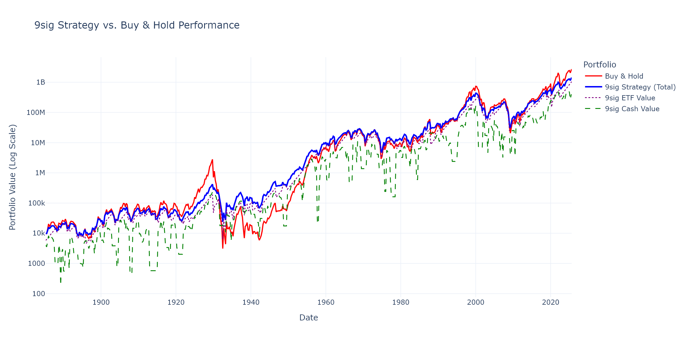

# 9sig Backtest

A backtester for a specific, rules-based investment strategy.

## The strat

It's a 60/40 portfolio (ETF/cash) that rebalances based on a set of rules. The core idea is to aim for a fixed quarterly growth target for the ETF portion and apply specific actions during significant market drawdowns or gains.

The full details are in `docs/strategy_guide.md` which I read in some Reddit post.

## The structure

```
.
├── .gitignore
├── README.md
├── requirements.txt
├── data
│   └── market_data.csv
├── docs
│   ├── strategy_guide.md
│   └── strategy_source.txt
├── results
│   ├── backtest.log
│   ├── performance_chart.html
│   ├── performance_chart.png
│   └── strategy_results.csv
└── src
    └── backtester.py
```

## How to run it

Make sure you have Python, then install the dependencies.

```bash
pip install -r requirements.txt
```

From the root directory, run the script.

```bash
python src/backtester.py
```

This creates a `results` directory with the output. You'll get an interactive chart, a CSV with the detailed data, the logs, and a summary table in the console.

## Results

So, the strategy underperforms a simple buy-and-hold. It does manage to curb volatility a bit, but not enough to make up for the lost returns. The rules seem to have a knack for selling too early in recovery periods.

